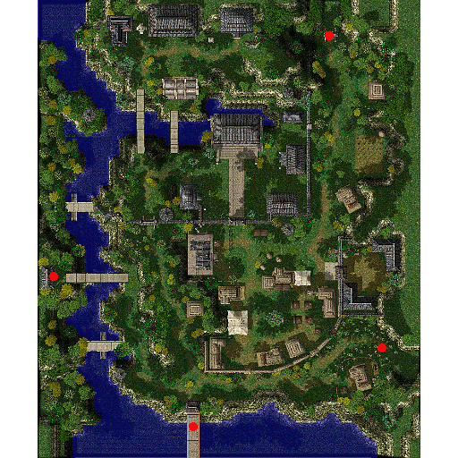

# Payon

## About Payon

Payon is the home to the [TaeKwon Kid](TaeKwon_Kid.md) and [TaeKwon Master](TaeKwon_Master.md) guilds. It is the only town in RO to have been redesigned, and is now much larger than before.  Payon is connected to the Greenwood Lake guild map, which is used during [War of Emperium](War_of_Emperium.md).

To the north is [Archer Village](Archer_Village.md), home to the Archer Guild and Payon Cave.

## Story

The city safe from outside invaders with the blessing of being surrounded by forests, Payon.
Their unique architecture reflects the use the wood only available in their surrounding forests.
The [Archer Village](Archer_Village.md) is in the vicinity and there are words going around that monsters in the form of tigers and nine-tailed foxes appear in the forest and caves.

## Guide

## Structures

## Buildings

*  1 - Archer House (151,126)
*  2 - Building (188,233)
*  3 - Central Palace (156,246)
*  4 - Empty Large House (128,204)
*  5 - House (268,152)
*  6 - Inn (222,117)
*  7 - Kitchen (155,327)
*  8 - Large House (107,325)
*  9 - Northeast House (255,285)
*  10 - Tool Shop (142,85)
*  11 - Weapon Shop (137,158) and (130,170)

## Billboards and Signs

*  Bulletin Board (178,108) - Gives background information on Payon

## Guild Flags

*  Bamboo Grove Hill Guild Flag (123,322) and (166,161)
*  Scarlet Palace Guild Flag (118,322) and (166,165)
*  Holy Shadow Guild Flag (113,322) and (166,169)
*  Sacred Altar Guild Flag (97,322) and (166,173)
*  Bright Arbor Guild Flag (90,322) and (166,177)

## NPCs

## Regulars

 Guide - Payon Guide (162,67)    Shows on minimap: Archer Guild, Weapon Shop, Tool Shop, Inn, Central Palace
 Kafra Employee (175,226)
 Kafra Employee (181,104)    Save, Kafra storage (60z), Teleport service, Rent Cart, Reserve points
 Employee Ahee (Inn)    Save, Rest (5000z)
 PVP Narrator
 Gate Keeper    PVP NPCs
 Antonio (144,173)    Upgrade NPC
 Begnahd (145,178)    Level 1/2 metal NPC
 Hakhim (137,178)    Level 3/4 metal NPC
 Repairman (143,165)    Repair NPC

## Store NPCs

 Taming Merchant (177,131)    Pet Food, Pet Incubator, Backpack, Rocker Glasses
 Tool Dealer (159,96)    Arrow, Red Potion, Concentration Potion, Fly Wing, Butterfly Wing

 Armor Dealer (Weapon Shop)    Sandals, Shoes, Boots, Hood, Muffler, Manteau, Ribbon, Bandana, Eye Patch, Cotton Shirts, Jacket, Adventurer's Suit, Silk Robe, Wooden Mail, Silver Robe, Mantle, Coat, Tights, Novice Armlet
 Tool Dealer (Tool Shop)    Arrow, Magnifier, Red Potion, Orange Potion, Yellow Potion, White Potion, Green Potion, Concentration Potion, Awakening Potion, Fly Wing, Butterfly Wing, Trap
 Weapon Dealer (Weapon Shop)    Arrow, Silver Arrow, Sword, Falchion, Blade, Knife, Cutter, Main Gauche, Rod, Bow, Composite Bow, Great Bow, Cross Bow, Arbalest Bow, Gakkung Bow, Hunter Bow

## Trade NPCs

 Jade (173,238)    **Amount traded is selectable**
 Red Gemstone for 2 Blue Gemstone
 Yellow Gemstone for 2 Red Gemstone
 Blue Gemstone for 2 Yellow Gemstone
 Merchant (200,134)    **Amount traded is selectable**
 Red Potion for 6 Tree Root
 Red Potion for 10 Jellopy
 Neko Neko (115,131)    Black Cat Ears for 1 Kitty Band, 1 Black Dyestuffs, 200 Fluff, 10,000z
 Smile Assistance - Smile Girl (186,104)    Mr. Smile for 10 Clover, 10 Fluff, 10 Jellopy

 Granny (House)    Pretend Murdered for 4 Skirt of Virgin
 Inventor Jaax (Weapon Shop)    1 Quiver for 500 Arrow, 500z
 1 Iron Arrow Quiver for 500 Iron Arrow, 500z
 1 Steel Arrow Quiver for 500 Steel Arrow, 500z
 1 Oridecon Arrow Quiver for 500 Oridecon Arrow, 500z
 1 Fire Arrow Quiver for 500 Fire Arrow, 500z
 1 Silver Arrow Quiver for 500 Silver Arrow, 500z
 1 Wind Arrow Quiver for 500 Wind Arrow, 500z
 1 Stone Arrow Quiver for 500 Stone Arrow, 500z
 1 Crystal Arrow Quiver for 500 Crystal Arrow, 500z
 1 Shadow Arrow Quiver for 500 Shadow Arrow, 500z
 1 Immaterial Arrow Quiver for 500 Immaterial Arrow, 500z
 1 Rusty Arrow Quiver for 500 Rusty Arrow, 500z
 Marx Hansen - Merchant Marx Hansen (Kitchen)    **Requires you to do [Juice Quest](Juice_Quest.md) to use his services**
 **Amount traded is selectable**
 Apple Juice for 1 Apple, 1 Empty Bottle, 3z
 Banana Juice for 1 Banana, 1 Empty Bottle, 3z
 Carrot Juice for 1 Carrot, 1 Empty Bottle, 3z
 Grape Juice for 1 Grape, 1 Empty Bottle, 3z
 Mystic Lady (Tool Shop)    Earmuffs for 1 Cursed Ruby, 1 Headset, 200 Feathers, 5000z
 Nanhyang (Large House)    Model Training Hat for 1 Apple of Archer, 1 Book
 Young Man (Northeast House)    Helm of Angel for 1 Helm[1], 1 Angel Wing, 5 Fang of Garm
 Deviruchi Hat for 600 Little Evil Horn, 40 Talon of Griffon

## Quest NPCs

 Bag Seller - RuRumuni (91,77)    Part of [Sand Attack](Thief_Skill_Quest.md) Quest
 Bard - Gunther Doubleharmony (181,172)    [Geffen Bard Quest](Geffen_Bard_Quest.md)
 Friar - Lania (79,171)    [Seal of Sleipnir](God_Items_Quest.md)
 Hunter (Building, west room)    Part of [Hunter](Hunter.md) job change quest
 Jason (103,63)    Teaches [Arrow Repel](Archer_Skill_Quest.md)
 Talpiz (214,79)    Part of [Blacksmith](Blacksmith.md) job change quest

## Travel NPCs

 Kafra Employee (175,226) and (181,104)    [Prontera](Prontera.md) - 1200z
 [Alberta](Alberta.md) - 1200z
 [Morroc](Morroc.md) - 1200z

## Other NPCs

*  Drunkard (210,110) ***---- If you buy him a drink, costs as much as possible up to 100z***
*  Guardsman (158,246) ***--- triggers when you enter within the following square: (155,245), (155,243), (161,243), (161,247). De-equips all your equipment.***
*  Lady (246,154)
*  Monster Scholar - Monster Scholar Vuicokk (132,235)
*  Woman (249,156)
*  Woman - Jim's Mother (246,158)
*  Young Man (173,82)
*  Young Man (134,211)

*  Archer Zakk (Archer House)
*  Archer Wolt (Archer House)
*  Chief (Central Palace) ***--- triggers when you enter within the following square: (98,188), (101,188), (100,190)***
*  Chief Guardsman (Central Palace) ***--- triggers when you enter within the following square: (93,119), (93,116), (99,117), (99,116). De-equips all your equipment.***
*  Fortune Teller - Lhimetorra (Central Palace)
*  Guard (Central Palace)
*  Waitress - Pub Lady (Inn)

**Related pages:**

* [Towns](Towns.md)
* [Rune-Midgarts Kingdom](Rune-Midgarts_Kingdom.md)
* [Alberta](Alberta.md)
* [Al De Baran](Al_De_Baran.md)
* [Archer Village](Archer_Village.md)
* [Comodo](Comodo.md)
* [Geffen](Geffen.md)
* [Izlude](Izlude.md)
* [Morroc](Morroc.md)
* [Payon](Payon.md)
* [Prontera](Prontera.md)
* [Umbala](Umbala.md)
* [Republic of Schwartzvald](Republic_of_Schwartzvald.md)
* [Einbech](Einbech.md)
* [Einbroch](Einbroch.md)
* [Hugel](Hugel.md)
* [Juno](Juno.md)
* [Lighthalzen](Lighthalzen.md)
* [Arunafeltz States](Arunafeltz_States.md)
* [Rachel](Rachel.md)
* [Veins](Veins.md)
* [Manuk](Manuk.md)
* [Amatsu](Amatsu.md)
* [Ayothaya](Ayothaya.md)
* [Kunlun](Kunlun.md)
* [Jawaii](Jawaii.md)
* [Louyang](Louyang.md)
* [Moscovia](Moscovia.md)
* [Nifflheim](Nifflheim.md)
* [Lutie](Lutie.md)

---
*Source: [iRO Wiki Classic](https://irowiki.org/classic/Payon) — GFDL 1.3+*
