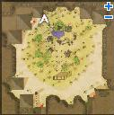
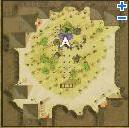

# Peace for Arunafeltz Quest

<!-- Quest info -->
- **Level requirement:** 60
- **Item requirement:** 1 Sardonyx
- **Quests required:** [Thor Volcano Base Quest](Thor_Volcano_Base_Quest.md)
- **Base EXP reward:** 2,500,000

1. At the Morroc Ruins (one map NW from Morroc) talk to the Foreign Merchant (moc_ruins 77,167) in the NW corner of the map.  He complains about how hot the town is and says he may be leaving soon, and asks if there's a place to grab a drink in town. Talk to him twice and he  will suggest a merchant at the oasis.

2. Next, walk around the perimeter of the oasis in the center of the map to trigger the next [NPC](NPC.md).  After a couple of trips around, he should appear at (moc_ruins 101,133), in between the Cool Corp. and Kafra voting staff NPCs.

3. Talk to the new Foreign Merchant, who says he's out of wine, but manages to scrounge up a bottle for you to give to the thirsty man.

4. Return to the first Foreign Merchant, who is thankful for the drink.  For some reason, he also knows your name--he's an agent of High Priest Zhed from the [Rachel Sanctuary Quest](Rachel_Sanctuary_Quest.md).

5. Head to [Rachel](Rachel.md), and talk to High Priest Zhed in the Sanctuary (ra_temin 277, 159).  He explains how he's lost control of the other priests, and belives the young Pope is too inexperienced to do her job.  He wants to help her, but needs your help to convince her to let him assist her.  He feels telling her the complete truth is the best course of action.  However, you must choose whether or not to "sugar coat" it to her. It's not relevant if you choose "Truth" or "Lies", the quests follows the same way.

6. Zhed tells you about his close friend, High Priest Niren, and asks that you go talk to her.

7. Inside the sanctuary still, go to the left side, and talk to the Female Follower (ra_temin 103, 151).  She says you can find Niren outside in the garden.

8. Talk to Niren (ra_temple 165, 57), and ask about Zhed.  She refuses to help him, and says she wants a war.

9. Return to Zhed, and explain Niren's feelings to him.  He writes you a note to give to her to explain himself better and gives it to you to deliver to her.

10. Deliver the note to Niren, and she seems to be symathetic to Zhed.  She asks you to wait a bit so she can think about what to do.

11. Talk to her again until she continues (it may take a few tries), who says she'll give Zhed another try, and tells you to go visit the Pope.

12. Go back into the Sanctuary, and head to the Pope's Office (ra_temin 132, 131).  Talk to the Pope, and she's apparently feeling lonely and tired.

13. Go back to Niren, and tell her about the situation with the Pope.  Unfortunately, the priests are with her day and night, so Niren comes up with a way to get them all to leave.  She writes a note for you to give to a forger who'll come up with something to give all the other priests some vacation.

14. Head to Rachel Field 3 (2 maps directly north of Rachel), and talk to Ishmael (top center-left of the map) at (139, 355).  Give her the File you got from Niren, but Ishmael needs a Sardonyx to finish the note because her pen broke.

15. Once you have a Sardonx, talk to Ishmael again, and she completes the forgery, then hands back another File.

16. Return the File to Niren, who gives it to her assistant to deliver.  She tells you go to get Zhed.

17. Talk to Zhed, and you tell him he and Niren can visit the Pope.

18. Go back to the Pope's Office, where you see Niren and Zhed speaking with the Pope.  She already knew most of what they told her, and is happy to have someone willing to help.  After their conversation ends, she sends you back to Rachel.

19. The Pope now makes a speech, saying the rest of the high priests and preistesses will now be under Zhed and Niren's command.

20. Talk to Niren again, who is very happy about what happened.  She then says to talk to Zhed, and gives you some Base Experience.

21. Talk to Zhed again, who says the Thor Volcano camp is closing down, and is glad that they're doing something to fight back against the extremist priests.  He rewards you with some Base Experience.

---
**Categories:** [Base Experience Reward](categories/Base_Experience_Reward.md), [Nameless Island Quests](categories/Nameless_Island_Quests.md)
*Source: [iRO Wiki Classic](https://irowiki.org/classic/Peace_for_Arunafeltz_Quest) — GFDL 1.3+*
