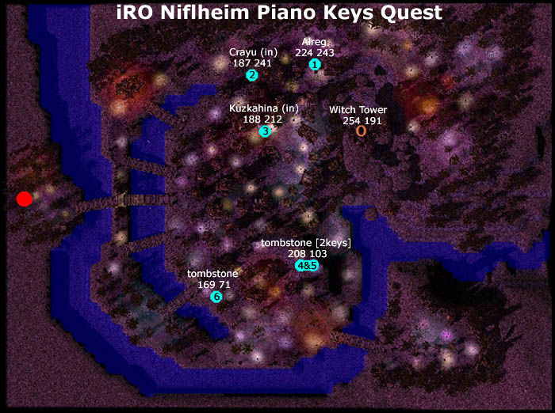

# Piano Keys Quest

<!-- Quest info -->
- **Level requirement:** None
- **Item requirement:** 6 Piano Keys
- **Quest reward:** [Sign Quest](Sign_Quest.md)

## Part 1

1. Talk to Alreg in [Nifflheim](Nifflheim.md) (niflheim 224, 243) and you will receive a Piano Key. He will bite you, and take a lot of [HP](Max_HP.md), so be prepared.

2. Talk to Crayu (nif_in 105, 81) in the building (niflheim 187, 241). He will sing a song for you.

* **Note**: If you talk to him again, he **may or may not** ask you to repeat some sentences. If he asks you to, go to Part 2a. If he does not, go to Part 2b.

## Part 2a

1. The sentences are:

*  Mountain sunset to the west
*  Where the purple dusk falls
*  Surrounded by beautiful melody
*  You become the key that ignores its master

He will give you a Piano Key if you did it right.

2. Talk to Kuzkahina (nif_in 31, 20) in the building (niflheim 188, 212). He will give you a Piano Key.

3. Walk past the Tombstone twice (niflheim 208, 103). It will give you 2 Piano Keys.

4. Walk past the Tombstone (niflheim 169, 71). It will give you a Piano Key.

* **Note**: Talking to the tombstones will do nothing.
* **Note**: The Tombstones don’t have names.

## Part 2b

1. Talk to Kuzkahina (nif_in 31, 20) in the building (niflheim 188, 212). He will give you a Piano Key.

2. Return to Crayu. He will ask you to write down a line of the song. The sentences are:

*  Mountain sunset to the west
*  Where the purple dusk falls
*  Surrounded by beautiful melody
*  You become the key that ignores its master

He’ll give you a key if you did it right.

3. Walk past the Tombstone (niflheim 169, 71). It will give you a Piano Key.

4. Walk past the Tombstone twice (niflheim 208, 103). It will give you 2 Piano Keys.

* **Note**: Talking to the tombstones will do nothing.
* **Note**: The Tombstones don’t have names.

## Part 3

1. Go to the Witch Tower (niflheim 254, 191) and go up the stairs to the second floor from the portal.

2. Walk by the wall on left side of the piano. There will be a pop-up and you will be warped to a small room with the Witch in the center.

3. Talk to the Witch (nif_in 188, 168). You will be warped to [Umbala](Umbala.md).

* **Note**: The Witch will always warp you to Umbala every time you talk her.

---
**Categories:** [Nifflheim Quests](categories/Nifflheim_Quests.md), [Quests](categories/Quests.md)
*Source: [iRO Wiki Classic](https://irowiki.org/classic/Piano_Keys_Quest) — GFDL 1.3+*
