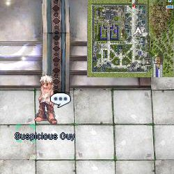
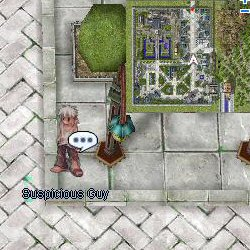
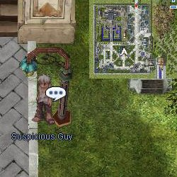

# Pickpocket Quest

<!-- Quest info -->
- **Level requirement:** 60
- **Item reward:** Purchasable Speed Potion

**Currently Not Implemented in pRO(Philippine Ragnarok Online) due to Bot abuse.**

1.  The Man (Pickpocketer) can appear in one of 3 different locations at a time.
  * Location A: (lighthalzen 240 216)

1.   

  * Location B: (lighthalzen 220 169)

1.   

  * Location C: (lighthalzen 164 127)

1.   

1.  When you come within 2 tiles of the Man, you'll activate a message. Every time a Pickpocket message pops out, you'll lose either 200z, 100z, or 10z.
1.  If you activate him at either location A or B, there's a 33% chance you'll catch him pickpocketing you. Once you find out he pickpockets, he'll flee from Location A to Location B or vice versa with 75% chance; or to Location C 25% with chance.
1.  If you activate him at location C, there's a 20% chance you'll catch him pickpocketing you. He has nowhere to escape, but you forgive him. He will later sell you something that "will produce strong power for your lower part body."
1. You can choose to buy from 1 to 3 Speed Potions, (15k per bottle). He later will appear at either Location A or Location B.
**Note: on iRO Classic Loki, once you catch the Pickpocket he will turn into a Speed Potion selling npc for 5 minutes.**

---
**Categories:** [Lighthalzen Quests](categories/Lighthalzen_Quests.md), [Quests](categories/Quests.md)
*Source: [iRO Wiki Classic](https://irowiki.org/classic/Pickpocket_Quest) — GFDL 1.3+*
