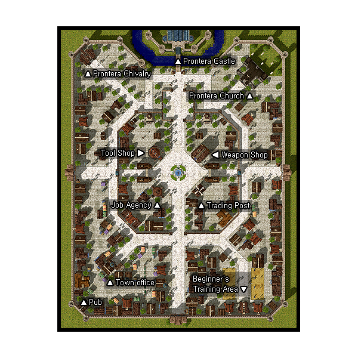

# Prontera

## About Prontera

Prontera is the capital of the [Rune-Midgarts Kingdom](Rune-Midgarts_Kingdom.md). It is home to the [Acolyte](Acolyte.md), [Priest](Priest.md), [Knight](Knight.md), and [Crusader](Crusader.md) guilds. Prontera is the heart of most of the Ragnarok Online communities, as well.

## Story

Many people live actively in this city. The Prontera Church and the King`s Chivalry are also based here. (Many of those who wish to become Knights, Crusaders, and Priests gather here with their dreams.) Through the orders of King Tristan III, new Swordsmen are being trained to become a member of the Chivalry. The center fountain has become a free market, as ordered by the King, with vendors and all different types of shoppers buying and selling items. On the side note, King Tristan III allowed the public to visit the castle, but because he is very busy, you will not be able to see him in the royal chamber.

## Guide

## Structures

## Buildings

1. 1 - Another Pub (44,67)
1. 2 - City Hall (76,92), (85,90), and (74,101)
1. 3 - Inn (Nenkaras), west branch (107,217); east branch (204,190)
1. 4 - Job Agency (135,185)
1. 5 - Library, west branch (120,265); east branch (192,265)
1. 6 - Prontera Castle (156,358)
1. 7 - Prontera Chivalry (47,344)
1. 8 - Pub (206,156)
1. 9 - Sanctuary (235,315)
1. 10 - Tool Shop (133,221)
1. 11 - Trading Post (177,186) aka Forge
1. 12 - Weapon Shop (175,219)

## Billboards

* Bulletin Board - Prontera: Capital of the Rune-Midgarts Kingdom (148,49) - Gives background information on Prontera
* Billboard (165,305) - Flavor Text
* Billboard (31,212) - Flavor Text
* Prontera Bulletin (156,197) - Flavor Text
* Sign (150,326) - Flavor Text
* Sign (145,304) - Flavor Text
* Sign (147,305) - Flavor Text
* Sign (278,212) - Flavor Text
* Sign Post (158,213) - gives general directions (or Flavor Text)

## Guild Flags

* Fadhgridh Guild Flag (143,203)
* Swanhild Guild Flag (146,194)
* Kriemhild Guild Flag (155,190)
* Gondul Guild Flag (165,194)
* Skoegul Guild Flag (167,203)

## NPCs

## Regulars

Guides - Prontera Guide (154,187)
Guides - Prontera Guide (160,29)
Guides - Prontera Guide (29,200)
Guides - Prontera Guide (282,208)
Guides - Prontera Guide (151,330)
  Show on minimap: Swordsman Association, Sanctuary, Prontera Chivalry, Weapon Shop, Tool Shop, Inn, Trading Post, Pub, Library, Job Agency, Prontera Castle, City Hall
Kafra Employee (146,89)
Kafra Employee (151,29)
Kafra Employee (29,207)
Kafra Employee (282,200)
  Save, Kafra storage (40z), Teleport service, Rent Cart, Reserve points, Kafra location
Kafra Employee (152,326)
  Save, Kafra storage (40z), Rent Cart, Reserve points
Inn Employee - Employee Sammy (Inn, east branch)
  Save, Rest (5000z)
Inn Employee - Employee Alma (Inn, east branch)
  Save, Rest (5000z)
PVP Narrator (Inn, east branch)
  Gate Keeper (Inn, east branch)
Vurewell (Upgrade Shop)
  Level 1/2 metal NPC
Dietrich (Upgrade Shop)
  Level 3/4 metal NPC
Repairman (Upgrade Shop)
  Repair NPC
Hollgrehenn (Upgrade Shop)
  Upgrade NPC

## Store NPCs

Butcher (64,125)
  Meat, Monster's Feed
Chef Assistant (156,212)
  Savory Sauce, Red Spice, Pot, Bread
Doll Merchant (248,153)
  Puppet, Poring Doll, Chonchon Doll
Flower Girl (58,182)
  Flower, Bouquet
Flower Lady (113,42)
  Flower, Bouquet
Fruit Merchant (104,49)
  Apple, Banana
Gift Merchant (105,87)
  Red Frame, Chung Jah, China, Black Ladle, Glass Bead
Milk Merchant (73,134)
  Milk
Pet Merchant (218,211)
  Pet Food, Pet Incubator, Backpack, Rocker Glasses
Veggie Merchant (48,58)
  Carrot, Potato, Pumpkin
Armor Dealer (Weapon Shop)
  Guard, Buckler, Sandals, Shoes, Hood, Muffler, Hat, Cap, Cotton Shirts, Jacket, Adventurer's Suit, Wooden Mail, Mantle, Coat, Padded Armor, Chain Mail, Novice Armlet, Belt
Bridal Dealer (City Hall)
  Bouquet, Wedding Bouquet, Wedding Dress, Wedding Veil, Tuxedo
Nun (Sanctuary)
  Rosary, Biretta, Scapulare, Saint's Robe, Club, Mace, Smasher, Flail, Morning Star, Chain
Tool Dealer (Tool Shop)
  Magnifier, Arrow, Red Potion, Orange Potion, Yellow Potion, White Potion, Green Potion, Concentration Potion, Awakening Potion, Fly Wing, Butterfly Wing, Trap, Monocle
Weapon Dealer (Weapon Shop)
  Arrow, Silver Arrow, Bow, Knife, Cutter, Main Gauche, Rod, Sword, Falchion, Blade, Rapier, Scimiter, Ring Pommel Saber, Tsurugi, Haedonggum, Saber, Flamberge, Katana, Axe
Weapon Dealer (Weapon Shop)
  Javelin, Spear, Pike, Guisarme, Glaive, Partizan, Trident, Hallberd, Lance

## Trade NPCs

Merchant (123,102)
  Amount traded is selectable
  Red Potion for 5 Shells
  Red Potion for 10 Fluff
  Red Potion for 10 Jellopy
Milk Merchant (73,140)
  *Exchanges as many as possible*
  Milk for 1 Empty Bottle, 15z
Nephia (165,232)
  Red Ribbon for 1 Big Ribbon, 1 Ribbon[1], 1 Silk Ribbon
Peco Peco Breeder - PecoPeco Breeder (55,350)
  *Knights only, Peco Peco Ride skill required*
  Peco Peco for 2,500z
Peco Peco Breeder - PecoPeco Breeder (232,318)
  *Crusaders only, Peco Peco Ride skill required*
  Peco Peco for 3,500z
Smile Assistance - Smile Girl (157,187)
  Mr. Smile for 10 Clover, 10 Fluff, 10 Jellopy
Jovovich - Hairdresser Jovovich (City Hall)
  Dyes your hair for 1 Dyestuffs of the color of your choice, 1,000z
Teacher (Job Agency)
  Ph.D Hat for 1 Illusion Flower, 1 Hinalle, 1 Aloe, 1 Ment
Wedding Staff - Happy Marry (Sanctuary)
  Marriage for 1,300,000z, 1 Tuxedo, 1 Diamond Ring from the Groom and 1,200,000z, 1 Wedding Dress and 1 Diamond Ring from the Bride

## Quest NPCs

Chivalry Captain - Captain Herman (Prontera Chivalry)
  [Knight](Knight.md) job change NPC
Chivalry Member - Bulma (Prontera Chivalry)
  Teaches [Play Dead](Play_Dead.md)
Cleric - Acolyte Klift (Sanctuary)
  Teaches [Holy Light](Holy_Light.md)
Cleric - Father Mareusis (Sanctuary)
  [Acolyte](Acolyte.md) job change NPC
Crusader - Gabriel Valentine (Sanctuary)
  Part of [Crusader](Crusader.md) job change quest
Erious (Pub)
  Part of [Message Delivery Quest](Message_Delivery_Quest.md)
High Bishop - Bishop Paul (Sanctuary)
  [Priest](Priest.md) job change NPC
Hypnotist (146,232)
  Provides [free skill resets](Beginner_Skill_Resetter.md) to first class characters below base level 40.
Juan (Trading Post)
  Teaches [Berserk](Berserk.md)
Lady Amy (Prontera Chivalry)
  Part of Knight job change quest
Leon Von Frich - Leon (Prontera Chivalry)
  Teaches [Fatal Blow](Fatal_Blow.md)
Man in Anguish - Murnak Mijoul (Prontera Castle)
  Part of Crusader job change quest
Marianne - Housewife Marianne (Inn)
  Part of [Juice Quest](Juice_Quest.md)
Morrison - Little Morrison (Inn)
  Part of Juice Quest
Nami (Inn)
  Teaches [First Aid](First_Aid.md)
Nursing Instructor - Dread Lord (Prontera Castle)
  Part of First Aid and Play Dead Quest
Patron Knight - Bliant Piyord (Prontera Castle)
  Part of Crusader job change quest
Recruiter (Prontera Chivalry)
  [Prontera Culverts Entrance Quest](Prontera_Culverts_Entrance_Quest.md)
Senior Crusader - Michael Halig (Prontera Castle)
  Crusader job change NPC
Sir Andrew (Prontera Chivalry)
  Part of Knight job change quest
Sir Edmond (Prontera Chivalry)
  Part of Knight job change quest
Sir Gray (Prontera Chivalry)
  Part of Knight job change quest
Sir Siracuse (Prontera Chivalry)
  Part of Knight job change quest
Sir Windsor (Prontera Chivalry)
  Part of Knight job change quest
Sister Cecilia (Sanctuary)
  Part of Priest job change quest
Young man - Neil (275,86)
  Part of Chief's Quest

## Travel NPCs

Kafra Employee (146,89), (151,29), (29,207), and (282,200)
  [Geffen](Geffen.md) - 1200z
  [Payon](Payon.md) - 1200z
  [Morroc](Morroc.md) - 1200z
  Orc Dungeon - 1700z
  [Alberta](Alberta.md) - 1800z
Kafra Employee (248,42)
  [Izlude](Izlude.md) - 600z
Customer - SoloHan (Pub)
  *Singles only*
  Jawaii --- *Tavern only, see note on [Jawaii](Jawaii.md) page*
Recruiter (Prontera Chivalry)
  Requires you to do [Prontera Culverts Entrance Quest](Prontera_Culverts_Entrance_Quest.md) to use
Map outside of Prontera Culvert (prt_fild05) - free

## Other NPCs

* Dairenne - Towngirl Dairenne (78,150)
* Gravestone (262,353)
* Guard - Prontera Guard (160,330)
* Guard - Prontera Guard (52,344)
* Guard - Prontera Guard (47,339)
* Guard - Prontera Guard (229,104)
* Guard - Prontera Guard (223,99)
* Merideth (106,116)
* Shuger (101,288)
* Strife (216,70)
* Tialfi (124,297)
* Tono (54,240)
* Woman (260,354)
* YuNa (149,202)
* YuPi (160,133)
* A File (x5) (Library)
* Bartender - Reams (Pub)
* Blacksmith Guide - Blacksmith Guide for Dummies (Library)
* Crusader - Max Von Shedough (Prontera Castle)
* Curator of Library - Curator Guiss (Library)
* Customer - Bachewcca (Pub)
* Garnet (Sanctuary)
* Ginedin Rephere - Tailor Ginedin Rephere (City Hall)
* Henson (Sanctuary)
* Librarian - Librarian Jekan (Library)
* Librarian (Prontera Castle)
* Library Girl - Library Girl Ellen (Library)
* Lord Arthur (Inn)
* Marvin (Pub)
* Monster Encyclopedia - Dungeon Monster Encyclopedia (x4) (Library)
* Monster Encyclopedia (x3) (Library)
* Rebarev Doug (Prontera Castle)
* Personnel Record (Prontera Castle)
* Praying Man (Sanctuary)
* Shevild (Pub)
* Sir Michael (Another Pub)
* TenSue (Pub)
* Tristram III (Sanctuary)
* Vending Guide - Vending Guide for Dummies (Library)

**Related pages:**

* [Towns](Towns.md)
* [Rune-Midgarts Kingdom](Rune-Midgarts_Kingdom.md)
* [Alberta](Alberta.md)
* [Al De Baran](Al_De_Baran.md)
* [Archer Village](Archer_Village.md)
* [Comodo](Comodo.md)
* [Geffen](Geffen.md)
* [Izlude](Izlude.md)
* [Morroc](Morroc.md)
* [Payon](Payon.md)
* [Prontera](Prontera.md)
* [Umbala](Umbala.md)
* [Republic of Schwartzvald](Republic_of_Schwartzvald.md)
* [Einbech](Einbech.md)
* [Einbroch](Einbroch.md)
* [Hugel](Hugel.md)
* [Juno](Juno.md)
* [Lighthalzen](Lighthalzen.md)
* [Arunafeltz States](Arunafeltz_States.md)
* [Rachel](Rachel.md)
* [Veins](Veins.md)
* [Manuk](Manuk.md)
* [Amatsu](Amatsu.md)
* [Ayothaya](Ayothaya.md)
* [Kunlun](Kunlun.md)
* [Jawaii](Jawaii.md)
* [Louyang](Louyang.md)
* [Moscovia](Moscovia.md)
* [Nifflheim](Nifflheim.md)
* [Lutie](Lutie.md)

---
*Source: [iRO Wiki Classic](https://irowiki.org/classic/Prontera) — GFDL 1.3+*
