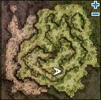

# Pursuing Rayan Moore

<!-- Quest info -->
- **Level requirement:** 70
- **Item requirement:** 30 Rune of Darkness, 30 Bloody Rune, and 30 Holy Water
- **Quests required:** [Onward to the New World Quest](Onward_to_the_New_World_Quest.md)
- **Base EXP reward:** 1,400,000
- **Job EXP reward:** 210,000
- **Window:** yes

1.  Talk to Echinacea (mid camp 215, 247 -> mid_campin 86, 138 -> mid_campin 68,185), and she asks you to go help Kidd.
1.  Kidd (mid_camp 199, 311) tells you that he hasn't received any communications from the Old World in some time, and he asks you to find Rin in the secret Assassin Pub in southwest [Morroc](Morroc.md).
1.  Talk to the Bar Manager in the secret pub, and ask about a mission. He tells you Rin is in the back room resting.
1.  Enter the back room, and go into the room to the south. Speak to Rin (que_job01 84, 17), and offer to help her.  She will ask you to investigate the area where she was ambushed.
1.  Speak to the pile of dirt at (hu fild04 235, 103), and investigate it closely. You will receive a Crystal of Feardom.
1.  Return to Rin with the Crystal, she will give you a report to take to Kidd along with the crystal.
1.  Deliver the Crystal and Journal to Kidd, he will ask you to come back later.
  * Receive 200,000 [Base EXP](Base_EXP_Chart.md) and 10,000 [Job EXP](Job_EXP_Chart.md)
1.  Speak to Kidd and you will feel the urge to touch the crystal.
1.  After a short dialogue, you will start to battle several Dandelion Members.
  * There is a time limit on this battle.
1.  After dispatching them, speak to the corpse (que_dan01 49, 36), and search his pockets. You will obtain a Sealed Scroll.
1.  Speak to Kidd regarding what you saw after touching the crystal.
1.  Kidd asks you to get Echinacea's opinion about which scholar to consult regarding the scroll.
1.  Speak to Echinacea and she will direct you to Defaria.
1.  Defaria (mid camp 256, 272) tells you the scroll is from Arunafeltz, and asks you to collect some items to unseal it.
1.  After bringing 30 Rune of Darkness, 30 Bloody Rune, and 30 Holy Water, Defaria will give you an Unsealed Magic Scroll.
1.  Consult with Kidd, he reminds you that your are his assistant and he tells you to use the scroll to go to the meeting.  Double click the Unsealed Magic Scroll to use it, you will be warped to (yuno fild09 255, 127).
1.  Walk up the hill and go into the building (yuno fild09 234, 133). Walk behind the curtain at the back of the building. After some conversation, you will be returned to your save point.
1.  Talk to Kidd, he asks you to listen in some more. Return to the house and enter the basement.
1.  Speak with the man (que_dan02 115, 53) at the back of the basement. Kidd will appear and arrest him.
1.  Return to Kidd in the new world, he gives you a journal to take back to Rin.
1.  Return to Rin, after some conversation you accidentally drop the Crystal and Rayan uses it to escape. Rin gives you a tracking number that can be used to find Rayan and asks you to go see Echinacea.
1.  Speak with Echinacea, she asks for the tracking number and explains how it works.
1.  Speak with her again and she tells you to check with building manager at the south end of the camp.
1.  Talk to the Manager (mid camp 191, 206), he tells you that he can not locate the target, but that Rayan must still be alive.
1.  Return to Echinacea to report the results. She thanks you for your help and rewards you.
  * Receive 1 Old Purple Box, 1,200,000 [Base EXP](Base_EXP_Chart.md), and 200,000 [Job EXP](Job_EXP_Chart.md)
1.  There is a wrap-up portion of the quest which you can complete by talking to Echinacea, which requires 20 Potatoes and 20 logs.  Completing these additional steps rewards the player with 5 Sweet Potatoes (smokie taming item).

---
**Categories:** [Ash Vacuum Quests](categories/Ash_Vacuum_Quests.md), [Base Experience Reward](categories/Base_Experience_Reward.md), [Job Experience Reward](categories/Job_Experience_Reward.md), [New World Quests](categories/New_World_Quests.md), [Quest Window Quests](categories/Quest_Window_Quests.md)
*Source: [iRO Wiki Classic](https://irowiki.org/classic/Pursuing_Rayan_Moore) — GFDL 1.3+*
