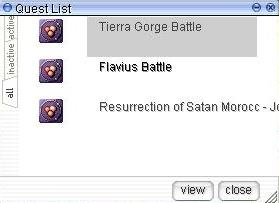

# Quests

<big>**To easily sort through quests with [Experience](Experience.md) rewards, see [Quest Table](Quest_Table.md)**</big>

## Quest Window

The Quest Window or Quest Journal (Opened via Alt+U) allows the player to view all quests their character has started but not yet completed (Except for instance dungeon quests and [Battlegrounds](Battlegrounds.md) instances, which always remain once started).

To place a quest in the Inactive tab, right click once on it and the name will turn gray.  It will then appear on the Inactive tab instead of Active.  Right clicking the name again will bring it back to the Active tab.  **Moving the quest back and forth has no effect on whether you can continue it or not.**

Not every quest has a quest window component.  Those quests who have quest window walkthroughs can be found in this category as well as by having their infobox in **gold**.  Additionally, the Quest Window guides are not comprehensive, and do not specify the exact coordinates of the next [NPC](NPC.md) or location the player must visit.  It is highly recommended to continue using the wiki guides along with the in-game walkthroughs.

## Entry Removal

To remove unwanted event quest entries, talk to the Quest Knight in [Prontera](Prontera.md) (prontera 142, 227).

## Current Quests

Headgears and all other items made through [NPC](NPC.md)s are listed on the [Item Mixing](Item_Mixing.md) page. Quests that are repeatable are *italicized*. Repeatable quests with a cooldown period have said information on their repesctive pages.

## Arc Quests

**Note:** Arcs reflect what is currently implemented in iRO. The final quests for a given arc may change in future game updates.

## God Items

| First Quest | First Quest | Final Quest |
| --- | --- | --- |
| [Stop Metto's Research](Stop_Metto's_Research.md) (5.0) | **->** | [God Items Quest](God_Items_Quest.md) (9.0) |

## The Sign

| First Quests | First Quests | Final Quest |
| --- | --- | --- |
| [Umbala Language Quest](Language_Quest.md) (7.0) | **->** | [Sign Quest](Sign_Quest.md) (10.1) |
| [Piano Keys Quest](Piano_Keys_Quest.md) (7.1) | **->** | [Sign Quest](Sign_Quest.md) (10.1) |

## Republic of Schwartzvald

| First Quest | First Quest | Second Quests | Second Quests | Third Quests | Third Quests | Final Quest |
| --- | --- | --- | --- | --- | --- | --- |
| [Factory Quest](Factory_Quest.md) (10.1) | **->** | [Einbroch Murder Quest](Einbroch_Murder_Quest.md) (10.1) | **->** | [President Quest](President_Quest.md) (10.2) | **->** | [Rebellion Quest](Rebellion_Quest.md) (10.4) |
|   |   | [Biolabs Entrance Quest](Biolabs_Entrance_Quest.md) (10.2) | **->** | [President Quest](President_Quest.md) (10.2) | **->** | [Rebellion Quest](Rebellion_Quest.md) (10.4) |
|   |   | [Biolabs Entrance Quest](Biolabs_Entrance_Quest.md) (10.2) | **->** | [Cursed Spirit Quest](Cursed_Spirit_Quest.md) (10.2) | **->** | [Rebellion Quest](Rebellion_Quest.md) (10.4) |
|   |   |   |   | [Odin's Temple Excavation Quest](Odin's_Temple_Excavation_Quest.md) (10.4) | **->** | [Rebellion Quest](Rebellion_Quest.md) (10.4) |

## Friendship

| First Quest | First Quest | Final Quest |
| --- | --- | --- |
| [Friendship Quest](Friendship_Quest.md) (10.2) | **->** | [Bruspetti Quest](Bruspetti_Quest.md) (11.1) |

## Airships

| First Quest | First Quest | Final Quest |
| --- | --- | --- |
| [How the Airship Works Quest](How_the_Airship_Works_Quest.md) (10.2) | **->** | [Heart Fragment Quest](Heart_Fragment_Quest.md) (10.3) |
| [Airship Ticket Quest](Airship_Ticket_Quest.md) (10.1) |   |   |

## Rekenber Victims

| First Quest | First Quest | Final Quest |
| --- | --- | --- |
| [Medicine Quest](Medicine_Quest.md) (10.4) | **->** | [Biological Weapon Quest](Biological_Weapon_Quest.md) (10.4) |

## Arunafeltz and Nameless Island

| First Quest | First Quest | Second Quest | Second Quest | Third Quest | Third Quest | Fourth Quest | Fourth Quest | Final Quest |
| --- | --- | --- | --- | --- | --- | --- | --- | --- |
| [Lost Child](Lost_Child_Quest.md) (11.1) | **->** | [Rachel Sanctuary](Rachel_Sanctuary_Quest.md) (11.1) | **->** | [Veins Siblings](Veins_Siblings_Quest.md) (11.2) | **->** | [Thor Volcano Base](Thor_Volcano_Base_Quest.md) (11.2) | **->** | [Peace for Arunafeltz](Peace_for_Arunafeltz_Quest.md) (11.3) |
| [Lost Child](Lost_Child_Quest.md) (11.1) | **->** | [Rachel Sanctuary](Rachel_Sanctuary_Quest.md) (11.1) | **->** | [Veins Siblings](Veins_Siblings_Quest.md) (11.2) | **->** | [Nameless Island Entrance Quest](Nameless_Island_Entrance_Quest.md) (11.3) | [Nameless Island Entrance Quest](Nameless_Island_Entrance_Quest.md) (11.3) | [Nameless Island Entrance Quest](Nameless_Island_Entrance_Quest.md) (11.3) |
| [Curse of Gaebolg (Founding of the Nation Myth Quest)](Curse_of_Gaebolg_(Founding_of_the_Nation_Myth_Quest).md) (10.3) | [Curse of Gaebolg (Founding of the Nation Myth Quest)](Curse_of_Gaebolg_(Founding_of_the_Nation_Myth_Quest).md) (10.3) | [Curse of Gaebolg (Founding of the Nation Myth Quest)](Curse_of_Gaebolg_(Founding_of_the_Nation_Myth_Quest).md) (10.3) | [Curse of Gaebolg (Founding of the Nation Myth Quest)](Curse_of_Gaebolg_(Founding_of_the_Nation_Myth_Quest).md) (10.3) | [Curse of Gaebolg (Founding of the Nation Myth Quest)](Curse_of_Gaebolg_(Founding_of_the_Nation_Myth_Quest).md) (10.3) | **->** | [Nameless Island Entrance Quest](Nameless_Island_Entrance_Quest.md) (11.3) | [Nameless Island Entrance Quest](Nameless_Island_Entrance_Quest.md) (11.3) | [Nameless Island Entrance Quest](Nameless_Island_Entrance_Quest.md) (11.3) |

## Kunlun

| First Quest | First Quest | Final Quest |
| --- | --- | --- |
| [Dropped Knife Quest](Dropped_Knife_Quest.md) | **->** | [Chief's Quest](Chief's_Quest.md) |

## Louyang

| First Quest | First Quest | Final Quest |
| --- | --- | --- |
| [Doctor Quest](Doctor_Quest.md) | **->** | [Poison King Quest](Poison_King_Quest.md) |

## Tome of the Dark Lord

| First Quest | First Quest | Second Quest | Second Quest | Third Quest | Third Quest | Final Quest |
| --- | --- | --- | --- | --- | --- | --- |
| [Lost Spirits](Nifflheim_Spotlight.md) | **→** | [The Lion's Roar](Glast_Heim_Spotlight.md) | **→** | [Rekenber's Weapon](Lighthalzen_Spotlight.md) | **→** | [The Tome of the Dark Lord](The_Tome_of_the_Dark_Lord.md) |
| [Shadow Quest (Rekenber Job Quest)](Shadow_Quest_(Rekenber_Job_Quest).md) | [Shadow Quest (Rekenber Job Quest)](Shadow_Quest_(Rekenber_Job_Quest).md) | [Shadow Quest (Rekenber Job Quest)](Shadow_Quest_(Rekenber_Job_Quest).md) | **→** | [Rekenber's Weapon](Lighthalzen_Spotlight.md) | **→** | [The Tome of the Dark Lord](The_Tome_of_the_Dark_Lord.md) |

## New World

| First Quest | First Quest | Second Quest | Second Quest | Third Quest | Third Quest | Fourth Quest | Fourth Quest | Fifth Quest | Fifth Quest | Sixth Quest | Sixth Quest | Final Quest |
| --- | --- | --- | --- | --- | --- | --- | --- | --- | --- | --- | --- | --- |
| [Onward to the New World Quest](Onward_to_the_New_World_Quest.md) (13.1) | **->** | [New Surroundings](New_Surroundings.md) (13.1) | **->** | [Attitude to the New World](Attitude_to_the_New_World.md) (13.1) | **->** | [Report from the New World](Report_from_the_New_World.md) (13.1) | **->** | [Ring of the Wise King](Ring_of_the_Wise_King.md) (13.2) | **->** | [Two Tribes](Two_Tribes.md) (13.2) | **->** | [Guardian of Yggdrasil](Guardian_of_Yggdrasil.md) (13.2) |
| [Onward to the New World Quest](Onward_to_the_New_World_Quest.md) (13.1) | **->** | [New Surroundings](New_Surroundings.md) (13.1) | **->** | [Pursuing Rayan Moore](Pursuing_Rayan_Moore.md) (13.1) | **->** | [Report from the New World](Report_from_the_New_World.md) (13.1) | **->** | [Ring of the Wise King](Ring_of_the_Wise_King.md) (13.2) | **->** | [Two Tribes](Two_Tribes.md) (13.2) | **->** | [Guardian of Yggdrasil](Guardian_of_Yggdrasil.md) (13.2) |
| [Onward to the New World Quest](Onward_to_the_New_World_Quest.md) (13.1) | **->** | [New Surroundings](New_Surroundings.md) (13.1) | **->** | [Tripatriate Union's Feud](Tripatriate_Union's_Feud.md) (13.1) | **->** | [Report from the New World](Report_from_the_New_World.md) (13.1) | **->** | [Ring of the Wise King](Ring_of_the_Wise_King.md) (13.2) | **->** | [Two Tribes](Two_Tribes.md) (13.2) | **->** | [Guardian of Yggdrasil](Guardian_of_Yggdrasil.md) (13.2) |
| [Onward to the New World Quest](Onward_to_the_New_World_Quest.md) (13.1) | **->** | [New Surroundings](New_Surroundings.md) (13.1) | **->** | [Finding a Fairy](Finding_a_Fairy.md) (13.1) | [Finding a Fairy](Finding_a_Fairy.md) (13.1) | [Finding a Fairy](Finding_a_Fairy.md) (13.1) | **->** | [Ring of the Wise King](Ring_of_the_Wise_King.md) (13.2) | **->** | [Two Tribes](Two_Tribes.md) (13.2) | **->** | [Guardian of Yggdrasil](Guardian_of_Yggdrasil.md) (13.2) |

* **Note**: New Surroundings only needs to be completed up to step 5 to begin any of the subsequent quests.
* **Note 2**: Only two quests out of (New Surroundings, Attitude to the New World, Pursuing Rayan Moore, Tripatriate Union's Feud) need to be completed to start Report from the New World.

## Standalone Quests

* **Note**: Quests in *italics* are repeatable.

## Juno Quests

* [Alchemist Item Gathering](Alchemist_Item_Gathering.md)
* [Kiel Hyre Quest](Kiel_Hyre_Quest.md)
* [Juperos Ruins History Quest](Juperos_Ruins_History_Quest.md)

## Amatsu Quests

* [Dokebi Battle Quest](Dokebi_Battle_Quest.md)
* [Amatsu Dungeon Entrance Quest](Amatsu_Dungeon_Entrance_Quest.md)
* *[Ore Combining](Ore_Combining.md)*
* *[Sashimi Knife Quest](Sashimi_Knife_Quest.md)*

## Kunlun Quests

* [Battle Arena Entrance Quest](Battle_Arena_Entrance_Quest.md)

## Umbala Quests

* [Ore Downgrading](Ore_Downgrading.md)
* *[Meat Exchange](Meat_Exchange.md)*

## Nifflheim Quests

* [Message Delivery Quest](Message_Delivery_Quest.md)

## Louyang Quests

* *[Gemstone Exchanging](Gemstone_Exchanging.md)*
* [Revolution Quest](Revolution_Quest.md)
* [Shout Mountain Quest](Shout_Mountain_Quest.md)

## Ayothaya Quests

* [Footprint Quest](Footprint_Quest.md)
* [Ayothaya Dungeon Entrance Quest](Ayothaya_Dungeon_Entrance_Quest.md)
* [Tom Yung Goong Quest](Tom_Yung_Goong_Quest.md)

## Transcendent Update Quests

* *[Level 4 Weapons (Type 1)](Level_4_Weapons_(Type_1).md)*
* *[Level 4 Weapons (Type 2)](Level_4_Weapons_(Type_2).md)*
* [Rebirth Walkthrough](Rebirth_Walkthrough.md)

## Einbroch Quests

* [Lovers Quest](Lovers_Quest.md)

## Lighthalzen Quests

* [Biolabs Entrance Quest](Biolabs_Entrance_Quest.md)
* [Doomed Swords and Comodo Cheese Quest](Doomed_Swords_and_Comodo_Cheese_Quest.md)
* [Eye of Hellion Quest](Eye_of_Hellion_Quest.md)
* *[Juperos Quest](Juperos_Quest.md)*
* [Pickpocket Quest](Pickpocket_Quest.md)

## Noghalt Quests

* [Cooking Quest](Cooking_Quest.md)
* [Dandelion's Request](Dandelion's_Request.md) (**No Longer Implemented**)
* [Shadow Quest (Rekenber Job Quest)](Shadow_Quest_(Rekenber_Job_Quest).md)
* *[Thanatos Tower Quest](Thanatos_Tower_Quest.md)*

## Hugel Quests

* *[Fish Cake Soup Quest](Fish_Cake_Soup_Quest.md)*
* [Hide n' Seek Quest](Hide_n'_Seek_Quest.md)
* [Hugel Cow Milking](Hugel_Cow_Milking.md)
* [Hugel Memory Quest](Hugel_Memory_Quest.md)
* [Juno Remedy Quest](Juno_Remedy_Quest.md)

## Rachel Quests

* [Ice Necklace Quest](Ice_Necklace_Quest.md)

## Veins Quests

* [Spy Quest](Spy_Quest.md)
* [Help Mr. Zabaroo Quest](Help_Mr._Zabaroo_Quest.md)
* [Thor Volcano Base Quest](Thor_Volcano_Base_Quest.md)

## Nameless Island Quests

* [Z-Gang Quest](Z-Gang_Quest.md)
* [Rogue Guild Investigation Quest](Rogue_Guild_Investigation_Quest.md)
* [Muff's Loan Quest](Muff's_Loan_Quest.md)
* [Broken Diamond Quest](Broken_Diamond_Quest.md)
* [Unlucky Emerald Quest](Unlucky_Emerald_Quest.md)
* [Guild Relay Quest](Guild_Relay_Quest.md)
* [Party Relay Quest](Party_Relay_Quest.md)

## Satan Morroc Quests

*  [Continental Guard Quest (Resurrection of Satan Morroc)](Continental_Guard_Quest_(Resurrection_of_Satan_Morroc).md)
*  [Successor to the Throne Quest](Successor_to_the_Throne_Quest.md)
*  [Crow of Destiny Quest](Crow_of_Destiny_Quest.md)
*  *[Endless Tower Quest](Endless_Tower.md)*
*  *[Sealed Shrine Quest](Sealed_Shrine_Quest.md)*

## Moscovia Quests

* [Finding The Moving Island Quest](Finding_The_Moving_Island_Quest.md)
* [Help Mikhail Quest](Help_Mikhail_Quest.md)
* [Banish Winter Quest](Banish_Winter_Quest.md)
* *[Acorn Exchange Quest](Acorn_Exchange_Quest.md)*
* [Koschei the Immortal](Koschei_the_Immortal.md)

## Ash Vacuum Quests

* [Part Time Job](Part_Time_Job.md)
* [Finding a Fairy](Finding_a_Fairy.md)
* *[WoE 2 Guild Dungeon Event](WoE_2_Guild_Dungeon_Event.md)*

## Into the Unknown Quests

**Other World Allied Camp**
*  [Rin's Request](Rin's_Request.md)
*  *[Collecting Draco Eggs](Collecting_Draco_Eggs.md)*
*  *[Tribe Investigation](Tribe_Investigation.md)*

**Splendide**
*  *[Alfheim Perfume](Alfheim_Perfume.md)*
*  *[Laphine Craftsman](Laphine_Craftsman.md)*

**Manuk**
*  *[Midgard Ore](Midgard_Ore.md)*
*  *[Bradium Collection](Bradium_Collection.md)*
*  [Manuk's Monster Suppression](Manuk's_Monster_Suppression.md)

**Alberta**
*  [Alberta Boy](Alberta_Boy.md)

## Class-specific Quests

| [Class](Classes.md) | Quests | Quests | Quests |
| --- | --- | --- | --- |
| [Novice](Novice.md) |   | [Novice Skill Quest](Novice_Skill_Quest.md) | [Training Grounds Novice Test](Training_Grounds_Novice_Test.md) |
| [Super Novice](Super_Novice.md) | [Super Novice Job Change Guide](Super_Novice_Job_Change_Guide.md) |   |   |
| [Swordman](Swordman.md) | [Swordman Job Change Guide](Swordman_Job_Change_Guide.md) | [Swordman Skill Quest](Swordman_Skill_Quest.md) | [Swordman Training Quest](Swordman_Training_Quest.md) [Hood Quest](Hood_Quest.md) |
| [Mage](Mage.md) | [Mage Job Change Guide](Mage_Job_Change_Guide.md) | [Mage Skill Quest](Mage_Skill_Quest.md) | [Mage Training Quest](Mage_Training_Quest.md) |
| [Archer](Archer.md) | [Archer Job Change Guide](Archer_Job_Change_Guide.md) | [Archer Skill Quest](Archer_Skill_Quest.md) | [Archer Training Quest](Archer_Training_Quest.md) |
| [Merchant](Merchant.md) | [Merchant Job Change Guide](Merchant_Job_Change_Guide.md) | [Merchant Skill Quest](Merchant_Skill_Quest.md) | [Merchant Training Quest](Merchant_Training_Quest.md) |
| [Thief](Thief.md) | [Thief Job Change Guide](Thief_Job_Change_Guide.md) | [Thief Skill Quest](Thief_Skill_Quest.md) | [Thief Training Quest](Thief_Training_Quest.md) |
| [Acolyte](Acolyte.md) | [Acolyte Job Change Guide](Acolyte_Job_Change_Guide.md) | [Acolyte Skill Quest](Acolyte_Skill_Quest.md) | [Acolyte Training Quest](Acolyte_Training_Quest.md) |
| [TaeKwon Kid](TaeKwon_Kid.md) | [TaeKwon Kid Job Change Guide](First_Expanded_Job_Change_Guides.md) |   |   |
| [Gunslinger](Gunslinger.md) | [Gunslinger Job Change Guide](First_Expanded_Job_Change_Guides.md) |   |   |
| [Ninja](Ninja.md) | [Ninja Job Change Guide](First_Expanded_Job_Change_Guides.md) |   |   |
| [Knight](Knight.md) | [Knight Job Change Guide](Knight_Job_Change_Guide.md) | [Knight Skill Quest](Knight_Skill_Quest.md) |   |
| [Crusader](Crusader.md) | [Crusader Job Change Guide](Crusader_Job_Change_Guide.md) | [Crusader Skill Quest](Crusader_Skill_Quest.md) |   |
| [Wizard](Wizard.md) | [Wizard Job Change Guide](Wizard_Job_Change_Guide.md) | [Wizard Skill Quest](Wizard_Skill_Quest.md) |   |
| [Sage](Sage.md) | [Sage Job Change Guide](Sage_Job_Change_Guide.md) | [Sage Skill Quest](Sage_Skill_Quest.md) |   |
| [Hunter](Hunter.md) | [Hunter Job Change Guide](Hunter_Job_Change_Guide.md) | [Hunter Skill Quest](Hunter_Skill_Quest.md) |   |
| [Bard](Bard.md) | [Bard Job Change Guide](Bard_Job_Change_Guide.md) | [Bard Skill Quest](Bard_Skill_Quest.md) |   |
| [Dancer](Dancer.md) | [Dancer Job Change Guide](Dancer_Job_Change_Guide.md) | [Dancer Skill Quest](Dancer_Skill_Quest.md) |   |
| [Blacksmith](Blacksmith.md) | [Blacksmith Job Change Guide](Blacksmith_Job_Change_Guide.md) | [Blacksmith Skill Quest](Blacksmith_Skill_Quest.md) |   |
| [Alchemist](Alchemist.md) | [Alchemist Job Change Guide](Alchemist_Job_Change_Guide.md) | [Alchemist Skill Quest](Alchemist_Skill_Quest.md) |   |
| [Assassin](Assassin.md) | [Assassin Job Change Guide](Assassin_Job_Change_Guide.md) | [Assassin Skill Quest](Assassin_Skill_Quest.md) |   |
| [Rogue](Rogue.md) | [Rogue Job Change Guide](Rogue_Job_Change_Guide.md) | [Rogue Skill Quest](Rogue_Skill_Quest.md) |   |
| [Priest](Priest.md) | [Priest Job Change Guide](Priest_Job_Change_Guide.md) | [Priest Skill Quest](Priest_Skill_Quest.md) |   |
| [Monk](Monk.md) | [Monk Job Change Guide](Monk_Job_Change_Guide.md) | [Monk Skill Quest](Monk_Skill_Quest.md) |   |
| [Soul Linker](Soul_Linker.md) | [Soul Linker Job Change Guide](Soul_Linker_Job_Change_Guide.md) |   |   |
| [TaeKwon Master](TaeKwon_Master.md) | [TaeKwon Master Job Change Guide](TaeKwon_Master_Job_Change_Guide.md) |   |   |

## Other Quests

* [Abyss Lake Entrance Guide](Abyss_Lake_Entrance_Guide.md)
* *[Beginner Skill Resetter](Beginner_Skill_Resetter.md)*
* [Geffen Bard Quest](Geffen_Bard_Quest.md)
* *[Hair Styling/Dye Quests](Hair_Styling_Dye_Quests.md)*
* *[Headgear Quests](Headgear_Quests.md)*
* [Juice Quest](Juice_Quest.md)
* [OBB Quest](OBB_Quest.md)
* [Prontera Culverts Entrance Quest](Prontera_Culverts_Entrance_Quest.md)
* [Snowysnow Quest](Snowysnow_Quest.md)
* [Thor Volcano Level 2 Access Quest](Thor_Volcano_Level_2_Access_Quest.md)
* [Turtle Island Entrance Quest](Turtle_Island_Entrance_Quest.md)
* [Turtle Island Treasure Quest](Turtle_Island_Treasure_Quest.md)
* *[Repeatable EXP Quests](Repeatable_EXP_Quests.md)*
* *[God Items Quest 2](God_Items_Quest_2.md)* (aka Fallacious Okolnir)

**Also see [Access Quests](Access_Quests.md) for a table of all the restricted areas and the quests required to access them.**

## iRO Event Quests & Guides

## 2010

* [Talk Like a Pirate Day Event (2010/09/16) ~ (2010/09/30)](Talk_Like_a_Pirate_Day_Event_(2010_09_16)_~_(2010_09_30).md)
* [Ice Dungeon Leveling Event (2010/09/02) ~ (2010/09/23)](Ice_Dungeon_Leveling_Event_(2010_09_02)_~_(2010_09_23).md)
* [Summoner Event (2010/08/19) ~ (2010/09/16)](Summoner_Event_(2010_08_19)_~_(2010_09_16).md)
* [Turtle Island Hunting Event (2010/07/08) ~ (2010/08/12)](Turtle_Island_Hunting_Event_(2010_07_08)_~_(2010_08_12).md)
* [IRO 7th Anniversary Event (2010/06/03) ~ (2010/07/01)](IRO_7th_Anniversary_Event_(2010_06_03)_~_(2010_07_01).md)
* [Dano Festival Event (2010/05/27) ~ (2010/06/10)](Dano_Festival_Event_(2010_05_27)_~_(2010_06_10).md)
* [Dragon Hunting Event (2010/05/06) ~ (2010/06/03)](Dragon_Hunting_Event_(2010_05_06)_~_(2010_06_03).md)
* [Monster Activity Researcher Event (2010/04/14) ~ (2010/04/29)](Monster_Activity_Researcher_Event_(2010_04_14)_~_(2010_04_29).md)
* [Easter Event (2010/04/01) ~ (2010/04/20)](Easter_Event_(2010_04_01)_~_(2010_04_20).md)
* [April Fools Event (2010/04/01) ~ (2010/04/20)](April_Fools_Event_(2010_04_01)_~_(2010_04_20).md)
* [St. Patrick's Day Event (2010/03/11) ~ (2010/03/25)](St._Patrick's_Day_Event_(2010_03_11)_~_(2010_03_25).md)
* [Valentine's Day Event (2010/02/11) ~ (2010/02/25)](Valentine's_Day_Event_(2010_02_11)_~_(2010_02_25).md)
* [Monster Activity Researcher Event (2010/01/14) ~ (2010/02/04)](Monster_Activity_Researcher_Event_(2010_01_14)_~_(2010_02_04).md)

## 2009

*  [Christmas Event (2009/12/22) ~ (2010/01/05)](Christmas_Event_(2009_12_22)_~_(2010_01_05).md)
*  [Thanksgiving Event (2009/11/24) ~ (2009/12/08)](Thanksgiving_Event_(2009_11_24)_~_(2009_12_08).md)
*  [Trick or Treat Halloween Celebration (2009/10/20) ~ (2009/11/03)](Trick_or_Treat_Halloween_Celebration_(2009_10_20)_~_(2009_11_03).md)
*  [Harvest Moon Festival Event (2009/09/29) ~ (2009/10/13)](Harvest_Moon_Festival_Event_(2009_09_29)_~_(2009_10_13).md)
*  [Talk Like a Pirate Day Event (2009/09/15) ~ (2009/10/06)](Talk_Like_a_Pirate_Day_Event_(2009_09_15)_~_(2009_10_06).md)
*  [Monster Activity Researcher Event (2009/08/11) ~ (2009/09/29)](Monster_Activity_Researcher_Event_(2009_08_11)_~_(2009_09_29).md)
*  [IRO 6th Anniversary Event (2009/06/02) ~ (2009/07/07)](IRO_6th_Anniversary_Event_(2009_06_02)_~_(2009_07_07).md)
*  [Spring Event (2009/05/19) ~ (2009/06/02)](Spring_Event_(2009_05_19)_~_(2009_06_02).md)
*  [Easter Event Quest (2009/04/07) ~ (2009/04/21)](Easter_Event_Quest_(2009_04_07)_~_(2009_04_21).md)
*  [St. Patrick's Day Event (2009/03/10) ~ (2009/03/24)](St._Patrick's_Day_Event_(2009_03_10)_~_(2009_03_24).md)
*  [Summoner Event (2009/02/24) ~ (2009/03/10)](Summoner_Event_(2009_02_24)_~_(2009_03_10).md) (*Premium Servers Only*)
*  [2009 Valentine's Day Event (2009/02/10) ~ (2009/02/24)](2009_Valentine's_Day_Event_(2009_02_10)_~_(2009_02_24).md)
*  [Lunar New Year Event (2009/01/20) ~ (2009/02/03)](Lunar_New_Year_Event_(2009_01_20)_~_(2009_02_03).md)

## 2008

*  [Christmas Event (2008/12/16) ~ (2009/01/06)](Christmas_Event_(2008_12_16)_~_(2009_01_06).md)
*  [Halloween Event (2008/10/28) ~ (2008/11/04)](Halloween_Event_(2008_10_28)_~_(2008_11_04).md)
*  [Revenge of the Towels Event (2008/08/26) ~ (2008/09/09)](Revenge_of_the_Towels_Event_(2008_08_26)_~_(2008_09_09).md)
*  [Story of the Stone Cutters Event (2008/08/05) ~ (2008/09/02)](Story_of_the_Stone_Cutters_Event_(2008_08_05)_~_(2008_09_02).md)
*  [Card Trade-In Mini Event (2008/07/29) ~ (2008/08/12)](Card_Trade-In_Mini_Event_(2008_07_29)_~_(2008_08_12).md)
*  [Hugel Fifth Anniversary Festival Event (2008/06/10) ~ (2008/07/08)](Hugel_Fifth_Anniversary_Festival_Event_(2008_06_10)_~_(2008_07_08).md)
*  [Memorial Day Event (2008/05/20) ~ (2008/05/27)](Memorial_Day_Event_(2008_05_20)_~_(2008_05_27).md)
*  [Spring Event Quest (2008/04/22) ~ (2008/04/29)](Spring_Event_Quest_(2008_04_22)_~_(2008_04_29).md)
*  [Easter Event Quest (2008/03/18) ~ (2008/03/25)](Easter_Event_Quest_(2008_03_18)_~_(2008_03_25).md)
*  [St. Patrick's Day Event Quest (2008/03/11) ~ (2008/03/18)](St._Patrick's_Day_Event_Quest_(2008_03_11)_~_(2008_03_18).md)
*  [Valentine's and White Day Event (2008/02/12) ~ (2008/02/19)](Valentine's_and_White_Day_Event_(2008_02_12)_~_(2008_02_19).md)
*  [Lunar New Year Event (2008/02/05) ~ (2008/02/12)](Lunar_New_Year_Event_(2008_02_05)_~_(2008_02_12).md)
*  [Snowy Days Event (2008/01/22) ~ (2008/01/29)](Snowy_Days_Event_(2008_01_22)_~_(2008_01_29).md)

## 2007

*  [Christmas Event (2007/12/18) ~ (2008/01/04)](Christmas_Event_(2007_12_18)_~_(2008_01_04).md)
*  [Thanksgiving Event (2007/11/20) ~ (2007/11/27)](Thanksgiving_Event_(2007_11_20)_~_(2007_11_27).md)
*  [Remembrance Day Event (2007/11/06) ~ (2007/11/13)](Remembrance_Day_Event_(2007_11_06)_~_(2007_11_13).md)
*  [Halloween Event (2007/10/30) ~ (2007/11/06)](Halloween_Event_(2007_10_30)_~_(2007_11_06).md)
*  [Talk Like a Pirate Day Event (2007/09/18) ~ (2007/09/25)](Talk_Like_a_Pirate_Day_Event_(2007_09_18)_~_(2007_09_25).md)
*  [Forgotten Tales of Rune Midgard (2007/08/21) ~ (2007/09/11)](Forgotten_Tales_of_Rune_Midgard_(2007_08_21)_~_(2007_09_11).md)
*  [4th Anniversary Quest (2007/05/29) ~ (2007/07/10)](4th_Anniversary_Quest_(2007_05_29)_~_(2007_07_10).md)
*  [Mother's Day Quest (2007/05/08) ~ (2007/05/15)](Mother's_Day_Quest_(2007_05_08)_~_(2007_05_15).md)
*  [Easter Quest (2007/04/03) ~ (2007/04/10)](Easter_Quest_(2007_04_03)_~_(2007_04_10).md)
*  [April Fool's Quest (2007/03/27) ~ (2007/04/03)](Summoner_Event_(2009_02_24)_~_(2009_03_10).md)
*  [New Beginnings (2007/01/23) ~ (2007/01/30)](New_Beginnings_(2007_01_23)_~_(2007_01_30).md)

## 2006

*  [Christmas Event (2006/12/19) ~ (2007/01/02)](Christmas_Event_(2006_12_19)_~_(2007_01_02).md)
*  [Thanksgiving Event (2006/11/21) ~ (2006/11/28)](Thanksgiving_Event_(2006_11_21)_~_(2006_11_28).md)
*  [Halloween Event (2006/10/24) ~ (2006/11/07)](Halloween_Event_(2006_10_24)_~_(2006_11_07).md)
*  [Back to School Event (2006/09/19) ~ (2006/09/26)](Back_to_School_Event_(2006_09_19)_~_(2006_09_26).md)
*  [Cyfar (and Brigan) Exchange Event (2006/09/19) ~ (2006/09/26)](Cyfar_(and_Brigan)_Exchange_Event_(2006_09_19)_~_(2006_09_26).md)

---
**Categories:** [General Information](categories/General_Information.md), [Quests](categories/Quests.md)
*Source: [iRO Wiki Classic](https://irowiki.org/classic/Quests) — GFDL 1.3+*
