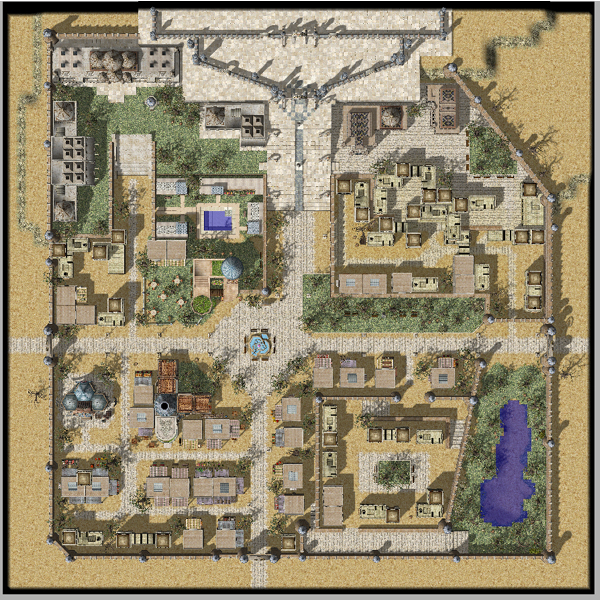

# Rachel

## About Rachel

Rachel is the capital of the [Arunafeltz States](Arunafeltz_States.md),serving as the nation's center for both politics and religion. Despite the everyday bustle of a heavy populated area, visitors commonly experience an atmosphere of quiet and calm. This sense of serenity is partially attributed to the natural beauty, the savanna fields and green grasslands that surround Rachel, but it is mostly accredited to the centered, gentle demeanor of Rachel's citizenry.

## Story

The holy words of the goddess Freya brought great change to the lives of the indigenous people living in Rachel: they swore to honor and adore her, erecting an immense temple as her house of worship in their small, simple oasis village. The faith and fervor of Freya's followers in Rachel proved to be infectious, and the entire nation of Arunafeltz eventually converted to this new faith. Religion became central and foremost in the hearts and minds of the people, naturally merging with Arunafeltz culture and government, and Rachel developed into a major, influential city.

## Quest

Quests added with the Rachel update can be found [here](Quests.md).

## Guide

## Structures

## Buildings

* Inn (115 149)

## Billboards

## Guild Flags

## NPCs

## Dungeon

## Rachel Sanctuary

Now that Arunafeltz has opened its doors to the Rune-Midgarts Kingdom, you'll be able to experience the grace and grandeur of Rachel for yourself.

However, unbeknownst to all but the highest ranking officials within Rachel, is the secret Holy Grounds below the Chechrumnir Temple. Even the pope herself is unaware of the true purpose of the Holy Grounds. What secrets lie hidden in a nation where its followers are driven mad by faith?

## Ice Dungeon

At the northern region of the Arunafeltz lies a vast frozen tundra. This barren land holds little life beyond a handful of carnivorous plants. They say though, hidden somewhere here is a mysterious cave of solid ice.

Within the caves are an assortment of ice monsters. Within the deepest depths of the cave lies a great magic seal bound by Thor's everlasting fire, and protected by the great Ice Salamander Ktullanux. What secret might be hidden here?

The ice caves dungeon is a three level dungeon populated with only water element monsters. Overall the dungeon monsters have low magic defence but medium to high physical defence, making it a great place to level as a magic user with wind magic or as a melee class using specialized equipment or skills to pierce the defence of monsters.

The boss monster of the Ice Caves is the Salamander Ktullanux. He protects Thor's Fire Seal should someone try to put out the magic fire. Players must complete a quest in order to summon Ktullanux, which can only be done once per player. If Ktullanux is defeated, portals near the center of the map will open to allow access to the 4th floor of the dungeon for a short period of time. No monsters appear on this 4th floor, however this is the floor where you will find out what Ktullanux is protecting....

After defeating Ktullanux, Thor's Fire will reappear after 2 hours. You cannot summon Ktullanux again until all the 4 fire reappeared.

**Related pages:**

* [Towns](Towns.md)
* [Rune-Midgarts Kingdom](Rune-Midgarts_Kingdom.md)
* [Alberta](Alberta.md)
* [Al De Baran](Al_De_Baran.md)
* [Archer Village](Archer_Village.md)
* [Comodo](Comodo.md)
* [Geffen](Geffen.md)
* [Izlude](Izlude.md)
* [Morroc](Morroc.md)
* [Payon](Payon.md)
* [Prontera](Prontera.md)
* [Umbala](Umbala.md)
* [Republic of Schwartzvald](Republic_of_Schwartzvald.md)
* [Einbech](Einbech.md)
* [Einbroch](Einbroch.md)
* [Hugel](Hugel.md)
* [Juno](Juno.md)
* [Lighthalzen](Lighthalzen.md)
* [Arunafeltz States](Arunafeltz_States.md)
* [Rachel](Rachel.md)
* [Veins](Veins.md)
* [Manuk](Manuk.md)
* [Amatsu](Amatsu.md)
* [Ayothaya](Ayothaya.md)
* [Kunlun](Kunlun.md)
* [Jawaii](Jawaii.md)
* [Louyang](Louyang.md)
* [Moscovia](Moscovia.md)
* [Nifflheim](Nifflheim.md)
* [Lutie](Lutie.md)

---
*Source: [iRO Wiki Classic](https://irowiki.org/classic/Rachel) — GFDL 1.3+*
