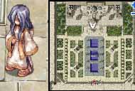
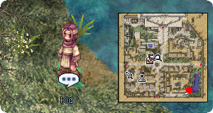
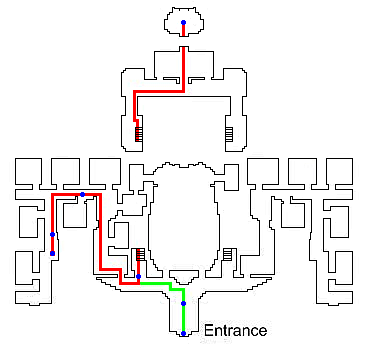
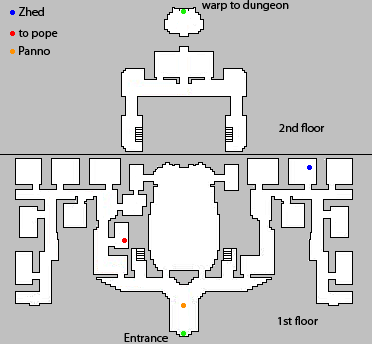
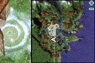

# Rachel Sanctuary Quest

<!-- Quest info -->
- **Level requirement:** 60
- **Item requirement:** 20 Firecracker, 40 Glacial Heart
- **Quests required:** [Lost Child Quest](Lost_Child_Quest.md)
- **Base EXP reward:** 1,100,000
- **Job EXP reward:** 600,000
- **Quest reward:** Access to the Rachel Sanctuary Dungeon

**Precondition:** Initially, you can go to the temple and talk to Nema, as well as enter the Sanctuary to talk to Panno for the exchange of vouchers, or High Priest Zhed for the [Lost Child Quest](Lost_Child_Quest.md). Nema will ask for donations to the sanctuary of 50,000 [Zeny](Zeny.md). Each time you donate, you're given a voucher which you can redeem for a random item (by seeing Panno inside the Sanctuary). Known lottery rewards include:
* Condensed White Potion (39%)
* Blue Potion (11%)
* Dead Branch (8%)
* Gift Box (7%)
* Honey (5%)
* Royal Jelly (5%)
* Yggdrasil Seed (12%)
* Yggdrasilberry (12% + 0.4%)
* Old Card Album (0.1%)
* Old Blue Box (0.3%)
* Old Violet Box (0.2%)

**Once 10,000 donations have been made, the sanctuary will be locked, and the quest can be started!** This is per server, not per person. This means that 500,000,000 Zeny must be donated to the sanctuary for the server before the quest can be done, and the dungeon accessed.

1. If you haven't yet, talk to Nemma.(ra temple 116,174) She'll complain about the locking mechanism on the [Rachel](Rachel.md) gates.

2. Talk to the Kid down by the lake back in the main city ([Rachel](Rachel.md) 243, 37). Tell him "Yeah, I love them."  He will then ramble a little bit about you not having any candy with you, then mention fighting priests.  If no there is no option which says exactly "Yeah, I love them", then keep talking to him until that option appears. *If you select "Yeah", it will end the conversation and you will have to talk to him to try again*

3. Go back up to the temple. Walk up to the windows left of the statue to the left of Nemma (ra temple 67, 209). You'll be able to sneak in.

4. You now need to investigate the locked down temple until you are able to push through the front gate.

For the sake of these directions:

*  NORTH = Up and left, deeper towards the back of the temple.
*  EAST = Up and right
*  WEST = Down and left
*  SOUTH = Down and right, towards the front of the temple.

Follow these directions (or the path shown):

*  Follow the red path
*  Blue dots show dialog locations
*  Once you're inside the locked down temple, head north down the hallway. You will get a popup along the way about some strange noises.
*  When you reach the end of the hallway, head east. You should get another popup about the noises.
*  When you reach a room with a woman's statue in it, continue through the southern exit of that room (through a gate).
*  Continue heading south until you hit a wall, then head east.
*  As you walk east along the front of the building along the benches, you should get a popup that says "CRASH" in red text.
*  Immeditely after you hear the "CRASH" turn left (north) into a small hallway with a staircase in it. Go up those stairs.
*  Once upstairs, head north and then east until you find a room with tiled checker flooring. Head towards the back of that room. Go through the portal behind the statue in that room.
*  Walk towards the gate, and a popup will tell you about the dark stains on the floor. Continue walking around over the bloodstains, investigating each time, until it tells you that you should leave before you become the next victim.
*  Backtrack along the red path until you reach the green path.
*  Head back to the staircase (southwest from the bloody room), and go back down the stairs.
*  Head just a bit to the east until you're back in the Atrium Hallway (stop when you see a statue against the back wall.)
*  Head south, towards the front of the building. After you get a popup, head further south until you reach the gate portal. When it gives you an option, try to "Push" or "Kick" it open.
*  You will find yourself back out front of the temple, and you will now be able to re-enter the temple through the front gate. The lights will be back on, and the [NPC](NPC.md)s will be back. But don't go back inside yet.

5. Talk to Nemma now.  If the donation target has been reached on your server, she will inform you that no more donations are needed.

6. Now you can go inside the real sanctuary (again, if you went in before).

7. Talk to Panno, choose the 3rd option of "Hey, did you open the gate?" and she'll tell you about the security.  Talk to her again and she will tell you more about the gate and what she found out the last time it locked.  (you won't be able to go on to 8 if you don't)

8. Go back to Nemma outside the temple and give her the 20 Firecrackers:. Buy Firecrackers in [Hugel](Hugel.md)'s Party Supplies Shop ([Hugel](Hugel.md) 94, 103).

*  Gain 200,000 [Base Experience](Base_EXP_Chart.md).

9. Talk to High Priest Zhed (ra_temin 277, 159). He'll tell you to take 40 Glacial Hearts to the Pope.

* **NOTE:** If Zhed simply says "May Freya be with you," then you have not completed the [Lost Child Quest](Lost_Child_Quest.md).

10. Visit the pope (ra_temin 134, 134). There will be two popups that you can enter any text in and it will accept (she asks you about yourself.)  Once she finishes she will inform you that Zhed wanted to talk to you.

11. After Zhed boots you from the room, go up to the left wall and eavesdrop on the conversation. A woman will then talk to you about Zhed and her relationship with him.

12. Go back and talk to Zhed. He'll want to rest. After you finish, walk out of the room and pick up the key on the ground (chat prompt). You'll then be able to enter the Sanctuary.

13. Enter the Sanctuary by going back upstairs to the "bloody room" behind the Chapel (ra_temin 29, 312).

14. Go to the "second level" (really a "quest" level) of the dungeon, and walk north until you get the prompt to look at the water. Walk around up onto the metal edge (que_san04 119, 203), and the woman will hit you and you'll be sent back to [Rachel](Rachel.md).

15. Go talk to Zhed and you'll receive experience.

*  Gain 900,000 [Base Experience](Base_EXP_Chart.md)
*  Gain 600,000 [Job Experience](Job_EXP_Chart.md)

---
**Categories:** [Base Experience Reward](categories/Base_Experience_Reward.md), [Job Experience Reward](categories/Job_Experience_Reward.md), [Quests](categories/Quests.md), [Rachel Quests](categories/Rachel_Quests.md)
*Source: [iRO Wiki Classic](https://irowiki.org/classic/Rachel_Sanctuary_Quest) — GFDL 1.3+*
