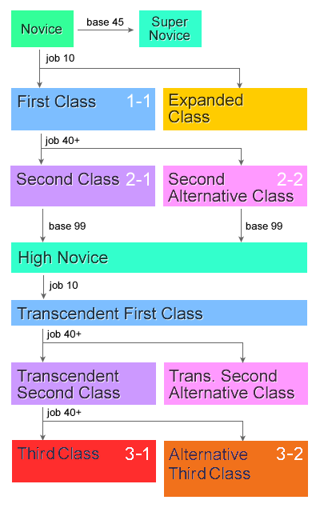

# Renewal/Classes

| Column 1 | Column 2 | Column 3 | Column 4 | Column 5 | Column 6 | Column 7 | Column 8 | Column 9 | Column 10 | Column 11 | Column 12 |
| --- | --- | --- | --- | --- | --- | --- | --- | --- | --- | --- | --- |
| **Novice** | **Novice** | **Novice** | **Novice** | **Novice** | **Novice** | **Novice** | **Novice** | **Novice** | **Novice** | **Novice** | **Novice** |
| [Novice](Novice.md) | [Novice](Novice.md) | [Novice](Novice.md) | [Novice](Novice.md) | [Novice](Novice.md) | [Novice](Novice.md) | [Novice](Novice.md) | [Novice](Novice.md) | [Novice](Novice.md) | [Novice](Novice.md) | [Novice](Novice.md) | [Novice](Novice.md) |
| **First Jobs** | **First Jobs** | **First Jobs** | **First Jobs** | **First Jobs** | **First Jobs** | **First Jobs** | **First Jobs** | **First Jobs** | **First Jobs** | **First Jobs** | **First Jobs** |
| [Swordman](Swordman.md) | [Swordman](Swordman.md) | [Mage](Mage.md) | [Mage](Mage.md) | [Archer](Archer.md) | [Archer](Archer.md) | [Merchant](Merchant.md) | [Merchant](Merchant.md) | [Thief](Thief.md) | [Thief](Thief.md) | [Acolyte](Acolyte.md) | [Acolyte](Acolyte.md) |
| **Second Jobs** | **Second Jobs** | **Second Jobs** | **Second Jobs** | **Second Jobs** | **Second Jobs** | **Second Jobs** | **Second Jobs** | **Second Jobs** | **Second Jobs** | **Second Jobs** | **Second Jobs** |
| [Knight](Knight.md) | [Crusader](Crusader.md) | [Wizard](Wizard.md) | [Sage](Sage.md) | [Hunter](Hunter.md) | [Bard](Bard.md)/[Dancer](Dancer.md) | [Blacksmith](Blacksmith.md) | [Alchemist](Alchemist.md) | [Assassin](Assassin.md) | [Rogue](Rogue.md) | [Priest](Priest.md) | [Monk](Monk.md) |
| **Transcendent Novices** | **Transcendent Novices** | **Transcendent Novices** | **Transcendent Novices** | **Transcendent Novices** | **Transcendent Novices** | **Transcendent Novices** | **Transcendent Novices** | **Transcendent Novices** | **Transcendent Novices** | **Transcendent Novices** | **Transcendent Novices** |
| [High Novice](High_Novice.md) | [High Novice](High_Novice.md) | [High Novice](High_Novice.md) | [High Novice](High_Novice.md) | [High Novice](High_Novice.md) | [High Novice](High_Novice.md) | [High Novice](High_Novice.md) | [High Novice](High_Novice.md) | [High Novice](High_Novice.md) | [High Novice](High_Novice.md) | [High Novice](High_Novice.md) | [High Novice](High_Novice.md) |
| **Transcendent First Jobs** | **Transcendent First Jobs** | **Transcendent First Jobs** | **Transcendent First Jobs** | **Transcendent First Jobs** | **Transcendent First Jobs** | **Transcendent First Jobs** | **Transcendent First Jobs** | **Transcendent First Jobs** | **Transcendent First Jobs** | **Transcendent First Jobs** | **Transcendent First Jobs** |
| [High First Class](High_First_Class.md) | [High First Class](High_First_Class.md) | [High First Class](High_First_Class.md) | [High First Class](High_First_Class.md) | [High First Class](High_First_Class.md) | [High First Class](High_First_Class.md) | [High First Class](High_First_Class.md) | [High First Class](High_First_Class.md) | [High First Class](High_First_Class.md) | [High First Class](High_First_Class.md) | [High First Class](High_First_Class.md) | [High First Class](High_First_Class.md) |
| **Transcendent Second Jobs** | **Transcendent Second Jobs** | **Transcendent Second Jobs** | **Transcendent Second Jobs** | **Transcendent Second Jobs** | **Transcendent Second Jobs** | **Transcendent Second Jobs** | **Transcendent Second Jobs** | **Transcendent Second Jobs** | **Transcendent Second Jobs** | **Transcendent Second Jobs** | **Transcendent Second Jobs** |
| [Lord Knight](Lord_Knight.md) | [Paladin](Paladin.md) | [High Wizard](High_Wizard.md) | [Scholar](Scholar.md) | [Sniper](Sniper.md) | [Clown](Minstrel.md)/[Gypsy](Gypsy.md) | [Mastersmith](Mastersmith.md) | [Biochemist](Biochemist.md) | [Assassin Cross](Assassin_Cross.md) | [Stalker](Stalker.md) | [High Priest](High_Priest.md) | [Champion](Champion.md) |
| **Third Jobs (External)** | **Third Jobs (External)** | **Third Jobs (External)** | **Third Jobs (External)** | **Third Jobs (External)** | **Third Jobs (External)** | **Third Jobs (External)** | **Third Jobs (External)** | **Third Jobs (External)** | **Third Jobs (External)** | **Third Jobs (External)** | **Third Jobs (External)** |
| [Rune Knight](http://ro.doddlercon.com/wiki/index.php?title=Rune_Knight) | [Royal Guard](http://ro.doddlercon.com/wiki/index.php?title=Royal_Guard) | [Warlock](http://ro.doddlercon.com/wiki/index.php?title=Warlock) | [Sorcerer](http://ro.doddlercon.com/wiki/index.php?title=Sorcerer) | [Ranger](http://ro.doddlercon.com/wiki/index.php?title=Ranger) | [Minstrel](http://ro.doddlercon.com/wiki/index.php?title=Minstrel)/[Wanderer](http://ro.doddlercon.com/wiki/index.php?title=Wanderer) | [Mechanic](http://ro.doddlercon.com/wiki/index.php?title=Mechanic) | [Genetic](http://ro.doddlercon.com/wiki/index.php?title=Genetic) | [Guillotine Cross](http://ro.doddlercon.com/wiki/index.php?title=Guillotine_Cross) | [Shadow Chaser](http://ro.doddlercon.com/wiki/index.php?title=Shadow_Chaser) | [Arch Bishop](http://ro.doddlercon.com/wiki/index.php?title=Arch_Bishop) | [Shura](http://ro.doddlercon.com/wiki/index.php?title=Shura) |
| **Expanded Jobs** | **Expanded Jobs** | **Expanded Jobs** | **Expanded Jobs** | **Expanded Jobs** | **Expanded Jobs** | **Expanded Jobs** | **Expanded Jobs** | **Expanded Jobs** | **Expanded Jobs** | **Expanded Jobs** | **Expanded Jobs** |
| [TaeKwon Kid](TaeKwon_Kid.md) | [TaeKwon Kid](TaeKwon_Kid.md) | [Ninja](Ninja.md) | [Ninja](Ninja.md) | [Ninja](Ninja.md) | [Gunslinger](Gunslinger.md) | [Gunslinger](Gunslinger.md) | [Gunslinger](Gunslinger.md) | [Super Novice](Super_Novice.md) | [Super Novice](Super_Novice.md) | [Super Novice](Super_Novice.md) | [Super Novice](Super_Novice.md) |
| [Soul Linker](Soul_Linker.md) | [TaeKwon Master](TaeKwon_Master.md) | [Ninja](Ninja.md) | [Ninja](Ninja.md) | [Ninja](Ninja.md) | [Gunslinger](Gunslinger.md) | [Gunslinger](Gunslinger.md) | [Gunslinger](Gunslinger.md) | [Super Novice](Super_Novice.md) | [Super Novice](Super_Novice.md) | [Super Novice](Super_Novice.md) | [Super Novice](Super_Novice.md) |

## About Classes

In Ragnarok Online, a character's abilities and skills are defined by their class (also known as job). Characters start out as Novices, then once they reach job level 10 they can choose between a variety of first job classes. Once they then reach at least Job Level 40 they can then change to a second class job, either 2-1 or 2-2. Then after reaching Base Level 99 and Job Level 50 as a second class they can choose to transcend and start the process again, being rewarded with a more powerful, transcendent character.  Alternatively, from Novice, players can choose to become the ultimate Novice, the Super Novice, or explore one of the Expanded classes.

A 3rd class option has been released on kRO as part of [Renewal](Renewal.md). These additional classes are the next step after a Transcendent Second Job or regular Second Job and offer a broad spectrum of additional spells and abilities.
More information can be found [here.](http://ro.doddlercon.com/wiki/index.php?title=3rd_Classes)

---
**Categories:** [Classes](categories/Classes.md), [General Information](categories/General_Information.md)
*Source: [iRO Wiki Classic](https://irowiki.org/classic/Renewal/Classes) — GFDL 1.3+*
