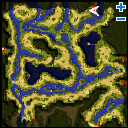
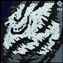
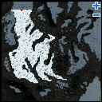

# Report from the New World

<!-- Quest info -->
- **Level requirement:** 70
- **Quests required:** 2 of the following 4 quests: [Attitude to the New World](Attitude_to_the_New_World.md), [New Surroundings](New_Surroundings.md), [Tripatriate Union's Feud](Tripatriate_Union's_Feud.md), [Pursuing Rayan Moore](Pursuing_Rayan_Moore.md)
- **Base EXP reward:** 2,500,000
- **Item reward:** 3 First Aid Kit
- **Window:** yes

1.  Inside the central building (mid_camp 215, 247) at the camp, talk to Hibba Agip who is on the north side of the table in the center (mid_campin 90, 114), he and Abidail discuss your accomplishments.
1.  Talk to Staff Officer Abidail at the east end of the table, accept his request. He tells you to talk to Commander Agip.
1.  Speak to Hibba Agip again, he gives you a document and asks you to speak to the messenger at at the dimensional gate.
1.  Find Expedition Messenger (mid_camp 206, 286), while you are discussing the report, someone sneaks up and attempts to take it.  If you attempt to safeguard the report from the attacker, it will be easier later to re-assemble the report later.
1.  Return to Hibba Agip to inform him that the report has been destroyed. He tells you to go find the pieces of it.
1.  Staff Officer Abidail asks you to bring him pages of the report in increments of 10.
1.  Speak to any of the Expedition Scout on the New World field maps, the scout will start looking for pages.  Return every 30 minutes (15 minutes if you are playing on iRO instead).
  * Scout locations are:
    * (spl_fild02 296, 369) *(north wall)*

    * (spl_fild03 172, 71) *(south wall)*

    * (man_fild01 316, 92) *(southeast)*

    * (man_fild03 202, 251) *(east wall, halfway up)*

  * Pages can also be found when killing specific quest summoned monsters on the fields. (usually at one of several fixed spawn points)
1.  After returning with 10 pages, Abidail will restore one of the four volumes of the report. Keep searching for pages until all the volumes are restored.
  * There is a very high chance that the pages bring do not form a single volume, or that they form a volume you already have. You will lose 10 pages and must collect more. (On iRO, you only lose 5 pages instead)
  * You will automatically fail and discard the pages if he manages to restore a volume of the report you already have on you.  As such, you should put completed volumes in storage.  The extra volumes of the report can be given to other players doing the quest.
1.  Return to Hibba Agip when you have all 4 volumes, and he'll give you the completed report. He instructs you to follow the same plan; he has stationed more soldiers in the area to protect the report.
1.  Deliver a report to Laur in the throne room of Prontera Castle (prt_castle 88,165).
1.  Deliver a report to Nuria outside Rachel's temple (ra_temple 122, 174).
1.  Deliver a report to Gerhart at the front desk, inside Rekenber's Headquarters (lhz_in01 110, 174).
1.  Return to Hibba Agip, he thanks you for your help
  * Receive 2,500,000 [Base EXP](Base_EXP_Chart.md) and 3 First Aid Kits.

---
**Categories:** [Base Experience Reward](categories/Base_Experience_Reward.md), [New World Quests](categories/New_World_Quests.md), [Quest Window Quests](categories/Quest_Window_Quests.md)
*Source: [iRO Wiki Classic](https://irowiki.org/classic/Report_from_the_New_World) — GFDL 1.3+*
