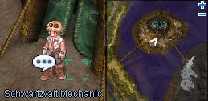
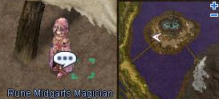

# Ring of the Wise King

<!-- Quest info -->
- **Level requirement:** 70
- **Quests required:** [Finding a Fairy](Finding_a_Fairy.md), Started [Report from the New World](Report_from_the_New_World.md)
- **Base EXP reward:** 1,000,000
- **Job EXP reward:** 300,000
- **Item reward:** Ring of the Wise Ancient King
- **Window:** yes

1.  Speak to Schwartzvalt Mechanic (mid_camp 197, 237) outside the Alliance Headquarters. He tells you about the Ring of the Wise King, and asks you to speak to the Arunafeltz Linguist on the 2nd floor of the Alliance Headquarters.

  * 

1.  Inside, up the stairs, find the linguist in the room to the far right. He asks you to visit the Faerie and Giants out on the fields and remember every single word they say. These are from the [Finding a Fairy](Finding_a_Fairy.md) quest.
  * The Faerie's text is:
1.     RLGHLRXLA TKANTLFDMS
1.     WJACK TNAHRDNJSDMFH
1.     WLSGHKWND !!
  * The Giant's text is:
1.     TJDTMFJDNS CJFDI
1.     TKADLFDMF QKATOS
1.     EKDTLSDML DLFMADMS..
1.   **Note**: On non-iRO servers, the text for the linguist is different:
  * The Faerie's text is:
1.     TKANTLFDMS
1.     TNAHRDNJSDMFH
1.     WLSGHKWND
  * The Giant's text is:
1.     CJFDI
1.     QKATOS
1.     DLFMADMS..
1.  The Linguist isn't able to make any sense of the languages and refers you to the Rune Midgart's Magician.
1.  The Rune Midgart's Magician (mid_camp 147, 256), in the west half of the allied camp, says he needs to actually hear the languages being pronounced. He had some assassins bury gems near the villages to record the spoken languages, he would like you to go retrieve the gems.

  * 

1.  Talk to the Gem at (spl_fild02 26, 218), near the fairy, and attempt to dig it out. Several thief bugs will spawn, kill them. Repeat until you obtain a Red Jewel from it.
1.  Talk to the Gem at (man_fild03 227, 109), near the giant, and attempt to dig it out. Several thief bugs will spawn, kill them. Repeat until you obtain a Blue Jewel from it.
1.  Return to the Rune Midgart's Magician with the gemstones, he says he will extract the voices from the gems and send them to the Arunafeltz linguist.
1.  Return to the Arunafeltz linguist, He tells you that he has made amazing progress decoding the language. So much so that he's unsure how to even store all the data.  He asks you to speak the Schwartzvalt Mechanic.
1.  The Schwartzvalt Mechanic says he needs some way to store the massive amount of data, and asks you to inquire with the Rune Midgart's Magician about a magical gem to hold the data.
1.  The Rune Midgart's Magician says he needs an Ore unlike any found in the old world to store the data. He asks you to go find one on the manuk fields.
1.  Return to him with 1 Unidentified Mineral (obtained from "Mysterious Rock" which are located on all 3 Manuk fields). He asks you to wait a minute while he works his magic.
1.  Talk to the magician and he asks you to take the gem to the Schwartzvalt Mechanic.
1.  The Schwartzvalt Mechanic says it will take him at least an hour to complete a machine to translate using the gem. Return in 1 hour.
1.  Return to the mechanic and he will give you the Ring of the Wise Ancient King and some [EXP](Experience.md).

---
**Categories:** [Base Experience Reward](categories/Base_Experience_Reward.md), [Into the Unknown Quests](categories/Into_the_Unknown_Quests.md), [Job Experience Reward](categories/Job_Experience_Reward.md), [New World Quests](categories/New_World_Quests.md), [Quest Window Quests](categories/Quest_Window_Quests.md)
*Source: [iRO Wiki Classic](https://irowiki.org/classic/Ring_of_the_Wise_King) — GFDL 1.3+*
