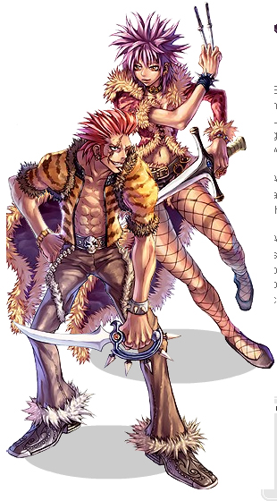

# Rogue

<!-- Job info -->
- **Job base:** Thief
- **Job type:** 2-2
- **Changes at:** Pharos, Beacon Island
- **Skills:** 20
- **Skill points:** 131
- **Quest skills:** 1
- **STR:** 6
- **AGI:** 7
- **VIT:** 6
- **INT:** 4
- **DEX:** 7
- **LUK:** 0

## Overview

Rogues are a versatile class, only really lacking in PvM skills but excelling in PvP and WoE. With their strip skills, Rogues can render most classes useless in a PvP environment. With Gank, a Rogue can obtain double the loot another class could gather in the same amount of time. Rogues can wield bows, daggers, or swords and can copy a variety of player skills to help them level, although a Rogue cannot use Intimidate to its full potential like its transcendent counterpart can.

## Jobchange Guide

*See [Rogue Job Change Guide](Rogue_Job_Change_Guide.md) for detailed information.*

Changing into a Rogue from a [Thief](Thief.md) requires the player to complete a number of tasks:
*  A Written Test
*  Item collection test
*  Maze test

After completing these tests, the player will be transformed into a Rogue. Most of this takes place inside the Rogue Guild at the Pharos Lighthouse (cmd_fild07).

## Builds

## Dagger Gank

Stat Build:
*  STR: 110-120
*  AGI: 60-90
*  VIT: 5-30
*  INT: 1
*  DEX: 40-70
*  LUK: 1

Skill Build:
*  [Gank](Gank.md) 10
*  [Mug](Mug.md) 4
*  [Backstab](Back_Stab.md) 4
*  [Stalk](Stalk.md) 2
*  [Sightless Mind](Sightless_Mind.md) 5
*  [Snatch](Snatch.md) 5
*  [Intimidate](Intimidate.md) 10
*  [Sword Mastery](Sword_Mastery.md) 9

With max [Intimidate](Intimidate.md), the dagger gank rogue can level quickly with copied skills ([Bowling Bash](Bowling_Bash.md) and [Raging Trifecta Blow](Raging_Trifecta_Blow.md) the most common). [Sword Mastery](Sword_Mastery.md) boosts damage with both daggers and one-handed swords, and [Gank](Gank.md) doubles loot gain. The more money-minded can max [Mug](Mug.md) in exchange for levels in [Sword Mastery](Sword_Mastery.md) or [Intimidate](Intimidate.md).

Stats-wise, high STR and high AGI will guarantee swift and powerful attacks. VIT is less important, since AGI will provide enough flee to dodge most attacks. The dagger gank rogue excells in PvM and will level quickly to achieve [Stalker](Stalker.md), should PvP or WoE be the ultimate goal.

Weapons: Triple [Carded](Card_System.md) Gladius, [Elemental](Element.md) Damascus, [Ice Pick](Ice_Pick.md)

## Strip

Stat Build:
*  STR: 1-20
*  AGI: 1-20
*  VIT: 70-100
*  INT: 1-30-60
*  DEX: 110-120
*  LUK: 1

Skill Build:
*  [Gank](Gank.md) 4
*  [Mug](Mug.md) 4
*  [Backstab](Back_Stab.md) 4
*  [Stalk](Stalk.md) 2
*  [Divest Helm](Divest_Helm.md) 5
*  [Divest Shield](Divest_Shield.md) 5
*  [Divest Armor](Divest_Armor.md) 5
*  [Divest Weapon](Divest_Weapon.md) 5

*  [Vulture's Eye](Vulture's_Eye.md) 10
*  [Double Strafe](Double_Strafe.md) 5
-OR-
*  [Sightless Mind](Sightless_Mind.md) 5
*  [Snatch](Snatch.md) 5
*  [Intimidate](Intimidate.md) 5

Strip rogues are ideal for a PvP or WoE setting. [Divest Weapon](Divest_Weapon.md) will render many melee classes useless (particularly swordsman classes and emp-breaking assassins), while [Divest Armor](Divest_Armor.md), [Divest Shield](Divest_Shield.md), and [Divest Helm](Divest_Helm.md) will negate damage-reducing cards and equips.

The strip rogue has high VIT for survivability, along with high DEX for successful divests and moderate INT for a good SP pool (since divests drain SP quickly). A small investment in the [Double Strafe](Double_Strafe.md) or [Intimidate](Intimidate.md) trees will make PvM leveling easier.

Weapons: Quadruple [Carded](Card_System.md) Composite Bow (preferably +7 to +10 to make up for the low ATK), Double [Carded](Card_System.md) Gakkung or Double [Carded](Card_System.md) Arbalest

## Bow

Stat Build:
*  STR: 1-20
*  AGI: 50-80
*  VIT: 40-60
*  INT: 1-30-60
*  DEX: 100-120
*  LUK: 1

Skill Build:
*  [Gank](Gank.md) 4
*  [Mug](Mug.md) 4
*  [Backstab](Back_Stab.md) 4
*  [Stalk](Stalk.md) 2
*  [Vulture's Eye](Vulture's_Eye.md) 10
*  [Double Strafe](Double_Strafe.md) 5
*  [Sightless Mind](Sightless_Mind.md) 5
*  [Snatch](Snatch.md) 5
*  [Intimidate](Intimidate.md) 10

Bow rogues can snipe enemies from afar with [Vulture's Eye](Vulture's_Eye.md) and [Double Strafe](Double_Strafe.md), then deal extra damage with a copied skill via [Intimidate](Intimidate.md). If feeling PvP or WoE oriented, they can sacrifice levels in the [Double Strafe](Double_Strafe.md) or [Intimidate](Intimidate.md) trees for some strip skills. However, only the first divests will probably be obtained ([Divest Helm](Divest_Helm.md) and [Divest Shield](Divest_Shield.md)), lest the bow rogue wishes to become a strip rogue (in which case the strip rogue build would be more useful).

The bow rogue has high DEX and high AGI for quick and devastating damage via bows. Moderate INT ensures a steady SP supply for intimidated skill spamming.

Weapons: Quadruple [Carded](Card_System.md) Composite Bow (preferably +7 to +10 to make up for the low ATK), Double [Carded](Card_System.md) Gakkung or Double [Carded](Card_System.md) Arbalest. While previously the Sidewinder Card was preferred for bows used by rogues (because it allows the full level 10 Double Attack to be used with bows), the kafra shop Chick Hat item which has the same effect, has largely made this obsolete.

## Equipment

## Class Data

## Skills

*See [Thief Skills](Thief.md) for first class skills.*

| Skill | Description | Levels | Type |
| --- | --- | --- | --- |
| [Back Stab](Back_Stab.md) | Attacks a target from behind, dealing up to 700% damage that does not miss | 10 | Offensive |
| [Divest Armor](Divest_Armor.md) | Forcibly remove an opponent's armor by chance | 5 | Active |
| [Divest Helm](Divest_Helm.md) | Forcibly remove an opponent's upper headgear by chance | 5 | Active |
| [Divest Shield](Divest_Shield.md) | Forcibly remove an opponent's shield by chance | 5 | Active |
| [Divest Weapon](Divest_Weapon.md) | Forcibly remove an opponent's Weapon by chance | 5 | Active |
| [Double Strafe](Double_Strafe.md) | Deal up to 380% damage to a single target. | 10 | Offensive |
| [Gank](Gank.md) | Adds a chance of casting [Steal](Steal.md) automatically when attacking a monster. | 10 | Passive |
| [Haggle](Haggle.md) | Buy items from [NPC](NPC.md)'s with an up to 25% discount. | 5 | Passive |
| [Intimidate](Intimidate.md) | Allows the player to use the most recent skill that has damaged them. | 10 | Passive |
| [Mug](Mug.md) | Attempts to steal [Zeny](Zeny.md) from a monster. | 10 | Active |
| [Piece](Piece.md) | Paints graffiti on a guild flag. Unimplemented | 5 | Active |
| [Remove Trap](Remove_Trap.md) | Remove a [Hunter](Hunter.md)'s trap from the ground. | 1 | Active |
| [Remover](Remover.md) | Removes graffiti from a guild flag. Unimplemented | 1 | Active |
| [Scribble](Scribble.md) | Writes text on the ground. | 1 | Active |
| [Sightless Mind](Sightless_Mind.md) | Damages all opponents in a 3x3 area around the caster, with a chance to [Blind](Status_Effects.md) or [Stun](Status_Effects.md) | 5 | Offensive |
| [Slyness](Slyness.md) | Prevents non-boss monsters from attacking any rogues sitting together | 1 | Passive |
| [Snatch](Snatch.md) | Forcibly [Teleport](Teleport.md)s the player and a non-boss monster to another location on the map. | 5 | Offensive |
| [Stalk](Stalk.md) | Allows the player to move while in the [Hiding](Hiding.md) state. | 5 | Passive |
| [Sword Mastery](Sword_Mastery.md) | Increases damage done with Daggers and One-Handed Swords. | 10 | Passive |
| [Vulture's Eye](Vulture's_Eye.md) | Increases range and [HIT](Stats.md) when using bows. | 10 | Passive |

## Quest Skills

| Skill | Description | Levels | Type | Job Level Requirement | Quest |
| --- | --- | --- | --- | --- | --- |
| [Close Confine](Close_Confine.md) | Locks the caster and a target in place for up to 10 seconds. | 1 | Active | 35 | [Close Confine Quest](Rogue_Skill_Quest.md) |

## Soul Link

*See the [Rogue Spirit](Rogue_Spirit.md) page.*

## Job Bonuses

**Job Bonus**

| Stat\Amount | +1 | +2 | +3 | +4 | +5 | +6 | +7 |
| --- | --- | --- | --- | --- | --- | --- | --- |
| STR | 5 | 25 | 27 | 30 | 36 | 42 |   |
| AGI | 1 | 7 | 16 | 23 | 27 | 39 | 45 |
| VIT | 2 | 6 | 9 | 14 | 15 | 26 |   |
| INT | 38 | 43 | 47 | 48 |   |   |   |
| DEX | 3 | 11 | 18 | 20 | 33 | 34 | 50 |
| LUK |   |   |   |   |   |   |   |

## ASPD

## See Also

*  [Thief](Thief.md)
*  [Rogue Leveling](Rogue_Leveling.md)

## External Links

**Related pages:**

* [Rogue](Rogue.md)
* [Stalker](Stalker.md)
* [Skills](Skills.md)
* [Back Stab](Back_Stab.md)
* [Close Confine](Close_Confine.md)
* [Divest Armor](Divest_Armor.md)
* [Divest Helm](Divest_Helm.md)
* [Divest Shield](Divest_Shield.md)
* [Divest Weapon](Divest_Weapon.md)
* [Double Strafe](Double_Strafe.md)
* [Gank](Gank.md)
* [Haggle](Haggle.md)
* [Intimidate](Intimidate.md)
* [Mug](Mug.md)
* [Piece](Piece.md)
* [Remove Trap](Remove_Trap.md)
* [Remover](Remover.md)
* [Scribble](Scribble.md)
* [Sightless Mind](Sightless_Mind.md)
* [Slyness](Slyness.md)
* [Snatch](Snatch.md)
* [Stalk](Stalk.md)
* [Sword Mastery](Sword_Mastery.md)
* [Vulture's Eye](Vulture's_Eye.md)
* [Counter Instinct](Counter_Instinct.md)
* [Full Divestment](Full_Divestment.md)
* [Preserve](Preserve.md)
* [Steal Backpack](Steal_Backpack.md)
* [Stealth](Stealth.md)
* [Quests](Quests.md)
* [Rogue Job Change Guide](Rogue_Job_Change_Guide.md)
* [Rogue Skill Quest](Rogue_Skill_Quest.md)
* [Rebirth Walkthrough](Rebirth_Walkthrough.md)
* [Weapons](Weapons.md)
* [Bow](Bow.md)
* [Dagger](Dagger.md)
* [One Handed Sword](One_Handed_Sword.md)

**Related pages:**

* [Classes](Classes.md)
* [Novice](Novice.md)
* [High Novice](High_Novice.md)
* [Super Novice](Super_Novice.md)
* [Acolyte](Acolyte.md)
* [Archer](Archer.md)
* [High First Class](High_First_Class.md)
* [Mage](Mage.md)
* [Merchant](Merchant.md)
* [Swordman](Swordman.md)
* [Thief](Thief.md)
* [Priest](Priest.md)
* [Monk](Monk.md)
* [Hunter](Hunter.md)
* [Bard](Bard.md)
* [Dancer](Dancer.md)
* [Wizard](Wizard.md)
* [Sage](Sage.md)
* [Blacksmith](Blacksmith.md)
* [Alchemist](Alchemist.md)
* [Knight](Knight.md)
* [Crusader](Crusader.md)
* [Assassin](Assassin.md)
* [Rogue](Rogue.md)
* [Transcendent](Transcendent.md)
* [High Priest](High_Priest.md)
* [Champion](Champion.md)
* [Sniper](Sniper.md)
* [Minstrel](Minstrel.md)
* [Gypsy](Gypsy.md)
* [High Wizard](High_Wizard.md)
* [Scholar](Scholar.md)
* [Mastersmith](Mastersmith.md)
* [Biochemist](Biochemist.md)
* [Lord Knight](Lord_Knight.md)
* [Paladin](Paladin.md)
* [Assassin Cross](Assassin_Cross.md)
* [Stalker](Stalker.md)
* [Gunslinger](Gunslinger.md)
* [Ninja](Ninja.md)
* [TaeKwon Kid](TaeKwon_Kid.md)
* [TaeKwon Master](TaeKwon_Master.md)
* [Soul Linker](Soul_Linker.md)

---
**Categories:** [Classes](categories/Classes.md), [Pages needing expert attention](categories/Pages_needing_expert_attention.md), [Rogue](categories/Rogue.md)
*Source: [iRO Wiki Classic](https://irowiki.org/classic/Rogue) — GFDL 1.3+*
