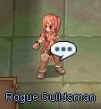
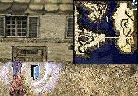
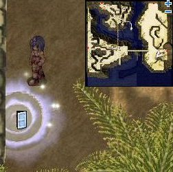
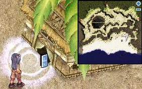
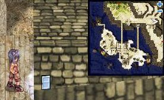
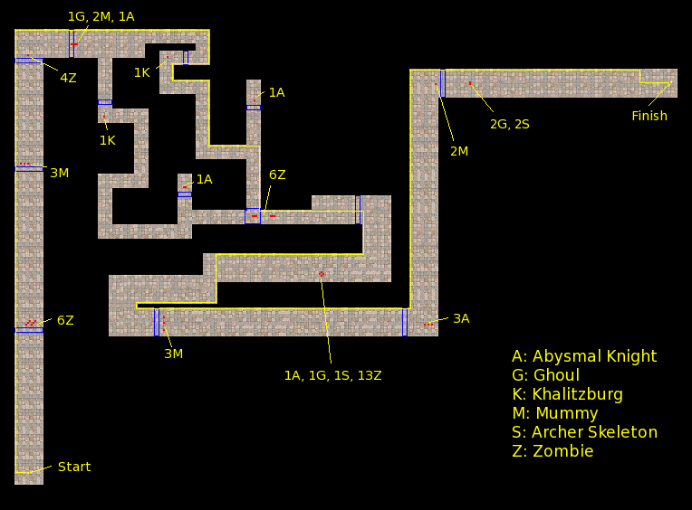

# Rogue Job Change Guide

<!-- Quest info -->
- **Level requirement:** None
- **Job level requirement:** 40
- **Class requirement:** Thief
- **Item requirement:** Varies
- **Item reward:** Worn Out Page, Gladius \[3\] (Job 50) -OR- Gladius \[2\] (Job 40~49)
- **Quest reward:** Jobchange to [Rogue](Rogue.md)

1. Go to the Pharos Lighthouse (cmd_fild07). To get there, go to [Comodo](Comodo.md) or [Morroc](Morroc.md) and speak to the [Kafra](Kafra.md) for a warp.

2. You will need to take the portal in the lighthouse (cmd_fild07 193,117) downstairs and speak with the Rogue Guildsman (in_rogue 363, 122).

3. Markie will ask you one of the following sets of questions (answers given in **bold**). You must get at least 9 out of 10 questions correct to pass the test.

**Set 1**
1.  *Which monster drops a slotted Gladius?* **Kobold**
1.  *Which monster drops a slotted Main-Gauche?* **Hornet**
1.  *Choose the class that is able to create unique potions.* **Alchemist**
1.  *Choose the weapon that Rogues aren't allowed to use.* **Katar**
1.  *Choose the property that the Hode monster possesses.* **Earth**
1.  *Choose the monster that is unable to be tamed for as a Cute Pet.* **Creamy**
1.  *Choose the monster that receives more damage from a Dagger with the Fire property.* **Hammer Goblin**
1.  *Choose the town that doesn't have any guild castles.* **Alberta**
1.  *Choose the plant that drops Blue Herbs.* **Blue Plant** or **Shining Plant**
1.  *Choose the monster that does not have the Undead property.* **Familiar**

**Set 2**
1.  *By what percentage is the flee rate increased when a Thief masters the Improve Dodge?* **30**
1.  *Choose the monster that detects a characters using the Hiding or Cloaking skill.* **Argos**
1.  *Choose the location where Thieves can change their jobs to Rogues.* **Paros Lighthouse**
1.  *In which town can Novice change their Jobs to Thieves?* **Morroc**
1.  *Choose the card that does not affect the DEX stat.* **Mummy Card**
1.  *So what's cool about being a Rogue?* ***any answer is correct***
1.  *When is it possible to change from Thief to Rogue?* **At Job Level 40** or **At Job Level 50**
1.  *You want to dye your hair blue. What town do you go to, and in which directing, with 12 o'clock being North.* **Prontera, 7 o'clock**
1.  *Choose the mushroom that is required on the Thief job change quest.* **Orange Gooey Mushroom** or **Orange Net Mushroom**
1.  *Choose the card that least benefits the Rogue class.* **Elder Willow Card**

**Set 3**
1.  *Choose the skill necessary for learning Stalk.* **Hiding**
1.  *In comparison to the Merchant's Level 10 Discount skill, how much more of a discount, in terms of percent, can a Rogue get with Level 10 Haggle skill?* **1 %**
1.  *What is the correct description for the skill, Mug?* **Steal Zeny from monsters**
1.  *How many Rogues does it require to activate the skill, Slyness?* **2 Rogues**
1.  *Choose the skill that you can learn at Level 5 Divest Helm.* **Divest Shield**
1.  *Choose the skill which allows its user to move while hiding.* **Stalk**
1.  *Choose the card that increases the accuracy rate of its owner.* **Mummy Card.**
1.  *Choose the monster that receives more damage with its attacked by a weapon with the Vadon card (20 % more damage on Fire property).* **Elder Willow**
1.  *How much SP does the skill Double Attack require when used with a Dagger?* **Passive skill, no SP required.**
1.  *Choose the most efficient dagger to use in the Byalan Dungeon.* **Wind Main-Gauche**

4. Once you have passed the written test, you will be sent to Mr. Smith (in_rogue 376, 23) on the floor above. He will tell you to go collect items. There are a few different sets of items. Listed Below.

| Set | Items |
| --- | --- |
| Set 1 | 10,000 [Zeny](Zeny.md), 5 Red Herb, 5 Fluff, 5 Clover, 5 Iron Ore, 5 Empty Bottle, 5 Chrysalis, 5 Spawn, 5 Tooth of Bat, 5 Feather of Birds, 5 Talon, 5 Monster Feed, 5 Animal Skin, 5 Stone Heart, 5 Scorpion Tail, 5 Yoyo Tail, 5 Yellow Gemstone, 5 Racoon Leaf |
| Set 2 | 10,000 Zeny, 10 Yellow Herb, 10 Shell, 10 Grasshopper's Leg, 10 Bear's Footskin |
| Set 3 | 10,000 Zeny, 10 Garlet, 10 Snake Scale, 10 Green Herb, 10 Crab Shell |
| Set 4 | 10,000 Zeny, 10 Skel-Bone, 10 Decayed Nail, 10 Horrendous Mouth, 6 Blue Herb |

5. After bringing back the correct items, Mr. Smith will send you to look for his partners. He will give you a password in his clue. Make sure you write this password down.

* **Note**: Players who were given Item Set 1 by Mr. Smith will be directed to Hermanthorn Jr.  They will be given a much easier maze to traverse.

**Aragham Jr.**

Fortress Saint Darmain (South) (cmd_fild09): 106, 195
Password: Aragham never hoarded upgrade items.

**Hollgrehenn Jr.**

Fortress Saint Darmain (South) (cmd_fild09): 335, 143
Password: My father never hoarded upgrade items.

**Antonio Jr.**

Kokomo Beach (cmd_fild04): 302,177
Password: Antonio doesn't enjoy destroying upgrade items.

**Hermanthorn Jr.**

Kokomo Beach (cmd_fild07): 349,285
No password is needed to enter the building. However, to enter the maze, you will be given the code **3019**.

6. As soon as you are inside you will be asked if you are ready to enter to maze. (Tip: Hotkey Backslide, Hide and have Authoritative Badges if you have access to them. A pair of Peco Wings will make this a breeze). You will be able to hide from any monster you encounter in the maze. A good tip would be just stay close to the wall. If you fail the first time, just try it until you get it right.

The map below represents the maze that Antonio Jr., Hollgrehenn Jr., and Aragham Jr. will send you to. The tiles marked in blue will summon monsters onto the nearby red tiles when you step on them. (Be careful not to touch them if you retreat, touching them more than once will summon more than one mob)

TIP:

You can wear a Frilldora compounded Garment to be able to use Cloaking along walls without worry.
The monsters spawning in the maze cannot detect hidden characters so you can finish the test without any trouble.

7. Once you escape from the maze, talk to the Rogue Guildsman (Markie) and who will promote you to  Rogue.

*  [Thieves](Thief.md) changing into Rogues at Job Level 50 will be given a Gladius \[3\] as a reward; those changing below 50 will receive a Gladius \[2\].

**Related pages:**

* [Rogue](Rogue.md)
* [Stalker](Stalker.md)
* [Skills](Skills.md)
* [Back Stab](Back_Stab.md)
* [Close Confine](Close_Confine.md)
* [Divest Armor](Divest_Armor.md)
* [Divest Helm](Divest_Helm.md)
* [Divest Shield](Divest_Shield.md)
* [Divest Weapon](Divest_Weapon.md)
* [Double Strafe](Double_Strafe.md)
* [Gank](Gank.md)
* [Haggle](Haggle.md)
* [Intimidate](Intimidate.md)
* [Mug](Mug.md)
* [Piece](Piece.md)
* [Remove Trap](Remove_Trap.md)
* [Remover](Remover.md)
* [Scribble](Scribble.md)
* [Sightless Mind](Sightless_Mind.md)
* [Slyness](Slyness.md)
* [Snatch](Snatch.md)
* [Stalk](Stalk.md)
* [Sword Mastery](Sword_Mastery.md)
* [Vulture's Eye](Vulture's_Eye.md)
* [Counter Instinct](Counter_Instinct.md)
* [Full Divestment](Full_Divestment.md)
* [Preserve](Preserve.md)
* [Steal Backpack](Steal_Backpack.md)
* [Stealth](Stealth.md)
* [Quests](Quests.md)
* [Rogue Job Change Guide](Rogue_Job_Change_Guide.md)
* [Rogue Skill Quest](Rogue_Skill_Quest.md)
* [Rebirth Walkthrough](Rebirth_Walkthrough.md)
* [Weapons](Weapons.md)
* [Bow](Bow.md)
* [Dagger](Dagger.md)
* [One Handed Sword](One_Handed_Sword.md)

---
**Categories:** [Job Change Guide](categories/Job_Change_Guide.md), [Rogue](categories/Rogue.md), [Thief](categories/Thief.md)
*Source: [iRO Wiki Classic](https://irowiki.org/classic/Rogue_Job_Change_Guide) — GFDL 1.3+*
