# Rogue Skill Quest

## Close Confine Quest

<!-- Quest info -->
- **Level requirement:** None
- **Job level requirement:** 35
- **Class requirement:** Rogue
- **Quest reward:** Ability to use [Close Confine](Close_Confine.md)

* **Note:** If you have learned this skill as a Rogue and have since transcended, proceed to step 3 and speak to Haijara Greg to regain the skill instantly.

1. Talk to one of the sons to start the quest, recommended is Thor Greg because he is closest to Beacon Island, Pharos. He may be also the only one that spills the hiding place of his father once the player talks to him twice.

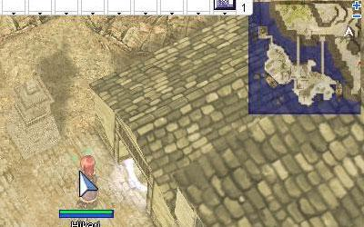

Beacon Island, Pharos (cmd_fild07): 351,286

2. He will say his father, Haijara Greg is being pursued and will mention that the rogue guild leader says the secret hiding place is next to her.

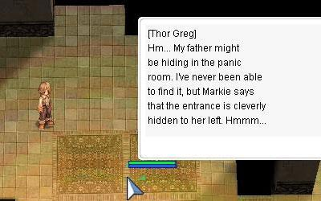

3. Visit said Haijara Greg inside the rogue guild, go down the stairs to the rogue job change npc and continue going left. Up towards the beds, there's a secret wall passage.

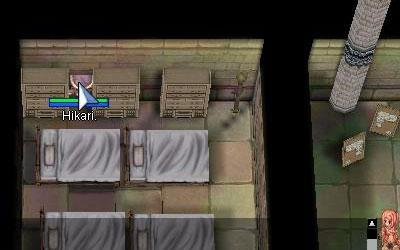

4. Talk to the father and he will ask some questions. Answering with a wrong question leaves the player with 1 HP. Correct answers in order:

* I don't mean you any harm!
* I came to help you.
* No.
* Sure!

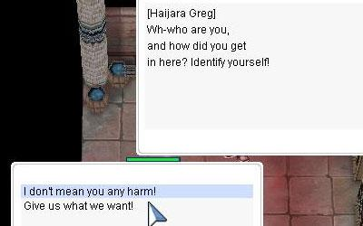

5. He will then ask the player to visit his son, Louis Greg, who happens to be in Hollgrehenn Jr.'s building 1 map east of Paros Lighthouse.

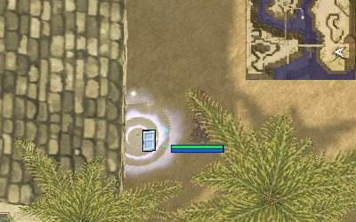

For those who forget, the password to enter the building: *My father never hoarded upgrade items.*

6. He will then ask to talk to his brother Thor Greg, whose location can be found above at the beginning the quest.

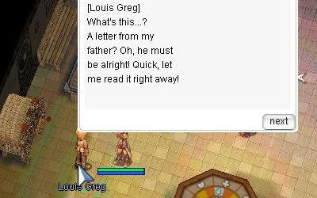

7. Talking to Thor Greg again, he will ask to talk to his brother Jay Greg, who can be found inside Antonio Jr.'s building. 1 North and 1 West of Paros Lighthouse.

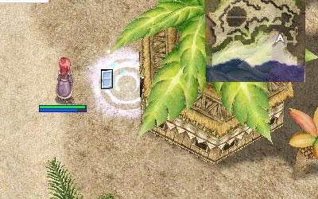

Kokomo Beach (cmd_fild04): 302,177. For those who forget, the password to enter the building: Antonio doesn't enjoy destroying upgrade items.

8. Once inside, talking to he will ask to return to his father to tell him that he will receive help.

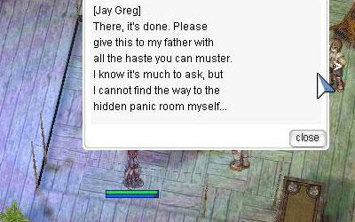

9. His father will then ask to once again visit Thor Greg to receive training for the Close Confine skill. Thor Greg will send the player to a waiting room. The player must enter a chat room and wait for anyone who's in line to finish before him.

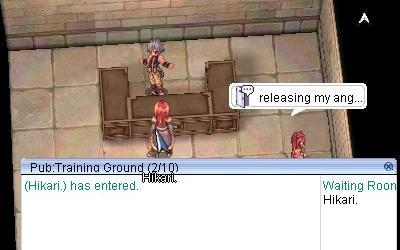

10. Here is where the fun starts. The players have 5 minutes before they are kicked out. Kienna will appear in one second as the room warns, and the player must walk right up 1 cell next to her before she hides, or she will disappear and the player will be sent back to the middle of the room to repeat.

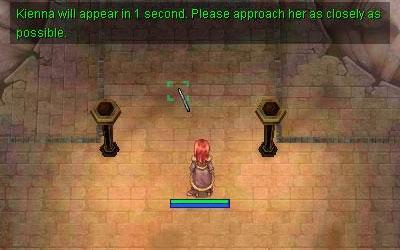

11. Upon successfully walking up to her she will prompt the player. Reminiscent of the battle dwarf of the God Items Quest for level 4 weapons, you must choose the right options: Block her from the left, Block her from the right, or Block her moving backward. Experience says that after a successful block it is wise to choose a different option. To pass the test, the player must perform above grade C+. Upon success she will return the player to Thor Greg. He will tell the player to go back to his father to finish learning the skill.

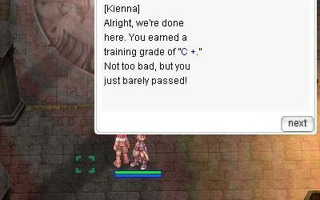

12. Upon returning to Haijara Greg to master the skill, a thief in the shape of a guard steals his book. The player must once again do the test, doing a similar blocking session, far easier, in which it tells you to watch the auras the thief displays and respond by picking the according direction, doing so successfully will get the book back. Once completed, talk to Haijara, and he will give you Close Confine.

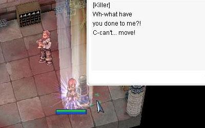

**Related pages:**

* [Rogue](Rogue.md)
* [Stalker](Stalker.md)
* [Skills](Skills.md)
* [Back Stab](Back_Stab.md)
* [Close Confine](Close_Confine.md)
* [Divest Armor](Divest_Armor.md)
* [Divest Helm](Divest_Helm.md)
* [Divest Shield](Divest_Shield.md)
* [Divest Weapon](Divest_Weapon.md)
* [Double Strafe](Double_Strafe.md)
* [Gank](Gank.md)
* [Haggle](Haggle.md)
* [Intimidate](Intimidate.md)
* [Mug](Mug.md)
* [Piece](Piece.md)
* [Remove Trap](Remove_Trap.md)
* [Remover](Remover.md)
* [Scribble](Scribble.md)
* [Sightless Mind](Sightless_Mind.md)
* [Slyness](Slyness.md)
* [Snatch](Snatch.md)
* [Stalk](Stalk.md)
* [Sword Mastery](Sword_Mastery.md)
* [Vulture's Eye](Vulture's_Eye.md)
* [Counter Instinct](Counter_Instinct.md)
* [Full Divestment](Full_Divestment.md)
* [Preserve](Preserve.md)
* [Steal Backpack](Steal_Backpack.md)
* [Stealth](Stealth.md)
* [Quests](Quests.md)
* [Rogue Job Change Guide](Rogue_Job_Change_Guide.md)
* [Rogue Skill Quest](Rogue_Skill_Quest.md)
* [Rebirth Walkthrough](Rebirth_Walkthrough.md)
* [Weapons](Weapons.md)
* [Bow](Bow.md)
* [Dagger](Dagger.md)
* [One Handed Sword](One_Handed_Sword.md)

---
**Categories:** [Quests](categories/Quests.md), [Rogue](categories/Rogue.md), [Skill Quests](categories/Skill_Quests.md)
*Source: [iRO Wiki Classic](https://irowiki.org/classic/Rogue_Skill_Quest) — GFDL 1.3+*
