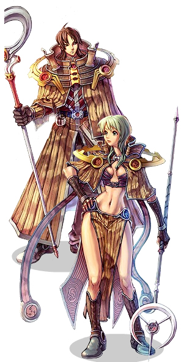

# Sage

<!-- Job info -->
- **Job name:** Sage
- **Job base:** Mage
- **Job type:** 2-2
- **Changes at:** [Juno](Juno.md)
- **Skills:** 20
- **Skill points:** 116
- **Quest skills:** 2
- **STR:** 5
- **AGI:** 5
- **VIT:** 3
- **INT:** 9
- **DEX:** 5
- **LUK:** 3

## Overview

Sages are a PvP-oriented class with the role of caster/anti-[Mage](Mage.md). They do not have the offensive abilities of a [Wizard](Wizard.md), but are a slightly buffed version of Mage with their [Free Cast](Free_Cast.md)ing. Sages shine in their defensive abilities, with many builds centered around [Magnetic Earth](Magnetic_Earth.md). [Dispell](Dispell.md) is also a popular and sought-after spell which is useful for removing buffs from the enemy. Many of their skills can only realistically be used in PvP, making PvM quite difficult, particularly for [VIT](Stats.md)/[DEX](Stats.md) builds that have difficulty solo levelling. Battle sages are a 'for fun' build which can become a powerful leveling build only if matched with a [Soul Linker](Soul_Linker.md) (see [Sage Spirit](Sage_Spirit.md) for more info).

## Jobchange Guide

*See [Sage Job Change Guide](Sage_Job_Change_Guide.md) for detailed information.*

Changing into a Sage from a [Mage](Mage.md) requires the player to complete a number of tasks:
*  Item Collection
*  Written Test
*  Battle Test
*  Thesis Composition

After completing these tests, the player will be transformed into a Sage. This takes place in [Juno](Juno.md).

## Builds

If the player desires more than just a [Magnetic Earth](Magnetic_Earth.md) slave or occasional battle-fun character character, it is advised to choose a PvM build in order reach [Scholar](Scholar.md) as soon as possible. This makes the Sage itself only a stepping stone.

Generally the best two Bolts to max are [Fire Bolt](Fire_Bolt.md) and [Lightning Bolt](Lightening_Bolt.md). The former is pretty much a given and LB is chosen because it is on the opposite side of the elements table. What this means is that having both FB and LB covers all the basic elements with no room for weakness. FB/CB on the other hand is weak to Water, as neither element is effective against it.

The quickest and easiest way to reach level 99 is to go for 99 [Int](Stats.md)/[Dex](Stats.md). Skills generally include [Thunderstorm](Thunderstorm.md) and [Heaven's Drive](Heaven's_Drive.md) for mobbing, max [Dragonology](Dragonology.md), maxing all three Bolt skills and skipping the many PvP skills, such as [Stone Curse](Stone_Curse.md) and [Magnetic Earth](Magnetic_Earth.md). However, this depends on personal preference. Since the introduction of the endgame dungeons, having [Magnetic Earth](Magnetic_Earth.md) will make your sage much more desirable for parties, making the last few levels easier.

## PvM/Endower

*  STR: 1
*  AGI: 9
*  VIT: 10-30
*  INT: 120-130
*  DEX: 110-125
*  LUK: 1

**Skill build:** [Skill Simulator](http://web.hc.keio.ac.jp/~fk061999/himeyasha/skill3/sag.html?10eKaknadxIOagbsrF3eAJy)

This build focuses on high [INT](Stats.md) for decent damage output with the limited spell arsenal. The goal is Lv. 99, might as well try to get there as fast as possible. The character can double as an endow-slave. [WoE](War_of_Emperium.md) is not out of the question but you will not preform as well as a sage specialized to fully support obviously.

## WoE Support

*  STR: 1-20
*  AGI: 1
*  VIT: 50-60
*  INT: 70-90
*  DEX: 125+
*  LUK: 9

**Skill build:** [Skill Simulator](http://web.hc.keio.ac.jp/~fk061999/himeyasha/skill3/sag.html?10qx1fkeKborgaCgArDrA1Jy)

The [Scholar](Scholar.md)-wannabe build. They have high [DEX](Stats.md) for fast casting [Magnetic Earth](Magnetic_Earth.md)s, and moderate [VIT](Stats.md) for durability. But with only marginal [INT](Stats.md), they are very slow to level PvM-wise, and their damage with bolts won't drop anyone.

## Hindsight

*  STR: 1
*  AGI: 99
*  VIT: 1
*  INT: 99
*  DEX: 9
*  LUK: 1

**Skill build:** [Skill Simulator](http://web.hc.keio.ac.jp/~fk061999/himeyasha/skill3/sag.html?10GK1IxeAcBakGAgFaf3Jy)

[Free Cast](Free_Cast.md) and [Hindsight](Hindsight.md) allows this build to melee with books while raining bolts from above on their foes. Despite being a melee build, their main offensive power doesn't come from having [STR](Stats.md), but rather from the high [ASPD](ASPD.md) to trigger the moderate damage bolts. Some even prefer to drop their [STR](Stats.md) to a marginal amount, and wield a Bazerald dagger for the added [MATK](Stats.md) bonus. Coupled with the [Sage Spirit](Sage_Spirit.md) buff of [Soul Linker](Soul_Linker.md)s, leveling them in Ice Dungeon 3 with [Lightning Bolt](Lightening_Bolt.md) is very effective.

## Hybrid aka Battle Sage

*  STR: 30 - 80
*  AGI: 60 - 90
*  VIT: 1 - 60
*  INT: 73 - 110
*  DEX: 35 - 75
*  LUK: 1 - 30 *possible to have a CRITICAL built sage*

**Skill build:** *same as Hindsight*

**Skill build:** [Skill Simulator](http://web.hc.keio.ac.jp/~fk061999/himeyasha/skill3/sag.html?10xudnwNaboodKHcgNdB1eAJy)

This is the Soldier Sage build, usually with a lot of variations. They are strongest at PvM with almost nil equipment, and can even take on PvP and WoE provided they have elitist equipment. This is the one of the few builds where careful planning is needed, lest you will have to resort to character deletion. Physical attacks complement the magical autocasts and precasts, which make it devastating with attack speed. Can still work even though MDEF or DEF is high.

## Hocus-Pocus!!

*  STR: 1
*  AGI: 1
*  VIT: 70
*  INT: 130+
*  DEX: 70
*  LUK: 9

**Skill build:** [Skill Simulator](http://web.hc.keio.ac.jp/~fk061999/himeyasha/skill3/sag.html?10HXakGAdqboeeqPgNkDdGeAJy)

During the early days of the introduction to the Sage class, it was the glory days of the [Hocus-pocus](Hocus-pocus.md) Sages. Sadly the yellow-gem nerf and [Hocus-pocus](Hocus-pocus.md) [Boss](Boss_Protocol.md) nerf meant the end of their era. The build aims at the most [INT](Stats.md) possible for a good regen rate, since casting HP repeatedly can drain the SP considerably. It also doesn't go for maxed [DEX](Stats.md), but focuses more on [VIT](Stats.md) instead to avoid death by random [Hocus-pocus](Hocus-pocus.md) skills.

## Bolting Sage

*  STR: 1
*  AGI: 9
*  VIT: 1
*  INT: 99+
*  DEX: 99+
*  LUK: 1

**Skill build:** [Skill Simulator](http://web.hc.keio.ac.jp/~fk061999/himeyasha/skill3/sag.html?10HXGKGAdoIOdH2s3eAJy)

If you like to level like a [Wizard](Wizard.md) or [Mage](Mage.md), you can use this build to take advantage of your [Mage](Mage.md)'s magical attacks. This build is similar to the basic [Wizard](Wizard.md) build; high INT and DEX, and maxes [Dragonology](Dragonology.md) for the extra +3 INT to make up for the Sage's lower INT job bonus. This build takes advantage of [Fire Wall](Fire_Wall.md), [Heaven's Drive](Heaven's_Drive.md), and [Thunderstorm](Thunderstorm.md) to kill mobs of enemies. [Frost Diver](Frost_Diver.md) and [Lightning Bolt](Lightening_Bolt.md) can be used as a combo to aid in leveling; as it is easy to use due to its ability to quickly disable a single target. Having all three elemental bolts gives you more options for dealing with different enemies, and [Free Cast](Free_Cast.md) can help you avoid sticky situations. It's recommended to stick with Rods that give high Int or Dex (depending on what you prefer). Or if possible, a Principles of Magic may be the best choice.

## Tactics

## PvM

Their [AoE](Area_of_Effect.md)-repertoire is limited to [Fire Ball](Fire_Ball.md), [Fire Wall](Fire_Wall.md), [Heaven's Drive](Heaven's_Drive.md) and [Thunderstorm](Thunderstorm.md). Although a battle build can be enjoyable, partied with a Priest, a pure PvM build yields faster exp rates. Their *endows can be indispensable* for other classes during [PvM](PvM~a1fb2.md)/[MVP](MVP.md), hence many Sages are built for slaving purposes only.

## WoE

*  **Offense**: A sage is excellent in breaking down opponent precasts (such as [Storm Gust](Storm_Gust.md)) using [Magnetic Earth](Magnetic_Earth.md), weakening their forward defense. The second task is to use [Dispell](Dispell.md) to remove buffs from as many opponents as possible, to weaken their counterattack ability. If there is time to spare, it is also helpful to [Stone Curse](Stone_Curse.md) (or [Frost Diver](Frost_Diver.md)) enemies, making it easier to deal with them. In most cases, the sage will want to stick with the other [Priest](Priest.md)s.
*  **Defense**: While attempting to hold a castle, sages are needed mostly to [Dispell](Dispell.md) any enemies who come in. If there are multiple enemies, [Stone Curse](Stone_Curse.md) is applicable to break down their tactics. Generally, Sages do not join precasts, but simply stand back with other support classes for defense. Remember to use [Sight](Sight.md) in case there are any [Assassin](Assassin.md)s or [Rogue](Rogue.md)s sneaking in.

In [WoE](War_of_Emperium.md) the most useful build for a Sage is Support. This involves setting down [Magnetic Earth](Magnetic_Earth.md) as quickly as possible in a precast and [Dispell](Dispell.md)ing foes. [Spell Breaker](Spell_Breaker.md) is a useful skill for preventing casts such as [Storm Gust](Storm_Gust.md) or even if a [Monk](Monk.md) attempts to [Guillotine Fist](Guillotine_Fist.md) (which is quite common, Support Sages are high up on the 'kill-on-sight' list). [Stone Curse](Stone_Curse.md) is used as a form of defensive spell and to divert fire until teammates can come to the player's aid. A support build is of course team-oriented and communication with guild members is a must.

## PvP

* **All**: Always try to [Dispell](Dispell.md) the opponent to remove their buffs, and use [Sight](Sight.md) to prevent ambushes from hidden characters. Use [Frost Diver](Frost_Diver.md) or [Stone Curse](Stone_Curse.md) to disable them.
*  **Melee: [Knight](Knight.md)s, [Crusader](Crusader.md)s, [Blacksmith](Blacksmith.md)s, [Alchemist](Alchemist.md)s, [Assassin](Assassin.md)s, and [Rogue](Rogue.md)s**: Since these classes usually depend on being close to their target, and many having low [MDEF](Stats.md), if a sage is able to kill them before they approach, victory is possible. Against certain (usually low-ASPD) builds, [Safety Wall](Safety_Wall.md) can help. [Fire Wall](Fire_Wall.md), [Frost Diver](Frost_Diver.md), or [Stone Curse](Stone_Curse.md) is helpful to slow them down. To deal with [Hiding](Hiding.md) or [Cloaking](Cloaking.md), use [Sight](Sight.md).
*  **Ranged: [Hunter](Hunter.md)s, [Bard](Bard.md)s, [Dancer](Dancer.md)s, and [Gunslinger](Gunslinger.md)s**: Sages are lacking in long-range defense. Their best bet is to get into casting range and [Frost Diver](Frost_Diver.md) or [Stone Curse](Stone_Curse.md) them on the spot. Equipped with a Phen accessory, it might be possible to counter attack from a distance, but it is difficult to out-damage them. However, this may be the only option if the opponent uses [Arrow Repel](Arrow_Repel.md) or traps.
* **Magical: [Wizard](Wizard.md)s, other [Sage](Sage.md)s, and [Ninja](Ninja.md)s**:  A sage, using [Spell Breaker](Spell_Breaker.md), [Magic Rod](Magic_Rod.md), and [Magnetic Earth](Magnetic_Earth.md), can defend from most forms of magical attack. The major threat would be from quickly cast skills/high [DEX](Stats.md) attacks like [Jupitel Thunder](Jupitel_Thunder.md) or [Freezing Spear](Freezing_Spear.md), which should be countered with [Magic Rod](Magic_Rod.md), followed by freezing the opponent. Against other sages, it is often a matter of who attacks first or faster. It may also be possible to trick them to magic rod their spell break.
* **[Monk](Monk.md)s**: Use [Dispell](Dispell.md) to remove them from their [Fury](Fury.md) status, rendering them unable to [Guillotine Fist](Guillotine_Fist.md). [Safety Wall](Safety_Wall.md) can also be used. Once their SP is drained, it is simple to take a monk out with usual skills.
* **[Priest](Priest.md)s**: Priests usually do not battle with Sages, as chances are neither will be able to kill the other.

## Equipment

## Weapons

## Book

[Book \[3\]](Book.md)
Sage's Diary \[2\]
Ledger of Death \[2\]
Principles of Magic \[2\]
In practice, the 3s book is rarely used. Hindsight sages who do not have access to better weapons more often choose to fight barehanded or use a Bazerald instead. Strictly for Magic Attack, The Principles of Magic sets (Principles of Magic, Pocket Watch, Librarian Glove, Monocle) outperforms other gear combinations on a hindsight sage. Ledger of Death, on the other hand, is a better choice for those who wish to achieve the highest possible attack speed.

## Knife

Fortune Sword
[Grimtooth](Grimtooth.md)
Combat Knife
Dagger of Counter
  [VIT](Stats.md)/[DEX](Stats.md) Sages can use Fortune Swords, Grimtooths, or Combat Knives for defensive purposes.
  Battlesages can use Dagger of Counter for crits.

## Rod

[Rod \[4\]](Rod.md)
[Staff \[3\]](Rod.md)
Survivor's Rod (Dex)
Survivor's Rod (Int)
  [INT](Stats.md)/[DEX](Stats.md) Sages and the majority of [VIT](Stats.md)/[DEX](Stats.md) opt for a Rod of some sort. Dexterous/Vital Rods/Staffs are the most common, although Survivor's Rods have become very popular. In Veins update there is an item called Survivor's Manteau, which grants bonuses if a Survivor's Rod is equipped.

## Headgear

## Top

Mage Hat

  All around useful headgear for mage classes. Gives 2 INT and increases SP by 150.

Apple of Archer

  This makes a good headgear for leveling, and can also be used in PvP. Although it is a fragile headgear (0 [DEF](DEF.md) and no damage reduction) the relatively large [DEX](Stats.md) bonus is a nice compensation.

Drooping Cat

  A [PvP](PvP~d29d2.md)/[WoE](War_of_Emperium.md) headgear that is useful alongside a Poo Poo Hat. It's not recommended to use this for general leveling.

Golden Gear

  A solid headgear which cannot be broken, giving 5 Defense. [VIT](Stats.md)/[DEX](Stats.md) Sages might be fond of this, although Drooping Cats and Poo Poo Hats are most common for [WoE](War_of_Emperium.md).

Feather Beret

  -10% damage from [Demi Human](Demi_Human.md)s makes for an excellent headgear in [PvP and WoE](War_of_Emperium.md). It gives an additional +1 MDEF, +1 DEF, and is upgradeable.

*  Slotted headgear (Dress Hat, Virgo Diadem, Crown of Deceit, Moon Rabbit Hat, etc)
(If the Sage is not [VIT](Stats.md) based then Marduk Card would be useful here, which protects from the [Silence](Status_Effects.md) status.)

## Middle

Sunglasses \[1\]
  *  The mid-headgear for those with lots of money, or lucky enough to own/inherit one from years ago. S.Sunglasses are more likely now to be saved away for MvP cards. If a Sunglasses is Erudite or Peerless though, it can be useful for a Sage.
Takius Blindfold
Robo Eye

*  [DEF](DEF.md) Headgears

Opera Masque
Angel Wing Ears
Evil Wing Ears
Alarm Mask

These headgears are mainly used for the [DEF](DEF.md) they provide. Angel/Evil Wing Ears are a particularly good choice for Battlesages as they give both DEF and [STR](Stats.md), although Masquerade is a possibility as well (only for Battlesages - the +3% does not work in conjunction with Magic). Opera Masques and Alarm Masks also occupy the bottom slot.

## Bottom

*  Gangster Mask
15% resistance to [Silence](Status_Effects.md).

*  Cigarette or Pipe
3% damage from [Insect](Insect.md) race monsters.

*  Evolved Pipe
+1 [VIT](Stats.md) - Kafra Shop Item Only

## Armor

*  Formal Suit
Provides 5 DEF and weigh very little.

*  Mink Coat
Provides 6 DEF but weighs a massive 230, drastically limiting the amount of other items that can be carried.

*  Coat
It doesn't have as much Def as Mink Coat and it's not as light as Formal Suit but an ordinary Coat is a lot cheaper. The weight is quite hefty though. Mantles are a good alternative for making an elemental armor set due to their low price and weight.

*  Silk Robe
Most popular choice for Unfrozen armors given its weight and [MDEF](Stats.md).

## Shield

*  [Guard](Guard.md)/Memory Book
Don't bother with the Mage-class Card combo (Parasite), just go for a racial card. Slotted memory book is very useful for caster sages, it has the same function as a guard with an additional +1 int. Memory Book is also part of the Pocket Watch set.

*  Stone Buckler
Tiny bit more Def than a Guard.. and also offers -5% damage from Large Sized Monsters (Ice Titans / Byalan Monsters).

## Garment

*  Muffler/Heavenly Maiden Robe
Battlesages would be best off with either Whisper or Raydric depending on their flee whilst casters may opt for Raydric and Noxious Cards.

*  Ragamuffin Manteau
Gives a good chunk of MDEF.

## Footgear

*  Shoes
For leveling Eggyra is best given the SP regeneration. Verit work well in WoE, Matyr and Firelock Soldier tend to be aimed more at melee/less SP dependent classes. The new +exp shoes make a good alternative for leveling.

## Accessory

*  Clip
Clips are good for utility cards, for example Creamy, Phen and Vitata. It is almost essential to get these cards, otherwise it will be significantly harder to level. Once the player reaches level 90 alternatively they can be slotted into Gloves/Rosaries for a small boost in stats and to make switching easier.

*  Ancient Glove
Nimble Gloves (Zerom Card) give a large amount of [DEX](Stats.md) which makes a noticable difference to cast timed. Prior to level 90, Zerom/Wormtail Clips are feasible.

*  Ancient Rosary
Rosaries are the common choice for [WoE](War_of_Emperium.md).

*  Ancient Ring/Brooch
Aimed for melee only. Kukre or Mantis Cards can be used, depending upon which accessory is chosen.

*  Nile Rose
A good alternative for Clips. The reason to this is that they take a different hotkey. Cycling between 3 accessories has never been easier with two Clips (Phen and Zerom) and a Nile Rose (Vitata).

*  Owl Baron/Owl Duke Combo
Good choice for Battle Sages, since they can get close to 190 ASPD without accessories, having this combo lets you dish out a bit more damage.

*  Pocket Watch and Librarian Glove
 Used with the Principles of Magic set. Pocket Watch is used with the monocle + memory book set.

## Class Data

## Skills

*See [Mage Skills](Mage.md) for first class skills.*

| Skill | Description | Levels | Type |
| --- | --- | --- | --- |
| [Cast Cancel](Cast_Cancel.md) | Cancel the casting of your skill and regain some of the SP. | 5 | Active |
| [Deluge](Deluge.md) | Use a Yellow Gemstone to create a 7x7 area of water on the ground. | 5 | Active |
| [Dispell](Dispell.md) | Use a Yellow Gemstone to remove all buffs from the target, with several exceptions. | 5 | Active |
| [Dragonology](Dragonology.md) | Increases [INT](Stats.md) up to 3, and increases [ATK](Stats.md) and [MATK](Stats.md) versus Dragon-race enemies. | 5 | Passive |
| [Earth Spike](Earth_Spike.md) | Attack a target for up to 500% [Earth](Earth.md)-element damage. | 5 | Offensive |
| [Endow Blaze](Endow_Blaze.md) | Use a Red Blood to endow a party member's weapon with the [Fire](Fire.md)-element. | 5 | Supportive |
| [Endow Quake](Endow_Quake.md) | Use a Green Live to endow a party member's weapon with the [Earth](Earth.md)-element. | 5 | Supportive |
| [Endow Tornado](Endow_Tornado.md) | Use a Wind of Verdure to endow a party member's weapon with the [Wind](Wind.md)-element. | 5 | Supportive |
| [Endow Tsunami](Endow_Tsunami.md) | Use a Crystal Blue to endow a party member's weapon with the [Water](Water.md)-element. | 5 | Supportive |
| [Free Cast](Free_Cast.md) | Allows you to walk and attack while casting spells. | 10 | Passive |
| [Heaven's Drive](Heaven's_Drive.md) | [Earth](Earth.md)-element [AoE](Area_of_Effect.md) attack dealing up to 500% MATK to targets in a 5*5 area. | 5 | Offensive |
| [Hindsight](Hindsight.md) | Allows the Sage to choose a skill from a short list and autocast that skill when physically attacking. | 10 | Active |
| [Hocus-pocus](Hocus-pocus.md) | Use 2 Yellow Gemstones to invoke a random non-Transcendent skill, or one of a few Hocus Pocus-specific effects. | 10 | Active |
| [Magic Rod](Magic_Rod.md) | Absorb a single-target skill that is targeting you, negating its damage and giving you [SP](SP.md). | 5 | Active |
| [Magnetic Earth](Magnetic_Earth.md) | Use a Blue Gemstone and Yellow Gemstone to create an area that cancels ground-targeting spells. | 5 | Active |
| [Sense](Sense.md) | Reveal basic information about the target monster. | 1 | Active |
| [Spell Breaker](Spell_Breaker.md) | Cancel the skill that the target is currently casting and absorb it as [SP](SP.md). | 5 | Active |
| [Study](Study.md) | Adds +3 [ATK](Stats.md) and +0.5% [ASPD](ASPD.md) per skill level to [Book](Book.md) weapons. | 5 | Passive |
| [Volcano](Volcano.md) | Use a Yellow Gemstone to create a 7x7 area of fire on the ground. | 5 | Active |
| [Whirlwind](Whirlwind.md) | Use a Yellow Gemstone to create a 7x7 area of wind on the ground. | 5 | Active |

## Quest Skills

| Skill | Description | Levels | Type | Job Level Requirement | Quest |
| --- | --- | --- | --- | --- | --- |
| [Create Elemental Converter](Create_Elemental_Converter.md) | Allows the Sage to create Elemental Converters, which can be used for short term endows. | 1 | Active | None | [Create Elemental Converter Quest](Sage_Skill_Quest.md) |
| [Elemental Change](Elemental_Change.md) | Uses an Elemental Converter to permanently change the [Element](Element.md) of a monster. | 1 | Active | 40 | [Elemental Change Quest](Sage_Skill_Quest.md) |

## Soul Link

*See [Sage Spirit](Sage_Spirit.md).*

## Job Bonuses

| Stat\Amount | +1 | +2 | +3 | +4 | +5 | +6 | +7 | +8 | +9 |
| --- | --- | --- | --- | --- | --- | --- | --- | --- | --- |
| STR | 42 | 44 | 46 | 47 | 48 |   |   |   |   |
| AGI | 3 | 6 | 13 | 22 | 33 |   |   |   |   |
| VIT | 4 | 11 | 18 |   |   |   |   |   |   |
| INT | 1 | 8 | 15 | 24 | 30 | 37 | 38 | 45 | 50 |
| DEX | 20 | 25 | 27 | 32 | 39 |   |   |   |   |
| LUK | 17 | 35 | 40 |   |   |   |   |   |   |

## ASPD

Sages can use [Concentration](ASPD_Potion.md) and Awakening Potions.

| Weapon | Base ASPD | ASPD w/ Study Lv.10 | Base Delay | Delay w/ Study Lv.10 |
| --- | --- | --- | --- | --- |
| Unarmed | 155 | 155 | 450 | 450 |
| Dagger | 147.5 | 147.5 | 525 | 525 |
| Book | 145 | 147.5 | 550 | 525 |
| Rod | 137.5 | 137.5 | 625 | 625 |

## External Links

*  [Himeyasha's Skill Simulator](http://web.hc.keio.ac.jp/~fk061999/himeyasha/skill3/sag.html)

**Related pages:**

* [Sage](Sage.md)
* [Scholar](Scholar.md)
* [Skills](Skills.md)
* [Cast Cancel](Cast_Cancel.md)
* [Create Elemental Converter](Create_Elemental_Converter.md)
* [Deluge](Deluge.md)
* [Dispell](Dispell.md)
* [Dragonology](Dragonology.md)
* [Earth Spike](Earth_Spike.md)
* [Elemental Change](Elemental_Change.md)
* [Endow Blaze](Endow_Blaze.md)
* [Endow Tornado](Endow_Tornado.md)
* [Endow Tsunami](Endow_Tsunami.md)
* [Endow Quake](Endow_Quake.md)
* [Free Cast](Free_Cast.md)
* [Heaven's Drive](Heaven's_Drive.md)
* [Hindsight](Hindsight.md)
* [Hocus-pocus](Hocus-pocus.md)
* [Magic Rod](Magic_Rod.md)
* [Magnetic Earth](Magnetic_Earth.md)
* [Sense](Sense.md)
* [Spell Breaker](Spell_Breaker.md)
* [Study](Study.md)
* [Volcano](Volcano.md)
* [Whirlwind](Whirlwind.md)
* [Blinding Mist](Blinding_Mist.md)
* [Double Bolt](Double_Bolt.md)
* [Fiber Lock](Fiber_Lock.md)
* [Foresight](Foresight.md)
* [Indulge](Indulge.md)
* [Mind Breaker](Mind_Breaker.md)
* [Soul Exhale](Soul_Exhale.md)
* [Soul Siphon](Soul_Siphon.md)
* [Quests](Quests.md)
* [Sage Job Change Guide](Sage_Job_Change_Guide.md)
* [Sage Skill Quest](Sage_Skill_Quest.md)
* [Rebirth Walkthrough](Rebirth_Walkthrough.md)
* [Weapons](Weapons.md)
* [Book](Book.md)
* [Rod](Rod.md)

**Related pages:**

* [Classes](Classes.md)
* [Novice](Novice.md)
* [High Novice](High_Novice.md)
* [Super Novice](Super_Novice.md)
* [Acolyte](Acolyte.md)
* [Archer](Archer.md)
* [High First Class](High_First_Class.md)
* [Mage](Mage.md)
* [Merchant](Merchant.md)
* [Swordman](Swordman.md)
* [Thief](Thief.md)
* [Priest](Priest.md)
* [Monk](Monk.md)
* [Hunter](Hunter.md)
* [Bard](Bard.md)
* [Dancer](Dancer.md)
* [Wizard](Wizard.md)
* [Sage](Sage.md)
* [Blacksmith](Blacksmith.md)
* [Alchemist](Alchemist.md)
* [Knight](Knight.md)
* [Crusader](Crusader.md)
* [Assassin](Assassin.md)
* [Rogue](Rogue.md)
* [Transcendent](Transcendent.md)
* [High Priest](High_Priest.md)
* [Champion](Champion.md)
* [Sniper](Sniper.md)
* [Minstrel](Minstrel.md)
* [Gypsy](Gypsy.md)
* [High Wizard](High_Wizard.md)
* [Scholar](Scholar.md)
* [Mastersmith](Mastersmith.md)
* [Biochemist](Biochemist.md)
* [Lord Knight](Lord_Knight.md)
* [Paladin](Paladin.md)
* [Assassin Cross](Assassin_Cross.md)
* [Stalker](Stalker.md)
* [Gunslinger](Gunslinger.md)
* [Ninja](Ninja.md)
* [TaeKwon Kid](TaeKwon_Kid.md)
* [TaeKwon Master](TaeKwon_Master.md)
* [Soul Linker](Soul_Linker.md)

---
**Categories:** [Classes](categories/Classes.md), [Sage](categories/Sage.md)
*Source: [iRO Wiki Classic](https://irowiki.org/classic/Sage) — GFDL 1.3+*
