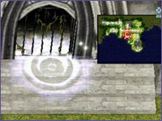
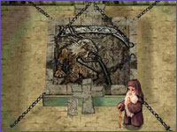
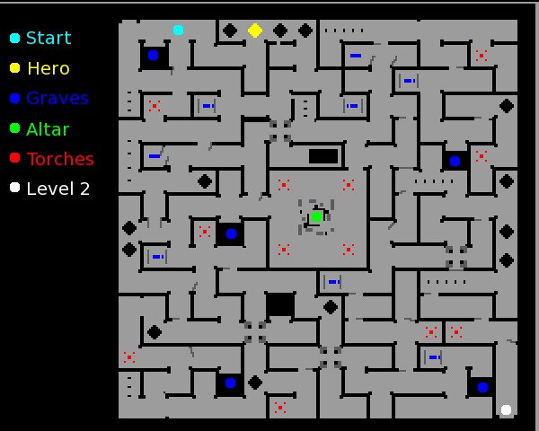

# Sealed Shrine Quest

> **Repeatable** — cooldown: 12 hour

<!-- Quest info -->
- **Level requirement:** 75
- **Party requirement:** 2+ People
- **Quest reward:** Headgear Creation (See [Rewards](Sealed_Shrine_Quest.md))
- **Window:** yes

1. At St. Capitolina Abbey, enter the building at (prt monk 192, 170).  Inside, your [Party](Party.md) leader must speak with Friar Patrick (monk_test 309, 146).

| Column 1 | Column 2 |
| --- | --- |
|  |  |

2. After asking to enter, the [Party](Party.md) must wait for the [Instance](Instance.md) to be created.  The party will have 5 minutes to enter the dungeon, or else the dungeon will be destroyed. If the dungeon is destroyed, the party may request another one immediately. A party may leave the shrine, but they must return to the shrine in 5 minutes. The party will have 2 hours to finish the dungeon. After the [Instance](Instance.md) expires, the party leader and anyone that participated in the party will be unable to create a new instance for 12 hours. (Party members can go with another party leader who can create the dungeon, however.)

* **Note:** A window will appear showing pertinent time limits for the dungeon.  If it is closed, it can be opened again using the shortcut Alt+B.

3. Once inside, the party leader must talk to the Falling Grave [NPC](NPC.md) to begin the quest in the Shrine (141, 221). [Snatch](Snatch.md), [Teleport](Teleport.md)/Fly Wings, [Safety Wall](Safety_Wall.md) and [Assumptio](Assumptio.md) are disabled in the dungeon. [Assumptio](Assumptio.md) Scrolls can be used, however.

* **Dungeon Monsters**
  * 40 Wraith Dead
  * 40 Flame Skull
  * 20 Khalitzburg
  * 40 Skeleton General
  * 30 Evil Druid
  * 30 Wind Ghost
  * 20 Lude
  * 10 Banshee
  * 20 Ancient Mimic
  * 40 Zombie Master

Monsters DO respawn here, and give both Experience and Drops. Experience is also lost upon death on both levels of the dungeon.

4. Talk to the Falling Graves. The correct one will give a pendant. Only the Party Leader can obtain and return the pendant to the Falling Grave (141, 221).

5. Return the Pendant of Spirit to the first Falling Grave. The [[[NPC]] will instruct you to meet him in the center of the Catacomb.

6. Now talk to the Soul of Ancient Hero in the middle of the map. He will require one representative of the party (the party leader) to get 10 Essence of Fires. He will also instruct you to gather Token of Apostle. Only the party leader and anyone who left the dungeon during the quest needs to have a Token of Apostle to progress to the next floor. You will have 1 hour to finish his task.

* Essence of Fire are obtained from Torches.
* Token of Apostle are obtained automatically by killing any monster named *Apostle of Baphomet*. These are tradable among party members, but only the party leader and anyone who left the dungeon during the course of the quest are required to have them in order to progress to the next floor.
*  If the party leader disconnects, respawns, or otherwise leaves the dungeon while collecting Essence of Fire, the Soul of Ancient Hero will no longer correctly recognize the party leader, and the quest cannot be continued.

7. After returning with the items, Soul of Ancient Hero will open the portal to the second floor. The portal can be found at the lower right side of the floor.

8. Once on the second floor, talk to The Main Altar to summon Great Demon Baphomet. Great Demon Baphomet is invulnerable to your attacks.

9. The Soul of Ancient Hero will tell you of seals that will weaken Baphomet. He will instruct you to go to 5 seal locations on the map. The locations are: 2 o'clock, 4 o'clock, 8 o'clock, 10 o'clock and the middle (above The Main Altar). The light blue dots show the locations of the seals.

* **Note: Currently the only Seal working is the one in the middle (above The Main Altar).**
10. Great Demon Baphomet must be brought to the seal and the seal must be activated to weaken Baphomet. Upon activating a seal, your [Party](Party.md) has a few seconds to damage Baphomet. The Soul of Ancient Hero will tell your party which seal to activate next. The party member who activates a seal will be [Stone Curse](Stone_Curse.md)d for approximately 30 seconds. It is during this time that the other party members must attack and damage Baphomet. The party member who activates a seal cannot activate two seals in a row. Thus, a party must have a rotation for members who will activate seals.

* **Warning: If triggered by a player (by standing in an area near the exits to the outer path), mobs of monsters will spawn near them.  At 5 minute intervals, the trigger is reset.  These can make it difficult to drag Baphomet around and should be killed as soon as possible after they spawn.**
  * *Note*: the 5 min timer is independent of the spawn actually being activated. for example, it is possible to active the spawn point at 4 min 59 sec, and then again at 5 min 1 sec, yielding two mobs in the space of 2 seconds

## Rewards

Upon killing Great Demon Baphomet, one can gather items to make the headgear, Baphomet Horns. Required to make the Baphomet Horns are:

1. With a Cursed Baphomet Doll in your inventory, speak with Friar Patrick,

2. Speak with Rust Blackhand (prt monk 261,91) with the following items to make a Giant Majestic Goat.

* 1 Cursed Baphomet Doll
* 1 Magestic Goat
* 30 Crystal of Darkness
* 50 Fragment of Darkness
* 990,000 [Zeny](Zeny.md)

**Related pages:**

* [Instance](Instance.md)
* [Endless Tower](Endless_Tower.md)
* [Nidhoggur's Nest](Nidhoggur's_Nest.md)
* [Orc Memory Dungeon](Orc_Memory_Dungeon.md)
* [Sealed Shrine Quest](Sealed_Shrine_Quest.md)

---
**Categories:** [Instances](categories/Instances.md), [Quest Window Quests](categories/Quest_Window_Quests.md), [Satan Morroc Quests](categories/Satan_Morroc_Quests.md)
*Source: [iRO Wiki Classic](https://irowiki.org/classic/Sealed_Shrine_Quest) — GFDL 1.3+*
