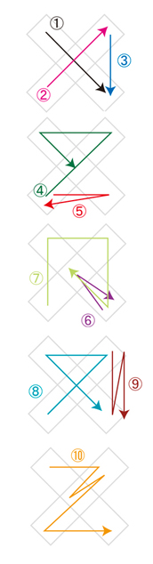
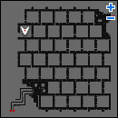
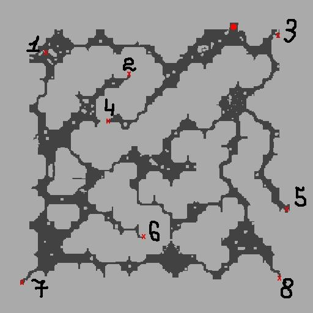

# Sign Quest

<!-- Quest info -->
- **Level requirement:** 50
- **Item requirement:** 100 Fluff, 50 Poison Spore, 30 Scorpion Tail, 20 Rotten Bandage, 15 Little Evil Horn, 10 Empty Test Tube, 2 Yggdrasil Leaf, 10 Green Herb, Various Art Items, 10 Royal Jelly, 20 Honey, 30 Bear's Footskin, 1 Hinalle Leaflet, 1 Ment, 1 Empty Bottle, 5 Mini Furnace, 2 Oridecon Hammer, 1 Golden or Emperium Anvil, 1 Mr. Smile, 10 Worn Out Page, 1 Glasses, 4 Resin, 12 Stone Heart, 375 Coral Reef
- **Items required:** 1 Level 4 Weapon
- **Zeny requirement:** 100,000
- **Quest requirements:** [Umbala Language Quest](Language_Quest.md), [Piano Keys Quest](Piano_Keys_Quest.md), Mr. Smile Assistance
- **Base EXP reward:** 2,000,000 **-OR-** 500,000
- **Item reward:** Lucifer's Lament and The Sign **-OR-** 1 Old Purple Box
- **Quest reward:** Cursed Water Fountain

## Part 1: Crumbs of Sobbing Starlight

1. Read the Announcement on a notice board in one of the cities. All the announcements are the same, so it is only necessary to read one.

*  [Alberta](Alberta.md): (35 241)
*  [Morroc](Morroc.md): (168 265)
*  [Payon](Payon.md): (160 183)
*  [Prontera](Prontera.md): (147 305)
*  [Geffen](Geffen.md): (168 175)
*  [Al De Baran](Al_De_Baran.md): (54 223)

2. Enter a Prontera building (prontera 263 275) and talk to the Archeologist, Metz (prt_in 227 45) about the announcement. Speak to him again, and agree to help him. Once he mentions Arian, travel to Morroc to find said man for the first test.

3. Go inside a Morroc building (morocc 283 173) and talk to the rogue, Arian (morocc_in 115 154) for the first test. He desires the following sets of items (bring only the set he asks for each time and NO other sets, i.e. not 100 Fluff and 50 Poison Spore at the same time. Otherwise, he will take all the quest items and you'll need to recollect):

*  Fluff x 100
*  Poison Spore x 50
*  Scorpion Tail x 30
*  Rotten Bandage x 20
*  Little Evil Horn x 15
*  Coral Reef x 10

4. After Arian has all the items he wanted, speak to the Young Man, Gaanan (morocc_in 114 162) above him. Gaanan will asks 5 questions, to which the answers are:

*  1. Stranded on an island: Fourth option
*  2. Stuck in a collapsed building: Fourth option
*  3. Lost in a dungeon: Third option
*  4. A murder is commited: First option
*  5. The world is going to end: Fourth option (save the world)

After answering correctly, talk to Arian to be rewarded with a Crumb of Sobbing Starlight and 10,000 [EXP](Experience.md). Now journey to Payon to find Daewoon for the second test.

5. Go inside a Payon building (payon 130 204) and talk to Daewoon, three rooms SOUTH WEST of the entrance (payon_in03 11 31). Select any option to "Do you have any idea what that jewel you're holding actually is?" and begin his test. Whether you suceed will depend on how much your answers appeal to him. The best choices are:

*  1. Option #1, **Yes**
*  2. Option #2, **I hate people who do that**
*  3. Option #2, **I can't destroy such beauty...**
*  4. Option #1, **Yes, of course!**
*  5. Option #1, **Yes**

You can take the test again if you failed. If you succeeded, Daewoon then hands over a Crumb of Sobbing Starlight and 10,000 [EXP](Experience.md), bringing the total to two.

Note: For question 3, the option "Close my eyes and attack/smash it" is also accepted.

*  Note: Sir Jore can only be spoken to during 5pm-10pm (Pacific Time) daily. If this time is missed, continue again tomorrow.

6. Enter the lower right Aldebaran building (aldebaran 223 56) and find Sir Jore (aldeba_in 155 101). He asks for the following items after he fails his experiment:

*  Empty Test Tube x 10
*  Yggdrasil Leaf x 2
*  Green Herb x 10

7. After collecting the items, Sir Jore requires information about the Stone of Sage from two famous alchemists. Talk to Piru Piru (aldeba_in 156 118, just north west from Sir Jore) and she'll reveal the location of the two alchemists: the south forest.

8. First, find the daughter Pleur on the second floor of the Hidden Temple (prt_maze02 57 151).

*  If entered the maze from prt_fild01: go up, down, left, right, down, up, left, up, up, left to reach the second floor.
*  If entered the maze from mjolnir_12 (suggested; one south of Aldebaran): go down, down, left, right, down, up, left, up, up, left to reach the second floor.

Once near her, one of two things will happen.

*  You'll be teleported and catch up with both father and daughter alchemists on the same map, thus completing this portion of the quest.
*  You'll become "lost" and be teleported to either (prt_maze01) or (prt_maze03).
   Upon becoming lost, keep finding Pleur until teleported to (prt_maze02).
   However, finding her again from (prt_maze03) is very difficult and time consuming:
   it is faster to just return to a save point and come back to the maze again from either (prt_fild01) or (mjolnir_12).

*  Note: It is possible to use Teleport level 1 or Fly Wings to get to the spot where the father and daughter alchemists are. It may take a while, but can potentially be less stressful than getting "lost".

9. Once caught up with them (prt_maze02 14 183 & 16 183), talk to Gordon and select "Roar~!" Harmless monsters will spawn; speak to him again about the Stone. After that expect to be teleported to one south of Aldebaran (mjolnir_12).

10. Tell Sir Jore what was discovered about the Stone of Sage from Gordon. When he asks what the Stone of Sage is, enter the response [Red Gemstone]. He'll hand over the third Crumb of Sobbing Starlight as well as 10,000 [EXP](Experience.md) and mentions Jesqurienne in Geffen.

11. Inside the top right Geffen building (geffen 168 170) is a female drinker, Jesqurienne (geffen_in 59 74). Tell her you've heard of her, and then call her a **stuck-up chick** to accept her challenge. Talk to her boyfriend Aaron at the same table to begin the challenge. In order to win, more questions must be answered correctly than Jesqurienne. The ten multiple choice questions presented will also be chosen at random. Examples of some questions are:

*  Choose the property that is unrelated to the Mage's Bolt type skills: Earth
*  Choose a monster that is a different type than the others: Penomena
*  Choose the job class that cannot equip Silk Robe: Hunter
*  Choose the weight of an Empty Bottle: 2
*  Choose the monster that doesn't drop a Yggdrasil Leaf: Marduk
*  Choose the defense of an Indian Fillet: 3
*  Choose the defense and stat bonus of a Bunny Band: 2 def, 2 luk
*  Choose the monster that takes extra damage from fire property weapons: Mace Goblin
*  Choose the armor that a novice cannot equip: Wooden Mail
*  Choose the monster that stone curse won't work on: Evil Druid
*  Choose the monster that is of a different size: Marine
*  Choose the item needed to make a gladius: Sapphire
*  Choose the location closest to Juno's weapon upgrade shop: Weapon Shop
*  Choose the NPC not needed for the Blacksmith change quest: Barcardi
*  Fifty-one times fifteen divided by three plus 5: 260
*  Choose the NPC that looks different from the others: Prontera Hollghrenen
*  Choose the item not needed to make condensed whites: Empty Bottle
*  Choose the correct name of the ruler of the Rune-Midgarts Kingdom: Tristram III
*  The city closest to Turtle Island: Alberta
*  Three thousand one hundred two added to five hundred, plus four, divided by six: 601

There will not be much time to look up the answers on other websites. If taking too long to answer, the quiz will be restarted. After beating her, key in **your** character's name to receive a fourth Crumb of Sobbing Starlight.

12. Go inside the Comodo casino (comodo 153 97), and proceed to the second floor (cmd_in02 190 78). Talk to a Strange Guy, Dearles (cmd_in02 88 51). First, he needs: 30,000 zeny. After, he will tell you to come back to him tomorrow.

* Note: Step 13 can only be done between 8 and 10 PM Pacific Standard Time.

13. Return 24 hours later any time between 8 and 10 PM and he'll ask for artsy items. You must collect 11 or more points worth of *different* artsy items in order to continue.

Here are all of the known examples: (w/ point values and npc location listed next to them)

*  Puppet - Doll Merchant (Prontera) - 1pt
*  Poring Doll - Doll Merchant (Prontera) - 1pt
*  Chonchon Doll - Doll Merchant (Prontera) - 1pt
*  Red Frame - Gift Merchant (Prontera) - 1pt
*  Chung Jah - Gift Merchant (Prontera) - 1pt
*  China - Gift Merchant (Prontera) - 1pt
*  Crystal Mirror - Trader (Morrc) - 2pt
*  Spore Doll - 3pt
*  Rocker Doll - 3pt
*  Frozen Rose - 4pt
*  Yoyo Doll - 4pt
*  Raccoon Doll - 4pt
*  Osiris Doll - 7pt
*  Baphomet Doll - 7pt

14. Finally, Dearles proposes a dancing test.

*  Steps:
     up left
     down right
     down left & up right
     down right
     down left & up right & up left & stay center
     down left & down right & down left
     down right & center & down right
     down left & up left & up right & down right & center
     down left & up right & up left & down right
     up right & down right & up right & down right
     up left & up right & center & up right & down left & down right

*  Any movement speed enhancing items/buffs are recommended, but not necessary.
*  You don't have to reach the end of the spot, just touch one of the first lines of the step to make it count. This strategy helps out to successfully finish the test.
*  When a "Hide" spot is seen at the dancing test room, move to it to "Unhide" the spot, indicating a dance move was performed correctly.
*  The last part is tricky: sometimes it's the center sometimes it's down, even if it says center. Be sure to check the "Hide" for the last part.

15. After the dance examiner states the test was passed, talk to Dearles for the fifth Crumb of Sobbing Starlight and 10,000 [EXP](Experience.md).

16. Leave to Alberta to find Bakerlan, the Wealthy looking Merchant. He is located inside a top left Alberta building (alberta 93 203) in the first room upstairs (alberta_in 125 101). He's busy and needs to know where his butler, Refined Steward, Mahatra (alberta_in 114 178) is. Find Mahatra on the first floor. He requires a Stone to be sent to a Crusader in Juno.

17. Go to Juno and find a crusader, Leibech (yuno 330 100). He gives a Receipt in turn for the Stone. Then head back for Mahatra.

18. Mahatra needs you to find his boss, Bakerlan. Bakerlan will say you still need experience and asks you go back to Mahatra and ask for another test! Mahatra gives you a quest to help the Maid, Seylin (alberta_in 154 171) in the second floor corridor. Seylin will ask your help to get Vigorgra as a gift for her brother.

19. Proceed to the Alchemist Guild in Aldebaran (aldebaran 68 56) and find an Alchemist, Melkaba (alde_alche 169 162). He'll create Vigorgra with the following ingredients:

*  Royal Jelly x 10
*  Honey x 20
*  Bear's Footskin x 30
*  Hinalle Leaflet x 1
*  Ment x 1
*  Empty Bottle x 1
*  10,000 Zeny

Note: He does have a chance to fail so you might have to look for these items again.

20. After receiving the Vigorgra, go back to Seylin. She'll need the Vigorgra and a letter send to her brother at Prontera Castle.

21. Go to Prontera Castle and find her brother, Maruin (prt_castle 107 58).

22. After he gets the items, return to Seylin. Then go downstairs and talk to Mahatra. Mahatra will send you up to Bakerlan. Finally Bakerlan say you've passed the test and gives you the sixth Crumb of Sobbing Starlight as well as 10,000 [EXP](Experience.md).

*  Receive 3 Panacea.

23. Return to Metz in Prontera. He will give you the 7th & last Crumb of Sobbing Starlight and 10,000 [EXP](Experience.md). He'll tell you more information about the Crumb of Sobbing Starlights.

## Part 2: The Complete Sobbing Starlight

1. Continue talking to Metz. He tells you that if you can merge all the Crumb of Sobbing Starlights into the Sobbing Starlight, he'll reveal more secrets. But there's only one Blacksmith who has the skill to forge it and no one knows his whereabouts. Metz tells you his family lives in Geffen.

*  Note: You'll need to talk to him few times to activate the second quest.

2. Go to a Geffen building (geffen 138 101) and find a Lonely Looking Woman, Brenda (geffen_in 159 48). You'll need to key in her husband's name [Engel Howard]. She'll tell you they moved to Geffen because it's near her husband's work place. After that, go talk to Cute Girl, Liana (geffen_in 171 42). The cute little girl will ask you to send a Picture Letter to her father.

*  To get the drawing you must select the "..." answer after telling Leiana her dad misses her.

3. Head to the Coal Mines to find her father. Go to second floor of the dungeon and find Engel (mjo_dun02 88 295) by using the hidden path from mjo_dun02 64, 295.

Give the Picture Letter to him and tell him your intentions. He'll ask you to find the required ingredients to forge the Sobbing Starlight.

*  Mini Furnace x 5
*  Oridecon Hammer x 2
*  Golden or Emperium Anvil x 1

*  Note: The higher quality the anvil, the higher chance it'll succeed. Emperium Anvil is the best, but your anvil will not be returned once you give it to him. You get one chance with any anvil of your choice, but if that attempt fails, you will need to return with a Golden or  Emperium Anvil instead.

After you pass over the items he needs, he'll ask you send the a letter to his Wife while waiting for him to complete the forging.

4. Go back to Geffen and pass the letter to his Wife, Brenda. Before you leave make sure to talk to the Cute Girl, Liana for a reward.

*  Receive 10 Candy.

5. Go back to the Coal Mines and talk to Engel. If he failed to forge it, recollect the ingredients and a higher quality anvil instead (Golden or Emperium Anvil only). If it succeeded, you'll get the Sobbing Starlight. Go back Prontera and talk to Metz.

6. When you tell Metz the good news, he's very happy you repaired the Sobbing Starlight. Unfortunately, he can't read the ancient words inside of it, so he sends you to the Magician, Dhota in Geffen.

7. Go to the Geffen Tower (geffen 120 110) and find Angry Man, Dhota (gef_tower 118 36) and the highest floor. Key in the [Sobbing Starlight] and he'll ask you to go to Umbala to get the solution instead.

*  The [Umbala Language Quest](Language_Quest.md) must be completed in order to continue.

8. Go to Umbala and talk to a Native named Laotan (umbala 163, 256) for clue. But he will only exchange the clue for a Mr. Smile.

*  Talk to Miss Smile to make Mr. Smile at Geffen/Prontera/Morroc/Alberta/Etc. Bring it to him.

9. According to the Native, you must go to the Umbala Dungeon and find a building (um_dun01 129 90). When you enter, you find a Strange Looking Man, Shaine (um_in 27 23). After you tell him your intentions he'll ask you to collect 10 Worn Out Pages.

*  Worn Out Page x 10

After bringing him the required items, he hands over an Ancient Document. Return to Prontera for Metz.

## Part 3: The Ancient Document

1. Metz states Frank needs to translate the Ancient Document.

2. Go to Alberta and to find a Fastidious Old Man, Frank (alberta 165, 83). But he seems to talking to himself and mumbles about his eyesight.

*  Go to Alberta's Armor Dealer and buy him a pair of Glasses.

3. Once he receives the Glasses, he'll help translate the Ancient Document. Once he finishes, keep talking to him until he gives you the Translated Ancient Language (2% chance).

4. Now go collect these items and bring them to the Giant Telescope in the West Geffen Field (gef_fild07 178,244).

*  Resin x 4
*  Stone Heart x 12
*  Coral Reef x 365

Move onto one of the chairs (gef_fild07 182 241) there to find an entrance to the Valkyrie Temple.

5. Keep going up to find Valkyrie, Sandra (himinn 48 85). After speaking to her, you receive 350,000 [EXP](Experience.md) and she kicks you out to Geffen.

6. Talk to the Metz again and he'll refer you to Niffleheim.

*  Note: The Witch's [Piano Keys Quest](Piano_Keys_Quest.md) must be completed to continue.

7. When arriving at Nifflheim find a Pleasant-Featured Lady, Serin (niflheim 313 70). She requires help: answer "Sure, go ahead" followed by "Sure, let's do it". The next answer determines how **you** wish to continue the quest.

A. Sure, why not? (Longer quest but receive Serin's Gold Ring as a reward along with some experience)

B. Why should I help them. (Shorter quest)

*  Most NPCs here are DEAD NPCs. So in order to talk to them, walk near them to let them initiate a conversation. To talk back, click on the NPC's head.

## Part 4a: "Sure, why not?"

'''

1. Once "I understand." is selected, track down a Kid, Alakina Anne (niflheim 169 162). She'll cry about wanting to go back home. After talking to her again "About the curse", she'll spew hints.

*  Walk near her and let her speak to you first then start clicking her head.

2. Go next to (don't click on it) the Cursed Spirit, Ashe Bruce (niflheim 350 258). He senses your strength, select the pull and read the 3rd book. You would be prompt to enter a spell, select the following options: Klaatu, Verata and Nictu (hidden 4th option). It takes a few tries of inputting this spell until his curse is finally broken.

*  4th option is tricky, as it's in white.

3. When the curse is successfully broken, the Witch's Spell Book will be received.

4. Go near Anne and she'll ask for help to go back. Choose "How are you going to get home?" and then go find the Witch at the Witch Tower.

5. The Witch is in the highest building (niflheim 254 191) in Nifflheim. Follow the carpet in the Piano room and to enter the Witch's Room. DO NOT CLICK ON, but go stand next to the Witch, Kirkena (nif_in 188 168) (if you click on her you will be teleported back to Umbala) so she begins talking. Give her the Witch's Spell Book and ask "Send a child back".

She'll hand over a Wing Of Crow. The only way to escape from her room is to use a Butterfly Wing, Warp Portal, or click her head and be sent to the Umbala Jump Point.

6. Go near Anne and she'll thank you. Then go near the Anne again and she'll say you lied to her, and she still can't go back.

7. Go back to Kirkena for an explanation. She'll say the Wing Of Crow only can be used by living people, which means Anne is dead.

8. You did your best, so you head back and talk to Serin. Even though you can't help Alakina, she still thanks you. And as she promised, she'll give you her important item, Serin's Gold Ring as reward. Talk to Serin again and she'll ask you to find Greyryu the Poet.

*  Don't equip Serin's Gold Ring during the quest, or it'll be confiscated by certain NPCs!

9. Go inside a Nifflheim building (niflheim 187 241) and you'll find Crayu (nif_in 105 81). Go near Crayu. After answering a few questions he asks you to find Gen.

10. You find a Depressing Man, Gen (niflheim 146 241) just West of the building you enter. Talk to him and you find out he was the chosen one once, but failed, and he cautions you. He advises you to find the Witch for help.

## Part 4b: "Why Should I Help Them?"

1. Once you choose "Why should I help them?," find a Depressing Man, Gen (niflheim 146 241) just West of the building you entered. Talk to him and you find out he was the chosen one once, but failed, and he cautions you. He advises you to find the Witch for help.

2. The Witch is at the highest building (niflheim 254 191) in Nifflheim. Follow the carpet in the Piano room and you'll enter the Witch's Room. Go near the Witch, Kirkena (nif_in 188 168) and she'll auto talk to you first. She'll ask you to find her Witch's Spell Book.

3. Go near the Cursed Spirit, Ash Bruce (niflheim 350 258). He senses your strength, select the pull and read the 3rd book. You would be prompt to enter a spell, select the following options: Klaatu, Verata and Nictu (hidden 4th option).

*  4 is tricky, as it's in white.

4. Go back to the witches castle. Enter the witches room by clicking on the speech bubble next to the portait in the 2nd floor (nif_in 139, 176), return the Witch's Spell Book to Kirkena.

## Part 5: Proving Yourself

1. Go near the Witch, Kirkena and she'll tell you about the dangers of the quest. She also tell you to prove yourself is by bringing her the Symbol of the Nine Realms and asks you to keep it as a secret. Go near her again and she'll ask you to come from the headstone near the stairs on the second floor the next time you visit.

2. Go to Serin. You need to click on her 3 times. She'll tell you thing that the Witch didn't tell you. She also wants you to inform her first-hand once you get the Authority Of Nine World from the Ruler of the Dead and listen to the reasons why she needs these powers.

3. Now go back to the Giant Telescope in West Geffen Field (gef_fild07 182 241) to teleport to Valkyrie Temple (No need to bring any ingredients). Talk to Valkyrie, Sandra and she'll say she can't help you, but she'll give you support mentally.

4. You're on your own now. So you go back Nifflheim to find more clues. You find a Mad Man, Laichin (niflheim 102 54) and he seems to have information you need for the quest! But he needs you to pay him twice, 40,000 Zeny and 20,000 Zeny.

5. Listen carefully to the locations he mentions. The locations are random for each person and there are 4 locations you need to go out of a total of 8. Follow the sequence he mentions.

| Number | Description | Cordinates |
| --- | --- | --- |
| 1 | big 10 o'clock | gl dun02 43 251 |
| 2 | small 11 o'clock | gl dun02 123 230 |
| 3 | big 1 o'clock | gl dun02 263 267 |
| 4 | very small 11 o'clock | gl dun02 118 183 |
| 5 | big 4 o'clock | gl dun02 273 97 |
| 6 | small 6 o'clock | gl dun02 138 72 |
| 7 | big 7 o'clock | gl dun02 19 27 |
| 8 | big 5 o'clock | gl dun02 268 33 |

The locations he mentions are in The Lowest Cave of Glast Heim (gl dun02). Bring a level 4 weapon from before the 10.1 update. [Click here for a list of pre 10.1 level 4 weapons](http://forums.irowiki.org/showpost.php?p=151934&postcount=15). Keep the weapon in your inventory (not equipped).

6. Once there, click on the Mysterious Environment and it'll pop up with 3 types of message.

*  i. The mysterious energy flows out. However, the environment seems to be creepier.
  * Wrong sequence. Find another spot.
*  With the weapon you have currently, it's impossible to break the seal.
  * Wrong weapon.
*  It shakes but there isn't any further response. Maybe it needs a greater impact to be activated.
  * Keep clicking the Mysterious Environment.

7. You'll get the Fragment of Soul once you break the seal. And when you break the fourth seal, you'll get Piece of Spirit. Go back to   Nifflheim and talk to Depressing Man, Gen.

8. Gen will identify himself as a servant to his master, Lady Hell. His master is looking for the Spiritual Whispers and he'll send you to an Unknown Area where his master resides.

9. Head up to the Unknown Area. You'll pass a fountain, but don't click it yet. Curiosity killed the cat. Keep moving upward and you'll find the Queen of the Dead, Lady Hell.

10. Talk to her and she'll give you Symbol of the Nine Realms in exchange for the Whisper of Soul.

*  You can click the fountain now. If you bring Empty Bottles you'll exchange for a Cursed Water each time you click the fountain.

11. Now you have two choices. Either give the Symbol of the Nine Realms to:

A. Witch, Kirkena (requires defeating more monsters, but can bring friends to help)

B. Pleasant-Featured Lady, Serin (requires defeating Incarnation of Dark Lord, aka 1 Dark Illusion, with NO help from friends)

## Part 6a: Kirkena the Witch

1. If you chose the Witch, Kirkena, go find her in her room through the headstone near the stairs on the second floor.

She'll ask for the Symbol of the Nine Realms and explain the reasons she needs it. If you got Serin's Gold Ring earlier, she'll take it but will return it later and you can store the ring in kafra now (before that you couldn't store it). After that she'll give you 1 Witch's Tonic and 5 Witch's Medal.

*  With 5 Witch's Medal, you can bring 4 more partners in your party to assist you in defeating the quest monsters later on. You need to talk to the Witch to enter Serin's room before others can follow. In order for the others to help you fight, they will need to talk to the same gravestone that you do in order to get into the witch's room. They will need to have the seal on them. Do not let the extra partners lose any of the Witch's Medal, they will need to be returned.

Kirkena found the location of Serin. Once you're ready, Kirkena will send you to a copy of nif_fild02 with many monsters on it: Ghouls, Succubus, Wraiths, Injustices, Evil Druids, and Ancient Mummies, which do not give EXP or drop anything. You must fight your way past them to get to the portal on the other side. Enter it, and you'll be in Serin's room. If you have people helping you, they'll be sent to Serin and must talk to her to get to where you are.

2. You'll find Serin at the Unknown Area. Talk to her and chose "Stop her."

3. Serin will summon monsters to attack you. Try not to stand near her when you talk to her.

You'll need to defeat these monsters:

*  1 Dark Illusion
*  2 Ancient Mummy
*  2 Wraith
*  5 Ghoul

4. Once you beat the monsters, Serin will reappear. She'll tell you she's happy that she met you and she'll give up her dream and live peacefully in Nifflheim. Later on she'll send you back to the Witch's room. There is a 10 minute time limit on this battle. Every time you are kicked from the room due to a loss or a time out, there is a chance that you will fail the quest.

5. If you fail, the Nifflheim NPCs will no longer talk to you.  Return to Metz to recieve 500,000 Base Experience and an OPB.

## Part 6b: Serin the Pleasant-Featured Lady

1. If you chose Pleasant-Featured Lady, Serin, go find Serin and pass her the Symbol of the Nine Realms. She'll send you directly to her room.

2. In the room listen to her reasons for using the Symbol of the Nine Realms. With some doubt, you must "Stop her." Serin will then summon 1 Dark Illusion to attack you. There is a 10 minute time limit on this battle. Every time you are kicked from the room due to a loss or a time out, there is a chance that you will fail the quest.

3. Once you beat the Dark Illusion, Serin will reappear. She'll tell you she's happy that she met you and she'll give up her dream and live peacefully in Nifflheim. Later on she'll send you back to the Witch's room.

## Part 7: The Sign

1. Talk to Kirkena and she's happy you stopped Serin. She gives you 300,000 [EXP](Experience.md) as a reward. She also asks you to talk to Lady Hell once more. (if you took the witch path above, you need to have all 5 Witch's Medal in your inventory)

*  Note: Serin (in Nifflehiem town) will give you base exp if you return her ring to her (if you took the path that gave it). This must be done before talking to Lady Hell, otherwise Serin will tell you "....." and /sob.

2. Talk to Depressing Man, Gen to enter to Lady Hell room. When you meet Lady Hell, she won't have much to say to you.

3. Next, go the Valkyrie Temple and talk to Sandra. She's happy that you can complete the quest, and proved your courage to God. She'll give you The Sign as proof that you are God's Chosen One. You'll be able to enter Valhalla with The Sign.

4. Go back to Prontera and pass The Sign to Metz. He's pretty excited when you pass The Sign to him and he is glad you completed the quest. He'll start to study The Sign.

*  Metz takes 3-4 hours to study The Sign. When you pass him The Sign, take note of the time you handed it to him, convert that time into PST/PDT, then round up to the next even hour (2, 4, 6, 8, 10 ,12), then add two hours to that number, you will have a two hour pickup window beginning then.  For example if you hand it to him at 13:20 PST/PDT, you should round up to 14:00 PST/PDT, then come back between 16:00 PST/PDT and 18:00 PST/PDT

5. After taking The Sign, Metz asks you to bring it to Engel Howard (mjo_dun02 88 295) to fix it.

*  Engel takes around 3-4 hours to fix The Sign (into an equippable accessory). When you pass him The Sign, take note of the time you handed it to him, convert that time into PST/PDT, then round up to the next even hour (2, 4, 6, 8, 10 ,12), then add two hours to that number, you will have a two hour pickup window beginning then.  For example if you hand it to him at 13:20 PST/PDT, you should round up to 14:00 PST/PDT, then come back between 16:00 PST/PDT and 18:00 PST/PDT

6. Bring The Sign back to Metz. After he finds out the truth of The Sign, his wish is fulfilled. He will then give you 2,000,000 base EXP.

* It should be noted that the 5% [ATK](Stats.md) that The Sign gives is a boost similar to a racial or elemental card, not a straight ATK boost. (aka, the ATK portion of The Sign will not affect skills like [Soul Destroyer](Soul_Destroyer.md), [High Speed Cart Ram](High_Speed_Cart_Ram.md) or [Grand Cross](Grand_Cross.md))

7. Bring The Sign and Sobbing Starlight to Gen (niflheim 146 241). Gen will warp you to his Master's room. Meet Lady Hell and pass the Sobbing Starlight to her. Then sit back and watch the fireworks display! After the fancy display, Lady Hell will give you Lucifer's Lament. (Lucifer's Lament is transferable, which means you may use it on any character.)

8. Go to the Geffen Fountain and click on it to enter Geffenia. The portal will open temporarily North of the Fountain, and anyone regardless of class, level, or having done the quest may enter it. Be warned however that this map has strong monsters.

## References

---
**Categories:** [Base Experience Reward](categories/Base_Experience_Reward.md), [Einbroch Quests](categories/Einbroch_Quests.md), [Quests](categories/Quests.md)
*Source: [iRO Wiki Classic](https://irowiki.org/classic/Sign_Quest) — GFDL 1.3+*
