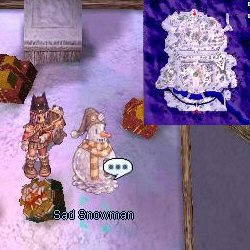
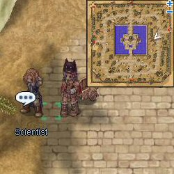
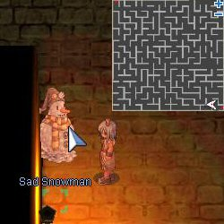
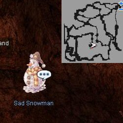
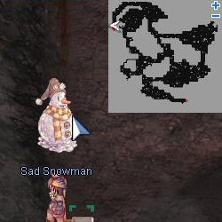

# Snowy Days Event (2008/01/22) ~ (2008/01/29)

> **Note:** Not implemented on iRO Classic.

<!-- Quest info -->
- **Level requirement:** None
- **Item requirement:** Varies
- **Base EXP reward:** Varies
- **Job EXP reward:** Varies

## Quest

1.  Talk to the Sad Snowman atop the roof in [Lutie](Lutie.md) (xmas 255, 167)

1.   

1.  Listen to his story and bring him either a Crystal Blue or a Mystic Frozen (depending on character level). He then asks you to find the scientist in [Morroc](Morroc.md).
1.  Speak to the scientist in [Morroc](Morroc.md) (morroc 255, 183). He needs several items to complete his device. (Item list determined by character level)

1.   

1.  Deliver the items to the scientist and he will begin making the Portable Snowman Machine
  * Receive [Base EXP](Base_EXP_Chart.md) and [Job EXP](Job_EXP_Chart.md)
1.  Speak to the Scientist again to receive the Portable Snowman Machine. Return to the Sad Snowman in [Lutie](Lutie.md).
1.  The Snowman wishes to visit a random Dungeon (based on character level)
1.  Visit Morroc Pyramid (moc_pyrd01 xx, yy), Nogg Road (mag_dun01 136, 76) or Thor Volcano Dungeon (thor_v01 17, 232). (just inside the entrance) The machine breaks during the visit and the Snowman thanks you for fulfilling his wish.

1.     

  * Receive [Base EXP](Base_EXP_Chart.md) and [Job EXP](Job_EXP_Chart.md)
1.  Return to [Morroc](Morroc.md) and speak to the scientist to complete the quest. (No further rewards given, so this step is assumed unnecessary)

## Portable Snowman Machine Materials

| 1 ~ 59 | 60 ~ 89 | 90 ~ 99 |
| --- | --- | --- |
| 30 Animal Skin | 30 Animal Skin | 30 Animal Skin |
| 2 Coal | 2 Coal | 2 Coal |
| 30 Flexible Tube | 30 Lantern | 30 Used Iron Plate |
| 20 Iron | 10 Used Iron Plate | 10 Rusty Screw |
| 1 Crystal Blue | 1 Crystal Blue | 1 Mystic Frozen |

*  Note: The quest requires a total of two Crystal Blue or Mystic Frozen (depending on character level).

## EXP Numbers

| Level | [Base Experience](Base_EXP_Chart.md) | [Job Experience](Job_EXP_Chart.md) |
| --- | --- | --- |
| 1 ~ 59 | 230,000 | 66,000 |
| 60 ~ 89 | 800,000 | 110,000 |
| 90 ~ 99 | 1,000,000 | 300,000 |

---
**Categories:** [Base Experience Reward](categories/Base_Experience_Reward.md), [Job Experience Reward](categories/Job_Experience_Reward.md), [Temporary Event Quests](categories/Temporary_Event_Quests.md)
*Source: [iRO Wiki Classic](https://irowiki.org/classic/Snowy_Days_Event_%282008/01/22%29_~_%282008/01/29%29) — GFDL 1.3+*
