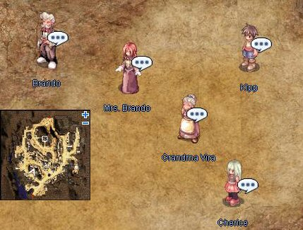

# Spring Event Quest (2008/04/22) ~ (2008/04/29)

> **Note:** Not implemented on iRO Classic.

<!-- Quest info -->
- **Level requirement:** None/Unknown
- **Item requirement:** 3 Coal, 10 Strawberry, 10 Orange, 10 Banana, 5 Mastela Fruit, 30 Feather, 5 Honey, 1 Yam, 30 Carrot, 3 Shoot, 10 Stem, 10 Green Herb
- **Base EXP reward:** 500,000
- **Job EXP reward:** 250,000
- **Item reward:** 1 Honey Herbal Tea, 1 Fruit Mix, 1 Tentacle Cheese Gratin, 1 Fried Sweet Potato, 1 Herb Marinade Beef

1. The Brando family is located in the southwest of Veins at approximately (141, 122).  First, talk to Mr. Brando and agree to help him.

1.   

1. Talk to Grandma Vira. She needs 3 Coal to start a fire.
  * Receive 1 Honey Herbal Tea.
1. Talk to Mrs. Brando. She wants 10 Strawberry, 10 Orange, 10 Banana, and 5 Mastela Fruit.
  * Receive 1 Fruit Mix.
1. Talk to Kipp, and bring him 30 Feather and 5 Honey.
  * Receive 1 Tentacle Cheese Gratin.
1. Talk to Cherice, and bring her 1 Yam and 30 Carrot.
  * Receive 1 Fried Sweet Potato.
1. Talk to Mr. Brando again, and bring him 3 Shoot, 10 Stem, and 10 Green Herb.
  * Receive 1 Herb Marinade Beef.
1. Talk to Grandma Vira again, she thanks you and rewards you with EXP.
  * Receive 100,000 [Base Experience](Base_EXP_Chart.md) and 50,000 [Job Experience](Job_EXP_Chart.md).
1. Talk to Mrs. Brando again, she thanks you and rewards you with EXP.
  * Receive 100,000 [Base Experience](Base_EXP_Chart.md) and 50,000 [Job Experience](Job_EXP_Chart.md).
1. Talk to Kipp again, he thanks you and rewards you with EXP.
  * Receive 100,000 [Base Experience](Base_EXP_Chart.md) and 50,000 [Job Experience](Job_EXP_Chart.md).
1. Talk to Cherice again, she thanks you and rewards you with EXP.
  * Receive 100,000 [Base Experience](Base_EXP_Chart.md) and 50,000 [Job Experience](Job_EXP_Chart.md).
1. Talk to Mr. Brando again, he thanks you and rewards you with EXP.
  * Receive 100,000 [Base Experience](Base_EXP_Chart.md) and 50,000 [Job Experience](Job_EXP_Chart.md).

---
**Categories:** [Base Experience Reward](categories/Base_Experience_Reward.md), [Job Experience Reward](categories/Job_Experience_Reward.md), [Temporary Event Quests](categories/Temporary_Event_Quests.md)
*Source: [iRO Wiki Classic](https://irowiki.org/classic/Spring_Event_Quest_%282008/04/22%29_~_%282008/04/29%29) — GFDL 1.3+*
