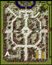

# St. Patrick's Day Event (2010/03/11) ~ (2010/03/25)

> **Note:** Not implemented on iRO Classic.

<!-- Quest info -->
- **Level requirement:** Unknown
- **Hunting:** 250 Bathory, 250 Poison Spore
- **Base EXP reward:** Premium servers: 900,000 Valkyrie server: 600,000
- **Job EXP reward:** Premium servers: 375,000 Valkyrie server: 250,000
- **Item reward:** 5–25 Green Ale
- **Quest reward:** +3 to all stats for 20 minutes
- **Window:** yes

1. Enter the pub in southwest [Prontera](Prontera.md) (prontera 44, 67).

2. Talk with O'Rilley (‘Happy Leprechaun’) and accept his request.

3. Kill 250 Bathories and 250 Poison Spores.

4. Return to the pub and talk with the Drunken Cat, who rewards you with an UP Coin.

5. Move towards the group of snakes outside the pub (prontera 45, 73) and one of them will offer to exchange some Green Ale for the UP Coin.

## Notes

* Bathories are located on basement floor 4 of the [Al De Baran](Al_De_Baran.md) Clock Tower, which a Key of Underground is required to access. The number of bathories has been slightly increased for the duration of the event.
* Hunter Flies have been removed from level 1 of Geffen Dungeon & Poison Spore spawns have been increased for the duration of this event.
* O'Riley will offer to warp you to the Clock Tower basement at no cost, once, if you have completed the quest once prior by using a Key of Underground.
* The UP Coin has no other use outside of this quest.

---
**Categories:** [Base Experience Reward](categories/Base_Experience_Reward.md), [Job Experience Reward](categories/Job_Experience_Reward.md), [Quest Window Quests](categories/Quest_Window_Quests.md), [Temporary Event Quests](categories/Temporary_Event_Quests.md)
*Source: [iRO Wiki Classic](https://irowiki.org/classic/St._Patrick%27s_Day_Event_%282010/03/11%29_~_%282010/03/25%29) — GFDL 1.3+*
