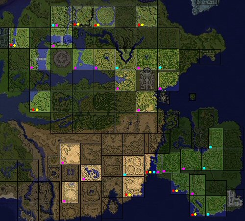

# St. Patrick's Day Event Quest (2008/03/11) ~ (2008/03/18)

> **Note:** Not implemented on iRO Classic.

<!-- Quest info -->
- **Level requirement:** None/Unknown
- **Item requirement:** 200 Firecracker
- **Base EXP reward:** 200,000
- **Job EXP reward:** 70,000
- **Item reward:** Green Ale for Coins

## The Lost Gold

1.  Speak to Anxious Leprechaun (O'Riley the Leprechaun) at (prt_fild05 170, 286). He hid his gold so the snakes couldn't find it this year. However, he can't open his hiding place, he needs you to fetch 200 Firecracker to blast it open.
  * Note: Firecracker can be purchased in sets of 5 for 500z inside the Party Supplies Shop in [Hugel](Hugel.md) (91, 104).
1.  Take the Firecrackers to (mjolnir_01 271, 363).  In order for the quest to proceed properly, the player must walk by this spot and follow the message prompts that pop up.  Doing this successfully consumes all 200 Firecrackers, causes the Lord of Vermillion skill animation, and you will gain the item Treasure Box. Return to O'Riley with the Treasure Box.
  * Note: If you are over 50% weight you will not be able to get the Treasure Box.
1.  After returning the Treasure Box to O'Riley, he asks you to rest, then speak to him again.
  * Gain 200,000 Base & 70,000 Job Exp
1.  He asks you to retrieve his kinsmen's coins from the filthy snakes, he will gladly exchange his magical brew for coins.
  * 1 Green Ale for 1 Gold Coin or 5 Silver Coins or 10 Bronze Coins
  * Note: Players can only get a maximum of 20 Green Ale at a time from O'Riley when exchanging coins.

## Snakes locations

| **Map Name** | **Snakes** | **Snakes** | **Snakes** | **Snakes** | Map |
| --- | --- | --- | --- | --- | --- |
| gef fild00 | Boa | Boa | Boa | Boa |  |
| gef fild04 | Boa | Boa | Boa | Boa |  |
| gef fild06 | Side Winder | Side Winder | Isis | Isis |  |
| gef fild07 | Boa | Boa | Boa | Boa |  |
| gef fild14 | Side Winder | Side Winder | Isis | Isis |  |
| mjolnir 01 | Boa | Boa | Anacondaq | Anacondaq |  |
| mjolnir 02 | Side Winder | Side Winder | Isis | Isis |  |
| mjolnir 03 | Side Winder | Side Winder | Isis | Isis |  |
| mjolnir 05 | Side Winder | Side Winder | Isis | Isis |  |
| mjolnir 09 | Anacondaq | Anacondaq | Anacondaq | Anacondaq |  |
| moc fild07 | Boa | Boa | Boa | Boa |  |
| moc fild08 | Anacondaq | Anacondaq | Anacondaq | Anacondaq |  |
| moc fild10 | Boa | Boa | Boa | Boa |  |
| moc fild12 | Boa | Boa | Boa | Boa |  |
| moc fild13 | Boa | Anacondaq | Side Winder | Isis |  |
| moc fild14 | Side Winder | Side Winder | Isis | Isis |  |
| pay fild01 | Boa | Boa | Boa | Boa |  |
| pay fild02 | Boa | Boa | Boa | Boa |  |
| pay fild03 | Boa | Boa | Boa | Boa |  |
| pay fild05 | Side Winder | Side Winder | Isis | Isis |  |
| pay fild06 | Anacondaq | Anacondaq | Anacondaq | Anacondaq |  |
| pay fild07 | Anacondaq | Anacondaq | Anacondaq | Anacondaq |  |
| pay fild08 | Anacondaq | Anacondaq | Anacondaq | Anacondaq |  |
| pay fild11 | Side Winder | Side Winder | Isis | Isis |  |
| prt fild00 | Boa | Boa | Boa | Boa |  |
| prt fild01 | Boa | Boa | Boa | Boa |  |
| prt fild02 | Anacondaq | Anacondaq | Anacondaq | Anacondaq |  |
| prt fild05 | Boa | Boa | Boa | Boa |  |
| prt fild06 | Boa | Boa | Boa | Boa |  |
| prt fild08 | Boa | Boa | Boa | Boa |  |

---
**Categories:** [Base Experience Reward](categories/Base_Experience_Reward.md), [Job Experience Reward](categories/Job_Experience_Reward.md), [Temporary Event Quests](categories/Temporary_Event_Quests.md)
*Source: [iRO Wiki Classic](https://irowiki.org/classic/St._Patrick%27s_Day_Event_Quest_%282008/03/11%29_~_%282008/03/18%29) — GFDL 1.3+*
