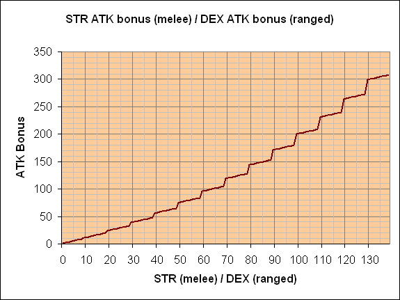
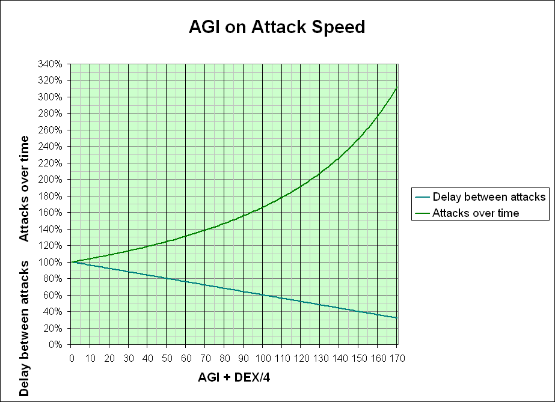
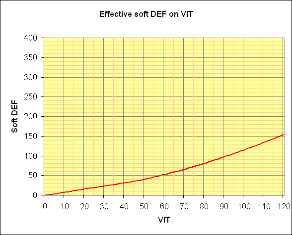
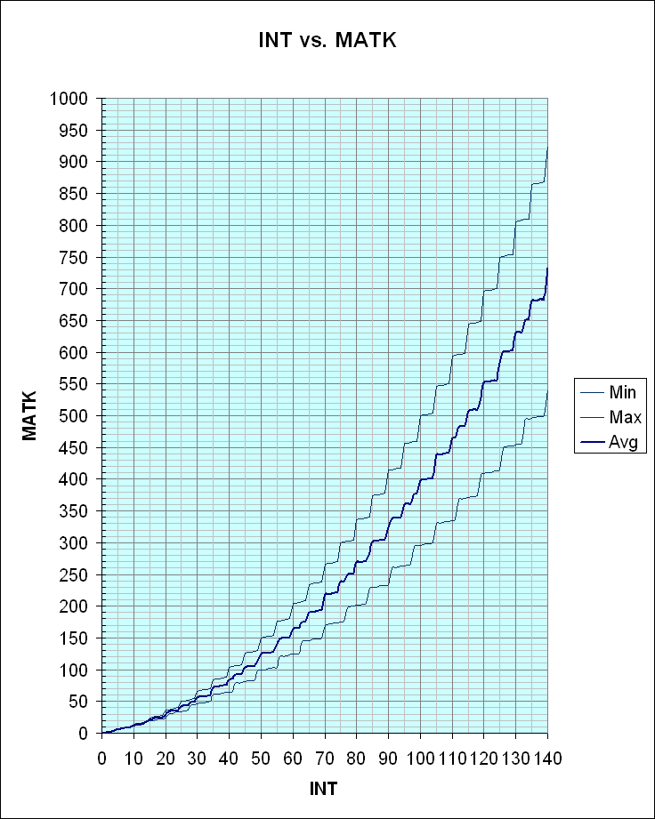
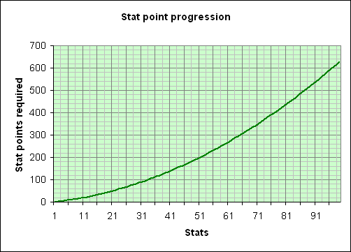

# Stats

## Primary Stats

Stats are the six fundamental character statistics that make (or break) a character. Stats start out with a base value of 1 and can be raised as far as 99. With bonuses, the effective value can pass 100. Base stats are increased by spending stat points, higher stats costing more to raise. Stat points are gained with base level increases, the amount increasing with higher levels.

## STR

Strength: This stat directly increases your physical damage (except using Guns, Instruments, Whips, and Bows), allowing you to deal damage even if you don't equip any weapons if you invest a sufficient amount of STR.

Every 1 STR provides:
* Attack minimum and maximum damage +1
  * Every 10 total STR provides additional damage bonus (see table below)
* Weight Limit +30
* Every 5 STR: Ranged attacks damage +1

**STR bonus damage on melee attacks**

| STR | 10 | 20 | 30 | 40 | 50 | 60 | 70 | 80 | 90 | 100 | 110 | 120 | 130 | 140 | Each additional 10 STR |
| --- | --- | --- | --- | --- | --- | --- | --- | --- | --- | --- | --- | --- | --- | --- | --- |
| Bonus damage at this increment | 1 | 3 | 5 | 7 | 9 | 11 | 13 | 15 | 17 | 19 | 21 | 23 | 25 | 27 | STR / 10] * 2 - 1 |
| Total bonus damage | 1 | 4 | 9 | 16 | 25 | 36 | 49 | 64 | 81 | 100 | 121 | 144 | 169 | 196 | [STR / 10]^2 |
| Total damage from STR | 11 | 24 | 39 | 56 | 75 | 96 | 119 | 144 | 171 | 200 | 231 | 264 | 299 | 336 | STR + [STR / 10]^2 |

STR specific:

* [ATK](Stats.md)
* [Weight Limit](Weight_Limit.md) (base stat only)

## AGI

Agility: Used to increase your attack speed and chance of dodging.

Every 1 AGI provides:
* Flee (chance to dodge enemy attacks) +1
* ASPD increase -0.4% base time between attacks

The actual ASPD calculation depends on AGI, DEX, ASPD potions and skills, the type of weapon you are using, and your job. It can take between 4 and 10 AGI to increase ASPD by 1. More details can be found in the entry for ASPD discussion.

AGI specific:

* [ASPD](ASPD.md)
* [Flee](Stats.md)
* **Does not** affect [Cast Time](Skills.md) or [Cast Delay](Skills.md)
* **Does not** affect [Movement Speed](Movement_Speed.md)

## VIT

Vitality: Each point of VIT provides the following:
* Maximum HP +1%
* approximately 0.8 VIT-based DEF (50 VIT or less, slightly higher with more VIT)
* Resistance vs. the following [Status Effects](Status_Effects.md):
  * Bleeding: -1% chance from being inflicted, decreases duration (exact value unknown)
  * Curse: dereases duration (exact value unknown)
  * Poison: -1% chance from being inflicted, decreases duration (exact value unknown)
  * Silence: -1% chance from being inflicted, -1% duration
  * Stun: -1% chance from being inflicted, -1% duration
* Effectiveness from healing items +2%
* Every 2 VIT: Soft MDEF +1 (?)
* Every 5 VIT: HP regeneration rate +1

The VIT-based DEF is not particularly useful at late levels (due to calculation being Final Damage = (Initial damage - Armor-based DEF (%) - Any cards that provide damage reduction or resistance - Any other reduction effects) - VIT-based DEF (pure value), but it still doesn't negate the fact it grants you much higher HP and great efficiency from healing items.

* The calculation to see actual HP increased with every 1 VIT is: Total HP = [Base HP * (VIT * 0.01)]
* The calculation to see actual HP regenerated naturally with every 5 VIT is: Total HP Natural Regeneration Rate = [Max HP / 200] + [VIT / 5]
* The calculation to see actual HP healed by healing item: Total Healing = Base Item Healing Rate + [Base Item Healing Rate * (VIT * 0.02)]. *For more information on the subject, see [Restoration Items](Restoration_Items.md).*

VIT specific:

* [Max HP](Max_HP.md)
* [HP Recovery](HP_Recovery.md)
* [DEF](DEF.md)
* [mDEF](Stats.md)
* [Healing Items](Healing_Items.md)
* [Status Effects](Status_Effects.md)

## INT

Intelligence: Primary stat for spellcasters, and this is used to increase their MATK and MDEF. Every 1 INT provides the following:
* Increase of MATK (See chart below)
  * Bonus to minimum MATK every 7 INT
  * Bonus to maximum MATK every 5 INT
* INT-based MDEF +1 (approximately)
* Maximum SP +1%.
* SP restoration items effectiveness +1%
* Every 6 INT: natural SP regeneration +1
* [Alchemist](Alchemist.md)s: brewing success rate +0.05% (half the benefits of DEX of LUK)
* Resistance vs. the following Status Effects:
  * [Blind](Status_Effects.md): -2/3% chance from being inflicted, -1/15 second duration
  * [Sleep](Status_Effects.md): -1% chance from being inflicted
  * [Chaos](Status_Effects.md): -2/3% chance from being inflicted

MATK chart:

| Total INT | Min | Max |
| --- | --- | --- |
| 1 | 1 | 1 |
| 2 | 2 | 2 |
| 3 | 3 | 3 |
| 4 | 4 | 4 |
| 5 | 5 | **6** |
| 6 | 6 | 7 |
| 7 | **8** | 8 |
| 8 | 9 | 9 |
| 9 | 10 | 10 |
| 10 | 11 | **14** |
| 11 | 12 | 15 |
| 12 | 13 | 16 |
| 13 | 14 | 17 |
| 14 | **18** | 18 |
| 15 | 19 | **24** |
| 16 | 20 | 25 |
| 17 | 21 | 26 |
| 18 | 22 | 27 |
| 19 | 23 | 28 |
| 20 | 24 | **36** |
| 21 | **30** | 37 |
| 22 | 31 | 38 |
| 23 | 32 | 39 |
| 24 | 33 | 40 |
| 25 | 34 | **50** |

| Total INT | Min | Max |
| --- | --- | --- |
| 26 | 35 | 51 |
| 27 | 36 | 52 |
| 28 | **44** | 53 |
| 29 | 45 | 54 |
| 30 | 46 | **66** |
| 31 | 47 | 67 |
| 32 | 48 | 68 |
| 33 | 49 | 69 |
| 34 | 50 | 70 |
| 35 | **60** | **84** |
| 36 | 61 | 85 |
| 37 | 62 | 86 |
| 38 | 63 | 87 |
| 39 | 64 | 88 |
| 40 | 65 | **104** |
| 41 | 66 | 105 |
| 42 | **78** | 106 |
| 43 | 79 | 107 |
| 44 | 80 | 108 |
| 45 | 81 | **126** |
| 46 | 82 | 127 |
| 47 | 83 | 128 |
| 48 | 84 | 129 |
| 49 | **98** | 130 |
| 50 | 99 | **150** |

| Total INT | Min | Max |
| --- | --- | --- |
| 51 | 100 | 151 |
| 52 | 101 | 152 |
| 53 | 102 | 153 |
| 54 | 103 | 154 |
| 55 | 104 | **176** |
| 56 | **120** | 177 |
| 57 | 121 | 178 |
| 58 | 122 | 179 |
| 59 | 123 | 180 |
| 60 | 124 | **204** |
| 61 | 125 | 205 |
| 62 | 126 | 206 |
| 63 | **144** | 207 |
| 64 | 145 | 208 |
| 65 | 146 | **234** |
| 66 | 147 | 235 |
| 67 | 148 | 236 |
| 68 | 149 | 237 |
| 69 | 150 | 238 |
| 70 | **170** | **266** |
| 71 | 171 | 267 |
| 72 | 172 | 268 |
| 73 | 173 | 269 |
| 74 | 174 | 270 |
| 75 | 175 | **300** |

| Total INT | Min | Max |
| --- | --- | --- |
| 76 | 176 | 301 |
| 77 | **198** | 302 |
| 78 | 199 | 303 |
| 79 | 200 | 304 |
| 80 | 201 | **336** |
| 81 | 202 | 337 |
| 82 | 203 | 338 |
| 83 | 204 | 339 |
| 84 | **228** | 340 |
| 85 | 229 | **374** |
| 86 | 230 | 375 |
| 87 | 231 | 376 |
| 88 | 232 | 377 |
| 89 | 233 | 378 |
| 90 | 234 | **414** |
| 91 | **260** | 415 |
| 92 | 261 | 416 |
| 93 | 262 | 417 |
| 94 | 263 | 418 |
| 95 | 264 | **456** |
| 96 | 265 | 457 |
| 97 | 266 | 458 |
| 98 | **294** | 459 |
| 99 | 295 | 460 |
| 100 | 296 | **500** |

| Total INT | Min | Max |
| --- | --- | --- |
| 101 | 297 | 501 |
| 102 | 298 | 502 |
| 103 | 299 | 503 |
| 104 | 300 | 504 |
| 105 | **330** | **546** |
| 106 | 331 | 547 |
| 107 | 332 | 548 |
| 108 | 333 | 549 |
| 109 | 334 | 550 |
| 110 | 335 | **594** |
| 111 | 336 | 595 |
| 112 | **368** | 596 |
| 113 | 369 | 597 |
| 114 | 370 | 598 |
| 115 | 371 | **644** |
| 116 | 372 | 645 |
| 117 | 373 | 646 |
| 118 | 374 | 647 |
| 119 | **408** | 648 |
| 120 | 409 | **696** |
| 121 | 410 | 697 |
| 122 | 411 | 698 |
| 123 | 412 | 699 |
| 124 | 413 | 700 |
| 125 | 414 | **750** |

| Total INT | Min | Max |
| --- | --- | --- |
| 126 | **450** | 751 |
| 127 | 451 | 752 |
| 128 | 452 | 753 |
| 129 | 453 | 754 |
| 130 | 454 | **806** |
| 131 | 455 | 807 |
| 132 | 456 | 808 |
| 133 | **494** | 809 |
| 134 | 495 | 810 |
| 135 | 496 | **864** |
| 136 | 497 | 865 |
| 137 | 498 | 866 |
| 138 | 499 | 867 |
| 139 | 500 | 868 |
| 140 | **540** | **924** |
| 141 | 541 | 925 |
| 142 | 542 | 926 |
| 143 | 543 | 927 |
| 144 | 544 | 928 |
| 145 | 545 | **986** |
| 146 | 546 | 987 |
| 147 | **588** | 988 |
| 148 | 589 | 989 |
| 149 | 590 | 990 |
| 150 | 591 | **1050** |

Every 100 SP will provide 1 more SP regenerated during natural regeneration state. You gain 1 INT-based MDEF for every 1 INT you increase. INT-based MDEF is taken into account after all other factors such as cards, your item-based MDEF, and such has been calculated first.

* The calculation to see actual SP increased with every 1 INT is: Total SP = Base SP + [Base SP * (INT * 0.01)]
* The calculation to see actual SP regenerated naturally with every 6 INT is: Total SP Natural Regeneration Rate = [Max SP / 100] + [INT / 6] + 1
* The calculation to see actual SP healed by healing item: Total Healing = Base Item Healing Rate + [Base Item Healing Rate * (INT * 0.01)]
* The calculation to see actual MATK rate: Min MATK = (INT + [INT / 7]^2) ~ Max MATK = (INT + [INT / 5]^2)

INT specific:

* [Max SP](Max_SP.md)
* [SP Recovery](SP_Recovery.md)
* [mATK](Stats.md)
* [mDEF](Stats.md)
* [SP Recovery Items](categories/Consumable_Items.md)
* [Status Effects](Status_Effects.md)

## DEX

Dexterity: Decides your accuracy with your weapons. It also increases your ASPD (but requires more stats than AGI to increase ASPD by 1), as well as decreasing cast time of your spells. It also reduces the min-max damage rate, allowing you to do better average damage output, eventually almost always only doing top-end damage should you invest in DEX highly. As noted in STR description, bow, gun, whip and instrument users do not increase their damage through STR; they do it through DEX. DEX also has a close relationship with success rates with creation abilities such as weapon forging as a [Blacksmith](Blacksmith.md) class or making a potion as an [Alchemist](Alchemist.md) class. Also, success rate of ability Steal ([Thief](Thief.md)'s ability) depends on your DEX.

Every 1 DEX provides the following:
* Increased damage of bows, guns, whip and instrument attacks
  * +1 minimum and maximum damage, additional bonus at every increments of 10 DEX (see table below)
* Hit (chance to land hit on enemy) +1
* Cast time -1/150 (150 DEX = instant cast)
* [Thief](Thief.md)s: [Steal](Steal.md) success rate +0.01x
* [Rogue](Rogue.md)s: divesting success rate +0.2%
* [Blacksmith](Blacksmith.md)s: forging success rate +0.1%
* [Alchemist](Alchemist.md)s: brewing success rate +0.1%
* [Cooking](Cooking.md) success rate +0.2%
* Increases minimum damage of attacks
  * Level 1 weapons: minimum damage +1
  * Level 2 weapons: minimum damage +1.2
  * Level 3 weapons: minimum damage +1.4
  * Level 4 weapons: minimum damage +1.6
* Slightly ASPD increase -0.1% base time between attacks (more information in ASPD discussion)
* Every 5 DEX: melee damage +1

**DEX bonus damage for bows, guns, whips and instruments'''**

| DEX | 10 | 20 | 30 | 40 | 50 | 60 | 70 | 80 | 90 | 100 | 110 | 120 | 130 | 140 | Each additional 10 DEX |
| --- | --- | --- | --- | --- | --- | --- | --- | --- | --- | --- | --- | --- | --- | --- | --- |
| Bonus damage at this increment | 1 | 3 | 5 | 7 | 9 | 11 | 13 | 15 | 17 | 19 | 21 | 23 | 25 | 27 | DEX / 10] * 2 - 1 |
| Total bonus damage | 1 | 4 | 9 | 16 | 25 | 36 | 49 | 64 | 81 | 100 | 121 | 144 | 169 | 196 | [DEX / 10]^2 |
| Total damage from DEX | 11 | 24 | 39 | 56 | 75 | 96 | 119 | 144 | 171 | 200 | 231 | 264 | 299 | 336 | DEX + [DEX / 10]^2 |

DEX specific:

* [ASPD](ASPD.md)
* [Hit](Stats.md)
* [Cast Time](Skills.md)
* [ATK](Stats.md)

## LUK

Luck: Each 1 LUK provides the following:
* Critical rate (DEF ignoring attack) +0.3%,
* Perfect dodge +0.1%
* [Blacksmith](Blacksmith.md)s: forging success rate +0.1%
* [Alchemist](Alchemist.md)s: brewing success rate +0.1%
* [Hunter](Hunter.md)s: each 3 points increases in 1% the chance of Auto-Blitz Beat be triggered, requires a Falcon and the skill Blitz Beat
* [Cooking](Cooking.md) success rate +0.1%
* Every 5 LUK: reduces enemy's chance of landing critical attack by 1%
* Every 5 LUK: ATK +1
* Resistance to some status effects
  * Blind: slightly decreases chance from being inflicted
  * Curse: -1% chance from being inflicted
  * Frozen: slightly decreases from being inflicted
  * Poison: slightly decreases chance from being inflicted (exact value unknown)
  * Silence: slightly decreases from being inflicted
  * Sleep: slightly decreases from being inflicted
  * Stone Curse: slightly decreases chance from being inflicted
  * Stun: slightly decreases chance from being inflicted, -0.01 seconds duration

LUK does **not** effect ingame drop rates, or chances to get a rarer item when killing. Its simply based on in-game percents not LUK as a stat.

* The calculation to see actual CRIT rate: CRIT = [LUK * 0.3] + 1

LUK Specific:

* [Critical](Stats.md)
* [ATK](Stats.md)
* [Perfect Dodge](Perfect_Dodge.md)
* [Status Effects](Status_Effects.md)
* **Does not** affect drop rate

## Leveling Up

* Going from level x to x+1 gives ROUNDDOWN( x / 5 ) + 3 stat points. ( ex. from level 94 to 95 is ROUNDDOWN( 94 / 5 ) + 3 = 21 status points gained )
* Going from level 1 to 99 gives a total of 1225 stat points.
* Stats increased during character creation are worth another 48 points, for a total of 1273 stat points.
* A newly rebirthed (or transcended) Novice has 100 stat points to invest at level 1, unlike normal Novices who has only 48 points to invest in stats. Other than this difference, stat points gathered as transcended classes are same as their non-transcended counterpart.

**Stat Points Gained Per Level**

| Level Range | 1-4 | 5-9 | 10-14 | 15-19 | 20-24 | 25-29 | 30-34 | 35-39 | 40-44 | 45-49 | 50-54 | 55-59 | 60-64 | 65-69 | 70-74 | 75-79 | 80-84 | 85-89 | 90-94 | 95-98 |
| --- | --- | --- | --- | --- | --- | --- | --- | --- | --- | --- | --- | --- | --- | --- | --- | --- | --- | --- | --- | --- |
| Points Gained | 3 | 4 | 5 | 6 | 7 | 8 | 9 | 10 | 11 | 12 | 13 | 14 | 15 | 16 | 17 | 18 | 19 | 20 | 21 | 22 |

## Raising stats

* Raising a stat from x to x+1 costs [(x-1) / 10] + 2 points.
* Raising a stat from 1 to 99 costs a total of 628 stat points.

**Stat Increase Cost**

| Level Range | 1-11 | 12-21 | 22-31 | 32-41 | 42-51 | 52-61 | 62-71 | 72-81 | 82-91 | 92-99 |
| --- | --- | --- | --- | --- | --- | --- | --- | --- | --- | --- |
| Increase Cost | 2 | 3 | 4 | 5 | 6 | 7 | 8 | 9 | 10 | 11 |

## Substats

There are also secondary stats which are determined by stats you have (along with gears and abilities).

## ATK

Attack: Your physical-oriented attack rating for both ranged and melee weapons. It is listed as A + B in the stat window, where A is Weapon DMG + STR / DEX / LUK, and B is the damage gained from weapon refinement upgrades. Barring elemental issues, even if your main damage is negated completely, you'll always do the damage bonus granted by weapon refinement upgrades.

## MATK

Magic Attack: Your magical-oriented attack rating. Using the number here, you can guess approximate amount of damage you will do with your magical ability. You should be wary of enemy elemental state, as using wrong elemental spell will cause you to do low amount of damage. The Maximum MATK grows by Int+(Int/5)^2. The Minimum MATK grows by Int+(Int/7)^2. But aware you have to round down the number resulting from Int/5 and Int/7 In example 33 Int means Maximum MATK is 33+(6,6)^2 and has to be Round down to 33+6^2 and Minimum MATK 33+4,71^2 rounds down to 33+4^2 resulting in 69 Maximum MATK and 49 Minimum MATK.

(Note: "," = "." for US decimals.)

See [MATK chart](Stats.md) for a table of MATK at each level of INT.

## DEF

*See [DEF](DEF.md) for more detail.*

Defense: Your defense rating against physical damage. It is shown as A + B in the stat window, where A is item-based DEF rate, and B is VIT-based DEF rate. The item-based DEF rate cuts damage by %, whereas VIT-based DEF rate is pure reduction with that number. Be aware that the status window does not accurately represent the DEF added by upgraded items. Each + on an upgraded item is shown in the status window as 1 item-based DEF, however damage is calculated with each + providing only 70% of 1 DEF (so 0.7 DEF). This means, if you have DEF listed as 10+5 and enemy just did initial damage worth 80, then you'll receive 67 damage.

## MDEF

Magic Defense: Your defense rating against magical damage. It works the same way as plain DEF in terms of mechanics.

Each point of hard MDEF also provides 1% resistance to [Frozen](Status_Effects.md) and [Stone Curse](Stone_Curse.md) statuses.

## HIT

Hit Rate: Your accuracy rating, which is calculated by your DEX + any other bonuses + your base LV value.

## CRIT

Critical Hit Rate: Your critical hit rating, which does damage that fully ignores enemy DEF, both % and pure value part. Because of difficulty of acquiring CRIT without sacrificing lots of other stats or useful cards/gears, it is recommended it is used on classes that naturally has fast ASPD one way or another. Offensive Skills do not take CRIT into account with the exception of Focused Arrow Strike. Critical Hit also ignore FLEE but not PERFECT DODGE.

The critical rate being displayed in the status window isn't the true value which is applied against monsters. The "status crit" is calculated by dividing current LUK by 3 and adding the crit bonuses from equips/cards. The real crit rate is a little different. Formula : LUK*0.3 + bonuses.

When you attack a monster or a player, the target's LUK influences your critical hit rate. Every 5 LUK that the target has, you lose 1% crit (Which isn't shown in the status window). For example if you hit Angeling, that has 100 LUK, you'll lose 100/5 = 20 crit. This crit tolerance is also known as "Crit Shield" on Doddler's monster database.

Critical is doubled when you use [Katar](Katar.md) type weapon.

## [FLEE](FLEE.md)

*For the [Monk](Monk.md) skill, see: [Flee (Skill)](Flee_(Skill).md).*

Flee Rate: Your dodge rating. It is shown as A + B in the stat window, where A is your AGI + any other bonuses + your base LV value, and B is the chance of doing 'lucky dodge', which can even dodge critical attacks. Make note that no matter how much AGI you have, you cannot have more than 95% dodge rate against anything in the game, however this does not ring true inside [WoE](War_of_Emperium.md) Maps, as players can have 100% dodge rate in these maps.

## [ASPD](ASPD.md)

ASPD is Attack Speed. It depends on the player's class, equipped Weapon Type, Speed Modifiers, AGI and DEX. ASPD increases Hits/Second exponentially. It has a limit of 190 ASPD or 5 hits per second.

## Quasi-Stats

The following are values which while not directly visible in the game on the Status Window are directly measurable and can have just as big an impact on gameplay.

## Attack Range

Attack Range is the maximum distance an attack or skill can be made from the player. For most weapons, the attack range is 3. However, If the player attempts to attack while outside of melee range the client will move to range 1. Bows get a range of 5 (Initially) and some special weapons have longer range (Such as the Long Mace). An attack is considered a melee attack if the attacker is < 4 cells away from the target when attacking. An attack is considered a ranged attack if the attacker is => 4 cells away from the target. Additionally, all skills have an Attack Range too.

## Base Stats vs. Total Stats

Base stats mean the stats alone without the bonus part (which is indicated by +X part in your status window). Total stats include both base and any bonus stats you may have.

Be warned any investment in stats cannot be reversed except through stat reset NPC (very rare that this NPC is put in the game, so don't hope for one), or by rebirthing to prepare for transcendence classes.

---
**Categories:** [Mechanics](categories/Mechanics.md)
*Source: [iRO Wiki Classic](https://irowiki.org/classic/Stats) — GFDL 1.3+*
