# Status Icons

## Overview

This page lists the various status icons in Ragnarok. These appear on the righthand side of a player's screen, and serve to let the player know if they are under any beneficial or adverse effects.

* **Note**: Names in **bold** do not currently display in the game.

## Status Icons

| Name | Description | Icon  |
| --- | --- | --- |
| Attack Speed Up | Indicates that the player is currently under the effects of a speed enhancing potion. This icon displays for Concentration Potion, [Awakening Potion](ASPD_Potion.md), and Berserk Potion. |   |
| Coating ([Alchemical Weapon](Alchemical_Weapon.md)) | Indicates that the player has his/her weapon protected by an [Alchemist](Alchemist.md) coat. This prevents his weapon from being broken or divested. | 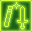  |
| Coating ([Biochemical Helm](Biochemical_Helm.md)) | Indicates that the player has his/her headgear protected by an [Alchemist](Alchemist.md) coat. This prevents his headgear from being broken or divested. |   |
| Coating ([Synthesized Shield](Synthesized_Shield.md)) | Indicates that the player has his shield protected by an [Alchemist](Alchemist.md) coat. This prevents his shield from being broken or divested. |   |
| Coating ([Synthetic Armor](Synthetic_Armor.md)) | Indicates that the player has his armor protected by an [Alchemist](Alchemist.md) coat. This prevents his/her armor from being broken or divested. |   |
| [Crazy Uproar](Crazy_Uproar.md) | Indicates that a merchant player currently has [Crazy Uproar](Crazy_Uproar.md) on. While in this state the player will have their [strength](Stats.md) stat increased by 4. |   |
| **Bard Song** | Indicates that a player currently has his/her performance increased by a [Bard](Bard.md) song. |   |
| **Dancer's Dance** | Indicates that a player currently has his/her performance increased by a [Dancer](Dancer.md)'s dance. |   |
| [Energy Coat](Energy_Coat.md) | Indicates that a [Mage](Mage.md) player currently has [Energy Coat](Energy_Coat.md) on. [Energy Coat](Energy_Coat.md) reduces damage received from attacks but drains your [SP](SP.md) each time you are hit. |   |
| Falcon | Indicates that a [Hunter](Hunter.md) player is currently renting a falcon. The falcon allows you to perform falcon specific skills and assists you when performing regular attacks. |   |
| [Hindsight](Hindsight.md) | Indicates that the skill [Hindsight](Hindsight.md) is currently active, and will allow the [Sage](Sage.md) character to auto cast bolt skills when attacking. |   |
| [Improve Concentration](Improve_Concentration.md) | Indicates that an [Archer](Archer.md) player currently has [Improve Concentration](Improve_Concentration.md) on. While in this state the player will have their [Agility](Stats.md) and [Dexterity](Stats.md) increased. |   |
| Peco Riding | Indicates that a [Knight](Knight.md) or [Crusader](Crusader.md) player is currently riding a peco. The peco increases a player's [Movement Speed](Movement_Speed.md) and carrying capacity, and allows the player to cast skills that require the player to be mounted. |   |
| [Play Dead](Play_Dead.md) | Indicates that a [Novice](Novice.md) player is currently [playing dead](Play_Dead.md). |   |
| **[Slyness](Slyness.md)** | Indicates that a [Rogue](Rogue.md) player is currently under the effect of [Slyness](Slyness.md). |   |

## Elemental Endowment Icons

| Name | Description | Icon  |
| --- | --- | --- |
| [Aspersio](Aspersio.md) | The player currently has his weapon endowed with [Holy](Holy.md) [Element](Element.md) by a [Priest](Priest.md). Each of the players attacks will deal [Holy](Holy.md) [Element](Element.md) damage. |   |
| [Enchant Poison](Enchant_Poison.md) | The player currently has his weapon endowed with [Poison](Poison.md) [Element](Element.md) by an [Assassin](Assassin.md). Each of the players attacks will deal [Poison](Poison.md) [Element](Element.md) damage. |   |
| [Endow Blaze](Endow_Blaze.md) | The player currently has his weapon endowed with [Fire](Fire.md) [Element](Element.md) by a [Sage](Sage.md). Each of the players attacks will deal [Fire](Fire.md) [Element](Element.md) damage. |   |
| [Endow Quake](Endow_Quake.md) | The player currently has his weapon endowed with [Earth](Earth.md) [Element](Element.md) by a sage. Each of the players attacks will deal [Earth](Earth.md) [Element](Element.md) damage. |   |
| [Endow Tornado](Endow_Tornado.md) | The player currently has his weapon endowed with [Wind](Wind.md) [Element](Element.md) by a sage. Each of the players attacks will deal [Wind](Wind.md) [Element](Element.md) damage. |   |
| [Endow Tsunami](Endow_Tsunami.md) | The player currently has his weapon endowed with [Water](Water.md) [Element](Element.md) by a sage. Each of the players attacks will deal [Water](Water.md) [Element](Element.md) damage. |   |
| [Mild Wind](Mild_Wind.md) ([Earth](Earth.md)) | The player has endowed himself with [Earth](Earth.md) [Element](Element.md) using the [TaeKwon](TaeKwon_Kid.md) skill [Mild Wind](Mild_Wind.md). Each of the players attacks will deal [Earth](Earth.md) [Element](Element.md) damage. |   |
| [Mild Wind](Mild_Wind.md) ([Wind](Wind.md)) | The player has endowed himself with [Wind](Wind.md) [Element](Element.md) using the [TaeKwon](TaeKwon_Kid.md) skill [Mild Wind](Mild_Wind.md). Each of the players attacks will deal [Wind](Wind.md) [Element](Element.md) damage. |   |
| [Mild Wind](Mild_Wind.md) ([Water](Water.md)) | The player has endowed himself with [Water](Water.md) [Element](Element.md) using the [TaeKwon](TaeKwon_Kid.md) skill [Mild Wind](Mild_Wind.md). Each of the players attacks will deal [Water](Water.md) [Element](Element.md) damage. |   |
| [Mild Wind](Mild_Wind.md) ([Fire](Fire.md)) | The player has endowed himself with [Fire](Fire.md) [Element](Element.md) using the [TaeKwon](TaeKwon_Kid.md) skill [Mild Wind](Mild_Wind.md). Each of the players attacks will deal [Fire](Fire.md) [Element](Element.md) damage. |   |
| [Mild Wind](Mild_Wind.md) ([Ghost](Ghost.md)) | The player has endowed himself with Ghost [Element](Element.md) using the [TaeKwon](TaeKwon_Kid.md) skill [Mild Wind](Mild_Wind.md). Each of the players attacks will deal [Ghost](Ghost.md) [Element](Element.md) damage. |   |
| [Mild Wind](Mild_Wind.md) ([Shadow](Shadow.md)) | The player has endowed himself with Shadow [Element](Element.md) using the [TaeKwon](TaeKwon_Kid.md) skill [Mild Wind](Mild_Wind.md). Each of the players attacks will deal [Shadow](Shadow.md) [Element](Element.md) damage. |   |
| [Mild Wind](Mild_Wind.md) ([Holy](Holy.md)) | The player has endowed himself with Holy [Element](Element.md) using the [TaeKwon](TaeKwon_Kid.md) skill [Mild Wind](Mild_Wind.md). Each of the players attacks will deal [Holy](Holy.md) [Element](Element.md) damage. |   |

## Expanded Classes Status Icons

| Name | Description | Icon  |
| --- | --- | --- |
| [Kaahi](Kaahi.md) | A [Soul Linker](Soul_Linker.md) status that recovers [HP](Max_HP.md) when hit at the cost of the player's [SP](SP.md). |   |
| [Kaizel](Kaizel.md) | [Soul Linker](Soul_Linker.md) status that revives the player instantly upon death. |   |
| [Kaupe](Kaupe.md) | [Soul Linker](Soul_Linker.md) status that completely blocks a single attack by chance. |   |
| [Cicada Skin Shed](Cicada_Skin_Shed.md) | [Ninja](Ninja.md) status that allows the caster to evade attacks, moving him/her away from the opponent. |   |
| [Gatling Fever](Gatling_Fever.md) | [Gunslinger](Gunslinger.md) status that boosts a player's [ASPD](ASPD.md) and damage with a gatling gun. |   |
| [Gunslinger's Panic](Gunslinger's_Panic.md) | [Gunslinger](Gunslinger.md) status that boosts [Flee](Stats.md) and ranged damage resistance at the cost of accuracy. |   |
| [Happy Break](Happy_Break.md) | [TaeKwon Kid](TaeKwon_Kid.md) status that indicates a player can use an [Earth Spike](Earth_Spike.md) scroll while only consuming [SP](SP.md). |   |
| [Increase Accuracy](Increase_Accuracy.md) | [Gunslinger](Gunslinger.md) status that increases [DEX](Stats.md) and [AGI](Stats.md) by 4. |   |
| [Last Stand](Last_Stand.md) | [Gunslinger](Gunslinger.md) status that boosts [ATK](Stats.md) and [ASPD](ASPD.md) at the cost of being unable to move. |   |
| [Mirror Image](Mirror_Image.md) | [Ninja](Ninja.md) status that allows the caster to evade attacks. |   |
| [Ninja Aura](Ninja_Aura.md) | [Ninja](Ninja.md) status that boosts [INT](Stats.md) and [STR](Stats.md), and allows for advanced [Ninja](Ninja.md) skills to be cast. |   |
| [Solar Protection](Solar_Protection.md) | [[[TaeKwon Master](TaeKwon_Master.md)]] status that increases the player's [defense](DEF.md). |   |
| [Lunar Protection](Lunar_Protection.md) | [TaeKwon Master](TaeKwon_Master.md) status that increases the player's [Flee](Stats.md). |   |
| [Stellar Protection](Stellar_Protection.md) | [TaeKwon Master](TaeKwon_Master.md) status that increases the player's [attack speed](ASPD.md). |   |
| [Sprint](Sprint.md) | [TaeKwon Kid](TaeKwon_Kid.md) status that indicates that he/she recieves bonus attack power and [STR](Stats.md) while unarmed. |   |
| [Counter Kick Stance](Counter_Kick_Stance.md) | [TaeKwon Kid](TaeKwon_Kid.md) status that allows the player to trigger a stance when attacking. |   |
| [Heel Drop Stance](Heel_Drop_Stance.md) | [TaeKwon Kid](TaeKwon_Kid.md) status that allows the player to trigger a stance when attacking. |   |
| [Roundhouse Stance](Roundhouse_Stance.md) | [TaeKwon Kid](TaeKwon_Kid.md) status that allows the player to trigger a stance when attacking. |   |
| [Tornado Stance](Tornado_Stance.md) | [TaeKwon Kid](TaeKwon_Kid.md) status that allows the player to trigger a stance when attacking. |   |
| [Tumbling](Tumbling.md) | [TaeKwon Kid](TaeKwon_Kid.md) status that allows the player to evade ranged attacks by chance. |   |

## Holy Skills Status

| Name | Description | Icon  |
| --- | --- | --- |
| [Angelus](Angelus.md) | The player's [VIT](Stats.md)-based [defense](DEF.md) is increased. |   |
| [Assumptio](Assumptio.md) | The player takes half damage from all attacks. | 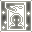  |
| [Blessing](Blessing.md) | The player's [STR](Stats.md), [INT](Stats.md), and [DEX](Stats.md) is increased. |   |
| [B.S Sacramenti](B.S_Sacramenti.md) | The player's armor is temporarily enchanted with the [Holy](Holy.md) element. |   |
| [Gloria](Gloria.md) | The player's [LUK](Stats.md) is increased. |   |
| [Increase Agility](Increase_AGI.md) | The player's [Movement Speed](Movement_Speed.md) and [AGI](Stats.md) is increased. |   |
| [Impositio Manus](Impositio_Manus.md) | The player's [attack power](Stats.md) is increased. |   |
| [Kyrie Eleison](Kyrie_Eleison.md) | The player is protected from a certain amount of damage. | 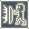  |
| [Lex Aeterna](Lex_Aeterna.md) | The player takes double damage from the next attack. | 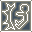  |
| [Magnificat](Magnificat.md) | The player's natural [HP](Max_HP.md) and [SP](SP.md) regeneration occur at double rate. |   |
| [Resistant Souls](Resistant_Souls.md) | The player takes reduced damage from both [Holy](Holy.md) and [Shadow](Shadow.md) [Element](Element.md) attacks. |   |
| **[Sacrifice](Sacrifice.md)** | The player is being protected by a [Crusader](Crusader.md) who is taking hits for them. |   |
| [Signum Crusis](Signum_Crusis.md) | The player's [Defense](DEF.md) is reduced. |   |
| [Slow Poison](Slow_Poison.md) | The player does not lose [HP](Max_HP.md) from being [Poison](Poison.md)ed. |   |
| [Suffragium](Suffragium.md) | The next skill cast by the player will cast faster. |   |

## Item Status Icons

| Name | Description | Icon  |
| --- | --- | --- |
| Bubble Gum | The player is currently under the effects of bubble gum from the [Kafra Shop](Kafra_Shop.md). The player will receive double drop rates from monsters killed. |   |
| Battle Manual | The player is currently under the effects of the field manual from the [Kafra Shop](Kafra_Shop.md). The player will receive 50% more experience from monsters killed. |   |
| Life Insurance | The player is currently under the effects of life insurance from the [Kafra Shop](Kafra_Shop.md). If the player dies he/she will not lose any experience. |   |
| Pastry Item | The player currently has his/her stats increased by a pastry item. This icon displays for Sesame Pastry, Honey Pastry, and Rainbow Cake. |   |
| **Coldproof Potion** | The player currently takes reduced damage from [Water](Water.md) [Element](Element.md) attacks, but increased damage from [Wind](Wind.md). |   |
| **Earthproof Potion** | The player currently takes reduced damage from [Earth](Earth.md) [Element](Element.md) attacks, but increased damage from [Fire](Fire.md). |   |
| **Fireproof Potion** | The player currently takes reduced damage from [Fire](Fire.md) [Element](Element.md) attacks, but increased damage from [Water](Water.md). |   |
| **Thunderproof Potion** | The player currently takes reduced damage from [Wind](Wind.md) [Element](Element.md) attacks, but increased damage from [Earth](Earth.md). |   |
| Agi Food | The player currently has his/her [AGI](Stats.md) increased by consuming a food item. |   |
| Dex Food | The player currently has his/her [DEX](Stats.md) increased by consuming a food item. |   |
| Int Food | The player currently has his/her [INT](Stats.md) increased by consuming a food item. |   |
| Luk Food | The player currently has his/her [LUK](Stats.md) increased by consuming a food item. |   |
| Str Food | The player currently has his/her [STR](Stats.md) increased by consuming a food item. |   |
| Vit Food | The player currently has his/her [VIT](Stats.md) increased by consuming a food item. |   |

## Adverse Status Icons

| Name | Description | Icon  |
| --- | --- | --- |
| 50% [Weight](Weight_Limit.md) | The player is currently over 50% of his/her carrying capacity. This prevents the player from naturally recovering [HP](Max_HP.md) and [SP](SP.md). | 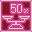  |
| 90% [Weight](Weight_Limit.md) | The player is currently over 90% of his/her carrying capacity. This prevents the player from naturally recovering [HP](Max_HP.md) and [SP](SP.md) and using any active skills. | 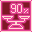  |
| [Agility Down](Decrease_AGI.md) | The player is currently under the effects of [Agility Down](Decrease_AGI.md). This reduces the player's [AGI](Stats.md) and slows their [Movement Speed](Movement_Speed.md) by 25%. |   |
| [Bleeding](Status_Effects.md) | The player is currently affected by [Bleeding](Status_Effects.md) status. The player's [HP](Max_HP.md) decreases rapidly. |   |
| **Broken [Weapon](Weapons.md)** | The player has their [Weapon](Weapons.md) broken. |   |
| **Broken [Armor](Armor.md)** | The player has their [Armor](Armor.md) broken. |   |
| [Hallucination](Status_Effects.md) | The player is currently hallucinating. When hallucinating the player will have his/her vision impaired, be unable to properly judge damage being dealt to themselves and flinch when targeted by any attack regardless of whether that attack connects. |   |
| [Critical Wounds](NPC_CRITICALWOUND.md) | The effects of any Heals cast on the player, or recovery items consumed are reduced by some amount (in percent). The amount depends on the skill's Level. |   |
| [Divest Armor](Divest_Armor.md) | The player has had his/her [Armor](Armor.md) stripped away by a [Rogue](Rogue.md). While active the player is unable to re-equip their armor. |   |
| [Divest Helm](Divest_Helm.md) | The player has had his/her [Headgear](Headgears.md) stripped away by a [Rogue](Rogue.md). While active the player is unable to re-equip their headgear. |   |
| [Divest Shield](Divest_Shield.md) | The player has had his/her [Shield](Shield.md) stripped away by a [Rogue](Rogue.md). While active the player is unable to re-equip his shield. |   |
| [Divest Weapon](Divest_Weapon.md) | The player has had his/her [Weapon](Weapons.md) stripped away by a [Rogue](Rogue.md). While active the player is unable to re-equip his weapon. |   |
| **[Hell Power](NPC_HELLPOWER.md)** | The player is currently inflicted with the [Hell Power](NPC_HELLPOWER.md) status. This prevents the player from being revived by the skill [Resurrection](Resurrection.md) for several minutes. |   |
| [Quagmire](Quagmire.md) | The player is currently affected by [Quagmire](Quagmire.md) status. This reduces a player's [DEX](Stats.md) and [AGI](Stats.md). |   |
| [Slow Cast](NPC_SLOWCAST.md) | The player is currently inflicted by the slow cast status. All skills has their cast time increased by a certain percentage, which depends on this skill's level. |   |
| [Tarot Card of Fate](Tarot_Card_of_Fate.md) | The player is currently inflicted by an effect from a [Gypsy](Gypsy.md) or [Minstrel](Minstrel.md)'s skill, [Tarot Card of Fate](Tarot_Card_of_Fate.md). The effects vary depending on the card drawn on the player. |   |

## Skill Status Icons

| Name | Description | Icon  |
| --- | --- | --- |
| [Adrenaline Rush](Adrenaline_Rush.md) | [Blacksmith](Blacksmith.md) support skill that boosts a player's [attack speed](ASPD.md) with mace and axe weapons. |   |
| [Berserk](Berserk.md) | [Swordman](Swordman.md) skill that causes [Provoke](Provoke.md) status on yourself when your [HP](Max_HP.md) drops low enough. |   |
| [Cart Boost](Cart_Boost.md) | [Mastersmith](Mastersmith.md) skill that boosts [Movement Speed](Movement_Speed.md) and allows casting of [High Speed Cart Ram](High_Speed_Cart_Ram.md). |   |
| [Cloaking](Cloaking.md) | [Assassin](Assassin.md) skill that hides the player from sight and allows the player to move around. |   |
| [Close Confine](Close_Confine.md) | [Rogue](Rogue.md) skill that locks a [Rogue](Rogue.md) and target player together preventing them from moving. |   |
| [Counter Instinct](Counter_Instinct.md) | [Stalker](Stalker.md) skill that reflects sword based attacks from players and attacks from monsters. |   |
| [Defending Aura](Defending_Aura.md) | [Crusader](Crusader.md) skill that greatly reduces ranged damage. |   |
| [Double Bolt](Double_Bolt.md) | [Scholar](Scholar.md) skill that gives the chance to double cast bolt type skills. |   |
| [Enchant Deadly Poison](Enchant_Deadly_Poison.md) | [Assassin Cross](Assassin_Cross.md) skill that greatly increases physical attack damage. |   |
| [Endure](Endure.md) | [Swordman](Swordman.md) skill that increases mdef and prevents flinching. |   |
| [Falcon Eyes](Falcon_Eyes.md) | [Sniper](Sniper.md) skill that boosts [Hit](Stats.md), [Critical](Stats.md), [Attack speed](Stats.md), and damage. |   |
| **[Fury](Fury.md)** | [Monk](Monk.md) skill that boosts critical rate and allows casting of [Guillotine Fist](Guillotine_Fist.md). |   |
| [Guard](Guard.md) | Crusader skill that blocks incoming melee damage. |   |
| [Hiding](Hiding.md) | [Thief](Thief.md) skill that renders a player immobile, but hidden from sight and immune to [area](Area_of_Effect.md) damage except [Heaven's Drive](Heaven's_Drive.md). |   |
| Land Skill Cast | After casting [Deluge](Deluge.md), [Volcano](Volcano.md), or [Whirlwind](Whirlwind.md), a [Sage](Sage.md) can cast new land skills without the gemstone requirement. | 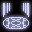  |
| [Marionette Control](Marionette_Control.md) | The player is having stats endowed to him/her by a [Gypsy](Gypsy.md) or [Minstrel](Minstrel.md). |   |
| [Power Maximize](Power_Maximize.md) | [Blacksmith](Blacksmith.md) skill that causes all attacks to strike for maximum damage. | 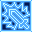  |
| [Maximum Power-Thrust](Maximum_Power-Thrust.md) | [Mastersmith](Mastersmith.md) skill that boosts physical attack power. | 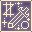  |
| **[Mystical Amplification](Mystical_Amplification.md)** | [High Wizard](High_Wizard.md) skill. Indicates that the next skill cast will be cast with 50% increased magical attack power. |   |
| [One-Hand Quicken](One-Hand_Quicken.md) | [Knight](Knight.md) skill that boosts attack speed with a one handed sword. |   |
| [Parry](Parry.md) | [Lord Knight](Lord_Knight.md) skill that allows the player to evade physical damage. |   |
| [Poison React](Poison_React.md) | [Assassin](Assassin.md) skill that counters poison [Element](Element.md) attacks. |   |
| [Power-Thrust](Power-Thrust.md) | [Blacksmith](Blacksmith.md) skill that boosts physical attack power. |   |
| [Preserve](Preserve.md) | [Stalker](Stalker.md) skill that prevents copying of skills for intimidate. | 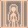  |
| [Provoke](Provoke.md) | [Swordman](Swordman.md) skill status that reduces [defense](DEF.md) but boosts attack power. |   |
| [Shield Reflect](Shield_Reflect.md) | [Crusader](Crusader.md) skill that reflects physical damage back at the attacker. |   |
| [Relax](Relax.md) | [Lord Knight](Lord_Knight.md) skill that triples [HP](Max_HP.md) regeneration while sitting. |   |
| [Shattering Strike](Shattering_Strike.md) | [Mastersmith](Mastersmith.md) skill that breaks armor and weapon when you attack. | 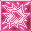  |
| [Shrink](Shrink.md) | [Crusader](Crusader.md) skill that knocks opponents back when you block an attack with Guard. |   |
| [Sight Blaster](Sight_Blaster.md) | [Wizard](Wizard.md) skill that throws an opponent away if they come too close. |   |
| [Spear Quicken](Spear_Quicken.md) | [Crusader](Crusader.md) skill that increases attack speed with a spear. |   |
| [Stealth](Stealth.md) | After using the stealth skill a [Stalker](Stalker.md) gains a boost to his/her [STR](Stats.md) for a period of time. |   |
| [Two Hand Quicken](Twohand_Quicken.md) | [Knight](Knight.md) skill that boosts attack speed with a two handed sword. |   |
| [Vital Strike](Vital_Strike.md) | [Lord Knight](Lord_Knight.md) skill that causes various status effects. | 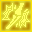  |
| [Weapon Perfection](Weapon_Perfection.md) | [Blacksmith](Blacksmith.md) skill that negates the size penalty of the equipped weapon. |   |
| [Wind Walker](Wind_Walker.md) | [Sniper](Sniper.md) skill that boosts [AGI](Stats.md) and movement speed. |   |

---
**Categories:** [General Information](categories/General_Information.md)
*Source: [iRO Wiki Classic](https://irowiki.org/classic/Status_Icons) — GFDL 1.3+*
