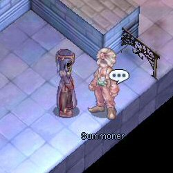
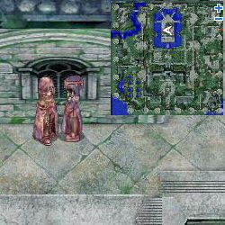
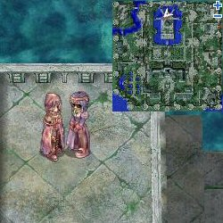
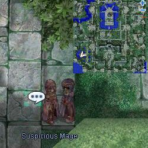
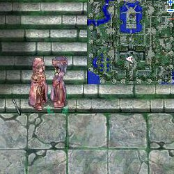
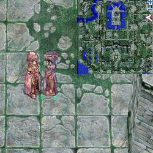

# Summoner Event (2009/02/24) ~ (2009/03/10)

> **Note:** Not implemented on iRO Classic.

<!-- Quest info -->
- **Level requirement:** None
- **Item requirement:** Varies (See Table Below)
- **Quest reward:** Ability to fight an [MVP](MVP.md)

## Quest

1.  On the 3rd floor of the [Geffen Tower](Geffen.md), speak to Summoner (Summoner Geshalt).

1.   

1.  His summoning books have been stolen by Clepto-Cal and he needs them returned.  He last saw Clepto-Cal headed for the castle to the west.
1.  At Glast Heim you will find Clepto-Cal at the following locations, players will either obtain a book or not, Clepto-Cal will summon a rideword if a player successfully obtains a book or a myst if the player does not obtain a book.  After you find him at location 1, he will move to location 2, likewise from 2 to 3 and so on.

  1. 

  1. 

  1. ]

  1. 

  1. 

  * note: it is not actually necessary to kill the monster Clepto-Cal summons.
1.  After his books are returned to him, speak to Summoner Geshalt again, he will display a list of MVPs to choose from (5 at a time).
  * Selecting "I want a different mob." or "A different mob!" will display another set of MVP's.
1.   Selecting an MVP will display a list of items Geshalt will need to summon that MVP.
1.  After going through all 7 lists, a dialogue will pop up with the options "What do I care, jerk?" and "I'm so sorry!".
  * Note: Players selecting "What do i care, jerk?" will receive an OBB and be killed by Geshalt and the quest will be over.
1.  After gathering and delivering the items needed for the desired MVP, talk to Geshalt again. If you wish to have friends come help, he will ask you to set a four digit password.  Anyone you wish to have join you will need to click the NPC just north of Geshalt and enter your password to enter the room.
1.  Players will have 9 minutes to defeat the chosen MVP.

## Summoning Materials

**Summoning Materials**

| **MVP** | **Items** | **Items** | **Items** | **Items** | **Items** |
| --- | --- | --- | --- | --- | --- |
| **Amon Ra** | 10 Flame Heart | 5 Star Crumb | 100 Trap |   |   |
| **Baphomet** | 5 Yggdrasilberry | 30 Antelope Skin | 3 Evil Horn |   |   |
| **Dark Lord** | 200 Skel-Bone | 30 Skull | 20 Live Coal |   |   |
| **Detardeureus** | 10 Dragon Tail | 75 Dragon Scale | 75 Dragon Canine | 1 Three-Headed Dragon's Head |   |
| **Doppelganger** | 2 Contorted Self-Portrait | 40 Arrow of Shadow | 50 Horseshoe |   |   |
| **Dracula** | 250 Horrendous Mouth | 100 Wing of Red Bat | 5 Cursed Ruby |   |   |
| **Drake** | 200 Skel-Bone | 5 Amethyst |   |   |   |
| **Eddga** | 150 Bear's Footskin | 5 Flame Heart | 20 Tiger Panty |   |   |
| **Egnigem Cenia** | 25 Handcuffs | 10 Steel | 25 Research Chart |   |   |
| **Evil Snake Lord** | 50 Arrow of Shadow | 30 Shining Scale | 2 Old Magic Book |   |   |
| **Fallen Bishop** | 150 Brigan | 15 Old White Cloth | 15 Memento |   |   |
| **Golden Thief Bug** | 250 Insect Feeler | 30 Yellow Gemstone | 1 Ora Ora |   |   |
| **Gopinich** | 10 Witherless Rose | 2 Treasure Box | 3 Crystal Mirror |   |   |
| **Gloom Under Night** | 30 Suspicious Hat | 20 Bloody Rune | 1 Will of Red Darkness |   |   |
| **Hatii** | 30 Ice Cubic | 100 Claw of Desert Wolf | 2 Frozen Rose |   |   |
| **Ktullanux** | 100 Glacial Heart | 1 Frozen Rose | 1 Ice Scale |   |   |
| **Lady Taynee** | 10 Royal Jelly | 200 Solid Peach |   |   |   |
| **Lord of the Dead** | 1 Shining Stone | 150 Horseshoe | 30 Holy Water |   |   |
| **Maya** | 1 Armlet of Obedience | 30 Round Shell | 10 Great Nature |   |   |
| **Memory of Thanatos** | 1 Fragment of Misery | 1 Fragment of Agony | 1 Fragment of Hated | 1 Fragment of Despair |   |
| **Mistress** | 300 Bee Sting | 16 Honey | 2 Rough Wind |   |   |
| **Moonlight Flower** | 20 Nine Tails | 5 Topaz | 5 Flame Heart |   |   |
| **Orc Hero** | 75 Ogre Tooth | 200 Orcish Voucher |   |   |   |
| **Orc Lord** | 75 Fang | 200 Orcish Voucher |   |   |   |
| **Osiris** | 1 Contract in Shadow | 100 Rotten Bandage | 10 Poison Arrow |   |   |
| **Pharaoh** | 50 Witch Starsand | 100 Holy Water | 1 Gold |   |   |
| **Phreeoni** | 50 Dragon Scale | 10 Tongue | 5 Star Crumb |   |   |
| **RSX 0806** | 200 Battered Kettle | 100 Used Iron Plate |   |   |   |
| **Samurai Specter** | 75 Broken Shuriken | 30 Large Jellopy | 15 Destroyed Armor |   |   |
| **Stormy Knight** | 10 Ice Cubic | 5 Aquamarine | 2 Mystic Frozen |   |   |
| **Tao Gunka** | 100 Iron Ore | 10 Stone Fragment |   |   |   |
| **Turtle General** | 100 Turtle Shell | 10 Ice Cubic | 10 Burnt Tree |   |   |
| **Vesper** | 200 Cogwheel | 100 Metal Fragment |   |   |   |
| **White Lady** | 100 Black Hair | 2 Crystal Mirror |   |   |   |

---
**Categories:** [Quests](categories/Quests.md), [Temporary Event Quests](categories/Temporary_Event_Quests.md)
*Source: [iRO Wiki Classic](https://irowiki.org/classic/Summoner_Event_%282009/02/24%29_~_%282009/03/10%29) — GFDL 1.3+*
