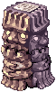
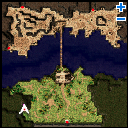
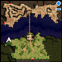
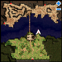
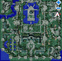
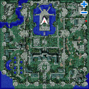
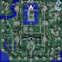

# Summoner Event (2010/08/19) ~ (2010/09/16)

> **Note:** Not implemented on iRO Classic.

<!-- Quest info -->
- **Level requirement:** None
- **Item requirement:** Varies (see table)
- **Quest reward:** Ability to fight a [boss monster](MVP.md)
- **Window:** yes

## Quest

1. Talk with Summoner Bentham on the third floor of [Geffen Tower](Geffen.md), who asks you to locate two summoning stones.

2. Examine the summoning stones situated in the following locations:

**Note**: There is only one summoning stone in each area, but they change locations randomly when examined.

**Juno Field 1:

| Column 1 | Column 2 | Column 3 |
| --- | --- | --- |
|  |  |  |
| (75, 57) | (58, 143) | (250, 191) |

**Glast Heim''':

| Column 1 | Column 2 | Column 3 |
| --- | --- | --- |
|  |  |  |
| (369, 299) | (199, 302) | (199, 350) |

3. Return to Geffen Tower and talk with Summoner Bentham, who offers to summon [boss monsters](MVP.md) for you to challenge in exchange for certain items (see Summoning Materials).

## Summoning

> **Repeatable** — cooldown: 30 min

1. With the neccessary items in your inventory, talk with Summoner Bentham, then choose a monster to fight.

2. Enter one of the two waiting rooms.

3. When you are transferred to an arena, talk with the NPC to summon the monster.

## Summoning Materials

**Summoning Materials**

| **MVP** | **Items** | **Items** | **Items** | **Items** | **Items** |
| --- | --- | --- | --- | --- | --- |
| **Amon Ra** | 10 Flame Heart | 5 Star Crumb | 100 Trap |   |   |
| **Baphomet** | 5 Yggdrasilberry | 30 Antelope Skin | 3 Evil Horn |   |   |
| **Dark Lord** | 200 Skel-Bone | 30 Skull | 20 Live Coal |   |   |
| **Detardeureus** | 10 Dragon Tail | 75 Dragon Scale | 75 Dragon Canine | 1 Three-Headed Dragon's Head |   |
| **Doppelganger** | 2 Contorted Self-Portrait | 40 Arrow of Shadow | 50 Horseshoe |   |   |
| **Dracula** | 250 Horrendous Mouth | 100 Wing of Red Bat | 5 Cursed Ruby |   |   |
| **Drake** | 200 Skel-Bone | 5 Amethyst |   |   |   |
| **Eddga** | 150 Bear's Footskin | 5 Flame Heart | 20 Tiger Panty |   |   |
| **Egnigem Cenia** | 25 Handcuffs | 10 Steel | 25 Research Chart |   |   |
| **Evil Snake Lord** | 50 Arrow of Shadow | 30 Shining Scale | 2 Old Magic Book |   |   |
| **Fallen Bishop** | 150 Brigan | 15 Old White Cloth | 15 Memento |   |   |
| **Golden Thief Bug** | 250 Insect Feeler | 30 Yellow Gemstone | 1 Ora Ora |   |   |
| **Gopinich** | 10 Witherless Rose | 2 Treasure Box | 3 Crystal Mirror |   |   |
| **Gloom Under Night** | 30 Suspicious Hat | 20 Bloody Rune | 1 Will of Red Darkness |   |   |
| **Hatii** | 30 Ice Cubic | 100 Claw of Desert Wolf | 2 Frozen Rose |   |   |
| **Kiel D-01** | 30 Solid Iron Piece |   |   |   |   |
| **Ktullanux** | 100 Glacial Heart | 1 Frozen Rose | 1 Ice Scale |   |   |
| **Lady Tanee** | 10 Royal Jelly | 200 Solid Peach |   |   |   |
| **Lord of the Dead** | 1 Shining Stone | 150 Horseshoe | 30 Holy Water |   |   |
| **Maya** | 1 Armlet of Obedience | 30 Round Shell | 10 Great Nature |   |   |
| **Memory of Thanatos** | 1 Fragment of Misery | 1 Fragment of Agony | 1 Fragment of Hated | 1 Fragment of Despair |   |
| **Mistress** | 300 Bee Sting | 15 Honey | 2 Rough Wind |   |   |
| **Moonlight Flower** | 20 Nine Tails | 5 Topaz | 5 Flame Heart |   |   |
| **Orc Hero** | 75 Ogre Tooth | 200 Orcish Voucher |   |   |   |
| **Orc Lord** | 75 Fang | 200 Orcish Voucher |   |   |   |
| **Osiris** | 1 Contract in Shadow | 100 Rotten Bandage | 10 Poison Arrow |   |   |
| **Pharaoh** | 50 Witch Starsand | 100 Holy Water | 1 Gold |   |   |
| **Phreeoni** | 50 Dragon Scale | 10 Tongue | 5 Star Crumb |   |   |
| **RSX 0806** | 200 Battered Kettle | 100 Used Iron Plate |   |   |   |
| **Samurai Specter** | 75 Broken Shuriken | 30 Large Jellopy | 15 Destroyed Armor |   |   |
| **Stormy Knight** | 10 Ice Cubic | 5 Aquamarine | 2 Mystic Frozen |   |   |
| **Tao Gunka** | 100 Iron Ore | 10 Stone Fragment |   |   |   |
| **Turtle General** | 100 Turtle Shell | 10 Ice Cubic | 10 Burnt Tree | 10 Broken Shell |   |
| **Vesper** | 200 Cogwheel | 100 Metal Fragment |   |   |   |
| **White Lady** | 100 Black Hair | 2 Crystal Mirror |   |   |   |

---
**Categories:** [Quest Window Quests](categories/Quest_Window_Quests.md), [Quests](categories/Quests.md), [Temporary Event Quests](categories/Temporary_Event_Quests.md)
*Source: [iRO Wiki Classic](https://irowiki.org/classic/Summoner_Event_%282010/08/19%29_~_%282010/09/16%29) — GFDL 1.3+*
