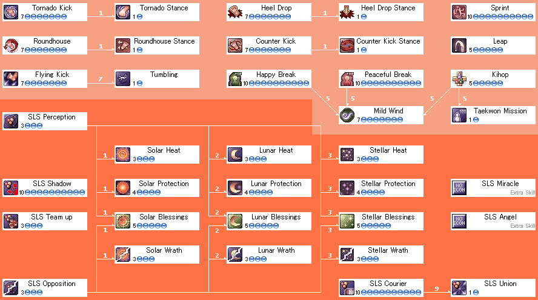

# TaeKwon Master

<!-- Job info -->
- **Job base:** TaeKwon Kid
- **Job type:** Extended
- **Changes at:** [Comodo](Comodo.md)
- **Skills:** 18
- **Skill points:** 75
- **Quest skills:** 0
- **STR:** 12
- **AGI:** 12
- **VIT:** 0
- **INT:** 0
- **DEX:** 6
- **LUK:** 0

## Overview

TaeKwon Master is a class for characters who have chosen TaeKwon Kid as their first profession and wish to continue in the ways of the TaeKwon. One of the most notable benefits that a TaeKwon Master has over a TaeKwon Kid is the ability to wield books to help deal more damage physically.
TaeKwon Master is an unusual class in that the majority of their skills are bound to the celestial bodies of the Sun (Solar), Moon (Lunar) and Stars (Stellar), and are very restricted in their use. These skills have three different restrictions in which they can be used, and are as follows:
* Certain skills can only be used on a day of their respective celestial body
* Some skills can only be used on maps that are designated as a place of a celestial body
* Other skills can only be used against enemies that are aligned as an enemy of a celestial body

The first restriction is unlike the latter two in that a TaeKwon master cannot change what day is representative of a celestial body; these days are already set. The setting for these celestial days is told in the mantra as follows:

The Sun shines brightest on even days. The Moon shines brightest on odd days. And the Stars shine without fail on every 5th day.
The second and third restriction can be set personally for each individual TaeKwon Master via their respective skills: Solar, Lunar and Stellar Perception and Solar, Lunar and Stellar Opposition.

However, there are also skills that are also bound by more than one restriction.

TaeKwon Masters are also known as **Star Gladiators** in other localizations of Ragnarok Online, which reflects the way how the skills of this class works.

If a TaeKwon Master ever finds the TaeKwon Master skill tree too confusing, a TaeKwon Master can always invest more skill points into the TaeKwon Kid skills, or observe the skills that are not restricted by the celestial bodies.

## Jobchange Guide

<!-- Quest info -->
- **Level requirement:** None
- **Job level requirement:** 40
- **Class requirement:** TaeKwon Kid
- **Item requirement:** 1 Flame Heart, 1 Mystic Frozen, 1 Rough Wind, 1 Great Nature, 1 Star Crumb, 1 Star Dust
- **Quest reward:** Jobchange to [TaeKwon Master](TaeKwon_Master.md)
- **Cat:** no

1. Find MooHyun In [Payon](Payon.md) (215 102). He will tell you to collect the following items:

*  1 Flame Heart
*  1 Mystic Frozen
*  1 Rough Wind
*  1 Great Nature

2. After obtaining the items, proceed to [Comodo](Comodo.md). There is a path around the mountain in the middle of the map (the base is found at 159, 180) that leads to the top of it.

3. At the top, find the [NPC](NPC.md) "Man" (comodo 172 231). After giving the items, the player will be warped to "The Sun, the Moon, and The Stars" (job_star 29 32).

4. Speak with Gladiator of the Sun. After some dialog, the player will be moved to the Gladiator of the Moon (job_star 95 33).

5. After speaking to the Gladiator of the Moon, the player will be warped to Payon. Speak to MooHyun and return to Comodo to be warped back. The player will once again be moved, this time to the Gladiator of the Stars (job_star 161 33). She requires the following items:

*  1 Star Crumb
*  1 Star Dust

6. After gathering these items, the Man can return the player to the quest area for free. Hand the items to the Gladiator of the Stars, who will change send the player back to Payon. The Man in comodo will turn the player into a TaeKwon Master.

## Builds

## STR/VIT All-Purpose

*  STR: 110-130
*  AGI: 1
*  VIT: 90-110
*  INT: 1
*  DEX: 1
*  LUK: 1-9

The STR/VIT build is an all-purpose TKM build that benefits from increased survivability and healing item efficiency while still maintaining high damage output through [Union](Solar,_Lunar_and_Stellar_Union.md) and [S](Solar_Heat.md)[L](Lunar_Heat.md)[S](Stellar_Heat.md) Heat. High-end activities include Thors, Somatology Labs, MVPing, and anywhere else that may involve the TKM tanking or receiving damage. High maximum HP allows the TKM to tank and kill large mobs of monsters with Heat effortlessly, accompanied by more efficient potion consumption.

## STR/DEX Specialized

*  STR: 110-130
*  AGI: 1
*  VIT: 20-40
*  INT: 1
*  DEX: 100-120
*  LUK: 1-9

The STR/DEX build is a specialized TKM build that maximizes [S](Solar_Heat.md)[L](Lunar_Heat.md)[S](Stellar_Heat.md) Heat damage. Because of the nature of the build, their attacks tend to yield the highest damage of all TKM builds. Due to the high amount of DEX, the TKM can naturally hit most monsters and is independent from using [Union](Solar,_Lunar_and_Stellar_Union.md). Though their damage output is exceptionally high, STR/DEX TKMs are more fragile and usually require a separate tank character to be able to perform effectively.

## AGI Kicker

*  STR: 110-130
*  AGI: 70-90 base
*  VIT: 1-50 base
*  INT: 1-12 base
*  DEX: 50-70 total w/ buffs
*  LUK: 1-20 base

The AGI build is a DPS build that uses speed, [TK Kid](TaeKwon_Kid.md) kicks, [Shadow](Solar,_Lunar_and_Stellar_Shadow.md), [Stellar Protection](Stellar_Protection.md), and [S](Solar_Wrath.md)[L](Lunar_Wrath.md)[S](Stellar_Wrath.md) Wrath to dispatch monsters quickly. [S](Solar_Heat.md)[L](Lunar_Heat.md)[S](Stellar_Heat.md) Heat will help to push mobs back so flee isn't reduced.

## Equipment

*For information on the headgears, footgears, armors, garments, shields and accessories, see [TaeKwon Kid's equipment](TaeKwon_Kid.md).*

## Accessory

Medal of Honor
  DEF+1, ATK+5%, MATK+5%, HP+500, SP+50, HIT+10, [Stun](Status_Effects.md) when attacking.

## Weapon

TaeKwon Masters can fight unarmed, keeping the bonuses from the [Sprint](Sprint.md) skill, or use [Books](Book.md).

[Book \[3\]](Book.md)
  [ATK](Stats.md)+85.
  This is the standard weapon used by most TKMs. The new 3-slot elemental books are slightly better.
Ledger of Death \[2\]
  [ATK](Stats.md)+137, [STR](Stats.md)+3, [LUK](Stats.md)-20, [ASPD](ASPD.md)+1% for each upgrade, 1% chance of inflicting [Coma](Status_Effects.md) on [Demi-humans](Demi_Human.md).
Bible \[2\]
  [ATK](Stats.md)+115.
Encyclopedia \[2\]
  [ATK](Stats.md)+110, [DEX](Stats.md)+2, [Crit](Stats.md)+20, [Crit](Stats.md)+0.1 for each point of base [LUK](Stats.md).
Sage's Diary \[2\]
  [ATK](Stats.md)+100, [ASPD](ASPD.md)+5% if [STR](Stats.md) is 50 or higher.
Hardcover Book \[1\]
  [ATK](Stats.md)+140, [STR](Stats.md)+3, [DEX](Stats.md)+2.
Tablet \[1\]
  [ATK](Stats.md)+125.
Legacy of Dragon
  [ATK](Stats.md)+130, ignores the defense of [Dragons](Dragon.md), regain 10 [SP](SP.md) when killing a [Dragon](Dragon.md).
Book of the Apocalypse
  [ATK](Stats.md)+120, +7% damage to [Fire](Fire.md), [Earth](Earth.md), [Wind](Wind.md), [Water](Water.md) elements, +5% damage to [Holy](Holy.md) element.
Book of Billows \[0\]
Book of Mother Earth \[0\]
Book of the Blazing Sun \[0\]
Book of Gust of Wind \[0\]
Book of Billows \[3\]
Book of Mother Earth \[3\]
Book of the Blazing Sun \[3\]
Book of Gust of Wind \[3\]
  [ATK](Stats.md)+90. *Slotted versions are better than Book [3], if TaeKwon Master overrides weapon's element with [Mild Wind](Mild_Wind.md) - not only do they have 5 more atk, but they also are level 3, so more damage is added by upgrading them. Unslotted versions are useless.*

## Class Data

## Skills

| Skill | Description | Levels | Type |
| --- | --- | --- | --- |
| [Solar, Lunar and Stellar Perception](Solar,_Lunar_and_Stellar_Perception.md) | Permanently memorize a map as being a Place of either the Sun, the Moon, or the Stars. | 3 | Active |
| [Solar, Lunar and Stellar Opposition](Solar,_Lunar_and_Stellar_Opposition.md) | Permanently memorize a monster or player class as being a Target of either the Sun, the Moon, or the Stars. | 3 | Active |
| [Solar Heat](Solar_Heat.md) [Lunar Heat](Lunar_Heat.md) [Stellar Heat](Stellar_Heat.md) | Barrier, which deals damage and pushes back enemies nearby. Can only be used in corresponding SLS Place. | 3 | Active |
| [Solar Wrath](Solar_Wrath.md) [Lunar Wrath](Lunar_Wrath.md) [Stellar Wrath](Stellar_Wrath.md) | Bonus attack power against corresponding SLS (Solar/Lunar/Stellar) Target proportionally to level, [DEX](Stats.md) and [LUK](Stats.md). | 3 | Passive |
| [Solar Protection](Solar_Protection.md) | Increases VIT DEF proportionally to level, DEX and LUK. Can only be used in a Place of the Sun on a Solar Day. | 4 | Active |
| [Lunar Protection](Lunar_Protection.md) | Increases Flee proportionally to level, DEX and LUK. Can only be used in a Place of the Moon on a Lunar Day. | 4 | Active |
| [Stellar Protection](Stellar_Protection.md) | Increases ASPD proportionally to level, DEX and LUK. Can only be used in a Place of the Stars on a Stellar Day. | 4 | Active |
| [Solar Blessings](Solar_Blessings.md) [Lunar Blessings](Lunar_Blessings.md) [Stellar Blessings](Stellar_Blessings.md) | Bonus EXP for corresponding SLS Target on corresponding SLS Day. | 5 | Passive |
| [Solar, Lunar and Stellar Shadow](Solar,_Lunar_and_Stellar_Shadow.md) | Permanently sacrifice sight in return for increasing [ASPD](ASPD.md). | 10 | Passive |
| [Solar, Lunar and Stellar Team-up](Solar,_Lunar_and_Stellar_Team-up.md) | When using Counter Kick, any [Monk](Monk.md)s in the party will have their chance of using [Raging Trifecta Blow](Raging_Trifecta_Blow.md) increased. If any Monks in the party use [Raging Thrust](Raging_Thrust.md), player's chance of using Counter Kick increases. | 3 | Passive |
| [Solar, Lunar and Stellar Courier](Solar,_Lunar_and_Stellar_Courier.md) | Increases carry capacity when logging in a SLS Place. | 10 | Passive |
| [Solar, Lunar and Stellar Union](Solar,_Lunar_and_Stellar_Union.md) | Fly off the ground, increase movement speed, attacks never miss and ignore DEF. HP is lost with every attack. Needs [Fist Master Spirit](Fist_Master_Spirit.md) to use, and deactivates spirit mode when used. | 1 | Active |

## Job Bonuses

## ASPD

## HP

| Column 1 | Column 2 |
| --- | --- |
| **Level** | **HP** |
| 1 | 40 |
| 2 | 47 |
| 3 | 55 |
| 4 | 64 |
| 5 | 74 |
| 6 | 84 |
| 7 | 95 |
| 8 | 107 |
| 9 | 120 |
| 10 | 134 |
| 11 | 149 |
| 12 | 165 |
| 13 | 182 |
| 14 | 200 |
| 15 | 219 |
| 16 | 238 |
| 17 | 258 |
| 18 | 306 |
| 19 | 329 |
| 20 | 354 |

| Column 1 | Column 2 |
| --- | --- |
| **Level** | **HP** |
| 21 | 379 |
| 22 | 406 |
| 23 | 433 |
| 24 | 462 |
| 25 | 491 |
| 26 | 521 |
| 27 | 551 |
| 28 | 583 |
| 29 | 615 |
| 30 | 649 |
| 31 | 683 |
| 32 | 719 |
| 33 | 755 |
| 34 | 793 |
| 35 | 831 |
| 36 | 870 |
| 37 | 909 |
| 38 | 950 |
| 39 | 991 |
| 40 | 1,034 |

| Column 1 | Column 2 |
| --- | --- |
| **Level** | **HP** |
| 41 | 1,077 |
| 42 | 1,122 |
| 43 | 1,167 |
| 44 | 1,214 |
| 45 | 1,261 |
| 46 | 1,309 |
| 47 | 1,357 |
| 48 | 1,407 |
| 49 | 1,457 |
| 50 | 1,509 |
| 51 | 1,561 |
| 52 | 1,615 |
| 53 | 1,669 |
| 54 | 1,725 |
| 55 | 1,781 |
| 56 | 1,838 |
| 57 | 1,895 |
| 58 | 1,954 |
| 59 | 2,013 |
| 60 | 2,074 |

| Column 1 | Column 2 |
| --- | --- |
| **Level** | **HP** |
| 61 | 2,135 |
| 62 | 2,198 |
| 63 | 2,261 |
| 64 | 2,326 |
| 65 | 2,391 |
| 66 | 2,457 |
| 67 | 2,523 |
| 68 | 2,591 |
| 69 | 2,659 |
| 70 | 2,670 |
| 71 | 2,680 |
| 72 | 2,690 |
| 73 | 2,700 |
| 74 | 2,710 |
| 75 | 2,720 |
| 76 | 2,730 |
| 77 | 2,740 |
| 78 | 2,750 |
| 79 | 2,760 |
| 80 | **3,000** |

| Column 1 | Column 2 |
| --- | --- |
| **Level** | **HP** |
| 81 | 3,020 |
| 82 | 3,040 |
| 83 | 3,060 |
| 84 | 3,080 |
| 85 | 3,100 |
| 86 | 3,120 |
| 87 | 3,140 |
| 88 | 3,160 |
| 89 | 3,180 |
| 90 | **3,455** |
| 91 | 3,524 |
| 92 | 3,593 |
| 93 | 3,663 |
| 94 | 3,834 |
| 95 | 3,806 |
| 96 | 3,878 |
| 97 | 3,951 |
| 98 | 4,025 |
| 99 | **4,500** |

## Zoom

All TKM's have the ability to zoom out farther than other classes while sitting down. Simply sit down and zoom out to see. (5x more zooming out)

## Level Up Angel

[Taekwon Kid](TaeKwon_Kid.md)s, Taekwon Masters and [Soul Linker](Soul_Linker.md)s share a unique level up angel that provides the following bonuses when a new base level is reached:
* [Blessing](Blessing.md) Level 10 (10 minutes)
* [Increase AGI](Increase_AGI.md) Level 10 (10 minutes)

## Resetting your places of the Sun/Moon/Stars

TaeKwon Masters can reset maps designated as Places of the Sun/Moon/Stars. The TaeKwon Master must be sitting beside another TaeKwon class ([Soul Linker](Soul_Linker.md), [TaeKwon Kid](TaeKwon_Kid.md) or another TaeKwon Master) and be regenerating [HP](Max_HP.md) (that is, your HP must not be full). It is speculated that being in Happy Mode is also required.  Spamming the /doridori emote repeatedly is not necessary, but it is needed to enter Happy Mode.  You can tell that you are in Happy Mode because you regenerate an additional +3 SP over the regular Happy Break effects.  The chance to reset the maps occurs every 10 seconds (on each [Peaceful Break](Peaceful_Break.md) HP tick). In order to ensure that you are continually regenerating HP, you can switch an HP-increasing item on and off, or use something which drains HP, like a rideword hat, combined with low HP regeneration. **The chance of the reset occurring is very low, sometimes taking many hours or days to be successful.**

## Solar, Lunar, and Stellar Miracle

As the Taekwon Master wanders the land and gazes at the sky, a blessing unlike any other may be endowed upon him. Solar, Lunar, and Stellar Miracle will grant the Taekwon Master the ability to use all Solar, Lunar, and Stellar-aligned skills on any map on any day of the week. The moon will eclipse the sun and the stars will shine brightly, making the world around the Taekwon Master go dark (the effect is similar to the darkness caused by a Soul Link). This means offensive and supporting skills are stacked as well. The effect lasts for one hour and disappears if the player logs off or switches maps.

## External Links

*  [Skill Simulator](http://web.hc.keio.ac.jp/~fk061999/himeyasha/skill3/fst.html)

**Related pages:**

* [TaeKwon Master](TaeKwon_Master.md)
* [Skills](Skills.md)
* [Lunar Blessings](Lunar_Blessings.md)
* [Lunar Heat](Lunar_Heat.md)
* [Lunar Protection](Lunar_Protection.md)
* [Lunar Wrath](Lunar_Wrath.md)
* [Solar Blessings](Solar_Blessings.md)
* [Solar Heat](Solar_Heat.md)
* [Solar Protection](Solar_Protection.md)
* [Solar Wrath](Solar_Wrath.md)
* [Stellar Blessings](Stellar_Blessings.md)
* [Stellar Heat](Stellar_Heat.md)
* [Stellar Protection](Stellar_Protection.md)
* [Stellar Wrath](Stellar_Wrath.md)
* [Solar, Lunar and Stellar Courier](Solar,_Lunar_and_Stellar_Courier.md)
* [Solar, Lunar and Stellar Opposition](Solar,_Lunar_and_Stellar_Opposition.md)
* [Solar, Lunar and Stellar Perception](Solar,_Lunar_and_Stellar_Perception.md)
* [Solar, Lunar and Stellar Shadow](Solar,_Lunar_and_Stellar_Shadow.md)
* [Solar, Lunar and Stellar Team-up](Solar,_Lunar_and_Stellar_Team-up.md)
* [Quests](Quests.md)
* [TaeKwon Master Job Change Guide](TaeKwon_Master_Job_Change_Guide.md)
* [Weapons](Weapons.md)
* [Book](Book.md)

**Related pages:**

* [Classes](Classes.md)
* [Novice](Novice.md)
* [High Novice](High_Novice.md)
* [Super Novice](Super_Novice.md)
* [Acolyte](Acolyte.md)
* [Archer](Archer.md)
* [High First Class](High_First_Class.md)
* [Mage](Mage.md)
* [Merchant](Merchant.md)
* [Swordman](Swordman.md)
* [Thief](Thief.md)
* [Priest](Priest.md)
* [Monk](Monk.md)
* [Hunter](Hunter.md)
* [Bard](Bard.md)
* [Dancer](Dancer.md)
* [Wizard](Wizard.md)
* [Sage](Sage.md)
* [Blacksmith](Blacksmith.md)
* [Alchemist](Alchemist.md)
* [Knight](Knight.md)
* [Crusader](Crusader.md)
* [Assassin](Assassin.md)
* [Rogue](Rogue.md)
* [Transcendent](Transcendent.md)
* [High Priest](High_Priest.md)
* [Champion](Champion.md)
* [Sniper](Sniper.md)
* [Minstrel](Minstrel.md)
* [Gypsy](Gypsy.md)
* [High Wizard](High_Wizard.md)
* [Scholar](Scholar.md)
* [Mastersmith](Mastersmith.md)
* [Biochemist](Biochemist.md)
* [Lord Knight](Lord_Knight.md)
* [Paladin](Paladin.md)
* [Assassin Cross](Assassin_Cross.md)
* [Stalker](Stalker.md)
* [Gunslinger](Gunslinger.md)
* [Ninja](Ninja.md)
* [TaeKwon Kid](TaeKwon_Kid.md)
* [TaeKwon Master](TaeKwon_Master.md)
* [Soul Linker](Soul_Linker.md)

---
**Categories:** [Classes](categories/Classes.md), [TaeKwon Master](categories/TaeKwon_Master.md)
*Source: [iRO Wiki Classic](https://irowiki.org/classic/TaeKwon_Master) — GFDL 1.3+*
