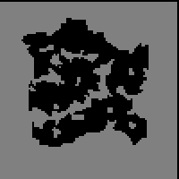

# Talk Like a Pirate Day Event (2009/09/15) ~ (2009/10/06)

> **Note:** Not implemented on iRO Classic.

## Quest 1

<!-- Quest info -->
- **Level requirement:** 60
- **Item requirement:** 2 Alcohol, 2 Karvodailnirol, 30 Steel, 10 Oridecon, 1 Iron Hammer, 15 Trunk, 2 Elunium, 2 Glass Bead, 10 Rusty Screw
- **Zeny requirement:** 100,000
- **Base EXP reward:** Varies
- **Job EXP reward:** Varies
- **Item reward:** Pirate Dagger, Pirate Eye Bandage
- **External:** <http://iro.ragnarokonline.com/News/Notice/noticeView.asp?noticeSeqNo=1017&mNum=1>
- **Window:** Yes

1. Visit Weather Beaten Old Man in the east room of Hugel Pub ([Hugel](Hugel.md) 127,66).

2. Listen to what he says and respond with "Wow, that sounds like my kinda lifestyle!" and he will offer to make a Pirate Dagger in exchange for some materials.

  *  2 Alcohol
  *  2 Karvodailnirol
  *  20 Steel
  *  8 Oridecon
  *  1 Iron Hammer
  *  15 Trunk

3. Talk to him with the items in your inventory to receive a Pirate Dagger.

    **NOTE: players must be above [Base Level](Levels.md) 60 to continue past this point**

4. After receiving a dagger, Talk to him again to hear of his woe's with the Kraken and Turtle Island.  He mentions that he entered a strange swamp (tur_dun06 Underground Swamp Zone) from the map with the throne room.

5. Immediately south of the throne room on the Turtle Palace map, Players will be taken to the swamp where Capitan Wesley had stored his treasure. (south west (tur dun04 71, 50) for 80+ and south east (tur dun04 132, 62) for 60+)

    **CAUTION: If you relog or are disconnected on the swamp map, you will be returned to your respawn point.**

6. At various points around the swamp, players will search for pieces of a map, pieces of a key, pieces of a shovel, and finally the Pirates Treasure box.  There are no hostile monsters on the swamp map.  Hover your mouse cursor over various search point locations to perform your search.  The search points must be done in order as follows

  {| class="wikitable"
|+ Coordinates
! 60+ to 80- !! 80+
|-
| Top Left (27,79)|| Top Right (77,73)
|-
| Center Left (24,53)|| Center (44,43)
|-
| Top Right (79,74)|| Bottom Right (78,22)
|-
| Bottom Left (18,26)|| Top Left (27,79)
|-
| Center (44,43)|| Bottom Left (18,31)
|-
| Bottom Right (76,22)|| Center Left (16,49)
|}

7. After obtaining his treasure box, return to Capitan Wesley in [Hugel](Hugel.md).  The player can avoid using a butterfly wing by relogging in the swamp as that returns a character to its respawn point. Wesley will insist that the player keep the treasure box, however since the key for it is broken he needs a few materials to make a new one

  *  10 Steel
  *  2 Elunium
  *  2 Oridecon
  *  2 Glass Bead
  *  10 Rusty Screw
  *  100,000 zeny

8. After bringing the materials, Capitan Wesley will make a lock pick to open the lock.  There is a time delay in the making of lock picks.  After getting a lock pick, the player will participate in a "battle" with the lock on the treasure box similar to the battle with Sudri in the [Seal of Mjolnir Quest](God_Items_Quest.md), with the important exception that it is rather difficult to lose.

  *  Note: if the pick is close to breaking, the player should select the option "Dry Hands" to restore 15 durability to the pick. Dry Hands then Apply Pressure to the Lock repeatedly works well, although it may begin to fail or become too random near the end.

9. After successfully bringing the lock's durability to zero, the box will open and players will receive a Pirate Eye Bandage.

## Quest 2

<!-- Quest info -->
- **Level requirement:** Unknown
- **Item requirement:** 10 Squid Ink, 5 Feather of Birds, 6 Worn Out Page, 1 Key of Clock Tower OR 1 Key of Underground
- **Items required:** Eye Patch (Purchasable at the Payon armor dealer) OR Pirate Dagger (Available only through previous quests.)
- **Base EXP reward:** Varies
- **Job EXP reward:** Varies
- **External:** <http://iro.ragnarokonline.com/News/Notice/noticeView.asp?noticeSeqNo=1017&mNum=1>
- **Window:** Yes

1. Head to [Comodo](Comodo.md) and talk to "J Roger" at (*217, 141*) wearing your pirate gear and pick the obvious choices.
1. Head to the east cave (*beach_dun3*)  Talk to the "Half Buried Chest" at either (*86, 65*), (*95, 87*), (*191, 213*), (*270, 74*) or (*244, 31*).  Do so until it gives you a "Treasure Box".
1. Head back to Comodo and once again talk to "J Roger".  He will give you your first EXP reward.
1. Talk to him again and he will ask you for the items to make a treasure map.
1.
  1. Talk to him when you have gathered the items and he prepares the map.  Talk to him again and he'll give you the map as well as the now locked Treasure Box.
  1. The place he sends you appears to be random.  If he says *"in front of the shore, where the light house is"* then see **Step 6a**.   If he says *"the shore of the Romantic Island  where Mobsters wander"*, **Step 6b**.  If he says *"the screeching bridge where wild otters play"*, go to **Step 6c**.
1.
  1. Head to Comodo Pharos Beacon (*cmd fild07*), you can teleport there via the [Comodo](Comodo.md) [Kafra](Kafra.md) Employee. As soon as you get there you'll get a popup and a marker on your mini-map of where to bury the treasure. **Note:** It's best to walk as teleporting or flywinging removes the marker from your map. Once at the marker, bury the treasure in the "Soft Earth" located between a bunch of trees. Follow the prompts, and drink the whatsit for your second EXP reward. **Skip to Step 7**.
  1. Head to Comodo Field 02 (*cmd fild02* one north, two west of Pharos Lighthouse (162,117)).  As soon as you get there you'll get a popup and a marker on your mini-map of where to bury the treasure. **Note:** It's best to walk as teleporting or flywinging removes the marker from your map. There are two portals to the map, the marker will not come up unless you enter from the portal on the beach.  Once at the marker, bury the treasure in the "Soft Earth".  Follow the prompts, and drink the whatsit for your second EXP reward.  **Skip to Step 7**.
  1. Head to Comodo Field 04 (*cmd fild04* One north, one west of Pharos Lighthouse). 4 As soon as you get there you'll get a popup and a marker on your mini-map of where to bury the treasure. **Note:** It's best to walk as teleporting or flywinging removes the marker from your map.  Once at the marker, bury the treasure in the "Soft Earth" located in the grass to the south of the bridge.  Follow the prompts, and drink the whatsit for your second EXP reward.
1. Go back to [Comodo](Comodo.md) to talk to "J Roger".  He informs you that the treasure has been stolen!  (Somehow..)  And the culprit is a pirate anchored near the lighthouse.  You can get to the lighthouse via the Comodo Kafra Employee (Comodo Pharos Beacon).
1. The pirate captain is located at (*80, 119*) on Beacon Island (*cmd fild07*).  Talk to him a couple times until he asks you to tell him the pirate spirit.  The answers are:
  * "Great"
  * "sailors"
  * "Help"
  * "the weak and old"
1.   Then
  * "conciliate him"
  * "You preach at him"
1.   He gives you an "old compass" to return to the boy (J Roger) as well as your final EXP reward.
  * Quest is Repeatable.

## EXP Rewards

*Experience Reward (Valkyrie Server):
* 250,000 [Base Experience](Base_EXP_Chart.md) and 70,000 [Job Experience](Job_EXP_Chart.md) per reward wearing one piece of equipment.
* 312,500 [Base Experience](Base_EXP_Chart.md) and 87,500 [Job Experience](Job_EXP_Chart.md) per reward wearing two pieces of equipment.
* 375,000 [Base Experience](Base_EXP_Chart.md) and 105,000 [Job Experience](Job_EXP_Chart.md) per reward when wearing all three.*Experience Reward (Premium Servers):
* 375,000 [Base Experience](Base_EXP_Chart.md) and 105,000 [Job Experience](Job_EXP_Chart.md) per reward wearing one piece of equipment.
* 468,000 [Base Experience](Base_EXP_Chart.md) and 131,250 [Job Experience](Job_EXP_Chart.md) per reward wearing two pieces of equipment.
* 562,500 [Base Experience](Base_EXP_Chart.md) and 157,500 [Job Experience](Job_EXP_Chart.md) per reward when wearing all three.

''Valid Equipment:
* Top Headgear: Corsair, Pirate's Pride - Pirate Bandana does not count.
* Mid Headgear: NPC-bought Eye Patch, and quest reward Pirate Eye Bandage
* Lower Headgear: Pirate Dagger.

---
**Categories:** [Base Experience Reward](categories/Base_Experience_Reward.md), [Job Experience Reward](categories/Job_Experience_Reward.md), [Quest Window Quests](categories/Quest_Window_Quests.md), [Temporary Event Quests](categories/Temporary_Event_Quests.md)
*Source: [iRO Wiki Classic](https://irowiki.org/classic/Talk_Like_a_Pirate_Day_Event_%282009/09/15%29_~_%282009/10/06%29) — GFDL 1.3+*
