# Talk Like a Pirate Day Event (2013/9/18)

<!-- Quest info -->
- **Level requirement:** None?
- **Base EXP reward:** 150,000 (VIP) (May vary by level or by which location you go to??)
- **Job EXP reward:** 37,500 (VIP)
- **Item reward:** Pirate's Folly [1], Some random misc. items
- **External:** <http://playragnarok.com/news/eventdetail.aspx?id=295>
- **Window:** Yes

> **Repeatable** — cooldown: 3 hour

1. Speak to **Captain Whitebeard** in [Prontera](Prontera.md) (154,120)
1. Tell him you want to look for the treasure and receive an eyepatch box from him.
1. Open the eyepatch box and use a magnifier on the glasses you receive.
1. Equip the eyepatch (It's a costume headgear) and kill monsters to receive **Sealed Envelopes**.
1. Open these **Sealed Envelopes** to receive **Tattered Maps**.
1. These maps will guide you to a spot where treasure can be found.
1. Walk near the location indicated by the map. There should be a lump of dirt near it. (You only need to go to 1 map-indicated spot to finish the quest.)
1. Kill the **Undead Pirates** and click on the chest that appears in place of the lump.
1. You should receive a few items.
1. Return to **Captain Whitebeard** for your Pirate's Folly [1].
1. Wait 3 hours and you can repeat the quest again.

## The Maps (36/36)

| Map | Location | Other Info |
| --- | --- | --- |
| 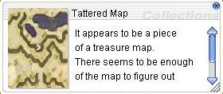 | Moc_fild12 (xx,yy) | 1 map South of [Morroc](Morroc.md) |
| 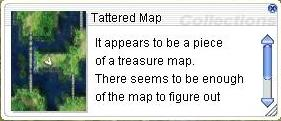 | Pay_fild04 (208,178) | Poring Island 2 South and 1 East of [Prontera](Prontera.md) |
| 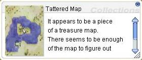 | Moc_fild11 (200,215) | 1 South and 1 East of [Morroc](Morroc.md) |
| 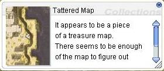 | Moc_fild16 (260,235) | 2 South and 2 East of [Morroc](Morroc.md) |
| 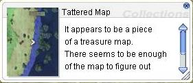 | Hu_fild06 (xx,yy) | 1 Map South of [Hugel](Hugel.md) |
| 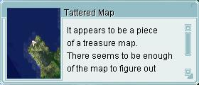 | Tur_dun01 (xx,yy) | This is the top left leg on Turtle Island. **Not** inside the dungeon. You can get there from the docks in [Alberta](Alberta.md). You must have started [Turtle Island Entrance Quest](Turtle_Island_Entrance_Quest.md). |
| 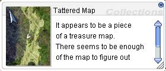 | Hu_fild05 (xx,yy) | Abyss Lake Map 1 South and 1 West of [Hugel](Hugel.md) |
| 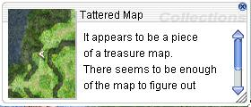 | Gef_fild03 (169,170) | 1 map East of Orc Village or 1 South and 3 West of [Prontera](Prontera.md) |
| 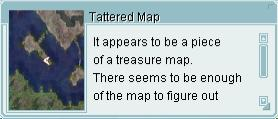 | Mjolnir_12 (101,94) | 1 map South of [Aldebaran](Al_De_Baran.md) |
| 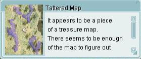 | Ra_fild01 (xx,yy) | Ice Dungeon Map 1 East and 3 North of [Rachel](Rachel.md) (The lump is actually more to the left and in the water) |
| 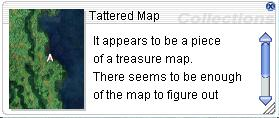 | Pay_fild09 (318,173) | 2 maps East of [Payon](Payon.md) |
| 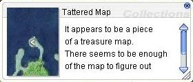 | Gef_fild09 (141,163) | 1 West, then 1 South and then 1 East of [Geffen](Geffen.md) |
| 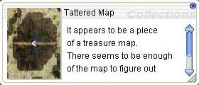 | Cmd_fild04 (125,262) | 3 East and 1 South of [Comodo](Comodo.md) (Including West through the cave map) |
| 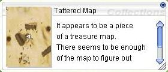 | Moc_fild17 (270,280) | 2 South and 1 East of [Morroc](Morroc.md) |
| 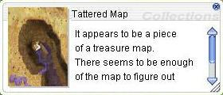 | Ve_fild07 (xx,yy) | 1 South of [Veins](Veins.md) |
| 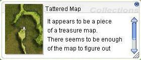 | prt_fild08 (54,61) | 1 South of [Prontera](Prontera.md) (To get there you must go 2 South of Prontera and enter the portal on the top left of that map.) |
| 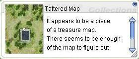 | Lhz_fild01 (xx,yy) | 1 North of [Lighthalzen](Lighthalzen.md) |
| 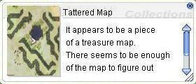 | Prt_fild09 (277,280) | 2 South and 1 West of [Prontera](Prontera.md) |
| 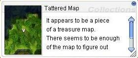 | izlu2dun (xx,yy) | Bylan Island. Talk to the NPC in [Izlude](Izlude.md) that warps you to Bylan Island. |
| 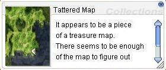 | Prt_fild03 (xx,yy) | 1 East, then 1 North, then 1 East of [Prontera](Prontera.md) |
| 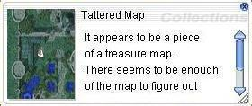 | Glast_01 (xx,yy) | 2 West, then 1 North, then 1 West of [Geffen](Geffen.md) |
| 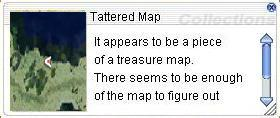 | Hu_fild05 (xx,yy) | Abyss Lake Map 1 South and 1 West of [Hugel](Hugel.md) |
| 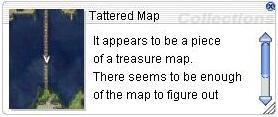 | Yuno_fild01 (182,272) | 1 North of [Aldebaran](Al_De_Baran.md) |
| 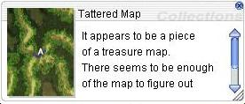 | Gef_fild02 (216,207) | 1 South and 2 West of [Prontera](Prontera.md) |
| 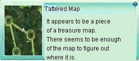 | Um_fild02 (xx,yy) | 2 South of [Umbala](Umbala.md) |
| 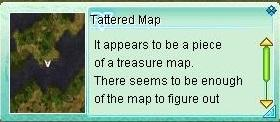 | Gef_fild11 (245,147) | 2 South of Orc Village or 2 South and 4 West of [Prontera](Prontera.md) |
| 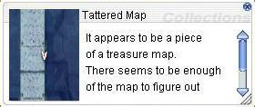 | Gef_fild04 (211,164) | 1 North of [Geffen](Geffen.md) |
| 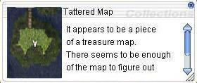 | Gef_fild05 (237,162) | 1 North and 1 West of [Geffen](Geffen.md) |
| 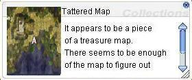 | Odin_tem01 (147,107) | In [Hugel](Hugel.md) speak to the boatsman to go to Odin's Temple. First start the [Odin's Temple Excavation Quest](Odin's_Temple_Excavation_Quest.md). |
| 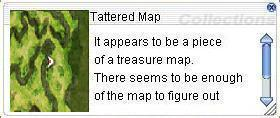 | Prt_fild01 (331,172) | From [Prontera](Prontera.md) go North through the castle and the WoE Realm until you reach the first field map. |
| 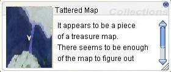 | Cmd_fild02 (96,139) | 2 East and 1 South of [Comodo](Comodo.md) (Including the cave going East) |
| 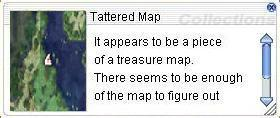 | Hu_fild02 (74,217) | 1 South then 2 West then 1 North of [Hugel](Hugel.md) |
| 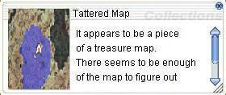 | Yuno_fild11 (xx,yy) | North 1 and West 2 of [Aldebaran](Al_De_Baran.md) |
| 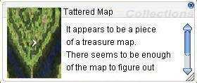 | Mjolnir_09 (212,213) | 1 West and 1 North of [Prontera](Prontera.md) |
| 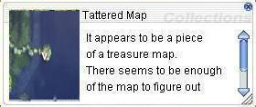 | Gef_fild07 (179,242) | 1 West of [Geffen](Geffen.md) |
| 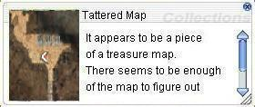 | Ein_fild06 (xx,yy) | 2 South of [Juno](Juno.md) |

---
**Categories:** [Base Experience Reward](categories/Base_Experience_Reward.md), [Job Experience Reward](categories/Job_Experience_Reward.md), [Quest Window Quests](categories/Quest_Window_Quests.md)
*Source: [iRO Wiki Classic](https://irowiki.org/classic/Talk_Like_a_Pirate_Day_Event_%282013/9/18%29) — GFDL 1.3+*
