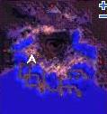
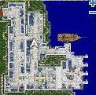
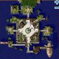

# Tame Ingredients

*For a list of other NPC items, go to [Item Mixing](Item_Mixing.md).*

| Pet | Tame | Ingredients | NPC and Location | Map Location |
| --- | --- | --- | --- | --- |
| Bongun | Her Heart | 1 Girl's Diary 1 Daenggie | Munak's Grandma Comodo (comodo 112, 182) |  |
| Rocker | Singing Flower | 1 Singing Plant | Monster Tamer Alberta Tool Shop (alberta_in 173, 76) |  |
| Hunter Fly | Monster Juice | 1 Animal Gore 2 Apple | Monster Tamer Alberta Tool Shop (alberta_in 173, 76) |  |
| Orc Warrior | Orc Trophy | 1 Chivalry Emblem 1 Scorpion Tail | Monster Tamer  Izlude Tool Shop   (izlude_in 128, 64) |  |
| Baphomet Jr. | Book of the Devil | 1 Old Magic Book 2 Horrendous Mouth | Monster Tamer  Izlude Tool Shop   (izlude_in 128, 64) |  |
| Munak | No Recipient | 1 Old Portrait | Monster Tamer  Izlude Tool Shop   (izlude_in 128, 64) |  |

## See Also

* [Pet System](Pet_System.md)

**Related pages:**

* [Items](Items.md)
* [Armor](Armor.md)
* [Headgear](Headgears.md)
* [Weapons](Weapons.md)
* [Weapon Materials](Weapon_Materials.md)
* [Garments](Garments.md)
* [Footgear](Footgear.md)
* [Accessories](Accessories.md)
* [Equipment Sets](Equipment_Sets.md)
* [Skill Equipment](Skill_Equipment.md)
* [Cards](Card_System.md)
* [Card Reference](Card_Reference.md)
* [Card Sets](Card_Sets.md)
* [Item Mixing](Item_Mixing.md)
* [Juice Ingredients](Juice_Ingredients.md)
* [Potion Ingredients](Potion_Ingredients.md)
* [Dye Ingredients](Dye_Ingredients.md)
* [Tame Ingredients](Tame_Ingredients.md)
* [Headgear Ingredients](Headgear_Ingredients.md)
* [Headgear Quests](Headgear_Quests.md)
* [Pet Equipment](Pet_Equipment.md)
* [Counteragent and Mixture Quest](Counteragent_and_Mixture_Quest.md)
* [Quest Items](Quest_Items.md)
* [Healing Items](Healing_Items.md)
* [Autocast](Autocast.md)

---
**Categories:** [Item Mixing](categories/Item_Mixing.md)
*Source: [iRO Wiki Classic](https://irowiki.org/classic/Tame_Ingredients) — GFDL 1.3+*
