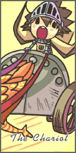
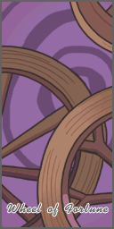
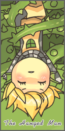
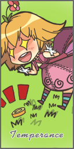
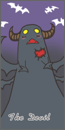
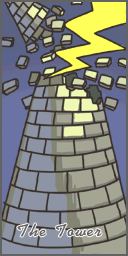

# Tarot Card of Fate

<!-- Skill info -->
- **Class:** Gypsy
- **Secondary class:** Minstrel
- **Type:** Offensive
- **Levels:** 5 (Fixed)
- **Prerequisites:** ([Archer](Archer.md)) [Improve Concentration](Improve_Concentration.md) Lv. 10, ([Bard](Bard.md)) [Unchained Serenade](Unchained_Serenade.md) Lv. 3, ([Dancer](Dancer.md)) [Hip Shaker](Hip_Shaker.md) Lv. 3
- **SP cost:** 40 (if successful)
- **Cast time:** 1
- **Delay:** 3
- **Target:** Foes
- **Range:** 9

## Description

Causes a Random effect from a list of fourteen "cards" when successful.

| Level | Success Rate |
| --- | --- |
| 1 | 8% |
| 2 | 16% |
| 3 | 24% |
| 4 | 32% |
| 5 | 40% |

## Cards

| Depiction | Card Name | Effect |
| --- | --- | --- |
|  | The Fool | Reduces target's SP to 0. |
|  | The Magician | Cuts target's MATK in half for 30 seconds. |
|  | The High Priestess | Removes all buffs on target. |
|  | The Chariot | Deals 1000 DEF-ignoring damage to target. Randomly breaks one of target's armors. |
|  | Strength | Cuts target's ATK in half for 30 seconds. |
|  | The Lovers | Randomly teleports the target (on maps that allow teleport) and heals the caster by 2000 HP. |
|  | Wheel of Fortune | Randomly causes the effects of two other tarot cards. |
|  | The Hanged Man | Target is [Frozen](Status_Effects.md)/[Stone Cursed](Status_Effects.md)/Stop at 100% chance. |
|  | Temperance | Target has [Chaos](Status_Effects.md) effect for 30 seconds. |
|  | The Devil | Deals 6666 DEF-ignoring damage to the target, halves ATK and MATK for 30 seconds, and causes [Curse](Status_Effects.md). |
|  | Death | Target gets [Cursed](Status_Effects.md), [Coma](Status_Effects.md)'d, and [Poison](Status_Effects.md)ed. |
|  | The Tower | Deals 4444 DEF-ignoring damage to the target. |
|  | The Star | Target is [Stunned](Status_Effects.md) for 5 seconds. |
|  | The Sun | Cuts target's [ATK](Stats.md), [MATK](Stats.md), [Flee](Stats.md) rate, [HIT](Stats.md), and [DEF](DEF.md) by 20% for 30 seconds. |

## Notes

*  The skill's 40% success rate cannot be further increased by the caster.
*  The target cannot reduce the skill's success rate, but his or her resistance to status effects (e.g. Curse, Poison, Stone, etc.) is taken into account.
*  Cast time can be reduced by increasing [DEX](Stats.md).
*  [SP](SP.md) is not consumed, but Cast Delay applies, when this skill fails.
*  This skill works through [Pneuma](Pneuma.md).
*  Damage is not reduced in WoE.

**Related pages:**

* [Bard](Bard.md)
* [Minstrel](Minstrel.md)
* [Skills](Skills.md)
* [Amp](Amp.md)
* [Encore](Encore.md)
* [Impressive Riff](Impressive_Riff.md)
* [Slow Grace](Slow_Grace.md)
* [Magic Strings](Magic_Strings.md)
* [Lady Luck](Lady_Luck.md)
* [Melody Strike](Melody_Strike.md)
* [Music Lessons](Music_Lessons.md)
* [Pang Voice](Pang_Voice.md)
* [Perfect Tablature](Perfect_Tablature.md)
* [Focus Ballet](Focus_Ballet.md)
* [Song of Lutie](Song_of_Lutie.md)
* [Gypsy's Kiss](Gypsy's_Kiss.md)
* [Unbarring Octave](Unbarring_Octave.md)
* [Unchained Serenade](Unchained_Serenade.md)
* [Ensemble Skill](Ensemble_Skill.md)
* [Acoustic Rhythm](Acoustic_Rhythm.md)
* [Battle Theme](Battle_Theme.md)
* [Classical Pluck](Classical_Pluck.md)
* [Down Tempo](Down_Tempo.md)
* [Harmonic Lick](Harmonic_Lick.md)
* [Lullaby](Lullaby.md)
* [Mental Sensing](Mental_Sensing.md)
* [Power Cord](Power_Cord.md)
* [Ragnarok](Ragnarok.md)
* [Arrow Vulcan](Arrow_Vulcan.md)
* [Marionette Control](Marionette_Control.md)
* [Tarot Card of Fate](Tarot_Card_of_Fate.md)
* [Longing for Freedom](Longing_for_Freedom.md)
* [Hermode's Rod](Hermode's_Rod.md)
* [Sheltering Bliss](Sheltering_Bliss.md)
* [Quests](Quests.md)
* [Bard Job Change Guide](Bard_Job_Change_Guide.md)
* [Bard Skill Quest](Bard_Skill_Quest.md)
* [Rebirth Walkthrough](Rebirth_Walkthrough.md)
* [Weapons](Weapons.md)
* [Bow](Bow.md)
* [Instrument](Instrument.md)

**Related pages:**

* [Dancer](Dancer.md)
* [Gypsy](Gypsy.md)
* [Skills](Skills.md)
* [Amp](Amp.md)
* [Charming Wink](Charming_Wink.md)
* [Dance Lessons](Dance_Lessons.md)
* [Dazzler](Dazzler.md)
* [Encore](Encore.md)
* [Focus Ballet](Focus_Ballet.md)
* [Perfect Tablature](Perfect_Tablature.md)
* [Gypsy's Kiss](Gypsy's_Kiss.md)
* [Song of Lutie](Song_of_Lutie.md)
* [Hip Shaker](Hip_Shaker.md)
* [Lady Luck](Lady_Luck.md)
* [Magic Strings](Magic_Strings.md)
* [Slinging Arrow](Slinging_Arrow.md)
* [Slow Grace](Slow_Grace.md)
* [Impressive Riff](Impressive_Riff.md)
* [Ensemble Skill](Ensemble_Skill.md)
* [Acoustic Rhythm](Acoustic_Rhythm.md)
* [Battle Theme](Battle_Theme.md)
* [Classical Pluck](Classical_Pluck.md)
* [Down Tempo](Down_Tempo.md)
* [Harmonic Lick](Harmonic_Lick.md)
* [Lullaby](Lullaby.md)
* [Mental Sensing](Mental_Sensing.md)
* [Power Cord](Power_Cord.md)
* [Ragnarok](Ragnarok.md)
* [Arrow Vulcan](Arrow_Vulcan.md)
* [Marionette Control](Marionette_Control.md)
* [Tarot Card of Fate](Tarot_Card_of_Fate.md)
* [Longing for Freedom](Longing_for_Freedom.md)
* [Hermode's Rod](Hermode's_Rod.md)
* [Sheltering Bliss](Sheltering_Bliss.md)
* [Quests](Quests.md)
* [Dancer Job Change Guide](Dancer_Job_Change_Guide.md)
* [Dancer Skill Quest](Dancer_Skill_Quest.md)
* [Rebirth Walkthrough](Rebirth_Walkthrough.md)
* [Weapons](Weapons.md)
* [Bow](Bow.md)
* [Whip](Whip.md)

---
**Categories:** [Gypsy](categories/Gypsy.md), [Minstrel](categories/Minstrel.md), [Offensive Skills](categories/Offensive_Skills.md), [Status Inflicting Skills](categories/Status_Inflicting_Skills.md)
*Source: [iRO Wiki Classic](https://irowiki.org/classic/Tarot_Card_of_Fate) — GFDL 1.3+*
