# Thanatos Tower Quest/old

> **Note:** Not implemented on iRO Classic.

<big>**NOTE: THIS IS THE OLD VERISON OF THIS QUEST. FOR THE CURRENT THANATOS QUEST ON iRO, GO TO
[THIS PAGE](Thanatos_Tower_Quest.md)!**</big>

<!-- Quest info -->
- **Level requirement:** None
- **Party requirement:** 5+ People for Level 3 Access
- **Item requirement:** 1 Fragment of Misery, 1 Fragment of Agony, 1 Fragment of Hatred, 1 Fragment of Despair
- **Items required:** Equippable Level 4 Weapon
- **Quests required:** Transcendent Class or 95+ Expanded Class characters
- **Quest reward:** Ability to Summon Memory of Thanatos (Repeatable)

*  Note: *In order to access floors higher than 6, players must be either a Transcendent class or Expanded class above level 95.*

*  Note: *If you do NOT intend to finish the entire quest at one time, you should be aware that once you obtain the Keys (possibly the stones as well), they cannot be put into storage or dropped. If every amount of weight counts on your character, you would be wise not to do this quest if you don't intend to do it to completion (or at least until you use all of the items).*

1. On Thanatos Tower 1F you should find a representative NPC (tha_t01 149 78) who is looking for recruits for those wishing to explore the tower. Sign up with her for the quest.

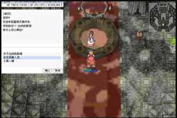

2. A guide on Thanatos Tower 2F (tha_t02 231 161) blocks the entrance to 3F. You will need to gather 5 or more players will the guide open the door to 3F. Its not required that you be in the same party to enter. If you have not received the quest from step 1, you will not be able to enter this portal.

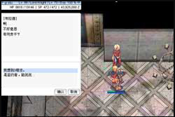

3. On 3F (tha_t03 67 70) you'll find a strange mechanism. Using a Lv. 4 weapon, you can pry the device open, obtaining a Red Key.

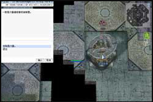

4. On 4F (tha_t04 195 195) you'll find another strange mechanism. The mechanism can be opened by solving a puzzle, similar to mastermind if you've ever played it. The machine will guess 3 numbers between 1 and 9 (none repeating), and you will be required to crack the password. Each round you can guess 3 numbers from 1-9 (no repeats), and the machine will inform you how many of the numbers you chose were correct and in the proper location, and how many numbers are correct but not in the right location. You have 5 rounds to guess the correct code or you will be required to restart.

When you correctly complete this puzzle, you will obtain a Yellow Key.

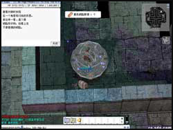

5. On 5F (tha_t05 101 37), there will be a third mechanism. This device is closed so strongly that you can only open it with the strength of many. Attempting to open the mechanism with 3 or more people nearby to help will gain you the Blue Key.

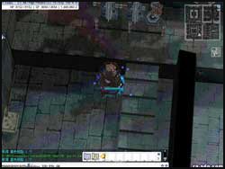

6. On 6F (tha_t06 43 152), there will be a fourth mechanism. Nearby, there will be 5 wheels which you can turn and adjust. Through trial and error, turn all the wheels so they make till they make the same sound and the machine will activate. Here you will obtain the Green Key.

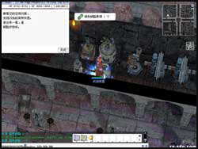

7. On the 9th floor (tha_t09 19 168), you will find the last mechanism. In order to open this, you will require either the Red Key or Red Charm Stone, Yellow Key or Yellow Charm Stone, the Blue Key or Blue Charm Stone, and Green Key or Green Charm Stone. With all 4 of these items, enter either "**Keys**" or "**Charms**" to obtain the Black Key.

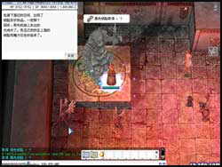

8. Once you've obtained all 5 colored keys you'll need to leave and re-enter the tower (in order to get back to lower floors). Returning to 4F (tha_t04 150 44), you will find a magical seal. When you try to open it, type in "**Blue Key**", and you will receive a Blue Charm Stone.

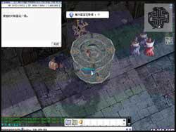

9. On 5F (tha_t05 218 116) you will find a second magic seal. Enter "**Red Key**", and you will receive the Red Charm Stone.

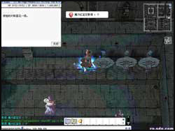

10. On 6F (tha_t06 226 230) you will find the third magic seal. Enter "**Black Key**", and you will receive the Black Charm Stone.

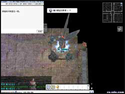

11. Now on 7F (tha_t07 113 129), you will find the fourth magic seal. Enter "**Yellow Key**", and you will receive the Yellow Charm Stone.

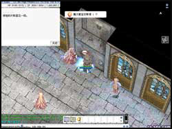

12. On 10F (tha_t10 129 159), you will find the fifth and final magic seal. Enter "**Green Key**", and you will receive the Green Charm Stone.

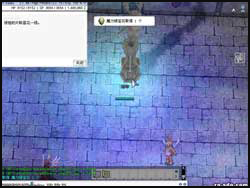

13. With all the magical jewels, you are now ready to open the pathway to the top of the tower. Make your way to the uppermost floor. On this 12th floor, start by placing the Red Charm Stone into the first statue (tha_t12 96 58) in the northwest direction.

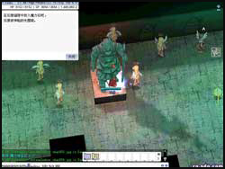

14. Place the Yellow Charm Stone into the second statue (tha_t12 161 58) in the northeast direction.

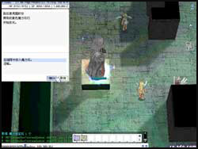

15. Then place the Blue Charm Stone into the third statue (tha_t12 104 18) in the southwest direction.

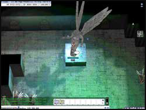

16. Place the Black Charm Stone into the fourth statue (tha_t12 128 86) in the north direction.

17. Place the Green Charm Stone into the final statue in the southeast direction. The pathway to the top of the tower should now appear in the center of the floor.

18. On the southeast platform you'll find a magic circle (thana_boss 217 167). For this you will need to have a Fragment of Agony or you will be unable to proceed. Fragment of Agony is dropped by Dolor of Thanatos. Walk over the magic circle and enter "**Fragment of Agony**". At this time, a Dolor of Thanatos will appear.

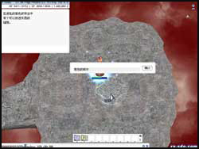

19. Once the first wave of monsters is defeated, proceed to the northeast platform (thana_boss 202 75). This time you will need a Fragment of Misery. Without this item, you will be unable to proceed. Place the "**Fragment of Misery**" in the magic circle, a Maero of Thanatos will appear.

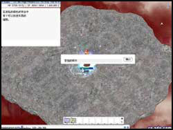

20. On the northwest platform (thana_boss 80 76), you will need a Fragment of Despair. When you place the "**Fragment of Despair**", a Despero of Thanatos will appear.

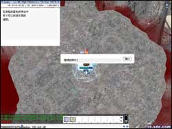

21. On the southwest platform (thana_boss 62 171), you will need a Fragment of Hatred. When you place the "**Fragment of Hatred**", an Odium of Thanatos will appear.

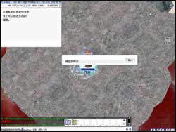

22. With all four fragments in place, you can finally break the seal. On the north platform, there will be a switch (thana_boss 141 218). Activating this seal will summon 1 of each of Thanatos' incarnations.

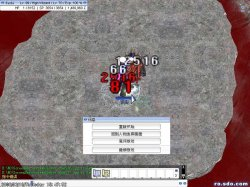

23. Once all 4 ghosts have been defeated, Memory of Thanatos will spawn south of the statue on the center platform.

---
**Categories:** [Noghalt Quests](categories/Noghalt_Quests.md), [Quests](categories/Quests.md)
*Source: [iRO Wiki Classic](https://irowiki.org/classic/Thanatos_Tower_Quest/old) — GFDL 1.3+*
