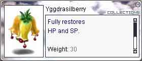
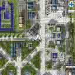
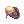
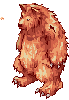
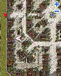
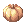
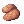
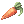
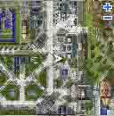

# Thanksgiving Event (2006/11/21) ~ (2006/11/28)

> **Note:** Not implemented on iRO Classic.

| Column 1 | Column 2 |
| --- | --- |
| **Event Ends** | November 28th, 2006 |
| **Difficulty** | Medium |
| **Cost** | 1,045z + Transport |

## What you get and what it requires

## Your reward for doing the quest is:

## Items

| Column 1 | Column 2 |
| --- | --- |
|    **Item**   |    **Description**   |
|      Yggdrasil Berry 2ea    Yggdrasil Berry 10ea if level 99 base. (unconfirmed)   |   |

## EXP

| Column 1 | Column 2 | Column 3 |
| --- | --- | --- |
| **Base Level** | **EXP** | **Percent** |
| 97 | 1,054,665 | 1.8% |
| 92 | 815,497 | 7% |
| 86 | 497,000 | 8% |
| 76 | 328,098 | 7.2% |
| 75 | 196,000 | 8.8% |

You may only do the quest once.

## The quest requires:

| Column 1 | Column 2 | Column 3 |
| --- | --- | --- |
|    **Item**   |    **Cost**   |    **Where to find**   |
|      Meat 10ea   | 50z |    Butcher in Lighthalzen General Store (202,160)    |
|      Yam 2ea   | N/A |  Grizzlies   at mag_dun01  From Juno:  1S, 1E  Yam |
|      Milk 5ea   | 25z |  Vendor from Milk Ranch in Prontera (76,136)  |
|    Pumpkin 5ea | 15z | Vegetable Gardener in Lighthalzen General Store |
|    Potato 10ea | 15z | Vegetable Gardener in Lighthalzen General Store |
|    Carrot 10ea | 15z | Vegetable Gardener in Lighthalzen General Store |
|    Alcohol 1ea | N/A |  Red Mushrooms   at prt_fild10  From Prontera:   2S, 2W  Alcohol |
|    Trunk 10ea | N/A |  Karakasa   at ama_fild01  Trunk |
|    Iron Ore 3ea | N/A |  Metaling   at lhz_fild01  From Lighthalzen:  N  Iron Ore |
|    Strawberry 5ea | N/A |  Yoyo   at prt_fild03  From Prontera:  1N, 2E  (Must pass through castle and WoE Map)  Strawberry |
|    Apple 3ea | 15z | Fruit Gardener at Lighthalzen General Store |

## Starting the quest

Make your way to (227,147) in Lighthalzen

where you will encounter the Brandos. They're all getting ready for Thanksgivin, and need various items.

First talk to Mr. Brando. He needs 10 meats  and 2 yams . Bring him the items for some EXP.

After helping Mr. Brando, turn your attention to Mrs. Brando. She is making Pumpkin Potato Bisque, and needs 5 milk , 5 pumpkins , 10 carrots , and 10 potatoes . Bring her the items for some more EXP.

After her, you need to help Grandma Brando. The holidays must be a bit too much for her, because she wants you to fetch her a vial of 200-proof alcohol . She'll reward you with some more EXP.

After Grandma, talk to Kipp. He wants 10 trunks  and 3 iron ore , though he'll tell you he only wants 3 trunks. You must bring 10 to complete this part of the quest.

Finally, talk to Cherise. She wants 5 Strawberries  and 3 apples  to make some jam. She'll give you some more EXP.

After you help Cherise, talk to her once more to receive 2 Yggdrasil Berries . Now, whenever you talk to one of the Brandos, they'll heal your HP and SP. You may be healed as often as you like, but you cannot get any more Yggdrasil Berries.

## References

*  Original guide from the [First Bank of iRO](http://robank.tacorner.com/thx)

---
**Categories:** [Base Experience Reward](categories/Base_Experience_Reward.md), [Quests](categories/Quests.md), [Temporary Event Quests](categories/Temporary_Event_Quests.md)
*Source: [iRO Wiki Classic](https://irowiki.org/classic/Thanksgiving_Event_%282006/11/21%29_~_%282006/11/28%29) — GFDL 1.3+*
