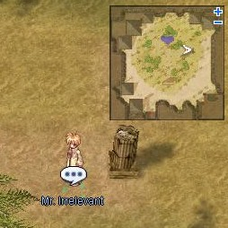

# Thief Job Change Guide

<!-- Quest info -->
- **Level requirement:** None
- **Job level requirement:** 10
- **Class requirement:** Novice
- **Item requirement:** Varies
- **Quest reward:** Jobchange to [Thief](Thief.md)
- **Cat:** no

1. Head off to the Pyramids, which is north-west of [Morroc](Morroc.md).

2. At the pyramid (58,159), enter, and head for the middle of the map to the Thief Guild (90,105).

3. Once inside, follow the hallway down and take the left gate (90,115). In here you will see two NPCs that will guide you through the quest.

4. Talk to the one closest to the portal. She will ask you a few questions, then instruct you to find an "Irrelevant Man" somewhere outside the Pyramid (141, 125) in order to steal mushrooms from a nearby mushroom farm.

5. At the farm, kill the mushrooms and collect the mushrooms that drop.  Aggressive Fabres and Chonchons (and Spores, but they're not aggresive) protect the farm, so you may want to avoid them.  Your mission is to collect at least mushrooms worth of 25 points.

| Mushroom | Point Value |
| --- | --- |
| Orange Gooey Mushroom | 1 Point |
| Orange Net Mushroom | 3 Points |

* **Note**: If you die, you can talk to Mr. Irrelevant to return to the farm as many times as needed.

6. After collecting a sufficient amount of Mushrooms, head back to Thief Guild.

7. Talk to NPC farthest from the warp portal. He will count your mushrooms and if you have enough points, he will promote you to a Thief.

**Related pages:**

* [Thief](Thief.md)
* [Skills](Skills.md)
* [Back Slide](Back_Slide.md)
* [Detoxify](Detoxify.md)
* [Envenom](Envenom.md)
* [Find Stone](Find_Stone.md)
* [Hiding](Hiding.md)
* [Improve Dodge](Improve_Dodge.md)
* [Sand Attack](Sand_Attack.md)
* [Steal](Steal.md)
* [Stone Fling](Stone_Fling.md)
* [Quests](Quests.md)
* [Thief Job Change Guide](Thief_Job_Change_Guide.md)
* [Thief Skill Quest](Thief_Skill_Quest.md)
* [Thief Training Quest](Thief_Training_Quest.md)
* [Weapons](Weapons.md)
* [Dagger](Dagger.md)
* [Bow](Bow.md)

---
**Categories:** [Job Change Guide](categories/Job_Change_Guide.md), [Novice](categories/Novice.md), [Thief](categories/Thief.md)
*Source: [iRO Wiki Classic](https://irowiki.org/classic/Thief_Job_Change_Guide) — GFDL 1.3+*
