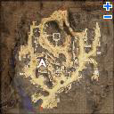
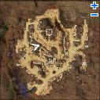
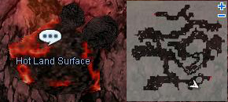
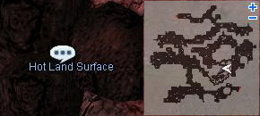
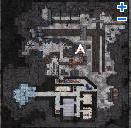
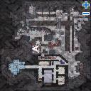
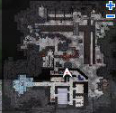
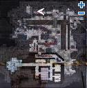

# Thor Volcano Base Quest

<!-- Quest info -->
- **Level requirement:** 60
- **Quests required:** [Veins Siblings Quest](Veins_Siblings_Quest.md)
- **Base EXP reward:** 1,000,000
- **Item reward:** 5 Giggling Boxes -OR- 1 Bloody Branch -OR- 1 Soft Apron -OR- Steel Arrow Quiver -OR- Random Quiver

1. Talk to High Priest Zhed inside Rachel Sanctuary (ra_temin 277, 159), he will ask you who created Ymir's Heart (the answer is Varmunt, but you don't have to type it in to pass this part, unsure what effect typing Varmunt in has).

2. Talk to the Female Follower (Lamir) on the far left side of the sanctuary temple, next to a bookshelf.  (ra_temin 40 124)

3. Talk to the Guard, Karlum (ra_temin 87 133) on the right side of the door; when prompted, type in "Lamir".

4. Down the hall to the right, break the blue vase (ra_temin 115 140) in the corner to attract the attention of the second guard.

5. Enter the now unguarded room, and obtain the File Folder from one the drawers. Escape via the ladder.

6. Go back to Zhed and tell him what you found.

7. Go to Veins, and enter the building (veins 151,176). Go upstairs and look around, but you can't find the Geologist.

8. Go to the tavern(veins 153,217), and find the Geologist in the midst of some highly intellectual discussion with his cohorts. Agree to help him, and he makes you his new assistant and gives you Note of Geologist which reads: 1WN, 2ES, 2EC.

9. Return to his room, click the bookshelf for another File Folder (ve_in 280,212) and the wall closet for the Broken Thermometer (ve_in 277,229).

10. Go to Volcano Thor Level 1, and click on the Hot Magma at (37, 234) (you can get to it from pretty close to the entrance).

11. Go to Level 2, and click on the spots at (165, 37) and (170, 100).

12. Still on Thor's Level 2, enter the portal at (143, 78) and walk through the map until you reach the guards at the end.
Talk to them, and they'll warp you to the Base Camp.

13. Walk south and talk to Sahedi at (250, 104), and agree to inspect the camp for signs of impending doom.

14. Walk to Colonel Vito(194 220) where you'll be drafted into the anti Rune-Midgard army.  (You'll be teleported to the training room to the south part of the map.)
* (Be careful when walking around! If you walk when the dialog pops up, you can be disconnected. The map does not allow you to relog there, and you will end up back at your save point).

15. You'll be asked to give an oath to Colonel Vito, choose Freya then reply to him with the following:

* as a devoted servant of Goddess Freya
* I pledge my honor to overthrow our mortal enemy
* I will show no mercy
* I shall devote my entire life
* Down with the Rune-Midgarts Kingdom!

Once you complete the oath, speak to him again and he'll send you yo investigate some pipes.

16. Walk to (109, 167) and click on the Control Panel there. Go back to Colonel Vito and inform him about its status.

17. Talk to Colonel Vito again, and he has you undergo more training by hitting a dummy. Click the dummy at (156, 65) to attack it.

18. Walk to (172, 132) (be careful to not walk over cell and get disconnected) and (148, 310) and read the dialogue that pops up there.

19. Go back to Sahedi (250, 104), and he gives you a File Folder to take back to the Geologist.

20. In Veins (the pub), give the Geologist the File Folder.

21. Go back to the Geologist's office, and click on the bookshelf (281, 214)
* Obtain: 800,000 Base Experience, 5 Giggling Boxes -OR- 1 Bloody Branch -OR- 1 Soft Apron -OR- Steel Arrow Quiver -OR- Random Quiver

22. Go back to Zhed, and tell him what happened.

* Obtain 200,000 Base Experience

---
**Categories:** [Base Experience Reward](categories/Base_Experience_Reward.md), [Quests](categories/Quests.md), [Veins Quests](categories/Veins_Quests.md)
*Source: [iRO Wiki Classic](https://irowiki.org/classic/Thor_Volcano_Base_Quest) — GFDL 1.3+*
