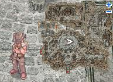

# Thor Volcano Level 2 Access Quest

<!-- Quest info -->
- **Level requirement:** 60
- **Item requirement:** 20 Ice Cubic, 5 Ice Cream
- **Base EXP reward:** 100,000
- **Job EXP reward:** 75,000
- **Quest reward:** Instant Access to Thor Volcano 2

* **Note**: **Completing this quest is *not* required to access Thor Volcano Level 2. It merely allows you to bypass walking through Level 1 in order to avoid Guardians and the like.**

1.  Speak to Survey Leader (juno 176, 186), and bring him 20 Ice Cubic and 5 Ice Cream.  The Survey Leader asks you to collect a TPS Report from a team in Nogg Road.

  * 

1.  On level 2 of Magma Dungeon, speak to Surveyor Peter (mag_dun02 247, 62), he didn't feel like doing his TPS Report.
  * *[image not archived: Magma2.jpg‎]*
1.  Speak to Surveyor Bob to collect a completed TPS Report.
1.  Return to Survey Leader with the completed TPS Report. Survey Leader asks you to investigate the Lava Tubes in Nogg Road.
1.  Walk directly over the cell at (mag_dun02 244, 75) to be warped to one of several locations on Thor Volcano 2.
1.  Return to the Survey Leader and receive some EXP.
  * 100,000 Base EXP / 75,000 Job EXP

* **Note:** After completing the quest you can return to (mag_dun02 244, 75) and be warped to Thor Volcano 2 as many times as you want. The quest itself is not repeatable.

---
**Categories:** [Base Experience Reward](categories/Base_Experience_Reward.md), [Job Experience Reward](categories/Job_Experience_Reward.md)
*Source: [iRO Wiki Classic](https://irowiki.org/classic/Thor_Volcano_Level_2_Access_Quest) — GFDL 1.3+*
