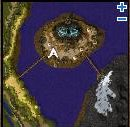
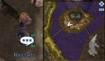
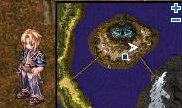
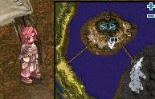

# Tripatriate Union's Feud

<!-- Quest info -->
- **Level requirement:** 70
- **Item requirement:** 1 Folding Fan of Cat Ghost, 1 Flame Stone, 1 Old Frying Pan, 1 Squid Ink
- **Quests required:** [Onward to the New World Quest](Onward_to_the_New_World_Quest.md)
- **Base EXP reward:** 300,000
- **Job EXP reward:** 100,000
- **Item reward:** 1 Rune Strawberry Cake, 1 Schwartzwald Pine Jubilee, 1 Arunafeltz Desert Sandwich, 1 First Aid Kit
- **Quest reward:** Ability to turn in New World monster drops for Consumables.
- **Window:** yes

1.  Walk near the United Research Official (mid camp 163, 234 -> mid_campin 376, 120). He asks you to speak to the people managing the documents.

  * 

1.  Speak to Ryosen (mid camp 165, 245), he asks you to deliver a Meeting Invitation to Hue, then to Hansenne.

  * 

1.  Deliver the invitation to Hue (mid camp 247, 255), and ask him to sign it.

  * 

1.  Next deliver the invitation to Hansenne (mid camp 222, 218), and ask him to sign it.

  * 

1.  Return to Ryosen, he directs you to return to the United Research Official.
1.  The United Research Official asks you to check on each of the researchers to make sure they're preparing for their meeting.
1.  Speak to Ryosen, he asks you to retrieve a document from Hansenne.
1.  Hansenne tells you he lost the document while playing on the west bridge. He suggests you go fishing.
1.  Take the west bridge and go to (mid camp 69, 134), where you will find a School of Fish in the water. Attempt to fish until you retrieve a Messy File.
1.  Return to Hansenne, who tells you to take the document to Hue to restore it.
1.  Hue requires 1 Folding Fan of Cat Ghost, 1 Flame Stone, 1 Old Frying Pan, 1 Squid Ink to restore the document.
1.  After giving him the items, he restores the document and gives you a Neat Report.
1.  Return the document to Ryosen, who then asks you to go the Official to wait for the meeting to start.
1.  Walk up to the Official, and the meeting begins. The three researchers give their reports, but the meeting is interrupted by the appearance of Thief Bugs, and everyone (including yourself) leaves the room.
1.  Reenter the building and kill all of the Thief Bugs, after which the others reappear.
1.  Walk over to the Official, and the "meeting" resumes, whereupon Ryosen accuses the rest of tampering with his precious Cake, and an argument ensues, until the Official finally tells everyone to call it a day.
1.  Walk back again towards the Official, where you explain that you know Hansenne wasn't the tamperer, although he took the blame for it.
1.  Talk to Hansenne, and he gives you a Arunafeltz Desert Sandwich in appreciation for your caring. He suggests you help Ryosen and Hue get along better.
1.  Talk to Hue, who asks you to take the Rune Midgard report to Ryosen, and gives you a Schwartzwald Pine Jubilee in thanks.
1.  Hand the report to Ryosen, who realizes he should've thanked Hue earlier, and asks you to set up another meeting with the Official. He gives you a piece of Rune Strawberry Cake in appreciation.
1.  Talk to the Official, who thanks you for all the work you've done, and gives you a First Aid Kit.
  * Receive 300,000 [Base Experience](Base_EXP_Chart.md) and 100,000 [Job Experience](Job_EXP_Chart.md).

## Turn-in Follow-up Quests

* Ryosen will give you 1 Rune Strawberry Cake (+5 [ATK](Stats.md) and +5 [MATK](Stats.md) for 10 minutes) for every 5 Mystic Horn you turn in.
* Hansenne will give you 1 Arunafeltz Desert Sandwich (+7 [Crit](Stats.md) for 10 minutes) for every 5 Peaked Hat you turn in.
* Hue will give you 1 Schwartzwald Pine Jubilee (+10 [Hit](Stats.md) and +20 [Perfect Dodge](Perfect_Dodge.md) for 10 minutes) for every 5 Fur you turn in.

---
**Categories:** [Ash Vacuum Quests](categories/Ash_Vacuum_Quests.md), [Base Experience Reward](categories/Base_Experience_Reward.md), [Job Experience Reward](categories/Job_Experience_Reward.md), [New World Quests](categories/New_World_Quests.md), [Quest Window Quests](categories/Quest_Window_Quests.md)
*Source: [iRO Wiki Classic](https://irowiki.org/classic/Tripatriate_Union%27s_Feud) — GFDL 1.3+*
