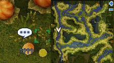
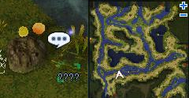
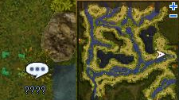
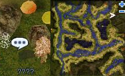
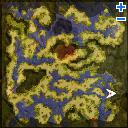

# Two Tribes

<!-- Quest info -->
- **Level requirement:** 70
- **Quests required:** [Ring of the Wise King](Ring_of_the_Wise_King.md)
- **Base EXP reward:** 1,200,000
- **Job EXP reward:** 100,000
- **Item reward:** 15 Manuk Coin, 25 Splendide Coin
- **Window:** yes

1.  With your Ring of the Ancient Wise King equipped, speak to Arc in Splendide (splendide 228, 162 -> spl_in01 32,306), and offer to help him look for his friend. He tells you his friend frequently ties knot's in weeds to leave a trail.
1.  Talk to the weeds outside the village (spl_fild02 44,214), they are knotted and point south.

  * 

1.  Talk to the weeds near (spl_fild02 123,106), they are knotted and point east.

  * 

1.  Talk to the weeds near (spl_fild02 330,192), they are knotted and point north.

  * 

1.  Talk to the footprints near (spl_fild02 328, 322), the footprints are headed north.

  * 

1.  Near (spl_fild01 343, 109) there are more footprints which lead to the root of a huge tree.

  * 

1.  Enter the Yggdrasil Dungeon just east (368, 112). (This is as far as you need to go in order to start the [Guardian of Yggdrasil](Guardian_of_Yggdrasil.md) Quest).
1.  Inside the dungeon, click on the Petrified Sapha (nyd_dun01 57, 222) in the northwest corner.
1.  Walk north a few cells to (62, 232) and climb out of the dungeon.
1.  Return to Arc, he tells you Terra left with some bradium, after some discussion, you decide to head back to the Petrified Sapha.
1.  Return to the Petrified Sapha, after noticing bits of bradium ore scattered about, you decide to go visit the sapha.
1.  In [Manuk](Manuk.md), speak to the Villagers near (manuk 278, 177), they mention Terra's arrival in Manuk.
1.  Inside the building at (252, 110) speak to Snorren and offer to interpret for him.
1.  Speak to Snorren again, the guard on the other side of the door says Terra's wounds need to be treated first. Head back to Arc to find out how.
1.  Speak to Arc, he tells you that Yggdrasil Berrys are the best way to cure a Laphine's wounds. He gives you 3 and tell you that you can get more at the root of the Yggdrasil Tree.
1.  Collect 1 Yggdrasil Berry from the fruit near (spl_fild01 356, 42).
1.  Collect another Yggdrasil Berry from the fruit near (spl_fild01 314, 78).
1.  Collect the last Yggdrasil Berry from the fruit near (spl_fild01 328, 26).
1.  Return to Snorren with the Berrys. (Warning: If you have more than 6 Berries, he will take them ALL)
1.  After giving Snorren the Berrys, enter the room behind him, Talk to the captured Laphine, she will tell you about the injured Sapha. Her captors are skeptical, and want to see proof to ensure they are not being led into a trap.
1.  Return the the Petrified Sapha. You will need to take something back with you, take his Muffler and the Bradium.
1.  Return to Snorren with the items, He recognizes that the bradium has not been properly refined and would not have helped Ogen. He also recognizes the muffler as Ogens. He asks you to lead him to the roots of the tree.
1.  Return to the Petrified Sapha, Snorren tells you Ogen is too far gone to be saved. His body can remain as a statue in his honor.
1.  Return to Snorren, he will reward you with 15 Manuk Coin.
1.  Return to Arc, he tells you to meet him at Terra's Yai (splendide 285, 139). Inside, talk to Terra.
  * Recieve 25 Splendide Coin, 1,200,000 [Base EXP](Base_EXP_Chart.md) and 100,000 [Job EXP](Job_EXP_Chart.md).

---
**Categories:** [Base Experience Reward](categories/Base_Experience_Reward.md), [Into the Unknown Quests](categories/Into_the_Unknown_Quests.md), [Job Experience Reward](categories/Job_Experience_Reward.md), [New World Quests](categories/New_World_Quests.md), [Quest Window Quests](categories/Quest_Window_Quests.md)
*Source: [iRO Wiki Classic](https://irowiki.org/classic/Two_Tribes) — GFDL 1.3+*
