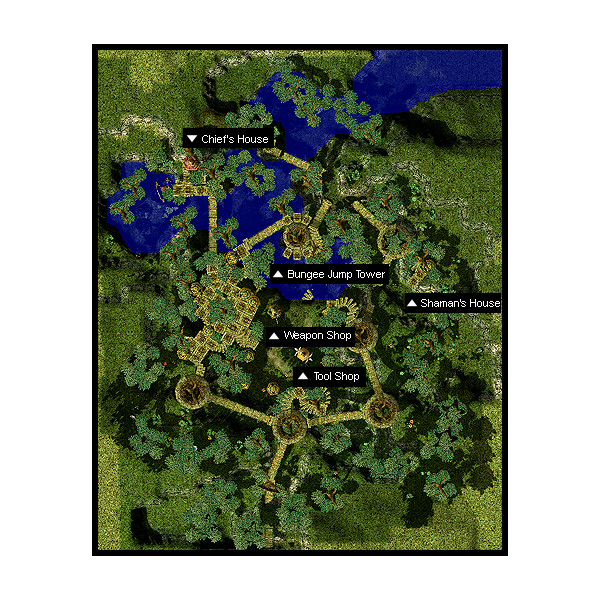

# Umbala

## About Umbala

Umbala is surrounded by four field maps characterized by lush greens and abundant forests. Monsters found in these maps are of a wide variety. They may look like they’re plants, but most of them are from various other races.
To get to Umbala, you can teleport from [Comodo](Comodo.md) or walk through the Comodo caves and some field maps.

## Story

According to legend, there is a forgotten path somewhere near north Comodo. At the end of the path, there is a giant tree from which treasure springs forth. It has been said: "Men ruled by avarice will obtain treasure. But men who are not will be lead to a new world."

The bards and dancers of Comodo spread this legend to the people but for many years it was misinterpreted as a tale about an ancient kingdom of treasures or the remnants of ancient gods. It eventually misled people to dream about the fortune and glory of discovering an ancient civilization. Over time, this legend became popular throughout the Midgard continent. As a result, droves of strange people started to gather in Comodo, one after another, in search of this legendary place. People from all walks of life flocked to Comodo. They wanted to know what this legend was all about.

Knights were dispatched from the Rune-Midgarts kingdom to verify the truth of the legend. Hunters came in search of ancient treasures. The Alchemists and Sages, who arrived, wanted to discover ancient relics. Lastly, the Rogues and Thieves arrived to enjoy themselves, at the expense of others, by “borrowing” the contents of their pockets. Many different people were hired to organize an expeditionary party. Thousands upon thousands of people searched the north area of Comodo, the path in the legend was never found.

One day, someone found a wood-carving ornament in Ruande, the north cave of Comodo. Scholars examined the ornament and concluded that the ornament was from the tree in the legend. When this was announced, people were again reassured that the legend could be real. At about the same time, many artifacts similar to the wood-carving ornaments were discovered in the Zenhai Marsh. This discovery made adventurers investigate the area around Ruande cave and Zenhai Marsh.

One day, they found an old wooden bridge that went over a canyon, which made them understand how small and insignificant humans can be. On the other end of the bridge was a great jungle forest which was so large that it almost enveloped the sky. The adventurers were awestruck with admiration at the beautiful jungle before them. After they crossed the bridge and ventured into the jungle, they arrived at a small tribal village full of people wearing strange masks who worshipped the Mother Tree.

They called themselves the Utan Tribe of Umbala and entertained the adventurers from Comodo with their traditional songs and dance. Many of the tribe members presented the adventurers with wood-carved ornaments to symbolize their friendship and to welcome them to their village. Although the tribe treated the adventurers as their honored guests, some of the adventurers were not happy that the treasures that were described in the legend were nowhere to be found.

Infuriated with this revelation, some of the adventurers took their anger out on village people. This caused a division within the village, some of the villagers decided to side with the visitors while others opposed them. Since the chief of the village and most of villagers favored the new visitors, they allowed more adventurers to come visit the village of the Utan. Due to the exotic surroundings, culture, and novel wood carvings, the village has become very popular to tourists and adventurers alike.

## Quests

Quests added with the Umbala update can be found [here](Quests.md).

## Guide

## Structures

## Buildings

* 1 - Chief's House (68,252)
* 2 - House #1 (108,129)
* 3 - House #2 (94,185) and (101,204)
* 4 - Shaman's House (219,188) --- Normal entrance is locked. Use Skull.
* 5 - Tool Shop (137,128)
* 6 - Weapon Shop (126,156)

## Billboards

* Bulletin Board (137,94) - Gives background information on Umbala

## NPCs

## Regulars

Guide - Adventurer (128,94)
  Show on minimap: Chief's House, Shaman's House, Weapon Shop, Tool Shop, Bungee Jump Place on minimap
Kafra Employee (87,160)
  Save, Kafra storage, Reserve points
Missing NPCs
  Upgrading NPC, Level 1/2 metal NPC, Level 3/4 metal NPC, Repair NPC, Inn NPC, PVP NPCs

## Store NPCs

Tool Dealer (Tool Shop)
  Apple, Carrot, Pumpkin, Potato, Banana, Meat, Monster's Feed, Pet Food, Fly Wing, Butterfly Wing, Concentration Potion, Awakening Potion, Yggdrasil Leaf
Weapon Dealer (Weapon Shop)
  Club, Mace, Smasher, Flail, Morning Star, Chain, Fist, Finger, Claw

## Trade NPCs

[Native] Utan Kid - Haatan (70,106)
  1 Meat for 1,000 Zeny
[Native] Utan Kid - Kotan (59,243)
  2 Jellopy, 2 Fluff, 2 Clover for 1 Meat
[Native] Utan Shaman - Puchuchartan (Shaman's House)
  *To trade, you must do the [Ore Downgrading](Ore_Downgrading.md) Quest*
  1 Green Live for 15 Horn
  1 Crystal Blue for 20 Snail's Shell
  1 Red Blood for 20 Scorpion Tail
  1 Wind of Verdure for 25 Rainbow Shell
  (random) Green Live for 1 Great Nature
  (random) Crystal Blue for 1 Mystic Frozen
  (random) Red Blood for 1 Flame Heart
  (random) Wind of Verdure for 1 Rough Wind

## Quest NPCs

Bazo (117,285)
  Weaponsmith
Billik (215,181)
  Part of [Message Delivery Quest](Message_Delivery_Quest.md)
[Native] Hibilaithan (163,257)
  Weaponsmith
[Native] Tabezthan (House #2)
  Weaponsmith
Utan Chief - Karkatan (Chief's House)
  [Language Quest](Language_Quest.md) and [Ore Downgrading](Ore_Downgrading.md)

## Travel NPCs

Skull (near 219,191)
  Shaman's House - Free (see note for details)

## Background NPCs

* [Native] Bertan (92,159)
* [Native] Bertztan (Tool Shop)
* [Native] Chabimatan (145,217)
* Pasto (177,153)
* [Native] Phrenetan (House #2)
* [Native] Utan Kid - Boorkatan (194,104)
* [Native] Utan Kid - Klumatan (149,165)
* [Native] Utan Man - Arotan (146,157)
* [Native] Utan Man - Jertan (140,157)
* [Native] Utan Man - Jooltan (139,205)
* [Native] Utan Man - Weitan (193,208)
* [Native] Utan Villager - Mutakutan (House #2)
* [Native] Wainatan (House #1)
* Yuwooki (80,146)

## Other

## Native NPCs

These speak the Utan language, which a regular adventurer cannot speak. Note that even though you may not understand them, you will still gladly make trades with the kids. Buyer beware.

Shaman
  The shaman doesn't want visitors, so the door is locked. To enter, you have to place Blue Gemstone, Red Gemstone, and/or Yellow Gemstone into the eyesockets of the Skull near the door. You don't lose the gems, so there's no harm in trying and failing your way in.
Bungee Jump Tower
  Taking a plunge off the bungee jump tower is a rite of passage practiced by the Utan youth. Brave adventurers have also been known to try their luck on the bungee tower, but beware... the tower may leave you hurt or even dead. If you are looking for a quick path to [Nifflheim](Nifflheim.md), however, then the bungee jump tower is a good place to start.

**Related pages:**

* [Towns](Towns.md)
* [Rune-Midgarts Kingdom](Rune-Midgarts_Kingdom.md)
* [Alberta](Alberta.md)
* [Al De Baran](Al_De_Baran.md)
* [Archer Village](Archer_Village.md)
* [Comodo](Comodo.md)
* [Geffen](Geffen.md)
* [Izlude](Izlude.md)
* [Morroc](Morroc.md)
* [Payon](Payon.md)
* [Prontera](Prontera.md)
* [Umbala](Umbala.md)
* [Republic of Schwartzvald](Republic_of_Schwartzvald.md)
* [Einbech](Einbech.md)
* [Einbroch](Einbroch.md)
* [Hugel](Hugel.md)
* [Juno](Juno.md)
* [Lighthalzen](Lighthalzen.md)
* [Arunafeltz States](Arunafeltz_States.md)
* [Rachel](Rachel.md)
* [Veins](Veins.md)
* [Manuk](Manuk.md)
* [Amatsu](Amatsu.md)
* [Ayothaya](Ayothaya.md)
* [Kunlun](Kunlun.md)
* [Jawaii](Jawaii.md)
* [Louyang](Louyang.md)
* [Moscovia](Moscovia.md)
* [Nifflheim](Nifflheim.md)
* [Lutie](Lutie.md)

---
*Source: [iRO Wiki Classic](https://irowiki.org/classic/Umbala) — GFDL 1.3+*
