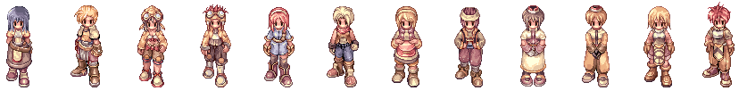

# Updates Changelog

This is a work in progress of several changes that came with (very) old patches that marked a major change in RO game play. For an idea of how long iRO took to get updates, see [IRO Updates](IRO_Updates.md).


## Alpha

Ragnarok Online (English version) began as a free 100~160 MB download with scattered patches rather than scheduled maintenances.

There were only five first classes, although the sprites for Magician were in the game client. The classes were: Swordman, Thief, Archer, Merchant, and Acolyte. Swordmen were the best at MVPing due to their high HP and ability to equip Plate Mail, the strongest armor, while Acolytes were the worst character as skills were not yet implemented. Users began as a Novice with a cotton shirt and knife in north [Prontera](Prontera.md).



Hair was animated while performing actions (such as attacking), and was "built into" the sprite (each class and gender had set hair an a set hair colour). Some sprites also had headgears: thieves wore modified goggles, the female archer wore a hairband, the female merchant wore something similar to a hairband, the male merchant wore a bandana, and acolytes wore berettas.

Players were only able to gain base levels. The original experience requirements also had more linear growth curves, so although more experience points were needed at lower levels, much less was needed overall to reach 99. The job level on the status window stayed at '0'.

**Job change requirements**

| Column 1 | Column 2 | Column 3 | Column 4 |
| --- | --- | --- | --- |
| **Class** | **Level** | **Zeny** | **Items** |
| Swordman | 10 | 200 | 10 Claw of Wolves, Letter of Residency |
| Thief | 6 | 400 | None |
| Archer | 8 | None | 20 Feathers of Bird |
| Merchant | 5 | 600 | Resident Certificate, Business Certificate |
| Acolyte | 5 | None | None |

**Growing list of original Alpha experience requirements**

| Column 1 | Column 2 | Column 3 |
| --- | --- | --- |
| **Current Level** | **EXP to next Level** | **Current EXP to next Level** |
| 1 | **?** | 9 |
| 2 | **1 345** | 16 |
| 15 or 25 | **6 200**? | 830 or 2 950 |
| 26 | **7 125** | 3 426 |
| 39 | **33 000** | 30 543 |
| 48 | **48 000** | 75 973 |
| 51 | **63 000** | 128 692 |
| 54 | **120 000** | 178 184 |

**Monsters**

| Column 1 | Column 2 | Column 3 |
| --- | --- | --- |
| **Current ID** | **Alpha Name** (*Not ingame but in client) | **Changes** |
| 1001 | Scorpion |   |
| 1002 | Poring |   |
| 1003 | - |   |
| 1004 | Hornet* |   |
| 1005 | Farmiliar | Beta 2?: Familiar |
| 1006 | - |   |
| 1007 | Fabre |   |
| 1009 | Condor |   |
| 1010 | Wilow | Beta 1: Willow |
| 1011 | Chocho | Beta 1: Chonchon |
| 1012 | Roda Frog |   |
| 1013 | Wolf |   |
| 1014 | Spore |   |
| 1016 | Skel Archer | Beta ?: Archer Skeleton |
| 1018 | Creamy | (Can't find in client?) |
| 1019 | Kocot | Alpha, later: Pecopeco; Beta: Peco Peco |
| 1020 | Mandragora | Disappeared form game early Beta |
| 1022 | Were Wolf* | Beta ?: Werewolf |
| 1024 | Wormtail | (Agressive) (Possibly Worm tail earlier) |
| 1025 | Boa | Beta 1: Snake, Snake also in client |
| 1026 | Munak |   |
| 1027 | Raptice* | Never used |
| 1028 | Skel Soldier | Beta 1: Soldier Skel, Beta ?: Soldier Skeleton |
| 1029 | Isis |   |
| 1030 | Anacondaq |   |
| 1031 | Poporing |   |
| 1032 | Vorit | (May have originally been Virot) Beta ?: Verit |
| 1033 | Elder Wilow | Beta 1: Elder Willow |
| 1035 | Hunter Fly* |   |
| 1037 | Side Winder* |   |
| 1038 | Osiris* | (Unless at the end of Alpha) |
| 1039 | Baphomet | (with Hunter Fly mob) |
| 1041 | Mummy |   |
| 1042 | Steel Chocho | Beta 1: Steel Chonchon |
| 1043 | Seahores* | (Never used and still sits in the client, Marc sprite) |
| 1044 | Obeaune* |   |
| 1046 | Doppelganger | (different sprite, also couldn't find its own, may have been exact Swordman) |

**Skills**: None. Job level always remained at 0.

**Classes**: First class (no Magician)

**Hair**: Hair style and colour fixed to job sprite. Hair was animated while performing actions. May have later been able to change hair type (not colour) on character creation towards very end, otherwise that was Beta 1.

**Headgear**: Headgear was fixed to job sprite.

* Alpha-only
  * Experience needed to next level displayed in status window (removed in Beta 1)
  * Many NPCs not functional (serve no purpose at all)
  * Maps: Prontera (North, South, West, East) Fields, Prontera Castle, North Prontera, South Prontera, Prontera Dungeon, Underground Waterway, Moroc Village, Moroc Castle, Moroc (North, South, East, North-East) Fields, Archer's Village, Moroc Jungle, Pyramid

  Potions, all with weight of 5:
    Red Potion, 30 zeny from NPC
    Scarlet Potion, 90 zeny from NPC
    Yellow Potion, 250 zeny from NPC
    White Potion, 500 zeny from NPC
    Blue Potion, 1000 zeny from NPC
    Green Potion, ??

* Exploits
  Item duping
  Zeny hack

* Announcements
  Beta 1 delayed until December 8, 2002  (Official releaes date: December 1, 2002)
  Beta 1 delayed (official release date: December 8, 2002)

* Resources for the time
  <http://ro-world.com>
  <http://mir.e-chrono.net/>
  <http://ro.pak0.com>
  ixga - had a GM posting frequently
  eroite (Every Ragnarok Online ITem Explained)


## Open Beta 1 (December 2001)

Beta, at some point cost $5 per month before it was opened again.

**Skills**: Introduced, job levels now possible and thus first class job change quests were changed. Many skills not fully functioning. Novices had to reach job 9 to change.
  Job 3->4: 1 000 exp (now: 58 first / 284 second)
  Job 9->10: 3 600 exp (now: 336 first / 2 540 second)?
  Job 18->19: also 3 600 exp?
  Job 19->20: 4 150 exp (now: 3040 first)
  Job 36->37: 42 000 exp (now: 78 160 first / 358 435 second)

**Classes**: First classes. [Mage](Mage.md) class added.

**Hair**: Beta 1 brought the ability to change one's hair upon character select (if not during late Alpha) although hair types had set colours.

**Headgear**: Helm had no sprite, Tiara was an MVP award from Mistress. Crown, Bunny Band, etc.

**Reset Status**: Complete character & item wipe.

**Cost**: Free.

**Job Change**: First update.

**Job change requirements**

| Column 1 | Column 2 | Column 3 | Column 4 |
| --- | --- | --- | --- |
| **Class** | **Level** | **Location** | **Requirements** |
| Swordman | Job 9 | Izlude building | Speak to an NPC |
| Thief | Job 9 | Pyramid, room below level 1 | Speak to an NPC |
| Archer | Job 9 | Archer Village | Speak to an NPC |
| Merchant | Job 9 | Alberta Building | Speak to an NPC in Morroc, then return. Pay 3000z (optionally 1500z split amongst two payments) |
| Acolyte | Job 9 | Prontera Church | Speak to the NPC in the top right corner of the Yo-Yo map (who saved the player's save position) and then return |
| Magician | Job 9 | Geffen building | Speak to an NPC |

* Other
  No guilds (no Emperium either?), Elu/Ori stones in game but upgrading not possible, cards in game but effects unknown and unable to compound.
  Players party would be shown beside their name (despite being "guildless").
  Status ailments not implemented.
  External programs were not looked down upon (i.e. exp viewers) until the ghost bug, which was blamed on Arsenic's ArseKit (Previously "hacks" had been linked to on all major forums, following this they were removed; mid 2002)
  Removal of Prontera Castle caves (where Doppelganger, Elder Willows, etc spawned)
  Loki a few months into 2002
  [Flee](Stats.md) dropping when more than 2 monsters are attacking a player, rather than infinite dodge
  Soft def reworked
  Training Grounds introduced at some point. Would enter the castle, then talk to the man behind the desk to begin. There were also three portals outside that led to Moroc, Payon, Prontera.
  Still no elements are weak to [Poison](Poison.md), they either take less damage from it or it does not affect them
  Archer Skeleton hit nerf and related changes not implemented.

* Skills
  Teleport was 10 skill levels, and Warp Portal was not usable until level 8. Pneuma was not implemented.
  Improve Concentration did nothing.
  Double Strafe did not take arrows and did not require equipped bow.
  Pneuma disabled (could still put points into it).
  Aqua Benedicta disabled (could still put points into it).

* Exploits & Programs
  Pre-February 2002
    Speed hack (fixed quickly)
    Autopot program
    Arsenic's program (bypass filters, change name to anything while talking)
    ArseKit (no disconnect, etc)
    Artfort's bot and ragboost.exe, both sent the user's username and password to a character in game which resulted in many people losing their accounts
  Post-Loki
    Arsenic's equip hack (allowed for equipping items in any equip spot)
    Main duping incident where one could deal another user an item and then rollback their character
    Roll backs on log off, allowing for more duping, which was fixed without first kicking everyone off the servers

* Resources
  <http://www3.xdsl.ne.jp/~selus/Ragnarok/news>

* Misc
  ro-world shut down, February 2002


## First Beta 2 (July 16, 2002)

This version was not open for very long as it was announced August 2nd, 2002 that iRO would be shut down for 3 months. When servers re-opened, the Closed Beta 2 period would commence. This was due to the servers having so many problems since July 16th.

**Classes**: 2-1 classes.

**Hair**: -

**Headgear**: -

**Reset Status**: Characters were kept through this transition. Any unequipped items were lost, and the amount of zeny limited by character level (level*10k ?). No announcement was made regarding equipped items staying through the transition until after the servers went down. Stats and skills were reset (all stats were taken to "1", thus bypassing the character creation minimum stat point allocation).

**Cost**: Free.

* Misc
  Acolytes warping people to GH (not accessible, map only had a few Mysts; could warp there with packet editting)
  Infamous Dancer screenshot surfaced in July 2002, most likely fake (SP and HP bars and points did not add up, etc).
  July 24 - missing characters began
  Alignment system (as explained in other Beta 2 updates, i.e. for jRO). The bottom 5% players would have their names displayed in red. You could only use one good and one bad point per day. You could also only give the same person a point per month (month? definitely not the next day).
  The amount of exp per level was adjusted and raised, as were existing characters:
    Level 43 -> 34
    Level 99 -> mid 60ish
  MVPs buffed and no longer respawn instantly. Previously had 5000-10000 max HP.

* Announcements
  Hello this is Ragnarok Online Operation Team.
  We inform you that the re-opening of international server will
  bring away the Beta 2 at the same time.
  Meanwhile the pre-arranged opening time has changed
  from July 9 into July 16,Tuesday 10:00(Korean Standard Time)
  especially concerning the New Client Downloading Period of players
  and other conditions.
  Thank you.

  Ragnarok Online Operation Team,
  Gravity Corp.

  Late July:
  Guys How are you all today?
  Although at least I have to excuse about the unreasonable
  Server shutdown,Please let me just say 'My Apologies'.
  Furthermore I heard many rumors around,
  but as long as we didn't state them,all of them are nothing but scum bags,worthless to believe.
  Simple server was out of control on last Sunday and
  we didn't have much time to pay attention due to the Korean Commercial then.
  And now apart from your all comdemnation
  Gravity has been shunned a lot due to the korean Commercial trial failed yesterday.
  So spare us gathering another breath for a moment and encourage us to recover our energy.
  we planned to open the international server on this afternoon (approximately),
  no more worries no more censures for now.
  Personally I apologise that i count not take a look on the BBS recently.
  I was busy enough to do my job and another things,
  i moved the department again to the Development Team from the Operation Team.
  So last weekand this week will be the most important term for me.
  Theis might be the hopeful news to you, we are looking for 3 SubGMs to perform English Game Masters
  instead of me,
  If you know anyone who is Korean living in Korea and well-spoken in English,just let me know via
  english@gravity.co.kr
  Unfortunately we can't afford to hire Non-koreans at this moment
  (Because SubGMs won't work for me but work for the Korean Operation Team,they are required to speak
Korean Very Fluently.)
  I inoform this information will be applicable for Koreans.

  July 29, prior to announcing RO would instead be down for 3 months
  Hello this is Ragnarok Online Operation Team.

  First off we apologise that we cannot promise a time for the Server Opening.
  But it doesn't mean we are going to give up the International server and it doesn't mean it will take as much time as one week or two.
  At the same time we are dealing with the difficulty to open the International Server, unexpected bad situations have occurred.
  Please understand we will take as much time as we need.
  Once again, the International server will be closed until the Further Notice.

  Ragnarok Online Operation Team,
  Gravity Corp.

```
October 17 (2002)
Hi,This is Christy Kay,IRO Game Master.
I guess this might be the first time I've ever mentioned on
the French Fansite.
It is honoured for me to get a chance to face all IRO fans,
also I am appreciate for Luno the administrator to allow me to
talk on his site.
On behalf of Gravity,
I want to say thank-you to all of you that you're always showing great interest in Ragnarok even though it has been down for months.
To be honest,if IRO is back on the road,
YOU WOULD NOT BE ABLE TO SEE YOUR OLD CHARACTERS EVER AGAIN.
We're planning to set out anew IRO,of course it will be better than used to be(it should be).
Nothing except this,has been settled down yet,
it is a pity that I can't release more news about IRO issue.
By the way,Thai RO is running well.
Asiasoftnet and Gravity shut down the closed beta on 15th already.
Now it is under preparation for the open beta.
I am going to Thailand with my associate Rex and the engineer on Monday next week.I am not sure how many weeks I will stay but it is for supporting Asiasoftnet and Thai players(I will be there like 12 weeks or less).
Hopefully we bring a great version of Ragnarok in Thailand,
so that many thai players will join us sooner or later.
People in Asiasoftnet are very kind,nice and ardent to settle Thai RO.Thai GMs are fine,polite and humorous.
I enjoy working with all of them and will do.
=) I think that's all for today.
See you in Thailand.

Christy Kay,
International Ragnarok Game Master &
Senior of Foreign Tech Support Team,
Gravity Corp.
```

  November 22?
  Hello this is IRO GM Team.
  This is one more information of the way to pay the maintenance fee.
  1.Debit card and other cards(even though Visa or Master printed on them) are not considerable to register.
  2.One Credit Card can not be used for Multiple accounts no matter what the reason is.
  We chose the Credit Card Payment system to check your real identification,
  to protect innocent players from immature ones having impure thoughts and
  to gather genuine personal information, NOT only for the maintenance fee.
  Please be fully aware of this information.
  We do not response to the inqury asking articles above.
  Thank you for the cooperation.

  IRO GM Team,
  Gravity Corp.

* Misc...
  Person who guessed Peter Kang's password and logged onto Christy's GM char obtained all of the user name/passwords of every iRO account


## Closed Beta (Beta 2 re-opened) Projected date: December 2 to February 2

On November 26, 2002 they began taking applicants for Closed Beta. There were 30 000 spots.

**Reset Status**: All IDs deleted. Complete wipe.

**Cost**: $10 for 2 months.

```
November 20, 2002
Hello this is IRO GM Team.
Followings are the neccessary that volunteers should fully be fully aware for the account application.
Please read carefully and if you have any request or question,inquire at iro-gm@gravity.co.kr via email.
(Make sure that GM Team won"t response to incorrect email which doesn"t need to get replied.)
And all time lines indicates Korean Standard Time.
You can refer the time info up on this page for Korean Time zone.

1.Opening Date : 11:30 am,Dec 2 2002
2.Period : Dec 2 ~ Feb 2,2003 (for 2 months)
          -Precise Ending time will be arranged and
           announced later.
          -Every Possible future plan after the closed
           Beta will be announced later as well.
3.Numbers of recruitment : 30,000
4.Closed Beta Testers Qualification
 -Global Fans except some of Asian Countries
  (i.e-Korea,Hong-Kong,Taiwan,Japan,Thailand,China,
       Indonesia,Malaysia and Singapore)
 -Various RO versions have been launched and running
  or will be launched in no time in those countries.
  If you want to join them,please inquire at
  the pertinent business partners of our own later.
 -Make sure all of IPs from these regions will be
  blocked from the registration page and the game
  server as well.
5.Account Applications : 11:30 am
                        Nov 26,on this website
 -You can register on the `Account"Section
  on this official site or on the `Gravity"s
  Official site from the appointed time.
 -GM doesn"t receive your aplications by email.
 -Applications will be continued until the numbers
  of recruitment satisfied.
 -After that, it will be shut down automatically
  any time,any day.
6.Client Download Page open : Nov 26
 -Make sure you need the renewed client to connect the
  right server.
7.Customer Service open : from 20 Nov
 -Email Support has been open since Nov 20.
 -Webboard will be open on Nov 26.
8.Flat Fee : 10 USD for 1 account(for 2 months)
           -This is for minimum charge to maintain
            IRO Closed Beta,to provide you better
            environment.
9.Payment method : Only Credit Card
                  (VISA, MASTER, JCB, AMEX) allowed
                 -1 Credit Card can"t be used for
                  Multiple accounts.
10.Everything belong to the previous service,open eta
  will be deleted.
  But we will try to carry on personal/account
  information of this closed beta to the further
  service.

Please be aware of this notice and deal with less
misunderstanding.
Thank you for the cooperation,see you in IRO later.

IRO GM Team,
Gravity Corp.
```

```
Hello this is the international RO game master team.
First of all,we appreciate all of our global fans to wait for us with patience during last 3 months and are
glad to announce that IRO will be back again,in the form of Closed Beta.
Before we inform the detailed information needed for volunteering for the IRO closed beta,
there are some issues that we hope you will understand.
First we decided to charge testers the minimum game maintenance fee including server maintenance at IDC,internet backbone lines and other official requirements.
Secondly every information and game data belong to the last open beta,such as accounts,personal information and characters will be totally wiped out this time and
it means volunteers must newly apply onto the closed beta.
Please understand that we do this to provide desirable renewed environment to our global fans,to stablize game servers and to identify/confirm/manage our future customers efficiently.
Meanwhile we"re deeply sprry for a long delay and poor service quality during the past open beta.
From now on,we will try to manage IRO in a better way than before.
Thank you for the cooperation.

IRO GM Team,
Gravity Corp.
```

```
Hello this is IRO GM Team.
Precisly we are looking for SubGMs who will support the chief GM to manage IRO,
but unfortunately we have no plan to hire in abroad `for now".
We need someone living in Korea,who speaks fabulous Korean as well as English
for SubGMs right now because we stay in Korea.
But of course we have a plan to expand our branch in the states in near future,
it means we will need native speakers for IRO GM Team to operate Games
more closely to our customers.
If there is someone who want to volunteer for GM Team in abroad,
please check our official webboard frequently.
When we settle down every policy related to the law of overseas labor and the USA
Branch, we will announce our plan at that moment.
Thank you for the cooperation.

IRO GM Team,
Gravity Corp.
```

```
Hello this is IRO GM Team.
We"ve been offering the Original Fanart Book 1st edition to some of fansites in abroad.
Follwings are detailed information of fanart book.
1.Book is written in Korean,196 paged in A4 size.
2,Minimum order is 30 books at one time.
3.The price is 30USD for one book.
If you want to purchase as well,
please inquire at iro-gm@gravity.co.kr for more information such as shipping issue.
Thank you.

IRO GM Team,
Gravity Corp.
```

* The fan book led to the huge scam by Gravity where many people from iRO paid for it yet the book was never released.
* Fabre bug on first day (training grounds and thief quest fabres reset base exp to 0 (if any had been gained) and gave a ton of job experience)
* RO was constantly down, for days at a time in December
* In January Christy announced that registration for Closed Beta would re-open for people who missed it on January 6th. She also warned players that she would start banning them for illegal behaviour. Introduced 3 day bans for mob training. Other RO versions already had these systems.


## Second Period of Closed Beta (February 21, 2002 - March 28, 2003)

This Beta phase was only going to last a month, and again cost $10 for the phase.

* v2002.2.21 beta
* Not re-registering would result in losing characters from Closed Beta
* A few new  monsters (15-20), two new maps (Glast Heim finally accessible)
* Marc card not working
* Ended March 28, 2003

```
March 11, 2003
Hello this is iRO GM Team.
Here is another in-game event.
We will implement 2 kinds of different PvP system on 2 towns, Alberta and Lutie.
For more information,please read followings carefully.

Event Period : March 13,17:00 ~ March 17, 17:00(GMT+9)
Event articles
*Alberta turns into a normal mode PvP map which you don't lose items or EXP when you die.
*Lutie turns into a hard mode PvP map which you could lose items or EXP when you die.
*Every NPC in town will stay as they used to do.
So people who wish to become merchants will be able to visit Merchant Guild.
*GM will randomly appear in event place with monsters to encourage users.

Hopefully every testers will enjoy this PvP event.
Thank you.

iRO GM Team,
Gravity Corp.
```


## Open Beta 2

* April 28, 2003?
* Went back to closed a month or two later, $12/month
* After closed, stat reset that cost a few hundred thousand zeny in August
* RWC: Cost 10 million zeny to register a team of 9 with two substitutes (11 players overall), given special accounts on Loki server to find against other players
  * All characters had same weapons
  * 1 Priest Lvl 85, 1 Wiz Lvl 85, 1-2 Knights Lvl 90,1-2 hunters Lvl 85,1-2 BS Lvl 90 and 1-2 Sins Lvl 90


## Comodo Changes

* Notes
  Balance patch information can be found here: <http://iro.ragnarokonline.com/News/Notice/NoticeView.asp?noticeSeqNo=3&Page=7&Condition=&KeyWord=&mNum=4>
  Spiky band + other armor nerfed? (i.e. [Assassin](Assassin.md)s can't wear Silk Robes)
* Content
  Oridicon and Elunium drop frequencies increased (Oridicon dropping from 800k zeny to 50k as a result very quickly on Chaos/Loki)
  Armor would drop at a much lower rate from monsters
  MVPs became harder
  Minorous monster introduced (as Demon race, not Brute), everything relative to that
  **Many cards altered**; temporary run-through:
    All racial cards previously -50%, now -30%
    Raydric card previously -15% from Neutral, now -20%
    Status-inflicting cards previously 1% chance, now 5% chance
    Element-reduction garments previously -50% from Element, now -30%
    Damage inducing cards that were previously +25% to monster now only +20% or +15% if size card (i.e. Skel Worker card was +25% to medium, now changed to +15% to medium)
    Some MVP cards not implemented adjusted: Pharaoh, Maya
    Kobold card becomes CRIT +4%, STR +1 from CRIT +5%
* Mechanics
  Failing to upgrade an armor or weapon would result in losing that item permanently, rather than having the upgrades reset to "0"
  Safe cap on upgrading Armor lowered from 5 to 4
  See Balance patch for player skills changed, and all quest skills now introduced (i.e. [Holy Light](Holy_Light.md))
  Movement-increasing properties no longer stack, except for [Pecos](Peco_Peco_Ride.md). i.e. Moonlight Flower card now acts as [Increase Agility](Increase_AGI.md) and will not stack with said skill
  CRIT Shield introduced
  Awaiting upgrade bug fix (player was informed when their equipment broke before it did, so one could use a bot to log out of RO before the equipment was broken)


## Turtle Island Changes (December 16, 2003)

* Notes
  For Monster skill changes, see: <http://iro.ragnarokonline.com/News/Notice/NoticeView.asp?noticeSeqNo=4&Page=7&Condition=&KeyWord=&mNum=4>
* Content
  Job change quests ([Knight](Knight.md), [Assassin](Assassin.md), [Hunter](Hunter.md))
  Monster skills
  War of Emperium around now
    Guild Dungeons came with WoE, at this point you could relog in GD without being kicked out, and PK of enemy guilds was not enabled
  Maps: Geffen Dungeon 2 loses its Bathory spawn?
* Mechanics
  Players are classified as Medium Size as opposed to Small sometime around now


## Juno Changes

* Notes
  Single most uncalled nerf in RO history: Alde Guild Dungeon nerfed again
* Content
  2-2 classes
  Turtle Island "nerf", turtle monsters HP/exp adjusted, can no longer [Teleport](Teleport.md) on fourth level
  Many other maps changed, mimics scattered throughout: GH Graveyard (Mimics introduced), Pyramids (previously level 2 was Archer Skeleton/Drainliar/Mummy/Solider Skeleton, now mimics introduced)
  Mummy HP/exp adjusted
  Battle Mode introduced, along with 2 additional rows of hotkeys (previously only one)
  Can attack players of enemy guilds or who are guildless in Guild Dungeons
  Poring dolls increased in price (various players bought many 30k bunches from NPCs before the change, then resold them to the NPC for profit)
  [Safety Wall](Safety_Wall.md) render changed (previously a much more square, white render, rather than rounded and pink)
* WoE-Specific Changes
  Long Range and Magic attacks do less damage to players (does not stack with skill damage reduction)
  Traps last for 4x longer
* Mechanics
  Can no longer steal from Boss-flagged monsters (could only not steal from MVPs previously) or (Guild Castle) Treasure Boxes
  [SP](SP.md) Regen formula changed: previously parabolic, all values of INT below 124/126 gave horrible regen
  [HP](Max_HP.md) Regen formula changed
  [Increase SP Recovery](Increase_SP_Recovery.md) skill will regen more based on player's Max SP ([Increase HP Recovery](Increase_HP_Recovery.md) did this since it was implemented, based on Max HP)

  Many cards adjusted:

| Column 1 | Column 2 | Column 3 | Column 4 |
| --- | --- | --- | --- |
| **Card** | **Prior** | **After<br>Juno** | *Change* |
| All Weapon<br>Status Cards | Inflict Status +5% | Inflict Status +5%, ATK +5 | ATK +5 |
| All Headgear<br>-Status Cards | Resist Status +20% | Resist Status +20%, DEF +1 | DEF +1 |
| All Garment<br>-Element Cards | Resist Element +30% | Resist Element +30%, Flee +5 | Flee +5 |
| Many Armor<br>Change Element | Change Player's<br>Element | Change Player's<br>Element, DEF +1 | DEF +1 |
| Andre | ATK +10 | ATK +20 | ATK +10 |
| Bapho Jr. | AGI +3 | AGI +3, CRIT +1 | CRIT +1 |
| Chonchon | AGI +1 | AGI +1, Flee +2 | Flee +2 |
| Condor | Flee +5 | Flee +10 | Flee +5 |
| Cornutus | Armor Cannot<br>Break | Armor Cannot<br>Break, DEF +1 | DEF +1 |
| Deviruchi | Immune to Blind | Immune to Blind, STR +1 | STR +1 |
| Drops | Dex +1 | Dex +1, Hit +3 | Hit +3 |
| Fabre | VIT +1 | VIT +1, MaxHP +100 | MaxHP +100 |
| Female Thiefbug | AGI +1 | AGI +1, Flee +1 | Flee +1 |
| Golem | Weapon Cannot<br>Break | Weapon Cannot<br>Break, ATK +5 | ATK +5 |
| Hornet | STR +1 | STR +1, ATK +3 | ATK +3 |
| Lunatic | LUK +1 | LUK +1, CRIT +1, [PD](Perfect_Dodge.md) +1 | CRIT +1, PD +1 |
| Marc | Immune to Frozen | Immune to Frozen,<br>Water Resistance +5% | Water Resistance +5% |
| Marduk | Immune to Silence, -5% Cast Delay | Immune to Silence | Loses -5% Cast Delay |
| Martyr | MaxHP +12%, AGI +1 | MaxHP +10%, AGI +1 | MaxHP -2% |
| Nightmare | Immune to Sleep | Immune to Sleep, AGI +1 | AGI +1 |
| Pecopeco | MaxHP +150 | MaxHP +10% | MaxHP value |
| Phen | Uninterruptible Cast | Uninterruptible Cast<br>Cast Time +25% | Cast Time +25% |
| Picky | STR +1 | STR +1, ATK +10 | ATK +10 |
| Picky Egg | VIT +1 | VIT +1, MaxHP +100 | MaxHP +100 |
| Pupa | MaxHP +50 | MaxHP +700 | MaxHP +650 |
| Rocker | DEX +1 | DEX +1, ATK +5 | ATK +5 |
| Roda Frog | MaxHP +100 | MaxHP +400, MaxSP +50 | MaxHP +300, MaxSP +50 |
| Vitata | Enable Heal Lvl. 1 | Enable Heal Lvl. 1,<br>SP Consumption +25% | SP Consumption +25% |
| Willow | MaxSP +30 | MaxSP +80 | MaxSP +50 |
| Whisper | Flee +20 | Flee +20, +50% Damage from Ghost Element | +50% Damage from Ghost Element |
| Wolf | ATK +5 | ATK +15, CRIT +1 | ATK +10, CRIT +1 |
| (MVP) Eddge | Permanent [Endure](Endure.md) | Permanent [Endure](Endure.md),<br>MaxHP -25% | MaxHP -25% |
| (MVP) Mistress | No Gemstone Consumption | No Gemstone Consumption, SP usage +25% | SP Usage +25% |
| (MVP) Golden Thiefbug | Immune to Magic | Immune to Magic, SP Usage +50% | SP Usage +50% |
| (MVP) Orc Hero | Immune to Stun | Immune to Stun, VIT +3 | VIT +3 |

  1. List of Weapon Status-Inflicting cards changed: Familiar (Blind), Magnolia (Curse), Marina (Freeze), Metaller (Silence), Plankton (Sleep), Requiem (Chaos - still not implemented at the time), Savage Bebe (Stun), Snake (Poison)

2. List of Headgear Status-Resisting cards changed: Coco (Sleep), Martin (Blind), Stainer (Silence)
    **Exception**: Zenorc is +4% chance to inflict Poison and +10 ATK

3. List of Armor "Change Element" cards: Dustiness (Wind), Hode (Earth), Isis (Shadow), Jakk (Fire), Marionette (Ghost), Marse (Water), Mist (Poison), Orc Zombie (Undead)

4. List of Garment Element-Resisting cards changed:
    **Affected**: Argiope (Poison), Bathory (Shadow), Dokebi (Wind), Pasana (Fire), Sandman (Earth), Swordfish (Water)
    **Not affected**: Angeling (Holy), Ghostring (Ghost - is given a -25% HP Regen penalty)

5. +15% to Size cards now give +5 ATK

  * Needs confirmation:
  * * When was Medusa card given -15% damage from Demon?
  * * What was Thiefbug egg card before becoming +400 MaxHP?
  * * When did some accessories give Lvl. 3 of a skill rather than Lvl. 1?

  * Add later:
  * * Soldier Skeleton, Kobold, Sohee, Yoyo

  * Effects Updates:
  * * Warp Portal, Map Portals, Font Color Changes, Heal


## Amatsu Changes

* Notes
  Most notable: Monster relocation, intense patch that affected a large amount of maps (i.e. Geffen Dungeon: Level 1 receives Hunter Flies, Level 2 sees Dracula with other spawn changes, Level 3 loses Mysts and Argos for Deviruchis + etc)
  Second most notable: Alde Guild Dungeon nerfed for third time, while Geffen Guild Dungeon has spawns increased significantly
* Content
  Payon map changed
  MVPs respawn their mobs frequently now, can no longer lure the MVP from its mob and kill the MVP alone
* Mechanics
  [Ruwach](Ruwach.md) and [Sight](Sight.md) nerfs, no longer full screen.

---
**Categories:** [General Information](categories/General_Information.md)
*Source: [iRO Wiki Classic](https://irowiki.org/classic/Updates_Changelog) — GFDL 1.3+*
