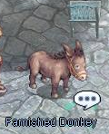
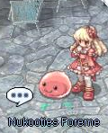
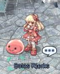
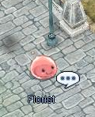
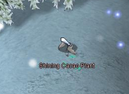

# Valentine's Day Event 2017

<!-- Quest info -->
- **Level requirement:** None
- **Item requirement:** 5 Burning Heart, 10 Slick Paper or 10 Candy, 50 Apple or 5 Illusion Flower, 10 Stolen Cacao (drops from Shining Cacao Plant)
- **Base EXP reward:** 300.000
- **Item reward:** 4 Boy's Pure Heart, 4 Girl's Naivety

## Note

This article is based on forsakenspoon's post in warpportal forums you can find here : <https://forums.warpportal.com/index.php?/topic/207370-classic-valentines-event-2017/>

## Quest

1. Speak with Sad Deviling in Aldebaran at 174, 127.

2. Speak with Delightful Angeling in Aldebaran. 183, 129.

3. Speak with Famished Donkey in Aldebaran at 163, 107.

4. Speak with Nukooties Foreme and Boies Rjerks in Aldebaran at 139, 180 and 140, 180.

5. Return to Sad Deviling.

6. Choose which gift you'd like for him to give the Delightful Angeling.
(I believe your reward is affected by what you choose but as Illusion Flowers are very hard to find, I'd suggest only Chocolate and a Letter.)

7. You'll be tasked to find several NPC's and complete a quest for each of them.

*  The Arts Master is located in Aldebaran at 153, 109.
He requires 5 Burning Heart and 10 Slick Paper.

*  The Chocolatier in located in aldebaran at 232, 114.
He requires 10 Candy and 50 Apple.

*  The florist is a poring in the north west corner of Aldebaran at 163, 107.
It requires 5 Illusion Flower and 10 Stolen Cacao (drops from Shining Cacao Plant).

*Reward: Incubus and Succubus tames! Double drops rates for 30 minutes and some EXP.*

---
**Categories:** [Base Experience Reward](categories/Base_Experience_Reward.md)
*Source: [iRO Wiki Classic](https://irowiki.org/classic/Valentine%27s_Day_Event_2017) — GFDL 1.3+*
