# Valentine's and White Day Event (2008/02/12) ~ (2008/02/19)

> **Note:** Not implemented on iRO Classic.

<!-- Quest info -->
- **Level requirement:** None
- **Zeny requirement:** 1,000
- **Base EXP reward:** 2,000 (repeatable)
- **Job EXP reward:** 1,000 (repeatable)
- **Item reward:** Varies

## The Missing Brother

1.  Offer to help YiJinha in [Payon](Payon.md) at 164,204.

1.   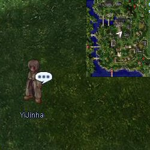

1.  He asks you to search for his brother YiSeryu in [Prontera](Prontera.md).
1.  Speak with Shocola Bassinio in Prontera at 120,52 and select **Talk**. She tells you that YiSeryu went to [Umbala](Umbala.md).

1.   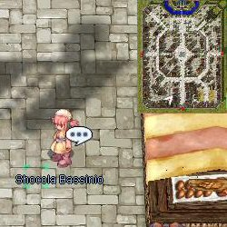

1.  In Umbala find Breid at 72, 171. He tells you that Seryu took the boat from [Izlude](Izlude.md) to Pharos Lighthouse, and that he wanted to see 'Coco Beach'.

1.   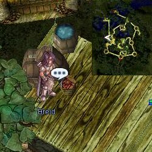

1.  At Pharos Lighthouse, speak to the Kid at 114, 109. He tells you that he saw the captain of the boat give Seryu directions. Reward him with 1,000 zeny in order to continue the quest.

1.   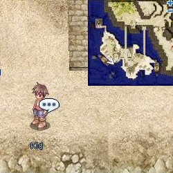

1.  Speak to the captain of the boat at Izlude 177, 188. Ask him about **YiSeryu** then about **Paros**. Talk to him several more times.

1.   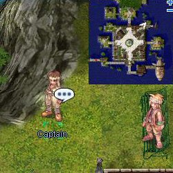

1.  Go to Fortress Saint Darmain (south) (cmd_fild09 106, 195).  The password to enter the building is **Aragham never hoarded upgrade items.**

1.   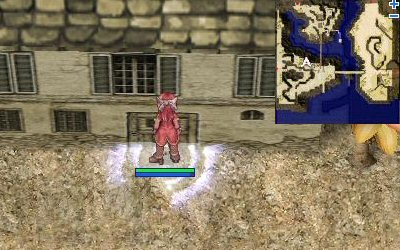

1.  Inside the building (258, 61), speak to YiSeryu. He tells you that he can't leave and to go hunt cacaos.

1.   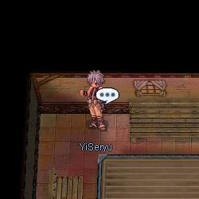

1.  Return to Breid in Umbala and **Chat**. He gives you 10 Cacao to deliver to Shocola.
1.  Shocola thanks you for the delivery and tells you to let Jinha know his brother is safe.
1.  Return to Jinha in Payon and let him know the good news. He rewards you with 10 Egg and 10 Flour.
1.  The player is now able to ask [NPC](NPC.md)s for part time jobs delivering things.

## Part Time Jobs

The part time jobs can be repeated as many times as the player wishes. However, once the player starts a job, they need to finish it before anyone else will given them a new job.

If your delivery needs to be made to Arles in Juno, you'll be given a Free Ticket for Flyship. Deliveries to Shocola will include a Free Ticket for Kafra Transportation

## YiJinha

1.  Ask YiJinha for a part time job. He gives the player 5 Egg and 5 Flour to deliver to Arles in [Juno](Juno.md) or Shocola in Prontera.
1.  Speak to Arles and select **Delivery!**, he will thank the player and send them back to YiJinha.
1.  YiJinha will reward the player with their choice of:
  * 2,000 Base Experience and 1,000 Job Experience
  * 4 Egg and 4 Flour

## Shocola

1.  Ask Shocola for a part time job. She gives the player 2 Chocolate to deliver to Arles in Juno.
1.  Speak to Arles and select **Delivery!**, he will thank the player and send them back to Shocola.
1.  Shocola will reward the player with their choice of:
  * 2,000 Base Experience and 1,000 Job Experience
  * 1 Chocolate

## Breid

1.  Ask Breid for a part time job. He gives the player Cacao to deliver to either Arles in Juno or Shocola in Prontera.
1.  Speak to Arles and select **Delivery!**, he will thank the player and send them back to Breid. Or Speak to Shocola and select **Part Time Job**, she will thank the player and send them back to Breid.
1.  Breid will reward the player with their choice of:
  * 2,000 Base Experience and 1,000 Job Experience
  * 10 Cacao Bean

## Chocolate Deliveries

1.  Speak to Arles inside the building located at [Juno](Juno.md) 197, 89. Select **Talk** followed by **I want to do something fun!**

1.   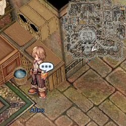

1.  He asks the player to deliver a few chocolates and personalized notes for him.
1.  The first delivery is to Sylbegh in [Al De Baran](Al_De_Baran.md) at 238, 164.  The note for him begins with **Lee Hester's gained weight again.**

1.   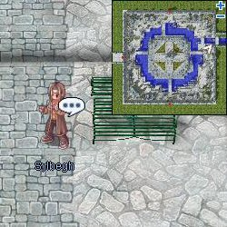

1.  The 2nd delivery is to Futark inside the [Geffen](Geffen.md) Inn. Futark's note begins with **To the great, honorable mage...**

1.   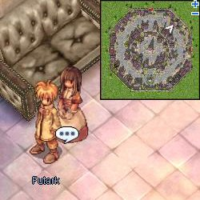

1.  The final delivery is to Breid in [Umbala](Umbala.md); Breids note begins with **I'm sorry...**
1.  Return to Arles and he will reward the player with several recipes.

## The Chocolate Thief

1.  With a Chocolate Strawberry and Chocolate Tart in your inventory, talk to Saneva inside Payon Inn.

1.   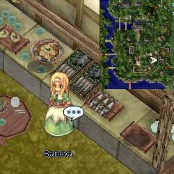

1.  She will dig through your inventory, steal your chocolate treats, and kick you out of the building.
1.  Go back inside and talk to her again. She apologizes and explains that she needs the chocolate treats to give to YiSeryu.
1.  Male characters will then be required to deliver the chocolates to YiSeryu. (Females can ignore this step)
1.  Talk to Saneva again and she will offer to make Fierce Cacao 99% if the player brings 99 Cacao Beans and 1 Milk. Fierce Cacao 99% restores roughly 2x the HP of a normal white potion.

## Cooking Chocolate Treats

After collecting recipes from Arles, players can cook various chocolate treats at one of two kitchens. Chocolate Strawberries cast level 5 [Blessing](Blessing.md) and Chocolate Tarts cast level 5 [Angelus](Angelus.md).

Making mistakes in the cooking process may result in Cute Strawberry-Choco (restores some [SP](SP.md)), Lovely Choco-Tart (restores a moderate amount of [HP](Max_HP.md)) or Junky Chocolate (restores small amount of SP with a chance to inflict Poison status on yourself). The latter three do not grant any buffs.

Players can also create more recipes by bringing Arles 2 Blue Gemstone and 1 Feather of Birds

| Juno Kitchen | Payon Kitchen |
| --- | --- |
| 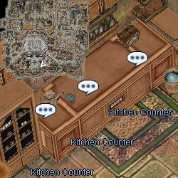 | 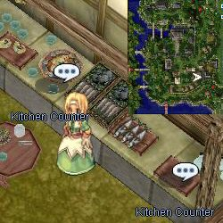 |

| Item | Ingredients | Directions | Town ([Juno](Juno.md) or [Payon](Payon.md)) |
| --- | --- | --- | --- |
| Chocolate Drink | 30 Cacao Bean 2 Milk 4 Chocolate | *None needed* | Juno |
| Chocolate Strawberry | 1 White Chocolate 2 Strawberry 1 Chocolate | use **Barely Simmering** water **Hold By Stem** to dip strawberry **Stick Toothpick** into strawberry | Both |
| Chocolate Tart | 3 Chocolate 1 Flour 3 Milk 1 Egg 1 Holy Water | soften butter at **Room Tempeture** **Sift** the flour **Add Egg Yolk** melt in **Double Boiler with Holy Water** | Juno |
| Hand-made Chocolate | 5 Chocolate 1 Milk | **Finely Chop** chocolate use **Moderate Heat** | Payon |
| Handmade White Chocolate | 5 White Chocolate 1 Milk | **Finely Chop** chocolate use **Moderate Heat** | Payon |

---
**Categories:** [Base Experience Reward](categories/Base_Experience_Reward.md), [Job Experience Reward](categories/Job_Experience_Reward.md), [Temporary Event Quests](categories/Temporary_Event_Quests.md)
*Source: [iRO Wiki Classic](https://irowiki.org/classic/Valentine%27s_and_White_Day_Event_%282008/02/12%29_~_%282008/02/19%29) — GFDL 1.3+*
