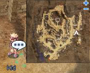
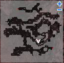
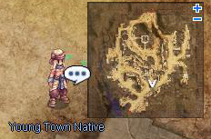
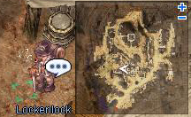
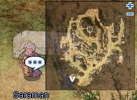
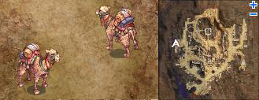
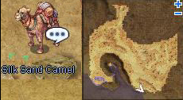

# Veins Siblings Quest

<!-- Quest info -->
- **Level requirement:** 60
- **Item requirement:** 100+ Green Herb, 5 Monster's Feed, 1 Unripe Apple, 2 Yellow Potion, 10+ Milk, 50+ Jellopy, 6 Empty Bottle
- **Items required:** 1 Steel
- **Quests required:** [Rachel Sanctuary Quest](Rachel_Sanctuary_Quest.md)
- **Base EXP reward:** 1,000,000
- **Job EXP reward:** 700,000
- **Item reward:** 1 Old Purple Box
- **Window:** yes

* **Party Note**: This quest involves entering the Thor's Volcano dungeon three times, up to the second floor. Players may wish to prepare a party for this purpose.

* **Thief/Asssassin Note**: Lots of the monsters in the Thor's Volcano dungeon either have the [Boss Protocol](Boss_Protocol.md) or are of the [Demon](Demon.md) race, so [Hiding](Hiding.md) and [Cloaking](Cloaking.md) won't do much good.

* **Item Note**: The number of Green Herb, Jellopy, and Milk used can be very high, as the listed amount is only enough for 5 tries, each of which may fail. Players are recommended to bring at least 3 times this amount or more.

1. Talk to the Kid, Karyn in [Veins](Veins.md) ([Veins](Veins.md) 327, 185), who says he's looking for his sister.

2. Go to Volcano Thor Thor level 2, and go to (144, 78), and enter the portal there.  Head down the path until you come to a room at the end with a girl (Little Curdie (que_thor 32,64)) in the corner.

3. Talk to the girl, who reveals herself as Karyn's sister. You agree to return to town and seek the help of a locksmith.

4. Return to Karyn.

5. After that talk to the Young Town Native (221, 120).

6. Talk to Lockenlock (veins 181, 166), bring him a Yellow Potion. He says he needs you to make a special soap to create a mold for the key.

7. Talk to Organic Soap Maker Ivory (veins 227,127), who asks you to bring some ingredients to make the soap (but she wont take the items off you yet):

* 10 Milk
* 100 Green Herb
* 50 Jellopy
* 5 Empty Bottle

8. After bringing her the ingredients, she says she also needs something from the camel farmer in the south part of town.

9. Talk to the camel farmer (veins 115, 59) in the bottom left, who says the soap is made with camel dung.  You need to bring some more items in order to get the camels to poop for you to collect the droppings.

* 5 Monster's Feed
* 1 Unripe Apple
* 1 Empty Bottle
* 1 Yellow Potion

10. After bringing the items, talk to the camel farmer again.  He tells you to go to the camels and feed them the concoction.  Head up north (veins 7x, 22x) and find the 6 camels there.  Talk to them all, but none of them are the right one.

11. Go back to the farmer and explain about not finding the right camel.  He replies that his Silky Camel is lost, and you need to find it in order to collect the droppings.

12. Go one map below town (ve_fild07 235, 42) where you find the Silky Camel with an injured leg.

13. Talk to the camel, and start collecting the droppings.  With the ingredients you collected (the Green Herb, Milk, Jellopy, etc set) you have 5 chances to collect a dropping.  If you fail to get a dropping you'll receive a potato.  Once you run out of tries, you have to collect enough ingredients (First Set, under the Soap Maker) to try again.  Keep doing so until you have the 5 droppings.
*  Note: It's safe to say this may take more than 10 tries or over 1K Green Herbs and 500 Jellopy.
*  No more than 5 Empty Bottles will be used.

14. Head back to the farmer, and inform him of the whereabouts of his camel.  He thanks you, and gives you an Old Purple Box.

15. Talk to the soap lady again, who can now make the soap for you.

16. Take the soap to the locksmith, he needs a mold to make the key from.

17. Go back to the little girl in the volcano and pour the soap into the lock to make a copy of the key.

18. Take the copy of the key to the Locksmith. He will ask you to bring him 1 Steel to make the key. After bringing him the steel(it will not be consumed), he demands to know why you need the key.  After explaining about the locked up little girl, he gives you the master key to the locks.

19. Return to the little girl in the volcano, and free her.

20. Talk to the Karyn again, who thanks you and gives you some experience.

---
**Categories:** [Base Experience Reward](categories/Base_Experience_Reward.md), [Job Experience Reward](categories/Job_Experience_Reward.md), [Quest Window Quests](categories/Quest_Window_Quests.md), [Veins Quests](categories/Veins_Quests.md)
*Source: [iRO Wiki Classic](https://irowiki.org/classic/Veins_Siblings_Quest) — GFDL 1.3+*
