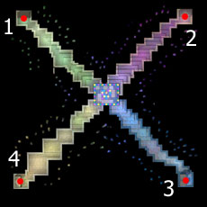

# War of Emperium for Newbies

> **User:kuchkda/template/not iro** — replace: no

## Overwiew

Newbie WoE is a special edition of the War of Emperium system involving the addition of new castle group in [Izlude](Izlude.md). Talk to [NPC](NPC.md) ([Izlude](Izlude.md) 130, 219) outside the [Izlude Arena](Izlude_Arena.md) to be taken to map where the castles for nWoE are located (no [Teleport](Teleport.md)ation or /memo on that map). There is a single castle from each WoE 1 realm, being the exact copy of the original.

To enter nWoE, your character must be a non-rebirthed First Class job (no extended classes), and your base level must be below or equal 59.

## Izlude Castles

| Column 1 | Column 2 | Column 3 | Column 4 |
| --- | --- | --- | --- |
|  | Izlude castle | Izlude castle | Copy of |
|  | 1 | Дом Весны | Payon 1 |
|  | 2 | Дом Осени | Geffen 1 |
|  | 3 | Дом Лета | Al De Baran 1 |
|  | 4 | Дом Зимы | Prontera 1 |

## Battle System

The rules of battle are generally the same as in the original [War of Emperium](War_of_Emperium.md). All damage formulas and ally statuses are the same. The following additions are the main points of difference between the two.

*  Emperium's HP lowered from 68,000 to 25,000, and other Emperium [Stats](Stats.md) lowered by half.
*  In order to gain benefit from nWoE castles, the guild leader must be able to enter nWoE (first class and 59 base level maximum).
*  It is possible to [Urgent Call](Urgent_Call.md) non-eligible characters, but this is prohibited by game rules.
*  On rRo, nWoE takes place at the same times as WoE 1.

## Notes

*  nWoE was implemented on ruRO June 21, 2006.
*  [It was said](http://www.raggame.ru/news.asp?id=504) that nWoE on rRo would be implemented for testing before a worldwide release, yet so far no other servers have the system.

---
**Categories:** [PVP](categories/PVP.md)
*Source: [iRO Wiki Classic](https://irowiki.org/classic/War_of_Emperium_for_Newbies) — GFDL 1.3+*
