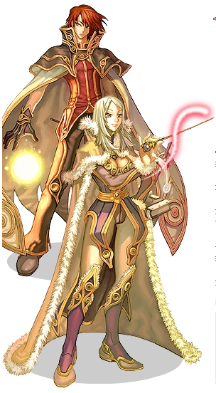

# Wizard

<!-- Job info -->
- **Job type:** 2-1
- **Job base:** Mage
- **Changes at:** [Geffen](Geffen.md) Tower
- **Skills:** 13
- **Skill points:** 101
- **Quest skills:** 1
- **STR:** 1
- **AGI:** 8
- **VIT:** 1
- **INT:** 12
- **DEX:** 6
- **LUK:** 2

## Overview

Wizards are powerful offensive magic users. They rely on dangerous magic strikes as well as devastating Area of Effect spells to wreak havoc.

## Jobchange Guide

*See [Wizard Job Change Guide](Wizard_Job_Change_Guide.md) for detailed information.*

Changing into a Wizard from a [Mage](Mage.md) requires the player to complete a number of tasks:
*  Item Collection
*  Written Test
*  Battle Test

After completing these tests, the player will be transformed into a Wizard. This takes place inside of the [Geffen](Geffen.md) Tower.

## Builds

There are a large variety of builds in terms of skills. In terms of stats however, there is freedom for originality besides using a melee build, which is unusual. Most Wizards have 99 [DEX](Stats.md) then varying levels of [INT](Stats.md) and [VIT](Stats.md), depending on what their character have been built for.

## Melee

Melee Wizards are rare and probably stem from the fact that they can use Berserk Potions and a Dagger of Counter (+90 [CRIT](Stats.md)). Additionally, [Quagmire](Quagmire.md) makes dodging and hitting monsters much easier. They are rare builds that are for fun more than for practical use.

## PvM

*  [STR](Stats.md): 1
*  [AGI](Stats.md): 1
*  [VIT](Stats.md): 1-15
*  [INT](Stats.md): 120 (total) or 99 base
*  [DEX](Stats.md): 99
*  [LUK](Stats.md): 9

These Wizards can level solo or, as they more commonly are, be joined by a [Priest](Priest.md) or an entire party. Generally, the Priest will mob up monsters, Heal themselves and use [Suffragium](Suffragium.md) on you, reducing the cast time of a single [AoE](Area_of_Effect.md) skill - such as [Storm Gust](Storm_Gust.md) or [Meteor Storm](Meteor_Storm.md). If you're levelling solo, you'll need to learn how to use Vertical [Fire Wall](Fire_Wall.md). Many builds go for more [VIT](Stats.md) and less [INT](Stats.md), as seen in the WoE/PvP section.

## PvP/WoE

*  [STR](Stats.md): 1 - 11
*  [AGI](Stats.md): 1
*  [VIT](Stats.md): 1 - 49
*  [INT](Stats.md): 105/112/120 (total) or 99 base
*  [DEX](Stats.md): 99 base
*  [LUK](Stats.md): 9

In order to take part in WoE or even PvP, Wizards require VIT to avoid dying quickly and to resist Status Effects. Safety Wall, Stone Curse, Fire Bolt and varying levels of Jupitel Thunder and Storm Gust are popular weapons for Wizards in PvP. In WoE, Storm Gust and Meteor Storm are mainly used in precasts. Leftover stat points are dumped into STR for the single purpose to raise the Weight Limit. This can also be considered upon reaching high VIT, where a Wizard might decide holding more Potions is more effective than having higher HP or Status Effect resistence.

In PvP situations, try using Storm Gust level 1 to quickly freeze and scatter multiple targets.

Beware that opponents can easily resist Wizard skills with elemental armors and others (i.e. unfrozen) and MDEF. Players equipped with such can easily counter the damage from Storm Gust level 10. In these cases, try linking freezing techniques with Jupitel Thunder level 10 and Stone Curse with Fire Bolt level 10. Also, use various different elemental attacks if you suspect your opponent is switching armors to counter you. For example, if the damage of Jupitel Thunder is oddly low, the opponent may have equipped a Wind armor, so use Fire Bolt on them or an Earth attack instead.

## Equipment

**Top Headgears:**

[INT](Stats.md) Gear:
*  Mage Hat (+2 [INT](Stats.md), +150 SP)
*  Crown/Tiara (+2 [INT](Stats.md))
*  Erudite Crown/Tiara (+3 [INT](Stats.md))
*  Crown of Deceit[1] (+4 [INT](Stats.md), -10% Casting Time *Uses Mid headgear as well*)
*  Erudite card (+2 [INT](Stats.md)

[DEX](Stats.md) Gear:
*  Apple of Archer (+3 [DEX](Stats.md))
*  Ramen Hat (+4 [DEX](Stats.md), Kafra Shop item)
*  Isilla carded headgear

[INT](Stats.md) & [DEX](Stats.md) Gear:
*  Erudite Ulle's Cap (+2 [INT](Stats.md) with Elder Willow Card, +2 [DEX](Stats.md), +1 [AGI](Stats.md))

**Mid Headgears:**

*  Erudite Sunglasses (+2 [INT](Stats.md))

*  Peerless Sunglasses (grants immunity to [Silence](Status_Effects.md))

*  Dark Blinker (grants immunity to [Blind](Status_Effects.md), +2% [Stun](Status_Effects.md) resistance)

*  Blinker (grants immunity to [Blind](Status_Effects.md))

*  Opera Mask (+2 [DEF](DEF.md), occupies middle and lower headgear slots)

*  Alarm Mask (+2 [DEF](DEF.md), +50% [Blind](Status_Effects.md) resistance, occupies middle and lower headgear slots)

*  Robo Eyes (+1 [DEX](Stats.md), Kafra Shop item)

*  Sigrun's Wing (+1 [INT](Stats.md))

**Lower Headgears:**

*  Pipe/Cigarette (-3% damage from Insect monsters)
*  Romantic Flower/Romantic Leaf (-3% damage from Plant monsters)
*  Flu Mask (+10% silence resistance)
*  Gangster Mask (+15% silence resistance)
*  Well-Chewed Pencil (+2 [DEX](Stats.md))

**Right Hand:**

Whatever is chosen to wield in the right hand, it should always be a rod type weapon, as they all provide +15% MATK.

INT Rods: (If INT is greater than DEX)

*  Survivors Rod (INT version): +2 INT, +300 HP
*  Dextrous Survivors Rod (Drops card, INT version): +3 INT, +1 DEX, +400 HP
*  Double Dexterous Arc Wand (two Drops cards): +3 INT, +2 DEX
*  Evil Bone Wand, (+4 int)
*  Warlock's Magic Wand (Tierra): +4 INT, +3 DEX, bypasses 25% of Demi-Human's MDEF, 5% Stun chance upon magical attack
*  Warlock's Battle Wand (Flavius): +3 INT, +3 DEX, increases magical damage to Demi-Humans by 15%, 5% Stun chance upon magical attack

DEX Rods: (If DEX is greater than INT)

*  Survivor's Rod (DEX version): +2 DEX, +300 HP
*  Dexterous Survivor's Rod (Drops card, DEX version): +4 DEX, +400 HP
*  Triple Dexterous Staff (three Drops cards): +2 INT, +3 DEX
*  Quadruple Dexterous Rod (four Drops cards): +4 DEX

More DEX is usually better, but sometimes getting more INT to attain the next MATK bonus (occuring every 5 and 7 points of INT) is more desirable. The Staff [3] and Arc Wand [2] provide the most, although mixed, stat points for non-battle ground items.

The slotted Survivors Rods are desirable Wizard weapons. In the INT variant, one stat points is sacrificed for 400 HP. The DEX version is basically a Quadruple Dexterous Rod with an extra 400 HP. The non-slotted Survivors Rods are a viable alternative for lower level Mages and Wizard, but they do not offer enough stat points for higher level Wizards.

**Left Hand:**

*  Guard[1] (+3 DEF)
*  Valkyrja Shield[1] (+3 DEF, +5 MDEF, -20% from fire, water, shadow, and undead elements)
*  Magic Bible Vol1[1] (+3 MDEF, +2 INT, 10% to stun when receiving physical damage)
*  Memory Book[0] or [1] (+3 DEF, +2 MDEF, +1 INT, Compound bonus with Monocle and Pocket Watch: +7% MATK, +15% HP & SP Regen)
*  Stone Buckler[1] (+3 DEF, -5% damage from [Large] monsters, Compound bonus with Odin's Blessing\[1\] and Magni's Cap: +2 STR, +5 DEF, +5 MDEF)

The player should have multiple shields with "racial cards" - cards which resist respect races by 30%. For example, if they were to level in High Orcs or enter a PvP area, they should equip a Cranial shield (Thara Frog card) to reduce damage received from Demi-Humans (i.e. High Orcs or other players) by 30%.

While racial guards are vital, it may be difficult to acquire all of the necessary ones immediately. Some players choose to get a Rigid Guard (Thiefbug Egg card, +400 HP) for use in the places they do not yet have the appropriate racial guard for.

**Armor:**

Equippable Armor:

*  Coat/Slotted Coat: +5 DEF
*  Mage Coat: +5 DEF, +5 MDEF, +1 INT, +1 SP
*  Slotted Mink Coat: +6 DEF, very heavy
*  Robe of Cast: +5 DEF, Cast Delay -3%
*  Glittering Jacket[1]: +7 DEF,+5 MDEF, Adds a 3% chance of causing Blind status to enemies with each attack

**Garment:**

*  Morpheus Shawl (For MvP) Ragamuffin Manteau (for WoE)
*  Muffler with Element Resistance Cards

Ranged Attacks + [Neutral](Neutral.md) : Noxious Card

[Neutral](Neutral.md): Raydric

[Water](Water.md): Marse Card

[Wind](Wind.md): Dustiness Card

[Fire](Fire.md): Jack Card

[Earth](Earth.md): Hode Card

**Shoes:**

*  Soul-Enchanted Shoes (sohee card)

*  Shoes of Witch (Eggyra card)

*  +9/10 Superior Shoes (Antique Firelock card)

*  Fledged Shoes (Verit Card)

**Accessories:** Some accessories that are helpful in leveling or [PvP](PvP~d29d2.md) situations.

Belt[1], Clip[1] (+10 SP), Nile Rose[1] (+10 HP) have no level requirement, unlike other slotted accessories.

*  Healing Clip (Vitata Card) (Not on iRO Valkyrie server)
*  Teleportation Clip (Creamy Card) (Not on iRO Valkyrie server)
*  Hiding Clip (Smokie Card)
*  Clever Clip (Wormtail Card)
*  Clip Under a Cast (Phen Card)
*  Four Leaf Clover Rosary (Alligator Card)
*  Nimble Glove (Zerom Card, +4 [DEX](Stats.md))
*  Earring [0] (+2 [INT](Stats.md))
*  Medal of Honor (+5% MATK, +6 MDEF, +600 HP)
*  Pocket Watch

## Class Data

## Skills

*Below are listed the skills that are unique to the Wizard class. For more information about Mage skills, click [here](Mage.md).*

| Skill | Description | Levels | Type |
| --- | --- | --- | --- |
| [Earth Spike](Earth_Spike.md) | Causes the earth below a target to rise and strike a target for up to a maximum of 5 times. | 5 | Offensive |
| [Fire Pillar](Fire_Pillar.md) | Summons a pillar of fire on a target spot that acts similarly to a trap, dealing MDEF-ignoring damage. | 10 | Offensive |
| [Frost Nova](Frost_Nova.md) | Strikes surrounding enemies with water elemental damage with the chance of freezing them. | 10 | Offensive |
| [Heaven's Drive](Heaven's_Drive.md) | Raises the ground in a 5x5 area around a target area, dealing damage similar to Earth Spike. | 5 | Offensive |
| [Ice Wall](Ice_Wall.md) | Summons a shield of ice 5 cells wide in front of the caster. | 10 | Active |
| [Jupitel Thunder](Jupitel_Thunder.md) | Launches an orb of lightning that hits multiple times while pushing the target back. | 10 | Offensive |
| [Lord of Vermilion](Lord_of_Vermilion.md) | Summons explosive bolts of destruction in a 9x9 area that deals 10 strikes per second. | 10 | Offensive |
| [Meteor Storm](Meteor_Storm.md) | Calls forth a wave of meteors from the sky that strike multiple times, each with the chance to stun a target. | 10 | Offensive |
| [Quagmire](Quagmire.md) | Turns a 5x5 area of ground into a marshland that lowers AGI and DEX, and removes certain buffs. | 5 | Active |
| [Sense](Sense.md) | Analyzes a target, allowing the user and any party members to view an enemy's stats. | 1 | Active |
| [Sightrasher](Sightrasher.md) | Projects the fireball summoned by the Sight skill to knock enemies back and deal damage. | 10 | Offensive |
| [Storm Gust](Storm_Gust.md) | Summons a destructive blizzard in a 7x7 target area that can freeze enemies within it. | 10 | Offensive |
| [Water Ball](Water_Ball.md) | Uses water beneath the caster to launch a shower of water balls at a target. | 5 | Offensive |
| [Fire Ivy](Fire_Ivy.md) | Damage enemies by summoning ivy vines of flame from the ground. Unimplemented | 10 | Offensive |

## Quest Skills

| Skill | Description | Levels | Type | Job Level Requirement | Quest |
| --- | --- | --- | --- | --- | --- |
| [Sight Blaster](Sight_Blaster.md) | Summon a protective fireball that lasts for 2 minutes, hitting any enemy that comes within a 3x3 area, knocking them back. | 1 | Offensive | 30 | [Sight Blaster Quest](Wizard_Skill_Quest.md) |

## Soul Link

*See [Wizard Spirit](Wizard_Spirit.md).*

## Job Bonuses

| **Stat\Amount** | **+1** | **+2** | **+3** | **+4** | **+5** | **+6** | **+7** | **+8** | **+9** | **+10** | **+11** | **+12** |
| --- | --- | --- | --- | --- | --- | --- | --- | --- | --- | --- | --- | --- |
| **STR** | 12 |   |   |   |   |   |   |   |   |   |   |   |
| **AGI** | 6 | 10 | 24 | 34 | 41 | 43 | 46 | 47 |   |   |   |   |
| **VIT** | 38 |   |   |   |   |   |   |   |   |   |   |   |
| **INT** | 1 | 4 | 9 | 18 | 22 | 29 | 31 | 33 | 40 | 45 | 48 | 50 |
| **DEX** | 2 | 5 | 13 | 26 | 32 | 39 |   |   |   |   |   |   |
| **LUK** | 15 | 34 |   |   |   |   |   |   |   |   |   |   |

## ASPD

Wizards can use Concentration, Awakening and Berserk Potions.

| Weapon | Base ASPD | Base Delay |
| --- | --- | --- |
| Unarmed | 150 | 500 |
| Dagger | 142.5 | 575 |
| Rod | 137.5 | 625 |

## See Also

* [Wizard Leveling](Wizard_Leveling.md)

## External Links

**Related pages:**

* [Wizard](Wizard.md)
* [High Wizard](High_Wizard.md)
* [Skills](Skills.md)
* [Earth Spike](Earth_Spike.md)
* [Fire Ivy](Fire_Ivy.md)
* [Fire Pillar](Fire_Pillar.md)
* [Frost Nova](Frost_Nova.md)
* [Heaven's Drive](Heaven's_Drive.md)
* [Ice Wall](Ice_Wall.md)
* [Jupitel Thunder](Jupitel_Thunder.md)
* [Lord of Vermilion](Lord_of_Vermilion.md)
* [Meteor Storm](Meteor_Storm.md)
* [Quagmire](Quagmire.md)
* [Sense](Sense.md)
* [Sight Blaster](Sight_Blaster.md)
* [Sightrasher](Sightrasher.md)
* [Storm Gust](Storm_Gust.md)
* [Water Ball](Water_Ball.md)
* [Ganbantein](Ganbantein.md)
* [Gravitational Field](Gravitational_Field.md)
* [Mystical Amplification](Mystical_Amplification.md)
* [Napalm Vulcan](Napalm_Vulcan.md)
* [Soul Drain](Soul_Drain.md)
* [Stave Crasher](Stave_Crasher.md)
* [Quests](Quests.md)
* [Wizard Job Change Guide](Wizard_Job_Change_Guide.md)
* [Wizard Skill Quest](Wizard_Skill_Quest.md)
* [Rebirth Walkthrough](Rebirth_Walkthrough.md)
* [Weapons](Weapons.md)
* [Rod](Rod.md)

**Related pages:**

* [Classes](Classes.md)
* [Novice](Novice.md)
* [High Novice](High_Novice.md)
* [Super Novice](Super_Novice.md)
* [Acolyte](Acolyte.md)
* [Archer](Archer.md)
* [High First Class](High_First_Class.md)
* [Mage](Mage.md)
* [Merchant](Merchant.md)
* [Swordman](Swordman.md)
* [Thief](Thief.md)
* [Priest](Priest.md)
* [Monk](Monk.md)
* [Hunter](Hunter.md)
* [Bard](Bard.md)
* [Dancer](Dancer.md)
* [Wizard](Wizard.md)
* [Sage](Sage.md)
* [Blacksmith](Blacksmith.md)
* [Alchemist](Alchemist.md)
* [Knight](Knight.md)
* [Crusader](Crusader.md)
* [Assassin](Assassin.md)
* [Rogue](Rogue.md)
* [Transcendent](Transcendent.md)
* [High Priest](High_Priest.md)
* [Champion](Champion.md)
* [Sniper](Sniper.md)
* [Minstrel](Minstrel.md)
* [Gypsy](Gypsy.md)
* [High Wizard](High_Wizard.md)
* [Scholar](Scholar.md)
* [Mastersmith](Mastersmith.md)
* [Biochemist](Biochemist.md)
* [Lord Knight](Lord_Knight.md)
* [Paladin](Paladin.md)
* [Assassin Cross](Assassin_Cross.md)
* [Stalker](Stalker.md)
* [Gunslinger](Gunslinger.md)
* [Ninja](Ninja.md)
* [TaeKwon Kid](TaeKwon_Kid.md)
* [TaeKwon Master](TaeKwon_Master.md)
* [Soul Linker](Soul_Linker.md)

---
**Categories:** [Classes](categories/Classes.md), [Wizard](categories/Wizard.md)
*Source: [iRO Wiki Classic](https://irowiki.org/classic/Wizard) — GFDL 1.3+*
