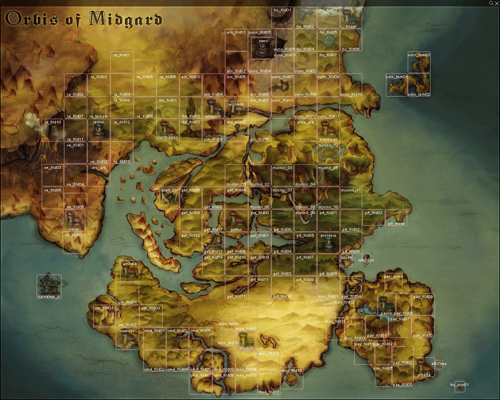
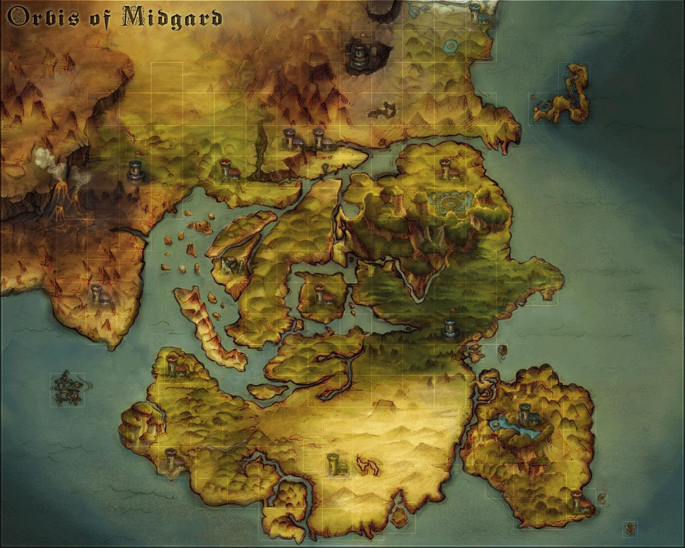

# World Map

## Overview

Players begin on the continent of Midgard. Note, however, that there are two continents, a number of islands, and various unique destinations in the surface world of Ragnarok Online. In addition, there is an underground town such as Comodo, the ruins of Glast Heim, many large underground areas, and instances. The War of Emperium also takes place on some maps.

The southernmost part of the Midgard continent is the [Rune-Midgarts Kingdom](Rune-Midgarts_Kingdom.md), the capital of which is [Prontera](Prontera.md). The northeast part of this continent is the [Republic of Schwartzvald](Republic_of_Schwartzvald.md), governed by a President, the capital of which is [Juno](Juno.md). The northwest part of the continent contains the [Arunafeltz States](Arunafeltz_States.md), the capital of which is [Rachel](Rachel.md).

## In-Game Map

The Midgard continent map can be accessed within the game as of Episode 12 through the following shortcuts :

<small>Note: This shortcuts applies to iRO Client, other official servers can have different shortcuts</small>

| Keyboard Region | Shortcut |
| --- | --- |
| American English | CTRL+~ |
| British English | CTRL+' |
| Canadian French | CTRL+`{ |
| Canadian Multilingual | ALT GR+È |
| French | CTRL+ù |
| German | CTRL+Ö |
| Italian | CTRL+ç |
| Portuguese | CTRL+Ç |
| Spanish | CTRL+Ñ |
| Swedish/Finnish | CTRL+Ö |

The map shows your current location (if you are on a field/town map) and that of your [Party](Party.md) members. Views of specific areas may popup when hovering your cursor over them.

## The Map

This is the map of the Midgard continent as of Episode 12. An updated interactive Episode 12 worldmap can be found [here.](http://ro.amesani.org/db/world-map/)

## See also

*  [Towns](Towns.md)
*  [Places](Places.md)
*  [Visual world map](http://ro.amesani.org/db/world-map/)

---
**Categories:** [General Information](categories/General_Information.md), [Places](categories/Places.md)
*Source: [iRO Wiki Classic](https://irowiki.org/classic/World_Map) — GFDL 1.3+*
